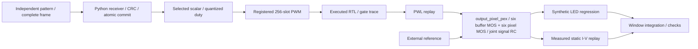

# Open MicroLED Driver ASIC

An independent, open platform for experimental R&D methodology validation and teaching in digital, mixed-signal, transistor and physical ASIC design, starting with one pixel.

**本轮新增（2026-10-26，A/B/C条件配对）**：[高速驱动研究报告](docs/research/fair-driver-comparison-20261025/index.html) / [完整文字](docs/research/fair-driver-comparison-20261025/README.md)。A20/B21/C49 MOS统一负载、电流目标和七源端口能量；24个DC＋45个主体瞬态、32个DC＋11个单因素控制，统一绝对延迟接收规则并保留旧结果。新增C的MOS译码/DAC、内部电容慢尾与体结风险诊断；属于新原理图级实验，不继承历史版图/PEX，不预选架构。

[本轮GitHub归档与新检出DC恢复验收](docs/development-handoff.md)：源码标签固定，原始证据按SHA读回，恢复范围及仍未闭合的工程问题分别记录。

**阶段复盘（2026-10-25）**：[显示PWM与高速光通信的架构、性能和路线选择](docs/research/architecture-decision-review-20261025/index.html) / [完整文字](docs/research/architecture-decision-review-20261025/report-complete.md)。核对电流/PWM、Gb/s/pJ/bit/BER、阵列、QSPI及量产成本边界；是现有证据与公开资料的研究复盘，没有新增电路/EDA或光学实验。

**当前阶段（2026-10-24，参考与启动修订）**：显示 PWM 保留原 39 MOS 实际版图/PEX，修订板级补偿、滤波和受控启动边界；高速 B 已接入 12 MOS 参考/保护与原 9 MOS 核心，完成实际联通 GDS、DRC/LVS/PEX 及限定电气回归。两份独立报告保留失败过程、外部基准/许可前提和残余电源重启的体结风险；尚无硅片或实测光链路证据。

**早期基础路径（历史状态，2026-10-05–07）**：从1 Pixel开始，电气与物理研究基线为 **v0.4（2026-10-05）**，新增 **frame experiment v0.1（2026-10-07）**。电气基线：在冻结的共同GDS上，实际提取末级`output12/buf_2`、数字输出线、跨宏线与六MOS pixel的联合信号寄生模型；nominal为12MOS、45 signal R、77显式C，另有HRHC／LRHC／HRLC／LRLC四种actual RC提取。模型从真实M3右端接入，整体替换v0.3分块路径。主研究37次transient／12次DC、146项工程guards通过；[电源／控制边界](docs/research/robustness.md)另保留startup假设越界、enable延迟与static LED headroom失效。

项目定位为**实验性研发方法验证与教学**：用独立提出的假设、可复现的实验和可追溯的证据，研究 MicroLED 器件电测与驱动共设计。先把单像素的真实负载、reference、供电和控制边界讲清楚，再由明确的实验问题决定4×4是否值得实现。早期v0.4联合模型仍把PG／body电阻及PG-only电容投影到理想rails，邻居按声明的截断条件处理；它不构成完整芯片PEX、制造接受或光学验证。

## GitHub 备份与跨机开发

每个已验证阶段完成后同步。代码、报告、最终 Blender 场景和紧凑证据保存在 Git；大型原始数据采用有 SHA-256 清单的 Release 附件。阅读 [跨机接续说明](docs/development-handoff.md)，按需恢复指定实验。普通 `git clone` 不包含被忽略的全部 `build/`、PDK 或虚拟机。

[2026-10-24 参考源与受控启动快照](https://github.com/Kevin-Kaiyo/open-microled-driver-asic/releases/tag/reference-v2-20261024)：22 个归档、5,760 个文件，29 份远端资产均完成 SHA-256 回读。新检出恢复4,801文件与576相对链接；PWM和NRZ两个DC点复跑与原结果均差0。仅清理本轮已验证的压缩暂存副本，保留原始实验和失败证据；恢复边界见[交接说明](docs/development-handoff.md)。

[2026-10-24 显示PWM与高速NRZ扰动快照](https://github.com/Kevin-Kaiyo/open-microled-driver-asic/releases/tag/driver-robustness-20261024)：25 个归档、2,302 个文件，32 份远端资产均完成 SHA-256 回读。新检出恢复 2,057 个小输入/物理文件，PWM和NRZ各一个DC点复跑与原结果差0；完整矩阵及跨操作系统验证范围见[交接说明](docs/development-handoff.md)。

[2026-10-23 慢热/快冷修复快照](https://github.com/Kevin-Kaiyo/open-microled-driver-asic/releases/tag/nrz-pvt-20261023)：17 个增量归档、2,400 个文件；跨机依赖、逐文件清单、远端回读和限定恢复记录见[交接说明](docs/development-handoff.md)。完整物理 PDK 和旧版基线按各自清单恢复。

[2026-10-20 NRZ 版图与寄生快照](https://github.com/Kevin-Kaiyo/open-microled-driver-asic/releases/tag/nrz-pex-20261020)：15 个增量归档、3,000 个文件已完成逐成员校验和上传后回读。独立 GitHub 检出目录恢复 483 个版图及字体文件，并复核 74 个物理交付文件；没有重新运行全部仿真或物理工具。SCHEM 原始数据依赖下方前一阶段附件。

[2026-10-19 研究快照与原始附件](https://github.com/Kevin-Kaiyo/open-microled-driver-asic/releases/tag/research-20261019)：31 个归档的上传后回读核验通过；独立检出恢复并复算 96 组 NRZ 数据，完整分析和汇总文件与归档逐字节一致。此次使用同一台 Mac 的不同目录，跨操作系统完整流程仍待验证。

## 从头阅读研究过程

[个人博客：MicroLED 驱动研究记录](https://kaiyo-blog.pages.dev/zh/microled-driver-series/)按十篇文章串联环境搭建、材料与模型、显示 PWM、高速 NRZ、失败修订和复现方法，另保留三篇电路基础。资料截止 2026-10-24；2026-10-25 的整理发布没有新增电路实验。原始数据、所执行物理检查与光学/硅片证据分别标明。[本仓库发布记录与来源身份](docs/research/blog-series-20261025.md)保留对应博客版本和验收范围。

## 先读当前研究报告

- **显示 PWM：参考源与受控启动修订（2026-10-24）：[中文报告](docs/research/pwm-reference-startup-20261024/index.html) / [完整 Markdown](docs/research/pwm-reference-startup-20261024/report-complete.md) / [复现入口](docs/research/pwm-reference-startup-20261024/README.md)。** 从 N2 补偿、封装阻尼和 100 Ω / 15 nF 板级滤波解释恢复、严格启动、独立保护和最低 PWM 码；100 nF 与 47 nF 的失败保留。原 39 MOS 制造图形未变，外部 FAULT/PERMIT 与电压基准仍是接口前提。

- **高速 B：真实参考、供电与保护（2026-10-24）：[中文报告](docs/research/nrz-b-reference-power-20261024/index.html) / [完整 Markdown](docs/research/nrz-b-reference-power-20261024/report-complete.md) / [复现入口](docs/research/nrz-b-reference-power-20261024/README.md)。** 10 MOS 电流反馈参考加两只保护管，与原 B 核心构成 21 MOS 实际提取宏。固定 0.5 Gb/s 的 10 项通信测试均为 0/511；参考容差、全电源端口能量、实际布线和原 LDO 失败分别呈现。提前释放过压与残余电源重启约 0.747 V 体结正向偏置未闭合，不能写成任意上掉电安全。

以下为历史阶段，保留当时结论与限制。

- **供电、电阻角与封装扰动（2026-10-24）：[中文研究报告](docs/research/driver-robustness-20261024/index.html) / [实际GDS分层查看器](docs/research/driver-robustness-20261024/layout-viewer.html) / [证据与复现](docs/research/driver-robustness-20261024/README.md)。** 显示PWM和高速NRZ分开整理。旧9–11 mV余量不能覆盖+50 mV或声明的供电/回地封装阻抗；新的实际厚栅氧核心完成DRC/LVS/PEX与电气复验。A在固定辅助电源三条件的0.4 Gb/s点通过，但辅助电源扰动仍失败；B在0.5 Gb/s的本轮所测扰动条件下通过。PWM板侧参考滤波显著减小扰动，恢复时间和启动数值一致性仍未闭合。报告保留失败、同速率能量比较及原始证据边界。

- **慢热接收与快冷端电压修正（2026-10-23）：[中文研究报告](docs/research/highspeed-nrz-pvt-20261023/index.html) / [新版真实 GDS](docs/research/highspeed-nrz-pvt-20261023/layout-viewer.html) / [复现入口](docs/research/highspeed-nrz-pvt-20261023/README.md)。** 两路线新增工艺输入电阻与低阻衬底返回连接，B 另调整参考供电。相同负载与接收条件下，实际 RC 在三组联合条件的最高离散通过点为 A 1 Gb/s、B 0.5 Gb/s；A 的 2 Gb/s 接收仍失败。130 条主记录包含 42 条只读基线引用，另有 4 条电容分配控制。实际新 GDS 的两套 DRC、LVS、PEX 审计通过；快冷端电压筛查余量约 9–11 mV，尚非产品可靠性余量。

- **单通道 NRZ 版图与寄生验证（2026-10-20）：[中文研究报告](docs/research/highspeed-nrz-pex-20261020/index.html) / [真实 GDS 分层查看器](docs/research/highspeed-nrz-pex-20261020/layout-viewer.html) / [证据与复现](docs/research/highspeed-nrz-pex-20261020/README.md)。** 两版 GF180 核心完成固定公开规则下的 DRC/LVS、全网 R 提取与审计后的 C 组装；279 条结果包含既有基线复用。相同负载和接收代理下，RC 典型最高离散通过点为 A 2 Gb/s、B 0.5 Gb/s；同为 0.5 Gb/s 时正向取能较原理图增加约 5.00% / 3.95%。慢热接收失败、快冷过冲、电容空间近似和理想电源依赖仍是明确限制，不代表生产签核或实测 BER。

- **单通道 NRZ 晶体管比较（2026-10-19）：[中文研究报告](docs/research/highspeed-nrz-20261019/index.html) / [网表、数据与复现](docs/research/highspeed-nrz-20261019/README.md)。** 实现 GF180 电压驱动与电流转向两版电路，统一静态 LED 曲线、动态负载假设、数据序列与接收条件，检查速率、逐电源取能/回灌、MOS 角落、电容敏感性及数值收敛。属于 pre-layout 电气与接收代理实验；真实光学 BER、完整高速版图和流片验证仍未完成。

- **最新实作（2026-10-15）**：[18页启动、保护与版图验证报告](docs/research/single-pixel-closure-20261015/report.pdf) / [HTML](docs/research/single-pixel-closure-20261015/report.html) / [复现入口](docs/research/single-pixel-closure-20261015/README.md)。已新增参考/保护完整39MOS版图、PWM与恢复存储数字宏及共同顶层；两套DRC、LVS、完整PEX通过。最终模拟宏270点DC和17组瞬态通过，启动最大0.656338 nA。旧相对收敛失败保留，新数值判据独立验证；共同顶层全晶体管动态、供电扰动过冲及流片签核仍待后续。

以下2026-10-14及以前资料保留各自的历史状态；本轮新增结果以上述入口为准。

- **总框架：从研究平台到产品开发（2026-10-14）**：[28页研究报告](docs/research/product-framework-20261014/report.pdf) / [带目录HTML](docs/research/product-framework-20261014/report.html) / [真实二维与三维分层版图](docs/research/product-framework-20261014/layout/viewer.html)。从架构、数字、buffer、像素、电流控制和LED模型，到工艺、布局、验证及交付晶圆厂；另对照高速光通信架构和教学眼图，配套验证计划与未完成流片包模板。真实旧GDS、新前仿真电路、合成链路与制造接受分层说明；本轮无新EDA签核，原启动严格收敛失败保留。
- **单像素启动修复与ASIC流片路线（2026-10-14）**：[18页新报告](docs/research/startup-tapeout-20261014/report.md) / [PDF](docs/research/startup-tapeout-20261014/report.pdf) / [完整制造教学](docs/research/startup-tapeout-20261014/fabrication-chapter.md)。保留原启动与单NMOS隔离失败，新增CMOS传输门、正常／停钟／恢复回归；功能合同通过，极小启动Q+严格相对收敛仍失败。解释硅CMOS、五层金属、实际GDS面积、布局与签核、交付厂家及回片测试；新增模块仍无新版layout/PEX，没有制造接受。
- **参考源、保护关断与驱动架构（2026-10-13）**：[新研究报告](docs/research/reference-safety-20261013/report.md) / [PDF](docs/research/reference-safety-20261013/report.pdf) / [详细教学章节](docs/research/reference-safety-20261013/architecture-notes.md)。解释IREF→电流镜→LED、0.1～7 mA电流设定、阵列一致性、PWM与高速数据控制，并新增实际GF180参考源和独立保护的晶体管实验。新模块仍为pre-layout；既有版图与信号PEX作为冻结对照，失败、外部基准依赖及未验证范围分别记录。
- **MicroLED驱动器材料与论文研究（2026-10-12）**：[10页研究报告](docs/research/driver-literature-20261012/report.md) / [PDF](docs/research/driver-literature-20261012/report.pdf) / [可搜索论文索引](docs/research/driver-literature-20261012/index.html)。覆盖Si CMOS、LTPS/oxide/LTPO、GaN/MoS₂/organic TFT及高速current-steering；21篇研究论文按关键全文/摘要核查分级，保留数据条件、DOI和精确定位。µPLS/EVIYOS仅作本轮公开材料身份辨识，不作为商业性能对标或项目复现目标；本轮没有新EDA结果。
- **从事实到研究决策（2026-10-11）**：[9页研究报告](docs/research/decision-review-20261011/report.md) / [PDF](docs/research/decision-review-20261011/report.pdf) / [HTML](docs/research/decision-review-20261011/report.html)。按“问题→方法与依据→条件/数据→解释→下一实验”展开；先掌握当前证据，再用headroom失败、reference/startup与模型域依赖选择投入方向。工程基线仍为`781ceb2`，本轮没有新EDA run；[证据与复算清单](docs/research/decision-review-20261011/evidence-ledger.json)区分既有结果与待执行A/B/C实验。
- **模型、方法与结论的可读说明（2026-10-08，只读审查当前 checkout）**：[研究说明](docs/research/readable-audit/report.md) / [PDF](docs/research/readable-audit/report.pdf) / [HTML](docs/research/readable-audit/report.html)，先回答实际证明了什么，再解释电路偏置、I–V来源、动态假设、软件配置、RC提取范围、失败与修正；[技术疑点与下一验证](docs/research/readable-audit/questions.md)。[实际操作与当前状态（2026-10-10）](docs/research/readable-audit/process-status.md)说明审查做过什么、任务在哪以及未解决项。基线`781ceb2`；没有重新运行实验或修改电路／仿真代码。旧报告保留各自历史。
- **当前进度与控制实验（2026-10-07）**：[6页教学报告](docs/research/control-experiment/progress.md) / [PDF](docs/research/control-experiment/progress.pdf) / [HTML](docs/research/control-experiment/progress.html)，完整帧→atomic commit→selected pixel→实际RTL→冻结joint signal PEX；[证据](evidence/control/README.md)含47笔错误交易、8,192个RTL逐槽检查、3 transient／2 DC／1 LED calibration及独立复算。
- **实验方法说明历史快照（2026-10-06）**：[研发方法验证报告](docs/research/experimental-methods/report.md) / [PDF](docs/research/experimental-methods/report.pdf) / [HTML](docs/research/experimental-methods/report.html)，从独立假设、控制模型和单像素回放说明如何建立可复现实验；[平台计划](docs/research/experimental-methods/platform-plan.md)跟踪已实现步骤与后续门槛。
- [分层研究报告 PDF](docs/research/research-report.pdf) / [HTML](docs/research/research-report.html) / [可检查的文字源](docs/research/research-report.md)：总览 → 初学者基础 → 工程验证 → 实验方法与研究价值；同一结果按不同阅读深度解释。
- [研究资料入口](docs/research/README.md)：完整 source、assumptions、条件、许可、脚本和证据的索引。
- [v0.2 预设研究指标](docs/specifications/single-pixel-v0.2.md)：100 µA±5%、最低码面积误差±2%，各项验证范围分开定义。
- [v0.3 集成退出条件](docs/specifications/single-pixel-v0.3.md)：实际金属连接、PG/body ties、负对照、接口负载及抽取范围。
- [v0.4 联合PEX目标](docs/specifications/joint-pex-v0.4.md) / [电气预设门槛](docs/specifications/electrical-v0.4.md)：冻结模型边界、避免重复寄生、检查电源／reference／控制及失败条件。
- [实际联合PEX](docs/research/joint-pex.md)、[实测验证计划](docs/research/bench-validation-plan.md)、[实验方法与研究价值](docs/research/technical-value-market.md)：说明当前能证明什么，以及下一步如何得到更强证据。

[教学 PPT](docs/teaching/open-microled-single-pixel-teaching-v2.pptx)、[初版讲义](docs/teaching/open-microled-single-pixel-report.pdf)、[2026-10-03 检阅](docs/review/README.md)、[v0.2历史报告](https://github.com/Kevin-Kaiyo/open-microled-driver-asic/tree/7ad33e16cfc26a8e785061ef1713156d36d97259/docs/research)与[v0.3历史报告](https://github.com/Kevin-Kaiyo/open-microled-driver-asic/tree/f4d478707f055cf1015267e14a2a56e28c3e9991/docs/research)保留各自快照。旧版尺寸、PWM和分块RC结论以当时输入为准；旧run及source hash不被新模型覆盖。

## 历史基础路径与结果（保留各自模型和日期）



1 MHz clock，每 slot 1 µs、每帧 256 µs，PWM 3906.25 Hz。`duty=0` 全关，`256` 全开，257–511 clamp 为 256；输入在 frame boundary 更新。电路为 simple 1:1 mirror、bias pass、gate clamp 与 CMOS inverter。该耦合路径为 digital→analog feed-forward，没有 analog→RTL feedback。

| 研究或实现 | 实际结果与条件 |
| --- | --- |
| 真实 LED 数据 | Lin 2026 / Zenodo 20034288，20 µm yellow InGaN on diamond；100 µA 插值 Vf=3.767910 V；100 点、101 OP 重放检查；温度与动态参数未报告 |
| 真实静态负载 + actual RC | 148 DC，其中135点网格；MOS固定27°C、LED曲线温度未知；98.175–100.984 µA，135/135在±5%内 |
| 名义真实静态负载 | IOUT=99.788467 µA；LED rail + analog-control/reference rail=828.942349 µW，尚不含数字及实际reference generator功耗 |
| Actual 20/4 reference / PVT | synthetic LED、1080 deterministic点；99.280257–102.075649 µA |
| Actual 20/4 mismatch | 五组各256；最差条件103.213571 µA、σ0.432865 µA、0/256超限；旧10/2相同种子为4/256，均为条件模型样本，非制造良率 |
| 最低码 / synthetic model | 3条件×2步长，6 transient；最大面积误差0.768297%，在±2%内 |
| 真实静态模型动态探针 | 假设C=0.2/2/20pF，10 transient；20pF最低码18.45%导电电荷位于未测延拓区，明确不具备真实dynamic qualification |
| Analog layout | 95×37.66 µm、3577.7 µm²；Magic DRC0、严格Netgen LVS、GDS roundtrip、7/7 nets、59R/43C、36 paired transient+3 calibration |
| Analog macro views | GDS / MAG / LVS SPICE / RC SPICE / 实际导出LEF，七个公开接口 |
| Digital logic / mapping | 518 frames / 133159 checks；95 mapped cells、19 FF；functional gate traces与RTL一致 |
| Digital physical / independent DRC | 实际检查与最终条件见[physical report](docs/digital/physical.md)，与模拟cell及RTL结果分别记录 |
| Joint routed macro top | 305×180 µm bbox、19 ports；共同实际GDS抽取、严格full-MOS/hierarchy LVS、Magic DRC0、独立KLayout XML0；错误PWM删段/PG桥接被拒绝 |
| New PWM interconnect | 实际Metal3 span30µm、宽0.56µm；4.81871Ω、PWM相关C2.34604fF；只抽新top routing，非全芯片joint PEX |
| Actual output-stage interface | 54 transient主研究；三包络joint最低码最大面积误差0.684259%，full-on100.068779–101.353805µA；另有3ns输入slew预算探针 |
| v0.4 selected joint signal PEX | 共同实际GDS重新提取，12MOS；nominal45R／77C／34邻居端口，5种RCstyle；真实M3右侧接入；语义复现不要求输出排序字节一致，见[joint PEX](docs/research/joint-pex.md) |
| v0.4 joint PEX电气主研究 | nominal RC三MOS包络及SS×HRHC／FF×LRLC补充点；full-on100.112984–101.423393µA、最低码最大面积误差0.700133%，通过预设±5%／±2%；非完整交叉穷举 |
| v0.4 电源／控制／负载边界 | 三批总66transient／28circuit DC另3calibration；19transient／4DC边界探针数值完成不称qualified；假设RLED10kΩ下88.265992µA失效；enable20→258.5µs提交；启动能量非完整PG／全芯片 |

表中的v0.2／v0.3电流与动态数值保留原先模型、窗口和条件。v0.4 post只使用一份联合模型，不额外叠加旧buf schematic、SPEF、link RC或analog RC；不能把不同路径结果拼成一个统一量产规格。

功耗、current accuracy、PWM area 和 pre/post-layout delta 是不同指标。平均 branch current 是 **electrical brightness proxy**；没有 optical power、EQE、luminance 或 silicon measurement。Reference 的误差行为模型用于预算，尚未实现片上 reference generator。真实 I–V 不含 C–V、低电流/reverse、I–V(T) 与光学模型。

## 快速复现

基本仿真在 Mac arm64、Icarus Verilog 13.0、ngspice 47 和锁定 Python dependencies 下执行：

```sh
brew install ngspice icarus-verilog uv
make setup
make test
make sim
```

`make sim` 保存 raw events、netlists、solver waveforms 与日志到 `build/phase1/`；`make evidence` 仅在检查成功后更新 compact evidence。原始模型子集由 [analog lock](analog/models/pdk-lock.json)固定，它不是完整 physical PDK。

实际模拟 layout 需要 [full-PDK/tool 安装](docs/layout/README.md)与[layout lock](layout/pdk-lock.json)：

```sh
build/layout/venv/bin/python scripts/layout/run_layout.py --publish-evidence
build/layout/venv/bin/python scripts/layout/export_macro.py
.venv/bin/python scripts/led/fit_lin2026.py
.venv/bin/python scripts/led/probe_boundaries.py
build/layout/venv/bin/python scripts/characterization/run_actual_mirror.py
build/layout/venv/bin/python scripts/characterization/measured_load.py
```

数字 mapping、physical flow 和独立KLayout分别见[digital](docs/digital/README.md)、[physical](docs/digital/physical.md)。基本回归保留 synthetic LED，不让静态数据模型代替未测 charge dynamics。更改 model/parameters 时需要 DC calibration 与 coupled regression。

v0.4的实际抽取、私有build复现、端口与原始投影ledger见[joint PEX证据](evidence/joint-pex/README.md)。新的RCstyle是所锁定open deck的提取条件，不自动成为manufacturing signoff corners；MOS PVT与RC corner分开记录。

## 如何核查证据

| 入口 | 对应内容 |
| --- | --- |
| [phase1](evidence/phase1/summary.json) | registered RTL + pre-layout transistor / synthetic LED regression |
| [analog physical](evidence/layout/summary.json) | 严格physical checks与配对PEX回归，含所用deck限制 |
| [real static LED](evidence/led-fit/lin2026-yellow20-fit.json) / [coupled](evidence/characterization/measured-load-summary.json) | 实测来源、插值与实际RC静态/假设动态检查 |
| [actual mirror](evidence/characterization/actual-w20-l4-summary.json) | reference/PVT、同种子MC、最低码与独立复算 |
| [digital mapping](evidence/digital/summary.json) | 标准单元映射、仿真模型边界与source hashes |
| [joint top](evidence/integration/README.md) / [independent review](docs/research/integration-review.md) | 新增route、完整GDS抽取、内部MOS与共同连接、失败检测和规则范围 |
| [actual interface](docs/research/interface.md) | 真实buf_2输出、charge/AC输入负载、54transient、slew敏感性和部分RC边界 |
| [v0.4 joint PEX](docs/research/joint-pex.md) / [独立review](evidence/research/v04-review.json) | 实际末级junction／cell metal、joint signal网络、5个RCstyle、端口／multiset／passivity与负对照 |
| [v0.4 electrical boundary](docs/research/robustness.md) | 同条件pre/post、电源／reference／reset／enable、邻居截断、series-R与真实静态LED失效边界 |
| [bench plan](docs/research/bench-validation-plan.md) / [研究价值](docs/research/technical-value-market.md) | 实物测量问题、可复算预算及后续实验的进入条件 |
| [控制实验v0.1](docs/research/control-experiment/progress.md) / [证据](evidence/control/README.md) | Python帧模型→实际RTL→单像素PEX；47笔无效交易、8,192slots、3transient；物理后端仍为v0.4 |
| [current evidence index](evidence/research/current-manifest.json) | 当前文件hash、历史输入关联与报告验证 |

旧run的input hash保留原样。教学排版、数字config、可选trace logging等变化与当前源码的关系单独核查，不伪造旧source hashes。历史审阅manifest描述旧快照，不能当作当前source inventory。

GitHub Actions模板保存在[CI instructions](docs/ci/README.md)，尚未启用：原OAuth token缺少workflow scope。实际结果以公开run证据为准。

## 下一步

继续单像素：从联合signal PEX推进真实PG／邻居网络、可实现reference及安全上电控制，获取真实LED动态／温度／光学资料并执行[bench验证计划](docs/research/bench-validation-plan.md)。独立frame／mask功能模型、完整性检查、atomic commit与selected pixel回放已由[frame experiment v0.1](docs/research/control-experiment/progress.md)连接到既有RTL／电气后端；receiver仍是Python模型，硬件接收器、实际bus和反馈尚未实现，后续门槛见[平台计划](docs/research/experimental-methods/platform-plan.md)。完成单像素门槛后，再按实验问题定义4×4的独立协议、register map、pixel memory、shared reference与power distribution。[实验方法与研究价值](docs/research/technical-value-market.md)中的面积、功耗和带宽均为未实现预算；不能把305×180µm共同macro跨度当成可线性复制的pixel die面积。当前没有完成串行通信、带pad/ESD完整芯片或provider接受；[Roadmap](docs/roadmap.md)保留退出条件。

ASIC与FPGA optical-link项目保持独立仓库，不能以另一项目的仿真替代本项目验证。只采用公开来源、公开PDK和独立设计；[原始brief](docs/project-brief.md)保留长期目标。

原创代码采用[MIT](LICENSE)。数值LED dataset为CC BY4.0，论文本身为CC BY-NC-ND4.0；独立重绘数值曲线保留署名。第三方PDK、标准单元与工具遵循各自license和notices；数字GDS中的标准单元保留[Apache license与来源声明](evidence/physical/NOTICE.md)。
