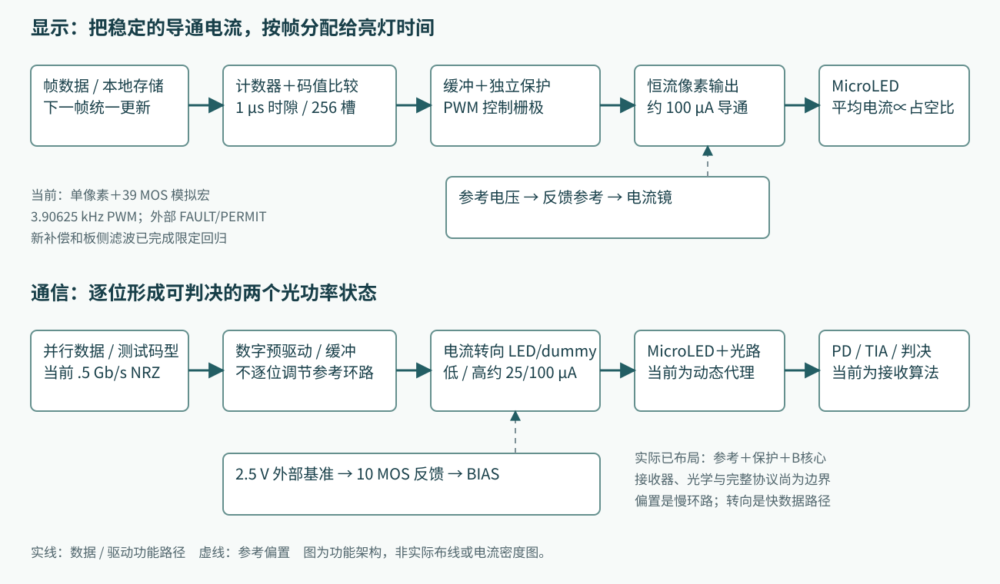
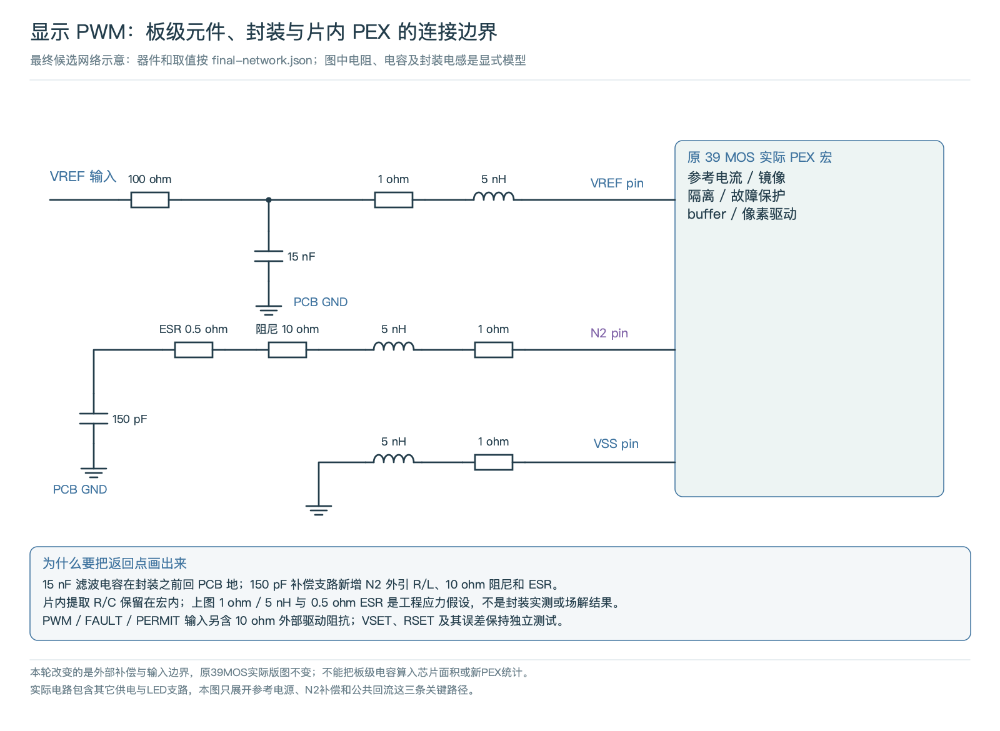
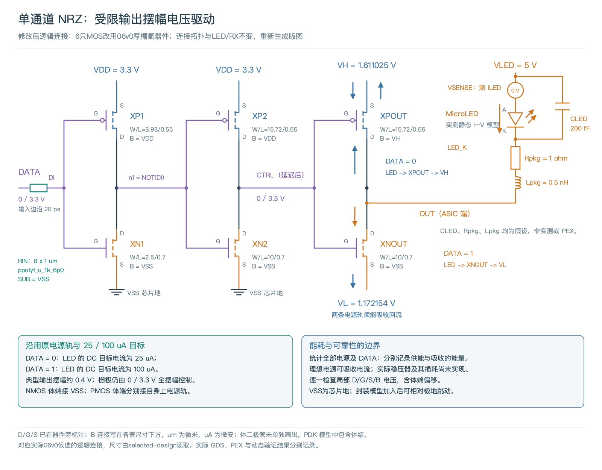
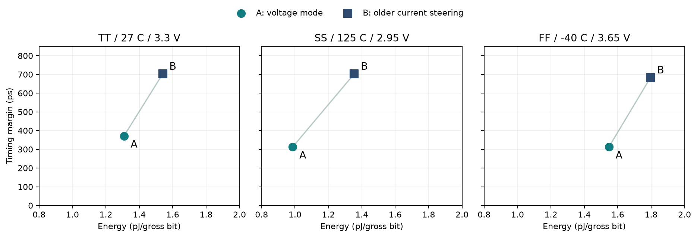
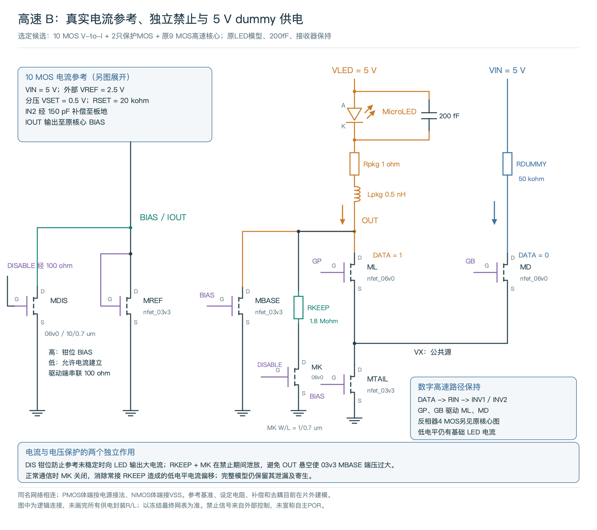

# MicroLED Driver：显示与光通信的阶段复盘及路线选择

**复盘日期：2026-10-25。** 当前建议是：显示方向先把约100 µA单像素做成具备自主就绪与保护的可测原型，再扩展4×4；通信方向先完成A/B在同输出目标、同供电实现边界下的比较，再决定优先架构。**高速路线尚未确定，B没有被证明综合胜出。** 现有结果足以定位决定性实验，尚不足以冻结商品芯片架构。

最重要的三个判断：

- **显示已经验证的是电流稳定和按时间调光。** 1 MHz时隙时钟、256 µs帧对应3.90625 kHz PWM；最新27个选定案例通过，名义供电阶跃恢复由17.71 µs缩短至2.28 µs。0.1–7 mA可编程幅值、最高PWM频率和真实光学灰度尚未形成产品规格。
- **通信已经验证的是带实际寄生的电路与接收代理。** 最新B固定在0.5 Gb/s，10个通信条件各0/511观测错误；名义端口正向能量2.688 pJ/bit。它依赖外部精密基准，并保留提前释放过压及残余供电重启的体结风险。
- **低成本、低能耗与阵列扩展应一起设计。** 不能把整套单像素测试宏逐像素复制。共享参考、局部镜像/缓冲、帧存储/时钟和分组校准有研究价值；收益必须在阵列寄生、同时切换、热耦合和光链路中复验。

本次是对既有证据的复核、公开资料研究和透明计算，没有新增电路仿真、硅片或光学测量。每一条“已验证”都只覆盖其列出的条件。

[TOC]

## 1. 两种应用共用电流控制基础，优化目标不同

图中的实线表示功能传递，虚线表示慢速参考偏置。通信参考环路无需每2 ns重新建立；高速转向管在参考已建立时切换数据。最新B参考环路名义交越约450 kHz，与0.5 Gb/s数据路径属于不同时间尺度。

| 比较项 | 图像显示PWM | 高速光通信NRZ |
|---|---|---|
| 要解决的问题 | 每个像素的亮度、灰度、均匀性、故障安全 | 每个位在规定时刻可靠地变成可判决的光状态 |
| 数字部分 | 帧/码值存储、统一更新、计数器、比较和保护状态 | 数据分发、预驱动；完整系统还需时钟、训练、校验和多路对齐 |
| 模拟输出 | 稳定导通电流，由PWM决定导通时间 | 电压驱动或基础电流＋快速电流转向；目标两个电平 |
| 关键性能 | 电流误差、积分电荷、最小脉冲、更新延迟、像素间一致性 | Gb/s、pJ/bit、眼图/时序余量、BER、距离和带宽密度 |
| 本项目当前实现 | 39 MOS参考/保护/缓冲/像素模拟宏，另有数字实现 | A为6 MOS受限摆幅核心；最新B为9 MOS核心＋12 MOS参考/保护 |
| 本项目负载 | 合成LED：100 µA、约2.8 V，CJO=2 pF、TT=1 ns | 公开20 µm黄色LED静态I–V；另假设200 fF、200 ps光学响应及1 GHz接收器 |
| 当前缺口 | 自主POR/欠压就绪、可编程电流范围、真实光学标定、阵列 | 真实接收机/光学噪声、完整上掉电保护、全链路能耗和阵列 |

两边保留不同LED负载，不能把PWM的精度和通信的速率拼成一份同负载规格。39 MOS和21 MOS是实验宏器件数，不是行业统一架构名称，也不是每像素必须使用的器件数量。

### 材料与工艺：发光材料和驱动MOS应分别讨论

项目驱动器采用GF180MCU的**硅基bulk CMOS**；当前物理选项是`gf180mcuD / 5LM_1TM_11K`，Metal1–Metal5共五层金属。通信修订使用实际06v0厚栅氧器件，B的部分偏置管仍是03v3。06v0 NMOS/PMOS的最小沟道分别0.70/0.55 µm，03v3器件可到0.28 µm；这解释了耐压、栅电容、面积和驱动速度需要重新权衡，不能只改器件名字。

发光器件的GaN/InGaN、衬底或转移到diamond的结构，属于LED与封装。**当前无需特殊GaN MOS来驱动GaN LED。** 若追求更高密度和低电压高速逻辑，可评估更先进硅CMOS、SOI或其他集成方式，但必须重新解决LED电压与薄栅氧耐压的接口问题。工艺节点本身不能给出通信速率上限。[GF180范围与金属栈](https://gf180mcu-pdk.readthedocs.io/en/latest/physical_verification/design_manual/drm_02.html)、[Poly2器件几何](https://gf180mcu-pdk.readthedocs.io/en/latest/physical_verification/design_manual/drm_07_08.html)。

## 2. 显示方向：目前能给出的性能是什么

### 2.1 电流幅值、平均电流与光学亮度是三个不同量

当前参考电路把外部VSET转换成电阻电流，再由电流镜输出到LED。近似关系是：

`IREF ≈ VSET / RSET；ION ≈ 镜像比例 × IREF；IAVG ≈ D × ION + (1−D) × IOFF`。

这里D为0～1的占空比，数字码N=0…256，D=N/256。PWM改变D；电流DAC、镜像比例或可调VSET/RSET才改变ION。光学亮度还要由实际LED的L–I、温度、光学结构和积分时间决定。当前平均电流与电荷是电气代理。

| 指标 | 当前有证据的结果 | 应如何理解 |
|---|---|---|
| 导通电流目标 | 100 µA | 最新宏围绕该点工作，不是连续可编程0.1–7 mA |
| 名义DC | 99.7335 µA，−0.26649% | 当前合成LED及名义参考条件 |
| 独立电阻/PVT DC矩阵 | −4.43614%～+1.98512% | 144个历史DC点，经DC等效及极值复测复用；不是144个全新瞬态 |
| 外部VSET误差控制 | −4.59665% / +2.18745% | 两个±0.2%和100 Ω源阻抗边界控制，非完整商业基准芯片验证 |
| 平均电流调光 | 理想约0～100 µA，步距0.390625 µA | 通过占空比实现；非0.390625 µA精密电流DAC |
| 最小PWM码电荷 | 99.6333 pC；相对匹配DC×1 µs误差−0.10053% | 单名义点、完整帧积分；不是光学灰度误差 |
| 供电阶跃恢复 | 名义17.713→2.28457 µs；12动态点最长2.52042 µs | 回到最终电流±0.5%带；最大瞬态偏差仍有8.87334% |
| 独立fault到安全 | 205.777 ns | 指定停钟和故障条件；与正常帧更新延迟不同 |
| 启动数值一致性 | 两种积分配置完整40 µs窗口通过 | 电源及FAULT/PERMIT有明确建立顺序，尚无自主POR |

[最新PWM原始汇总](../../../evidence/pwm-reference-v2/20261024/final-summary.json) · [PWM完整电路/版图/波形](../pwm-reference-startup-20261024/index.html)。

**优势：** 将导通电流稳定与灰度时间控制分开，便于独立标定；普通硅CMOS可以实现；数字控制直观，独立保护不依赖时钟继续运行。**代价：** 小灰度受边沿、泄漏、位移电流与最小脉冲影响；参考、外部元件和供电余量尚需产品化；当前没有阵列光学均匀性数据。

### 2.2 PWM频率、精度、延迟应分别列出

`fPWM = fslot / 256 = 1 MHz / 256 = 3906.25 Hz`。

当前最小时隙1 µs、帧256 µs；码值0…256共257个状态，包括全关与全开。端点码分别为恒低/恒高，只有中间码形成重复开关脉冲。实现使用9 bit端口容纳256，不代表512级9 bit有效灰度。占空比步距是1/256，即满量程0.390625%；理想最近值量化误差上界为半LSB，即满量程0.1953125%，不能把它当作模拟电流精度。

duty/enable输入改变后，在满足建立保持条件时于下一帧边界采样提交，等待约0至不足256 µs；整机还应计入尚未联通验证的输入传输/校验延迟。这个等待与纳秒级电流边沿是不同指标。普通码0和普通enable仍按帧提交；独立FAULT走另一条异步保护路径。

**目前没有验证“最大PWM频率”。** 已有数字STA和1 MHz功能回归不能代替模拟输出、最低码、故障及PVT的Fmax扫描。单次边沿快也不证明更高频率时每一灰度都准确。

本次从既有TT、D=1波形作只读后处理，模型导电分量的10–90%上升/90–10%下降约14/26 ns；总支路与电容分量会产生不同边沿和尾部，正常PWM下降后总支路到1 nA量级约需3.07 µs。这是单工作点的新增观察，尚无该指标的PVT/频率或光学验收。它说明205.8 ns的独立FAULT关闭时间不能代表普通PWM黑态或发光熄灭时间，完整帧净电荷通过也不能代替光学对比度。[定义、原始波形SHA与方法](../../../evidence/architecture-review-20261025/pwm-review.md)。

| 在1 MHz时隙时钟下的算术 | PWM重复频率 | 状态 |
|---|---:|---|
| 8 bit / 256槽 | 3.90625 kHz | 当前工作组织 |
| 10 bit / 1024槽 | 976.5625 Hz | 算术推演，未实现验证 |
| 12 bit / 4096槽 | 244.140625 Hz | 算术推演，未实现验证 |
| 16 bit / 65536槽 | 15.258789 Hz | 算术推演，未实现验证 |

若希望12 bit仍保持3.90625 kHz，需要16 MHz时隙时钟，最低码缩短到62.5 ns；届时必须重验输出建立时间与电荷。可研究分段PWM、PWM＋幅值混合调光、抖动/误差扩散，但这些方法各自引入噪声、闪烁或校准代价。

### 2.3 为什么现在不能写“0.1～7 mA已完成”

历史研究确实扫过1～70个理想几何单元的缩放，得到143个DC与16个PWM案例，但未实现可选择电流DAC、开关阵列与相应版图。公开静态LED数据给出：100 µA约3.76791 V、1 mA约4.39238 V、7 mA约5.13561 V。

因此5 V电源连LED的7 mA静态正向压降都不够，更无法再给恒流管留压差；该历史模型70单元只得到约3.643 mA。6 V或理想偏置对照用于定位余量，不等于已实现6 V产品供电。拓宽范围需共同完成LED安全工作区、可调镜像/DAC、驱动与开关、热/EM、最低码及PEX。

[电流范围实验汇总](../../../evidence/current-range/summary.json)明确记录`qualified_entire_0p1_to_7mA_range=false`。最新39 MOS宏的100 µA成果不自动继承历史缩放实验的范围。

## 3. 显示阵列、QSPI与商业化：能扩展，但要改变组织方法

### 3.1 4×4可以作为下一阶段工程目标

架构上可以扩展为：共享精密基准＋分组参考缓冲，每像素/每列局部电流镜、PWM使能与校准码；数字侧共享时钟和帧计数器，各像素存储独立灰度。先用4×4验证同时切换和均匀性，再决定密度。

必须跨过五组问题：

1. **电流一致性：** 参考绝对误差是共模项；局部MOS失配、镜像VDS差、供电IR压降是空间差异。需统计失配、共同/局部校准、对称布局和电源提取。
2. **亮度一致性：** 相同电流也可能不同亮度。必须测每像素L–I、温度、颜色与老化，建立电流校准与光学校准的分工。
3. **同时切换：** 16路同相PWM会把单路边沿叠加到PG/地回路，产生参考扰动、地弹和串扰。错相PWM可能降低峰值供电扰动，但会改变瞬时图案与采集同步条件。
4. **像素间距与连接：** PWM模拟测试宏约637.03×200.36 µm、0.127635 mm²；它包含共享候选参考/保护，外框不是微显示像素间距。需分离共享电路与局部像素、缩短互连，并明确焊接/转移/混合键合、pad/ESD和坏点修复路线。
5. **接口和存储：** 接收数据、CRC/错误状态、双缓冲、帧同步、掉电恢复及测试读回都需从功能模型走到真实RTL/物理/硬件。

直驱和行扫描也不同。若4行复用且峰值电流不变，每像素最大导通时间通常降至约1/4；要恢复相同平均亮度可能需约4倍峰流。实际LED效率和热非线性还会改变结果，不能将直驱100 µA精度直接等同扫描阵列。

**当前可以开展4×4设计和仿真；尚未完成4×4的物理/光学验证。** 已有帧行为模型与单像素回放，不代表已实现完整串行接收ASIC或多像素并发后仿真。

### 3.2 QSPI像写存储器，但选它的主要原因是带宽与引脚折中

目前未取得市场份额数据，不能概括“大多数MicroLED厂家都用QSPI”。公开矩阵驱动器中存在CCSI、普通串行和I²C等实现；显示控制器的QSPI也不能自动归类为MicroLED恒流驱动器。

Quad SPI以四条数据线在载荷阶段搬运数据；Quad不是把时钟、片选等全部连接线合计成四根。以50 MHz SDR为例，理论原始载荷速率约200 Mb/s；命令、地址、转向、等待及校验会降低有效速率。兼容主控资源、较少引脚、布线复杂度和足够的局部帧带宽，是选择理由。具体是否DDR、最大时钟和帧协议必须看芯片手册。

它在使用上常像“向地址空间写灰度RAM”，因为芯片内部可以有寄存器和帧缓冲：一组存储当前显示，另一组接收下一帧，再统一切换。**这是接口访问方式与缓冲组织相似，不表示驱动芯片本质上是Flash，也不表示必须使用QSPI。** 每个PWM周期不必重新从主控传完一帧。

| 不含开销的独立算术例子 | 灰度数据率 |
|---|---:|
| 4×4单色，8 bit，60帧/s | 7.68 kb/s |
| 4×4 RGB，3×8 bit，60帧/s | 23.04 kb/s |
| 3840×2160 RGB，3×8 bit，60帧/s | 11.944 Gb/s |

所以4×4未必需要QSPI；超高分辨率整帧也未必适合单条QSPI。可按分区、串接、并行端口或高速显示接口组织。TI的[TLC6983](https://www.ti.com/lit/ds/symlink/tlc6983.pdf)采用CCSI并描述双BANK；[TLC5958](https://www.ti.com/lit/ds/symlink/tlc5958.pdf)也有双BANK；[IS31FL3731](https://www.lumissil.com/assets/pdf/core/IS31FL3731_DS.pdf)使用I²C与多帧存储。这些是公开接口反例，非本项目商业对标。

### 3.3 能生产、可商业化、单价低，是三个不同问题

目前的电路方法使用常规硅CMOS，不存在“只有特殊MOS材料才能做”的门槛。生产难点集中在真实基准/POR、pad/ESD、可靠性、完整PG/封装、LED连接与测试良率。公开PDK的实验DRC/LVS/PEX结果，仍需匹配实际代工选项、制造规则和接单方验收。[上游公开PDK README](https://github.com/google/gf180mcu-pdk/blob/main/README.rst)仍将该开源分发标为experimental/alpha；[公开MPW服务](https://wafer.space/)的接单规则与PDK版本须另行确认。二者不能合并为本设计量产批准。

当前没有晶圆/掩模、封装、LED阵列、转移/键合、测试时间、良率及订单量的有效报价，不能给出可信人民币单价，也不能宣称成熟节点一定比先进节点便宜。芯片总面积应包括局部像素阵列、共享参考/数字、PG、隔离、pad/ESD和工艺填充；不能用21或39 MOS宏外框直接乘像素数报价。

可用成本模型表达，而不编造价格：

`单件成本 ≈ NRE / 销量 + (晶圆成本 / 每片晶圆可用die数 + LED/键合/封装 + 单件测试成本) / 最终装配良率`。

这是粗粒度预算：不同步骤的良率和测试/返工位置应进一步拆开，避免把同一损耗重复计入。小批量常受NRE/封装/测试主导，大阵列则对坏点、连接和校准成本更敏感。

| 降本方向 | 可能保留的能力 | 必须复验的代价 |
|---|---|---|
| 多像素共享参考、计数器及部分存储控制 | 局部恒流＋独立灰度的功能 | 驱动负载、失配、串扰、噪声、同时切换 |
| 分组trim/校准，评估较宽容差器件 | 目标电流精度可能保留 | 校准DAC/存储、测试时间、温漂与老化残差 |
| 低电压数字＋必要的耐压输出，缩短LED互连 | 降低数字CV²与布线负担 | 电平转换、域间保护、封装成本 |
| 小规模先用片外精密基准，密集阵列再评估片内集成 | 快速建立可测原型 | 片外BOM与引脚；集成后面积/精度/启动成本 |
| 按实际LED余量优化供电、提高转换效率 | 相同电流/时序目标 | 冷热Vf、输出压差、纹波和瞬态余量 |

存在“减少重复资源而不改变功能目标”的机会，但目前没有证据承诺“更便宜且完全不牺牲性能”。A、电流转向、分段DAC这些电路方法均可由常规CMOS实现；目前没有足够证据据此宣布哪一个完整MicroLED方案可以更快/更便宜量产。商业化需要选定应用需求、真实样品和供应链报价后决策。

## 4. 通信先用通行指标评价：Gb/s、GHz、pJ/bit与BER

### 4.1 每项指标都需要一个分母和测试边界

| 指标 | 定义 | 当前如何使用 |
|---|---|---|
| Gb/s | 每秒传输位数；区分gross与payload | 最新B为0.5 Gb/s gross、单lane固定测试点 |
| Gbaud | 每秒符号数 | NRZ每符号1 bit；理想PAM4每符号2 bit，开销另计 |
| GHz | 模拟频率/带宽或时钟频率 | 不等于Gb/s；200 ps一阶光学代理对应约0.796 GHz，接收代理另为1 GHz |
| pJ/bit | 同一窗口功率积分除以传输位数 | 必须标明LED、Tx端口或完整双端链路，以及gross/net |
| 眼图/判决余量 | 幅度判决距离、采样时序容许范围 | 本项目为冻结算法与代理单位，不是测量的dBm接收灵敏度 |
| BER | 错误位/实际发送位 | 必须给码型、总位数、噪声、时钟、距离、温度和FEC前后 |
| 带宽密度 | Gb/s/mm边长或Tb/s/mm²等 | 必须说明面积包含LED、驱动、接收和封装中的哪些部分 |

`Ebit = P / R；P[mW] = E[pJ/bit] × R[Gb/s]`。

本项目B名义2.688 pJ/bit × 0.5 Gb/s ≈1.344 mW，是所纳入端口的平均正向取能尺度。参考OTA、检测和输出参考三支路约700.76 µW，对应约1.40 pJ/bit；此DC分配与瞬态总能量的比较是预算解释，不是把两次实验强制相减得到新的动态测量。

**仅降低速率未必降低pJ/bit。** 若静态功率不变，`Ebit = Edynamic + Pstatic/R`，减小R反而增大静态摊销。正确目标是保持所需净吞吐、延迟和误码，降低整个指定范围的能耗；宽并行、共享、空闲关断和更短互连都要与其新增代价比较。

### 4.2 为什么当前零错码还不能给BER等级

最新每个条件只验证511 bit，且使用无完整随机光学噪声/抖动的接收代理。0/511证明这一有限序列在所测条件下可判决，不是BER=0或BER<10⁻¹²。

即便换成独立随机、平稳的实测样本，511 bit零错误的单侧95%统计上界也约0.585%；要以零错误支持10⁻¹²量级上界，需要约3×10¹² bit，在0.5 Gb/s下约1.66小时/条件。这只是统计算术，不能把该模型仿真的511 bit解释成随机独立测量样本。实际还需覆盖PRBS长度、突发错误、温度、电源、串扰、接收灵敏度、FEC及失锁恢复。

## 5. 通信路线A、B和多电平路线怎样比较

### 5.0 A/B是输出电路，C还改变了调制方式

A、B、C只是本项目的研究标签，不是行业统一、互斥的三种芯片类别。**A用输出电压控制LED电流；B把既有电流快速转向LED或dummy；C用多档电流/电压编码更多符号电平。** C通常可以由多个B类电流单元组成，也可以用电压型DAC；所以必须分清两个选择维度：

| 输出电路与调制 | NRZ/OOK：2电平、1 bit/符号 | PAM4：4电平、2 bit/符号 |
|---|---|---|
| 电压模式输出 | 当前A：已有晶体管、真实版图/寄生实验 | 本项目未实现，可作为以后候选 |
| 电流转向/分段电流输出 | 当前B：已有晶体管、真实参考/版图/寄生实验 | 过去标签C的一种实现：目前仅概念，缺该版仿真数据 |

预加重/均衡是可叠加手段；宽并行也是系统组织方法，并不自动等于选择B。PAM4在同符号率下增加理论位速率；相同总幅度的4个等间距电平，相邻间隔只有NRZ的1/3，噪声、LED非线性、DAC失配与接收器代价因此更重要。不能用“4电平”直接推断更快、更节能或BER更好。

| 路线 | 工作原理 | 现有项目证据 | 优势与限制 |
|---|---|---|---|
| A：受限摆幅电压驱动 | 数据经缓冲在两个输出电压状态间切换，电流由LED I–V和支路决定 | 最新厚栅氧版在固定理想辅助电源下，三联合条件0.4 Gb/s离散点通过；辅助电源扰动仍失败 | 电路简洁，低摆幅可减小CV²；对Vf、温度、辅助电源精度和可吸收电流能力敏感 |
| B：基础电流＋电流转向 | LED保持低电流；高速开关把附加电流导向LED或dummy | 最新21 MOS实际PEX，0.5 Gb/s固定点10项通过；含参考/供电端口能量 | 电平控制较直接、避免完全关断后的重新建立；dummy和低电平电流耗能，增加余量及偏置设计要求 |
| B叠加预加重/边沿增强 | 转换时短暂附加/抽走电流 | 概念与文献支持，本项目未完成该版晶体管验证 | 可能减轻ISI、加快电荷变化；增加峰流、过冲、驱动功耗与校准 |
| C：分段电流DAC/PAM4或更多电平 | 多组可加电流形成多个光电平 | 本项目只有架构和公开文献研究 | PAM4相同符号率可承载2 bit；相同可用幅度下相邻电平间隔变小，需线性、匹配、更多SNR及训练/均衡 |

相同200 fF电容，若仅以100 µA恒流充电，跨0.1 V约需0.2 ns，跨1 V约需2 ns。这是`CΔV/I`理想尺度，说明减小摆幅和保持预偏置为何有用；不代表真实LED节点只由这一电容决定，也不能把分散PEX电容全部直接相加代入该式。

A的输出级在VH/VL之间切换；两条轨要控制精度并能处理回灌。该图对应实际核心，辅助电源在已有对照中仍是理想双向电源。C的[分段电流DAC概念图](../highspeed-driver-routes-20261019/figures/route-c.png)仅用于解释四电平，尚无本项目该版晶体管/PEX与PAM4接收数据。

### 同速率数据：A能耗低，B时序余量大，输出电流仍须匹配

| 条件，均为历史0.4 Gb/s核心 | A / B正向能量 pJ/bit | A / B时序余量 ps | A / B平均LED电流 µA | 结果 |
|---|---:|---:|---:|---|
|TT / 27 C / 3.3 V|1.3082 / 1.5405|371.1 / 703.1|61.20 / 65.00|均0/511，限定联合筛查通过|
|SS / 125 C / 2.95 V|0.9863 / 1.3547|312.5 / 703.1|45.55 / 60.27|均0/511，限定联合筛查通过|
|FF / -40 C / 3.65 V|1.5473 / 1.7963|312.5 / 683.6|67.98 / 69.44|均0/511，限定联合筛查通过|

图与表取自同一冻结矩阵：同LED负载、接收代理、0.4 Gb/s及对应角落，A/B均含电源端口和DATA正向取能；不含各自真实辅助电源/参考生成成本，且实际LED电流不同。连线只连接同一条件的两个点，不能当作连续性能曲线。B的较大时间余量是该采样器下的确定性指标，不证明其真实BER一定更低；A的较低功耗也不代表同等光输出下必然更节能。

### 5.1 B实现更完整，不能据此判定输出级更优

| 实际PEX工作点，固定0.5 Gb/s | I0 / I1（DC，µA） | 正向端口能量pJ/bit（通信） | 通信结果 |
|---|---:|---:|---|
| TT / 27°C / 3.3 V | 25.154 / 100.395 | 2.6883 | 0/511 |
| SS / 125°C / 2.95 V | 25.065 / 97.448 | 2.5194 | 0/511 |
| FF / −40°C / 3.65 V | 25.261 / 103.372 | 2.9174 | 0/511 |

DC和通信为匹配工况下的独立实验。10项通信的最小归一化阈值余量0.228608，按声明75 µA跨度折算约17.15 µA代理距离；最小时序余量0.265625 UI，即0.53125 ns，二者最小值不一定发生于同一案例。

上述能量覆盖所声明电源和DATA端口，但未包含外部精密基准IC内部静态电流、上游供电转换、真实Rx、完整时钟/协议和光学损耗。RAW +250 mV脉冲条件的正向取能为786.67 pJ/bit，主要来自100 nF去耦充电；另记录返回约741.95、净额44.72 pJ/bit，理想端口返回不保证实际电源回收。该扰动窗口不能当作正常通信能耗。

RSET选±0.1% / ±25 ppm/°C后，所测精密联合DC误差为−3.196%～+3.811%，未做逐角重调。宽容差联合条件仍有+5.247%失败。25/100 µA的4:1电流比不能直接当作实测6 dB光学消光比，因为LED的L–I关系与光路尚未建成。

真实布局宏外框348.99×340.06 µm，约0.118678 mm²，21 MOS＋RIN，638个互连R/322个显式C。已完成对应公开环境的DRC/LVS/PEX与开短路负控；它不含pad/ESD、完整电源/外部参考、接收器或LED集成，不是量产die面积。

提前释放DISABLE的负控制出现4.86194 V的03v3端压失败；RAW掉电但LED/参考仍有电时，内部PMOS结出现约0.746649 V正向偏置。尚需保存结电流、验证复位/隔离、ready/欠压互锁和完整启动→数据链路。

### 5.2 不要把历史最高点当成当前速度规格

早期薄栅氧A曾在TT名义SCHEM和RC的2 Gb/s点接收通过；同版SS/电压条件与后续改版存在失败。10月23日修订版的共同通过点为1 Gb/s；10月24日更换实际耐压器件后，固定辅助电源的三条件共同选点为0.4 Gb/s，0.5 Gb/s慢热幅度余量0.09787低于0.1门槛。

A还有决定性的幅值失效：SS/125°C、VDD2.95 V、VLED4.95 V、VH/VL同时+50 mV时，高电流仅57.196 µA，已低于62.5 µA固定阈值，通信256/511错误；单纯降低速率不能解决。

这些离散结果受输出电路、输入R、寄生、电源和接收采样算法影响，不能拼成单调连续速率上限。B最新0.5 Gb/s也是固定研究点，没有重新搜索Fmax。

此前同为0.4 Gb/s、同LED/RX的A/B核心对照，A能量较低、B时序余量较大；输出电流也没有完全匹配，例如SS平均LED电流A约45.55 µA、B约60.27 µA，不能把所有能量差都归因于拓扑效率。A的两条理想辅助轨和B的旧理想偏置都未计入真实生成代价。**最新带真实参考的B，不能直接与只含核心的A能耗表作完整系统胜负判断。**

[六点原始能量独立重积分与结果索引](../../../evidence/architecture-review-20261025/route-comparison-reviewed.json) · [高速B最新报告](../nrz-b-reference-power-20261024/index.html) · [同条件历史A/B核心对照](../driver-robustness-20261024/index.html#nrzresults) · [本轮NRZ证据复核](../../../evidence/architecture-review-20261025/nrz-review.md)。

### 5.3 潜力、成本与量产应怎样评价

低能耗潜力上，A值得保留，因为较少开关和较低摆幅可以减少动态开销；能否兑现取决于真实VH/VL生成、吸收能力及电流校准。B已用于研究受控电流和保护，其低电平/假负载损耗、参考开销也更明确，但这不构成下一阶段优先选择B的性能结论。PAM4只有在通道数/光纤或可用模拟带宽成为主要瓶颈时，额外线性和噪声成本才可能值得。

| 同一系统目标下的工程推断 | 成本的可能来源 | 为什么暂不能宣布量产赢家 |
|---|---|---|
| A核心晶体管少 | 双辅助电源、精度、源/吸电流、校准及失效保护可能增加BOM或芯片面积 | 当前辅助电源仍理想，未完成完整实现后的面积/功耗/报价 |
| B电流设置较直接 | 参考、局部镜像、dummy、补偿及精密电阻；共享可减少部分重复 | 当前包含外部基准且上掉电未闭合；阵列共享和光学低BER未知 |
| PAM4可减少达到同总速率所需lane数 | DAC、匹配/校准、线性接收、均衡/时钟成本；可能减少光学连接数量 | 本项目尚无该版晶体管/阵列实现，无法证明新增电子成本小于光学节省 |

三种电路均可用合适的硅CMOS制造；“原理可制造”不能代替本设计的量产资格。对于高密度光引擎，LED转移/键合、微透镜/纤芯对准、检测阵列、坏lane筛选和封装测试都可能改变成本排序。下一阶段应让A/B在相同实现边界下比较，而不把已投入B的开发工作当作选择B的理由。

## 6. 公开研究证明了哪些能力，又没有证明哪些能力

这里比较的是研究方法、工作点与计量边界，不设置商业产品复现或性能对标目标。

| 公开原始来源 | 可以引用的结果 | 需要保留的条件 |
|---|---|---|
| [Pezeshki，CS MANTECH 2025，pp2–4 / Fig2–7](https://csmantech.org/wp-content/uploads/2025/05/10A.1-Final.2025.pdf) | 16 nm硅ASIC阵列的60通道逐路3.3 Gb/s BER图；另有2.5 Gb/s邻道同时活动串扰实验；单LED外部驱动10 Gb/s、约10⁻¹⁰ BER | 10 Gb/s使用sapphire测试基板、50 Ω外部驱动和一抽头FIR；约1 pJ/bit由LED平均I×V/R计算，作者预计加集成driver后约再增20%；不能写300路同时10 Gb/s |
| [MOSAIC，SIGCOMM 2025，§5–7 / Fig8、11–12](https://www.microsoft.com/en-us/research/wp-content/uploads/2025/08/benyahya25mosaic.pdf) | 100通道原型，每次测试25路；2 Gb/s/lane、20 m；中位BER<2×10⁻⁸，最差≤4×10⁻⁵ | 800 Gb/s和3.1–5.3 W/端为设计估算，50 m为模型研究；不是原型已测完整能耗或100路同时200 Gb/s |
| [Lin等，Nature Communications 2026，Fig5及方法](https://www.nature.com/articles/s41467-026-74151-4) | 20 µm黄色InGaN/diamond，25 µA、1.5 Gb/s、1 m OOK；56 fJ/bit可由3.360 V×25 µA/1.5 Gb/s复算 | 该低能耗点BER约3.1×10⁻³，采用仪器驱动；只代表LED直流功率指标，不能当完整ASIC或低BER链路功耗；也不能将另一个GHz工作点合并 |
| [Avicena官方，2025-11-17](https://avicena.tech/avicena-advances-microled-and-photo-detector-arrays-to-enable-the-worlds-lowest-power-ai-scale-up-optical-interconnects/) | 企业报告4 Gb/s、100 µA/LED、raw BER 10⁻¹²、80 fJ/bit per LED | 属企业公布数据；完整测试时长、driver/Rx/时钟和供电边界未完整披露，不当作独立全链路认证 |

这些来源说明多Gb/s、低器件能耗及并行阵列有实验基础，但还不足以判定本项目A/B哪种输出级在相同LED、Rx、光路和工艺下最好。先进ASIC、LED器件与转移工艺、接收灵敏度都对结果有贡献。

## 7. AI数据中心：方向是合理的，系统目标要再具体一些

Scale-up是让多颗加速器在高带宽、低延迟域内协同；不仅是同一基板上两颗芯片，也可延伸至机架或多机架。Scale-out连接多个计算域；光互连两种场景都可以使用。NVIDIA公开架构把NVLink域与机架间cluster网络分开；Marvell的公开说明也明确铜与光在scale-up中的不同距离角色。[NVIDIA架构](https://docs.nvidia.com/dsx/ncp/software-reference-guide/data-center-architecture)、[Marvell scale-up说明](https://www.marvell.com/ai-data-center/scale-up.html)。

因此应该把本项目目标写成：**研究满足既定距离、净吞吐、延迟和BER的低能耗并行光I/O**。提高互连带宽密度和可达距离有助于缓解I/O瓶颈；是否改善“数据墙”还取决于内存带宽/容量、协议、拓扑和计算通信比，单独LED driver不能解决所有瓶颈。

短距离铜连接可以很节能。光链路有电→光→电、接收放大和时钟代价，不能预设任何长度下都比铜省电。比较时应固定主机接口、距离、有效吞吐、方向和误码/可靠性等级，再计入两端、idle、训练、重传、FEC和冷却影响。

数量级例子：在1 Tb/s有效数据流上，每降低1 pJ/bit，对应约**1 W**功率；1000条同等数据流才是约1 kW。它是ΔP=ΔE×R的独立算术，不是本项目已经实现的数据中心节能。整机价值还需看利用率和光引擎是否能按负载关闭。

## 8. 通信阵列：把“多一个像素”变成“多一条完整lane”

通信lane包含driver、LED、光学通道、PD/TIA和判决，不只是LED数量。以B为例，架构上可沿用其数据通路扩展，但显示行扫描不能替代多路同时通信。

`Rpayload = Nactive × Rlane × η`，其中η计编码/FEC/帧开销，时钟、冗余和失效备用lane可能额外占用阵列位置。

例如16路×0.5 Gb/s=8 Gb/s gross；若独立假设η=90%，净7.2 Gb/s。它只是带宽算术，目前没有16路同时仿真、制造和光学验证。

### 8.1 共享参考有机会降低能耗，但不是无代价复制

以最新TT端口能量换算1.344 mW/lane，参考三支路约0.701 mW作预算。其中OTA＋检测约0.576 mW，输出参考约0.125 mW。对于16路、每路0.5 Gb/s、η=90%的**独立理想算例**：

| 共享假设 | 阵列总端口正向功率 / mW | pJ/gross bit | pJ/payload bit |
|---|---:|---:|---:|
| 当前单路全部逐路复制 | 21.506 | 2.688 | 2.987 |
| 仅共享OTA＋检测，保留每路输出参考 | 12.863 | 1.608 | 1.786 |
| 极理想：整份参考均可共享，局部输出也不重复 | 10.995 | 1.374 | 1.527 |

这三行均是功率分拆算术，不是阵列仿真、可实现下界或节能承诺。尤其单份25 µA参考直接分流给16个原BIAS负载，不能自动得到各路原电流。实际每路仍可能需要独立输出参考电流、镜像缓冲和校准，新增节点电容/串扰/供电噪声也会增加功耗。

若继续评估B的参考共享，所需验证是**共享OTA与基准、保留必要的局部镜像/缓冲**的真实4路电路对照。分拆对照的用途是确定哪些功率可共享、哪些必须逐路保留，再通过真实电路、版图和同时切换验证收益。

### 8.2 并行越多，系统验证越重要

- **时钟与偏斜：** forwarded clock可以成为候选，但每路需要采样相位、deskew、训练和故障恢复；高层输入若本来是高速串行，gearbox/SerDes成本仍在。
- **电源与电串扰：** 全0/全1、同相跳变、相邻反相、不同PRBS负载都要测；需要共享参考稳定性、PDN、封装互感和EM/IR。
- **光学串扰和耦合：** LED发散角、微透镜、纤芯/探测器对准、边缘通道损耗与温漂，可能决定系统BER和装配成本。
- **热与制造：** 阵列功率密度、坏点和连接良率需要冗余lane、映射和测试策略；单路典型通过不能推出阵列良率。
- **计量：** 记录每路与总功率、净吞吐、同时活动lane数、距离、BER时长、idle/retrain能量；不能把LED数量乘单路最高值当作实测吞吐。

增加N保持每路较低速率，是一条有公开实验依据的方向。它与A或B输出级正交：宽并行系统仍需选择每lane最合适的驱动、接收与偏置。

## 9. 目前怎样选路线，下一步怎样使选择可被数据推翻

**显示方面，我倾向先做共享参考＋局部恒流像素＋数字PWM的4×4研究架构。** 在扩大之前补reference-ready、欠压互锁与真实LED测量；将模拟幅值与PWM时间分开验收。暂不把7 mA全范围和更高位深同时并入第一颗原型，以免无法定位误差来源。

**通信方面，应先公平比较，暂不把A或B列为默认优先架构。** B的电流定义较直接且已接真实参考/实际PEX，但当前参考静态开销偏大，并未解决全部上掉电。A可能有较低开销，但VH/VL精密轨与吸收能力必须真实实现后才具备公平的能耗分母。此前先完善B的参考/保护，是工程补齐顺序，不是经过完整性能排序后的结论。

下一轮共同入口是：同一LED/光路/Rx目标、同净吞吐和I0/I1目标，只允许TT一次设定，PVT不逐点重调；先比较理想供电下的输出核心，再比较纳入实际供电/参考的完整Tx。每一层均记录峰流/应力、能量、时序/幅度余量、面积和失败。C/PAM4另需三阈值接收与线性/噪声验证，应与NRZ在相同净吞吐下比较，而不是强行沿用单阈值接收器。[比较合同与未知项](../../../evidence/architecture-review-20261025/comparison-contract.md)。

如果A加入真实供电后仍保有较低能耗且联合条件通过，就应优先A；若A为稳定电流付出的附加电路消耗抵消优势，而B能满足能耗/误码/面积目标，则优先B；如果每lane带宽或光学连接数量成为主约束，再判断C的总系统收益。现有数据尚不足以走完上述判定。

| 下一实验 | 固定比较条件 | 用什么结果决策 |
|---|---|---|
| 两方向的ready/欠压与掉电隔离 | 各自原LED；迟到参考、任意顺序、慢斜坡、brownout、fault | 启动电流/应力、结注入、恢复时间及第一帧/首包；保留失败 |
| B降低OTA电流、分离可共享参考 | 同I0/I1、同LED/Rx、同0.5 Gb/s与供电扰动 | 完整端口pJ/bit下降，同时稳定性、启动、偏置误差与眼图不越界 |
| A加入真实VH/VL生成和吸收电路 | 与B相同目标、速率、负载、Rx及条件；均纳入供电代价 | 在联合条件通过的工作点比较能量、面积和余量，失败点不计有效能效 |
| 实测器件和接收链路 | I–V、L–I、阻抗/带宽、温度、PD/TIA噪声与耦合 | 用可追溯模型替代动态假设；确认灵敏度和低BER所需电流 |
| 四路电路→4×4阵列 | 同时切换/相邻干扰、时钟、供电与坏lane | 净吞吐、阵列/每lane能量、误码与修复开销是否达标 |

量产选择应在这些性能条件和供应链条件同时成立后进行：设计/可靠性签核、LED/CMOS集成路线、封装与测试良率、实物长时误码、有效报价和产能。当前方向是先对齐输出目标与实现边界，再分别验证供电/参考、保护和真实光链路，以共同指标选择路线。

## 10. 证据、计算与复现入口

- 本次[计算JSON](../../../evidence/architecture-review-20261025/calculations.json)包含PWM位深/频率、接口载荷、能耗单位、共享参考极理想算例与BER统计算术；不调用ngspice或物理工具。
- [公开来源台账](../../../evidence/architecture-review-20261025/sources.json)记录原文定位、证据类别、适用条件及不能推导的结论；论文原图仅在本机私人证据视图保存，公共报告使用事实转述和本项目原创图。
- [显示证据复核](../../../evidence/architecture-review-20261025/pwm-review.md)、[高速证据复核](../../../evidence/architecture-review-20261025/nrz-review.md)、[接口/制造复核](../../../evidence/architecture-review-20261025/interfaces-manufacturing-review.md)支持本报告的不同问题。
- [构建脚本](../../../scripts/architecture_review_20261025.py)重建HTML、功能架构图及算术；[来源身份](../../../evidence/architecture-review-20261025/report-provenance.json)记录输入/输出SHA。既有工程原始波形与版图仍按[跨机接续说明](../../development-handoff.md)恢复。
