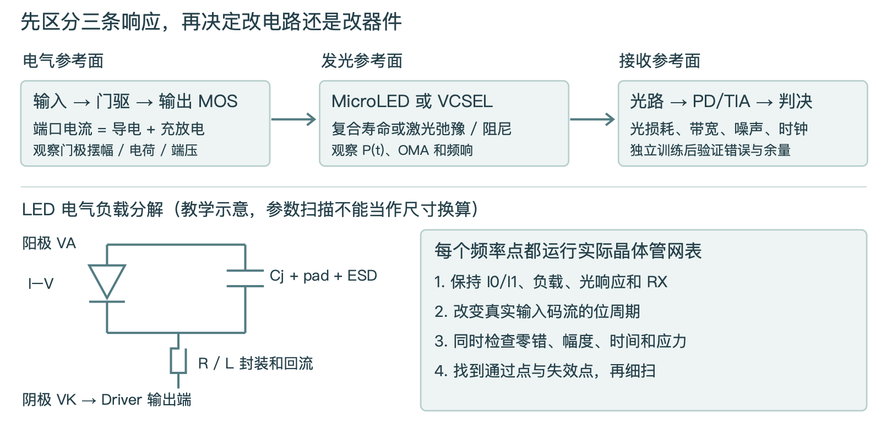
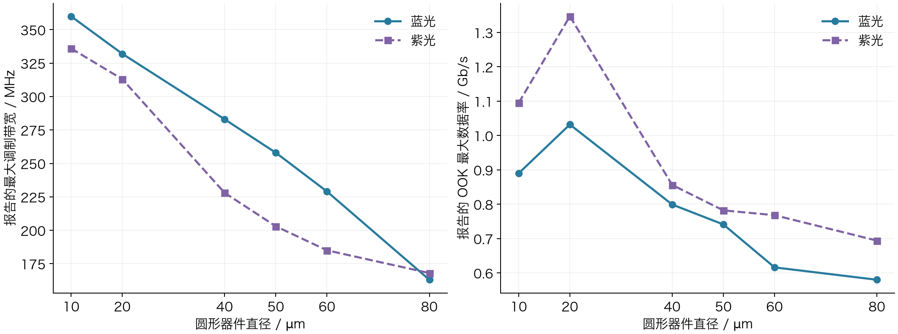
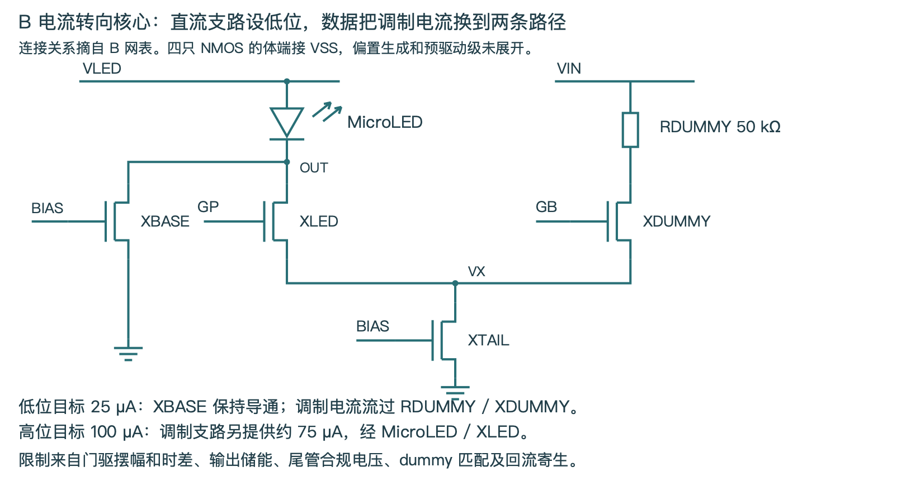
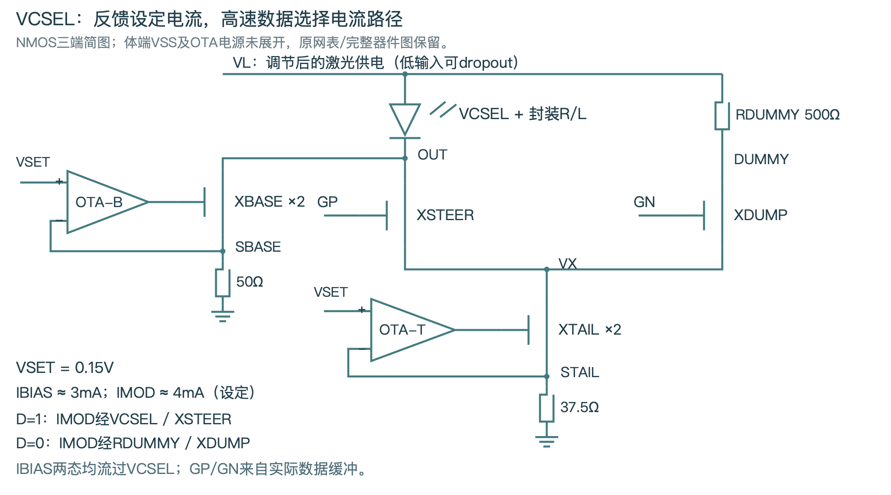
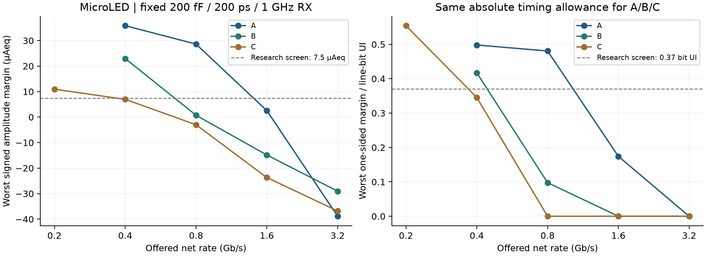
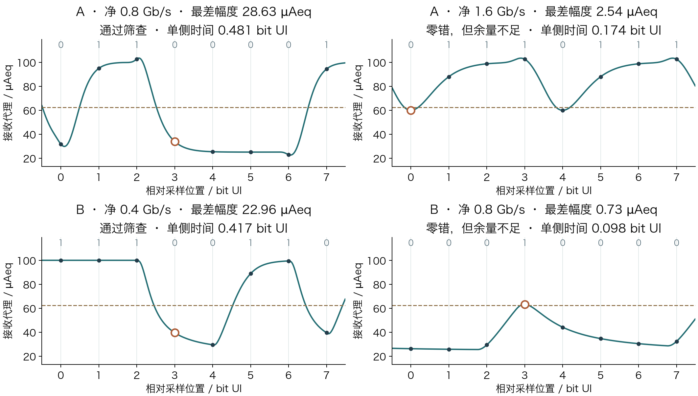
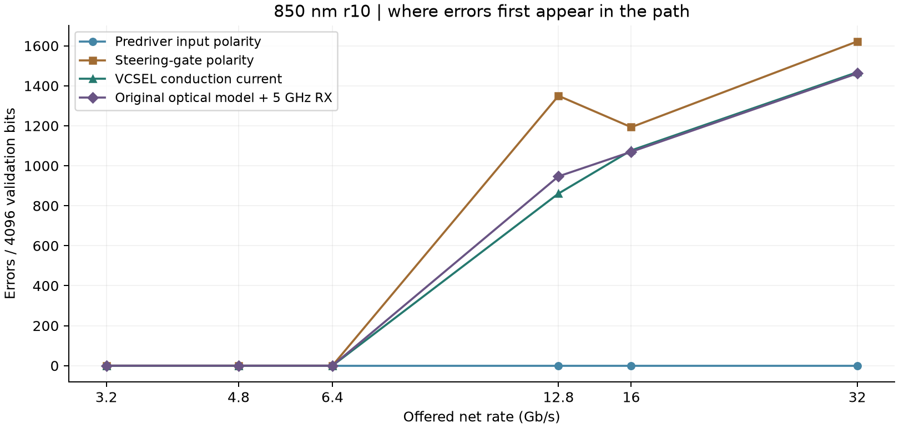
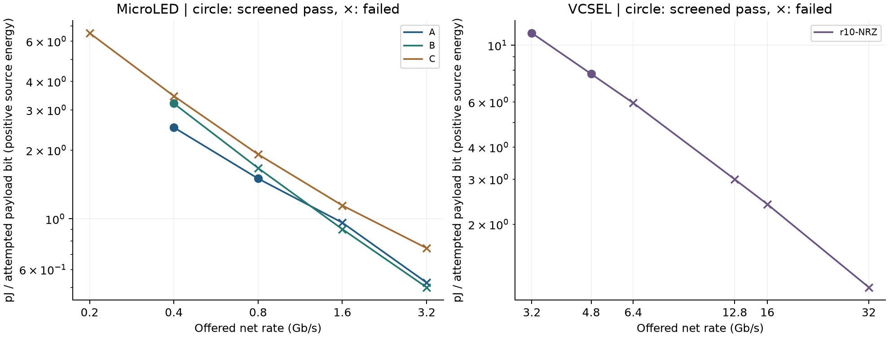
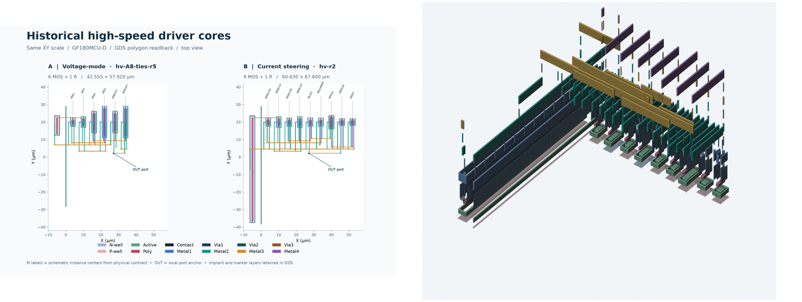

# MicroLED 与 VCSEL Driver
阶段技术成果报告

阶段总结 · 实验性研发方法验证与教学

本项目已建立从数字控制、参考源、晶体管驱动到版图寄生与接收判决的可追溯研究平台。本轮增加蓝光器件调查、低速至高速的真实网表扫描，以及按负载和证据层级进行的阶段复盘。

> 核心结论：蓝光 MicroLED 和蓝光 VCSEL 都有公开器件证据。短波长不会自动带来更高的调制速度。当前 3.2 Gb/s 与 32 Gb/s 是研发目标；现有电路的可用范围必须由逐点验证界定。

### 本轮最高已测试通过点

| 冻结电路 | 训练／验证零错 | 完整研究筛查 |
|---|---|---|
| A | 1.6 Gb/s | 0.8 Gb/s |
| B | 0.8 Gb/s | 0.4 Gb/s |
| C | 0.4 Gb/s | 未检出 |
| VCSEL r10 | 6.4 Gb/s | 4.8 Gb/s |

上表限于本报告的 TT、固定参考负载、固定接收器与指定扫速网格。完整筛查还要求幅度、归一化时间、端压、体结与静态模型域满足条件。零错来自 4,096 位验证段，尚不能视为真实链路 BER。

### 建议的研发方向

以本轮通过边界建立低速回归基线，再改实际预驱动与换流输出。MicroLED 保留 A/B/C 比较，先前 B 的理想旁路优势须与真实电路扫速结果区分；VCSEL 单独推进低摆幅高速路径。蓝光器件建立独立数据卡，850 nm 器件保留为有高速实测依据的参考。

[交互阅读版](index.html) · [蓝光文献细表](literature.html) · [成果核查](stage-audit.html) · [数据与复现](reproduce.html)

# 01 目前做到了什么

研究与验证 · 2026-11-10

| 层级 | 已完成的内容 | 证据边界 |
|---|---|---|
| 显示／照明 | 单像素 100 µA、8 bit PWM；受控启动、独立保护、参考源补偿；实际模拟宏 PEX 回归 | 尚无 mA 可调范围、1 MHz PWM 载波或阵列光均匀性实测 |
| 高速晶体管 | MicroLED A/B/C 与 VCSEL r10；真实参考／供电；PVT、寄生、错误定位及本轮扫速 | 动态负载部分为假设，未有光链路硬件与噪声 BER |
| 物理实现 | 显示宏及共同顶层；历史高速 A/B 核心 DRC、LVS、PEX 与 GDS | 新完整高速电路尚无对应新版图 PEX |
| 工程资产 | 公开网表、RTL、脚本、文献台账、原生波形、源哈希、2D／Blender 教学模型 | 研究交付包尚不等于代工签核包或硅片验证 |

### 本轮新增了什么

完成 18 个新增晶体管瞬态点，复用 11 个校验哈希的历史点，共 29 行分析记录。每个新速率都改变输入 PWL 的实际位周期并重新运行 ngspice；对照使用同一训练和独立验证规则。保留“零错但余量不够”与“应力失败”的区别。

> 历史资料中的“第一阶段完成”只适用于当时定义的实验范围。显示宏、完整高速芯片、硅片和光链路仍分别验收。

[逐项审计及原始 JSON](stage-audit.html) · [历史专业报告](../project-progress-review-20261108/index.html)

# 02 蓝光器件有哪些可研究选择

研究与验证 · 2026-11-10

| 类别 | 公开事实 | 当前可用于什么判断 |
|---|---|---|
| 蓝光 MicroLED | Aledia 资料有 3.5 × 3.5 µm 蓝光芯片，内部有源尺寸另计；QubeDot 提供可定制波长与尺寸的器件／系统 | 可作为询样和规格定义入口。库存、交期未核实，也没有本项目的多 Gb/s 通信保证 |
| 蓝紫光 MicroLED | Pezeshki 2025 外部 50 Ω 测试平台报告 10 Gb/s NRZ、约 10⁻¹⁰ BER；图中光谱峰值约 425 nm | 研究样品＋外部均衡。不能直接继承到现有 ASIC、450 nm 或某固定 20 µm 型号 |
| 蓝光 VCSEL | 日亚官方 2025 展示 442 nm、1 mW，明确标记 prototype | 确认技术存在；该资料未提供可直接设计 32 Gb/s 链路的 L–I–V／S 参数／BER 规格 |
| 蓝紫光 VCSEL | 419 nm 非极性 InGaN/GaN 研究报告 1 GHz；作者学位论文 Fig.11 说明测试受 APD 带宽限制 | 可以指导结构研究。1 GHz 不是该器件已确定的物理上限；学位论文原图尚未目视复核 |
| 近红外 VCSEL | 850 nm 器件在 9 mA 时 >35 GHz；106.25 GBd PAM4 对应 212.5 Gb/s 线路位，光眼含 TX FIR／RX FFE | 有高速研究依据；线路位率须与净率区分，现有 GF180 电路尚未达到这些值 |

蓝光边发射激光器（edge-emitting laser）、VCSEL 和 MicroLED 是不同器件。采购目录中的“blue laser”必须进一步核对出光方向、腔型和调制规格。

[官方产品与论文逐项索引、条件及复用状态](literature.html) · [日亚原型原文](https://www.nichia.co.jp/en/newsroom/2025/2025_061801.html)

# 03 波长与响应速度不是同一个量

研究与验证 · 2026-11-10

光载波频率由 f光 = c/λ 决定。450 nm 对应约 666 THz，850 nm 对应约 353 THz。Driver 改变的是光功率包络，包络的调制带宽通常按 MHz 或 GHz 评价。光学振荡更快，并不意味着注入电荷和光功率也能更快建立。

| 器件／环节 | 决定动态的关键因素 |
|---|---|
| MicroLED | 电气 RC、差分复合寿命、量子阱极化场与波函数重叠、电流密度、侧壁及温升 |
| VCSEL | 阈值与偏置、微分增益、光子寿命、弛豫频率和阻尼、寄生及热限制 |
| 整个链路 | 门极驱动、输出换流、光路损耗、PD 响应度、TIA、时钟和均衡 |

单极点近似 f₋₃dB ≈ 1/(2π τ)，100 ps 对应约 1.59 GHz，25 ps 对应约 6.37 GHz。这是教学计算，不能直接换算为最高数据率。多级串联、振铃和非线性条件下须用完整响应。较短波长每个光子的能量更高，也不能单独推出更低 pJ/bit；还需计入 PD 响应度、耦合和噪声。

# 04 尺寸、颜色与最高数据率

研究与验证 · 2026-11-10

在这组样品中，10 µm 蓝光器件最大带宽为 360 MHz，高于 20 µm 的 332 MHz；20 µm 的最高 OOK 速率却为 1.032 Gb/s，高于 10 µm 的 0.890 Gb/s。20 µm 紫光器件为 313 MHz、1.347 Gb/s。光功率和信噪比会改变速率排序。两组衬底不同，不能归因为波长的单独影响，也不能把 FEC 门槛下的线路位率视为无错净吞吐。

### Driver 应如何配合尺寸

先区分台面尺寸、注入口径和实际发光面积。固定电流密度 J 比较几何效应，再固定接收 OMA／可靠性目标比较系统能耗。正方形 10／20／40 µm 在 100 µA 下分别为 100／25／6.25 A/cm²。减小尺寸会改变电容、光功率、侧壁损失与热密度，不能只把 C 按面积缩放后宣称已得到新器件模型。

另有 5 µm 直径蓝光 GaN 研究报告 2.75 GHz、15 kA/cm²，圆形面积换算电流约 2.95 mA。该工艺及偏置不同于本项目。当前核查至作者机构摘要，晶向与系统净速率未确认，不能归类为非极性器件。

[Dai 原文与条件](https://doi.org/10.3788/COL202523.082501) · [5 µm 蓝光论文 DOI](https://doi.org/10.1109/LED.2026.3745737) · [逐项核查边界](literature.html)

# 05 MicroLED 三条驱动路线

研究与验证 · 2026-11-10

| 路线 | 信号如何变成光电流 | 改善方向 |
|---|---|---|
| A 电压驱动 NRZ | 在两条稳压轨之间切换阴极，依二极管 I–V 得到 25／100 µA 目标 | 轨阻抗、推挽尺寸、Vf 温漂、充放电路径与过冲 |
| B 电流转向 NRZ | 基准支路设低位；调制电流经差分开关流向 LED 或 dummy | 对称门驱、主动放电、dummy 匹配、合规电压与静态耗电 |
| C 电流 DAC PAM4 | 两位译码为三个单元电流，得到 25／50／75／100 µA 目标 | 译码偏斜、支路匹配、三只眼的线性与瞬态；同净率符号率减半 |

这些电流是名义目标，瞬态需看波形。20 µm 正方形面积下，25／100 µA 仅约 6.25／25 A/cm²，不能直接套用高电流密度论文的 GHz 带宽。当前静态 I–V 来自黄光器件，结电容、光极点及封装仍是条件化假设。

[A 电路](../fair-driver-comparison-20261025/figures/a-core.svg) · [C 电路](../fair-driver-comparison-20261025/figures/c-overview.svg) · [负载模型卡](../../../analog/models/microled_dynamic_v1/model-card.json)

# 06 VCSEL 要把偏置与高速调制分开

研究与验证 · 2026-11-10

低位电流 I0 由偏置支路建立，高位 I1 = I0 + Imod。选择低位接近或高于激光阈值，有助于减少跨阈值开启延迟，同时增加静态耗电和低位光功率。本项目 r10 名义采用 3／7 mA。

高速路径是输入差分接收、预驱动、换流 MOS、光源与回流。慢速路径是偏置／调制设定、温度补偿、稳压、启动和保护。慢反馈环不需要追逐每一位数据，但电源阻抗必须支持高速电流。

> 当前负载是 850 nm 图读代理，不能替代蓝光 VCSEL。蓝光器件需重新取得 Ith、Vf、斜率效率、S 参数、温度和绝对最大电流；只改波长参数没有物理依据。

[r10 详细电路与验证](../vcsel-reference-microled-dynamics-20261029/index.html) · [十倍目标诊断](../highspeed-workbench-20261110/bit-errors.html#vcsel)

# 07 如何测出当前设计的速度边界

研究与验证 · 2026-11-10

| 控制变量 | 本轮合同 |
|---|---|
| 码流与开销 | 研究帧 4,736 线路位、4,096 payload 位，效率 32/37。净 3.2／32 Gb/s 对应线路 3.7／37 Gb/s；尚未实现 FEC／重传协议 |
| 接收器 | MicroLED 固定 200 ps 光极点＋1 GHz RX；VCSEL 固定原 850 nm 光响应＋5 GHz RX |
| 训练与验证 | 仅训练段选择一次相位；验证段固定。扫 0～8 个线路 bit UI，1/64 UI 网格 |
| 通过门槛 | 训练及验证零错；幅度 ≥7.5 µAeq；单侧时间 ≥0.37 线路 bit UI；器件应力与模型电流域另检 |
| 数值控制 | 每个新速率运行原生 ngspice；边界附近将步长减半对照。历史锚点校验压缩与原生 SHA 后复用 |

同净速率下 A/B/C 使用相同绝对时间门槛，避免因 PAM4 符号较长就给予两倍宽松条件。0.37 bit UI 在净 3.2 Gb/s 为 100 ps，在净 32 Gb/s 为 10 ps。这是项目研究筛查预算，尚未由真实抖动／CDR／BER 要求分配。

共 5 组半步长对照，综合通过／失败判断保持一致 5/5。最大绝对幅度变化 0.0075 µAeq，最大时间变化 0.247 ps，正向能量相对变化最大 0.0036%。

> “最高已通过测试点”只是扫描网格上的结果。还要报告下一失败点、是否单调，以及负载／温度／接收条件。本轮从已建立的 DC 工作点起算，不含上电过程和启动能量；无噪声短帧不能证明量产保证速率。

[本轮完整条件与逐点记录](../../../evidence/blue-emitter-speed-review-20261110/speed-sweep-all.json)

# 08 MicroLED 从低速到目标点

研究与验证 · 2026-11-10

| 净 Gb/s | A 错误位 | B 错误位 | C 错误位 | A／B／C 综合 |
|---|---|---|---|---|
| 0.2 | 未测 | 未测 | 0 | 未测/未测/失败 |
| 0.4 | 0 | 0 | 0 | 通过/通过/失败 |
| 0.8 | 0 | 0 | 193 | 通过/失败/失败 |
| 1.6 | 0 | 637 | 969 | 失败/失败/失败 |
| 3.2 | 846 | 1,440 | 1,399 | 失败/失败/失败 |

每点验证 4,096 位；负载 200 fF，光极点 200 ps，RX 1 GHz，MOS 为 TT 27°C。未测组合不补算，不按曲线插值。

A 最高已通过 0.8 Gb/s；下一已测失效 1.6 Gb/s。B 最高已通过 0.4 Gb/s；下一已测失效 0.8 Gb/s。C 所测网格未通过。

> B 在净 0.8 Gb/s 虽为零错，最小幅度仅 0.734 µAeq，时间 0.098 bit UI。用“有没有错误”单独作选择会遗漏明显的脆弱工作点。

净 3.2 Gb/s 下 A 本轮为 846 错；旧报告为 844。原生波形相同，差异来自统一后的训练延迟窗与选相规则，并非电路性能变化。

# 09 波形如何解释“零错但余量不足”

研究与验证 · 2026-11-10

从左到右提升速率，上一位的电荷和光响应留下更长的相对尾迹；输出尚未充分到达预期电平，就进入下一次判决。四个图的验证位计数都为零错，但右侧最差样本已经明显靠近阈值。

幅度余量是样本离其正确判决边界的最短距离；时间余量是采样点到相邻错误判决区的最短时间。实际噪声、供电扰动或抖动都可能消耗这些余量，因此需要同时保留两项预算。图中的局部片段用于解释最差幅度，最差时间可能出现在另一位。

[绘图抽样 CSV](../../../evidence/blue-emitter-speed-review-20261110/waveform-excerpt.csv) · [完整帧分析](../../../evidence/blue-emitter-speed-review-20261110/speed-sweep-all.json)

# 10 负载极限与当前失败机制

研究与验证 · 2026-11-10

| B 的 C / fF | 净速率 Gb/s | 错误位／4,096 | 幅度 µAeq |
|---|---|---|---|
| 0 | 3.2 | 773 | -13.19 |
| 10 | 3.2 | 889 | -16.07 |
| 50 | 3.2 | 1131 | -22.22 |
| 200 | 3.2 | 1440 | -29.04 |
| 800 | 3.2 | 1807 | -29.74 |

上表只改变并联电容；光极点 200 ps、RX 1 GHz、目标电流、封装 R/L 与原电路保持不变。即使设置理想 0 fF，仍有错误。单纯缩小结电容无法消除目前全部瓶颈。

> 在净 0.4 Gb/s 下，B 的 200 fF 已通过；改为 800 fF 后，错误 368/4,096，幅度 -14.21 µAeq，单侧时间 0.000 bit UI，综合筛查失败。这两个离散点定义测试边界，尚未确定连续的最大电容。

### “最大负载”是多维条件

电容只是其中一个变量。输出需提供导电电流和充电电流：I端口 = I导电 + C × d(VA−VK)/dt。200 fF 跨越约 0.407 V 需约 81 fC；若在 135 ps 内完成，净充放电电流约 0.60 mA，已大于原 25／100 µA 静态目标。该估算用于找瞬态预算，不能替代实际电路。

### C 还有独立于接收的译码应力问题

C 在净 0.2 Gb/s 可通过接收余量，但译码内部仍有体结正偏。NOR2 的 P_OR 相对 VDD 正冲约 0.858 V，对应 XORPA 漏结／XORPB 源结；N_OR 负冲约 −0.604 V。固定 20 ps 边沿下，降速没有消除。先导出内部波形和体结电流，再验证耦合、节点放电与输入阻尼；现有峰值无法确定持续时间或唯一原因。

R、L、电流、温度未被本轮全面扫描，因此不发布通用 Cmax。体结 0.3 V 是项目研究筛查线，尚非器件已发生击穿的证明。[译码应力审计](stage-audit.html)

# 11 VCSEL 的可用范围与十倍目标

研究与验证 · 2026-11-10

| 净 Gb/s | 错误位 | 幅度 µAeq | 时间 ps | E+ pJ/尝试位 | 综合 |
|---|---|---|---|---|---|
| 3.2 | 0 | 34.10 | 130.65 | 11.162 | 通过 |
| 4.8 | 0 | 31.12 | 80.11 | 7.728 | 通过 |
| 6.4 | 0 | 28.65 | 46.42 | 5.952 | 失败 |
| 12.8 | 947 | -36.40 | 0.00 | 2.996 | 失败 |
| 16 | 1,070 | -37.23 | 0.00 | 2.395 | 失败 |
| 32 | 1,462 | -41.06 | 0.00 | 1.134 | 失败 |

冻结 r10，TT 25°C，150 fF、0.5 Ω／0.2 nH、850 nm 光响应、5 GHz RX、20 ps 输入边沿。幅度是按该模型 3／7 mA 光功率映射的等效量，不能和 MicroLED 的绝对光功率排序。

最高已通过 4.8 Gb/s；下一已测失效 6.4 Gb/s。净 32 Gb/s 对应 37 GBd NRZ，UI 仅 27.03 ps。现有预驱动在该条件下丢失短脉冲，门极极性错误为 1,622 位，完整接收为 1,462 位。

旧理想门极旁路使导电电流零错，但仅约 1.03 µAeq／1.68 ps 余量，电流达到 1.696～9.548 mA，dummy 管端压 3.868 V 超过 3.63 V 研究筛查线。需同时改预驱动、换流与负载。[公开 40 Gb/s NRZ 全链路](https://ieeexplore.ieee.org/document/8527238/)支持长期目标有实物先例，当前网表仍需逐档迭代。

# 12 能耗、错误与技术主线选择

研究与验证 · 2026-11-10

### 相同净 0.4 Gb/s 的实际实现

| 路线 | E+ pJ/尝试位 | 平均源功率 mW | 错误位 | 综合 |
|---|---|---|---|---|
| A | 2.514 | 1.006 | 0 | 通过 |
| B | 3.201 | 1.280 | 0 | 通过 |
| C | 3.452 | 1.381 | 0 | 失败 |

能量按当前七个电源／激励端口的正向交付积分，完整 4,736 位帧除以 4,096 payload。另存扣除回灌后的 E净。未包含实际输入 PHY／时钟和光接收器内部功耗。上电过程不在本次数据帧窗口内。

当前冻结条件下 A 在 0.4 Gb/s 的源端能量低于 B，并有较高的已验证速度边界。因此下一轮以 A 作实际性能基线更有依据，同时用 B 的门极／换流改版验证低寄生条件下的潜力；C 保留多电平探索。先前“B 优先”应限于改善机理实验，不能表达成当前成熟度领先。

> 正式选择要先满足相同净吞吐、误码／余量、应力和模型可信度，再比较完整链路 pJ/有效位。零错短帧与失败帧的低 pJ 都不足以单独确定最终架构。

# 13 显示 PWM 成果与下一档规格

研究与验证 · 2026-11-10

| 项目 | 已有验证 | 尚未完成 |
|---|---|---|
| 恒流 | 100 µA 设定；名义 99.7335 µA；144 点误差 −4.436%～+1.985% | 0.15～7.33 mA 可编程电流、统计失配与阵列校准 |
| PWM | 1 MHz clock，256 时间槽；载波 3.90625 kHz；最短槽 1 µs | 1 MHz PWM 载波／8 bit 时需 256 MHz clock 与 3.90625 ns 槽 |
| 恢复与保护 | 选定扰动最大偏离 8.873%，最长恢复 2.520 µs；TT 停钟约 205.78 ns 达安全条件 | 任意上电顺序、自主 POR、欠压互锁、全部故障角 |
| 低码积分 | 1 µs 脉冲 99.6333 pC，相对同网络 DC 积分误差 −0.1005% | 高频低码电荷、绝对光灰度、温升和寿命 |

参考目标约为 0.5 V / 5 kΩ = 100 µA。实现依赖外部基准、规定启动顺序和 FAULT／PERMIT。最终片外补偿与滤波必须在共同顶层接口合同中保持一致。

扩到 2.5 mA 和 7.33 mA 分别是现设定的 25 倍和 73.3 倍。需重新验证输出 MOS、参考比例、头间电压、限流、金属电流密度、供电压降及热。阵列还增加同步切换、分布式 IR drop、失配、坏点和校准存储。

[PWM 最终摘要](../../../evidence/pwm-reference-v2/20261024/final-summary.json) · [数字合同](../../pwm.md)

# 14 版图、材料与可视化成果

研究与验证 · 2026-11-10

| 已有物理对象 | 当前范围 |
|---|---|
| 显示 r5 模拟宏 | 39 MOS；345 R／288 C；29/29 网络。实际 DRC/LVS/PEX 与开短路负控制 |
| 显示共同顶层 | 916 × 204 µm 占据范围；7,277 MOS；36,588 R／30,230 C。完整顶层瞬态通过状态仍为空 |
| 高速历史核心 | A 6 MOS＋1 R，B 9 MOS＋1 R；新完整 A/B/C 20/21/49 MOS 与 r10 73 MOS 需重新布局 |

公开 GF180MCU D 配置有五层金属；旧高速核心实际使用至 M4。Driver 用硅工艺，InGaN/GaN 发光层或 GaAs 系 VCSEL 可通过倒装、转印或短互连组装。工艺选择依据速度、耐压、模型、ESD、热与制造条件，不能由“蓝光”直接推出特殊 MOS 材料。

[可交互 2D／3D 与可编辑 Blender](../highspeed-workbench-20261110/physical/index.html) · [逐层 PWM 动画](../blender-pwm-animation-20261018/index.html)

# 15 从研究电路到可送样芯片

研究与验证 · 2026-11-10

| 阶段 | 应交付的数据与检查 | 当前状态 |
|---|---|---|
| 需求与模型 | I0/I1、数据率、眼图、误码目标、保护、温度、供电、封装与绝对最大值 | 有研究合同，部分器件动态未校准 |
| 电路闭合 | DC/AC/瞬态、噪声、PVT、失配、启动、故障、功耗、环路稳定性 | 有指定范围结果，仍有速率与应力失败 |
| 新版本物理闭合 | 匹配网表的 GDS、DRC/LVS/ERC、PEX 后回归、密度、天线、EM/IR | 旧对象有证据，新高速完整芯片待做 |
| 封装和装配 | die drawing、pad/bump 坐标、bond map、光轴与热路径、公差及测试夹具 | 已有设计方法，尚未供应商闭合 |
| 代工与测试 | 认可 PDK／rule deck、层映射、顶层、版本哈希、waiver、MPW／订单规格、探针与测试规程 | 未流片，未完成代工签核或实测 |

开源环境能够完成现有研究级网表、数字时序、版图和寄生验证。高速封装／电源的三维电磁分析、完整光器件 TCAD 和代工接受的可靠性签核，需要相应模型、求解器与服务商规则。Blender 表达几何和工艺层关系，不能输出这些物理签核结论。

> 给晶圆厂的核心是符合其接受条件的版图与完整交付说明。只提交电路图、三维动画或孤立 GDS，无法保证芯片做出来能用。

[制造交付详细清单](../highspeed-workbench-20261110/fabrication.html)

# 16 下一步研发方向与决策门槛

研究与验证 · 2026-11-10

### 一 · 把可用速度和真实器件绑定

保留本轮低速通过点为回归基准。给蓝光 MicroLED、蓝光 VCSEL、850 nm VCSEL 分别建立器件数据卡，至少涵盖 L–I–V、偏置／温度下的复数 S11/S21、封装参考面和绝对光功率。缺少数据的参数继续扫范围，不把最佳假设当作名义规格。

### 二 · 改真实门驱和换流路径

MicroLED 以 A 作当前低速基线，成对比较 A 的推挽／轨阻抗优化与 B 的对称门驱、受控充放电、dummy 匹配。C 先定位并修复译码内部体结正偏，再验证三只眼。B 的理想旁路说明改善空间，不能替代实际能力排序。VCSEL 独立验证低摆幅差分预驱动、匹配输出与阻尼，保留慢速偏置和保护，逐档向 32 Gb/s 推进。

### 三 · 通过电气门槛后再投入新 PEX

先在相同负载、目标电流、接收器与能源边界下达到零错、幅度／时序与应力门槛，再做限制性 PVT、供电、元件容差和封装回归。合格版本重做完整高速核心版图，加入 PAD/ESD 和封装后复测边界。

| 决定事项 | 触发条件 |
|---|---|
| 选择主线 | 同净吞吐和可靠性目标都满足后，比较总功耗、有效位能量、面积、工艺可得性与模型可信度 |
| 换工艺／架构 | 真实门驱或输出级在合理尺寸、负载和应力范围仍不能满足预算；用同合同对照更快 CMOS／RF 工艺或另一调制路线 |
| 扩阵列 | 单通道在加入实际寄生后通过，再量化公共偏置、同步开关、光串扰、热、良率和校准成本 |

> 当前阶段的主要价值是把“为何失败、怎样改善、何时选择”转化为可复算的工程证据。技术主线由共同门槛下的结果决定，不能仅按失败帧的错误数量或 pJ/bit 排名。

# 17 证据索引与复现入口

研究与验证 · 2026-11-10

正文的新数值直接读取 speed-sweep-all.json；逐点记录含网表、波形、结果与分析源的 SHA-256。原始数据保存在 build，紧凑证据保存在 evidence。公开来源的许可与条件逐项保存在 sources.json，未获再发布许可的原图保留在本地研究目录。

| 内容 | 索引 |
|---|---|
| 本轮真实扫速 | [逐点 JSON](../../../evidence/blue-emitter-speed-review-20261110/speed-sweep-all.json) · [运行与恢复说明](reproduce.html) |
| 蓝光器件资料 | [论文／产品细表](literature.html) · [来源台账](../../../evidence/blue-emitter-speed-review-20261110/sources.json) |
| 当前成果审计 | [按证据层逐项核查](stage-audit.html) |
| 旧高速证据 | [冻结网表复跑](../highspeed-workbench-20261110/index.html) · [位错和32 Gb/s诊断](../highspeed-workbench-20261110/bit-errors.html) |
| 静态／动态模型 | [MicroLED 模型卡](../../../analog/models/microled_dynamic_v1/model-card.json) · [VCSEL 参考源研究](../vcsel-reference-microled-dynamics-20261029/index.html) |
| 物理工作台 | [真实 GDS／Blender](../highspeed-workbench-20261110/physical/index.html) · [制造准备](../highspeed-workbench-20261110/fabrication.html) |

### 阅读本报告时保留的三个限定

第一，扫速得到的是指定模型与接收器下的电路边界，尚非蓝光器件的实测最高速率。第二，零错短帧不是 BER 认证；没有随机噪声、抖动与统计样本，就不能声称真实 10⁻¹² BER。第三，旧版图与新电路分别验收，新电路的低速通过也不会自动转化为可流片产品。

版本日期 2026-11-10。历史证据保留原日期和条件。本轮没有硬件测试、流片、光器件实测或新完整高速版图签核。
