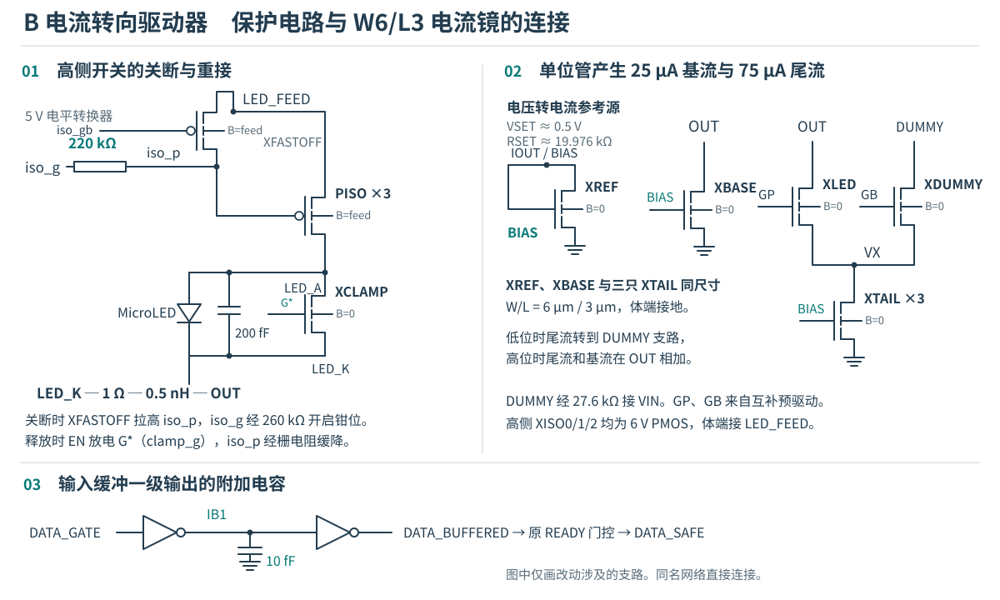
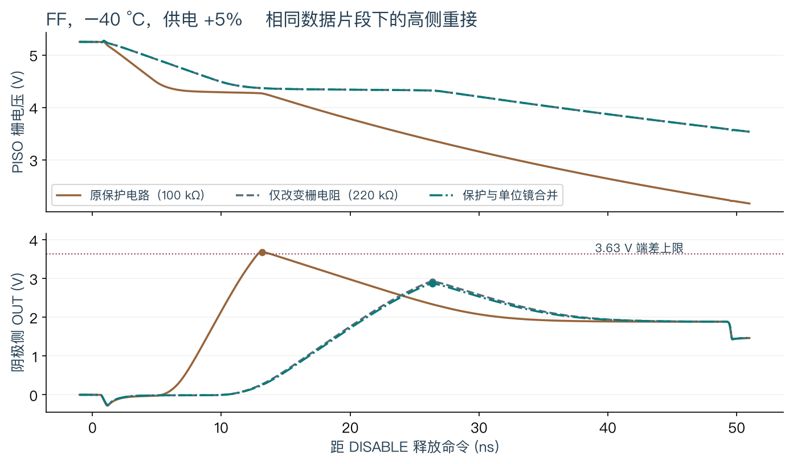
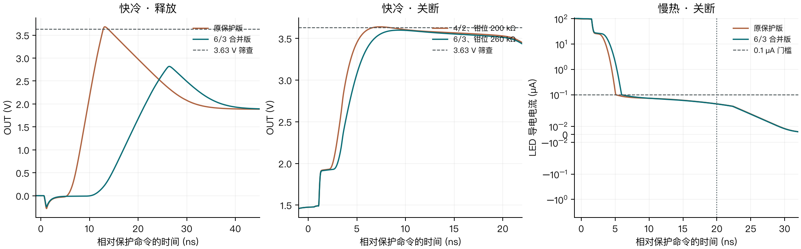
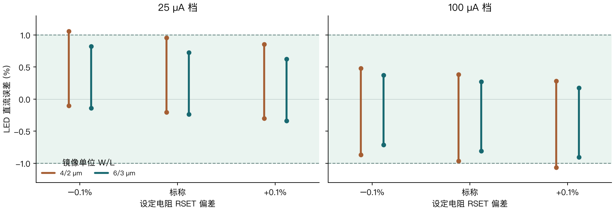
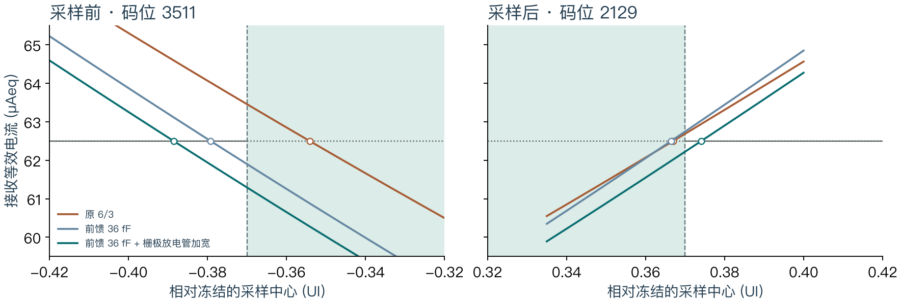
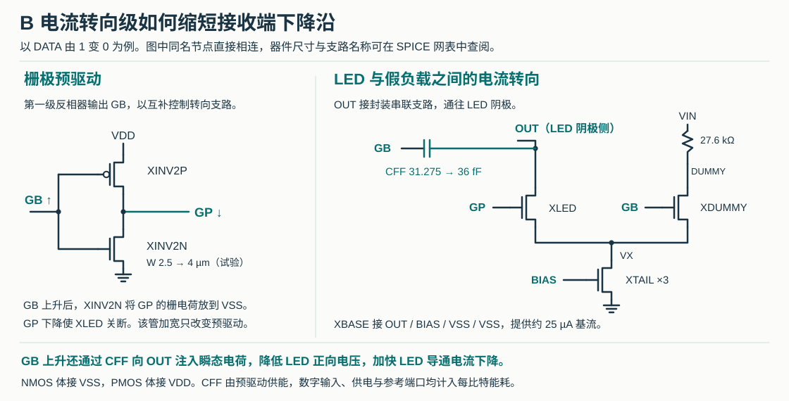
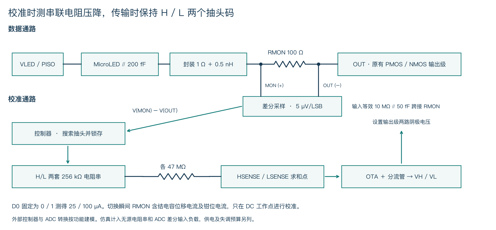
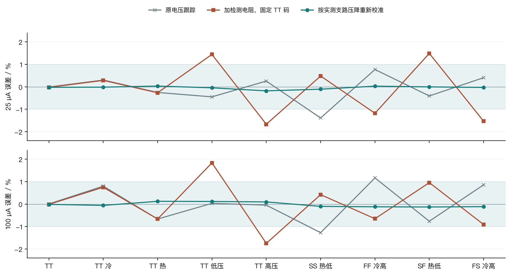
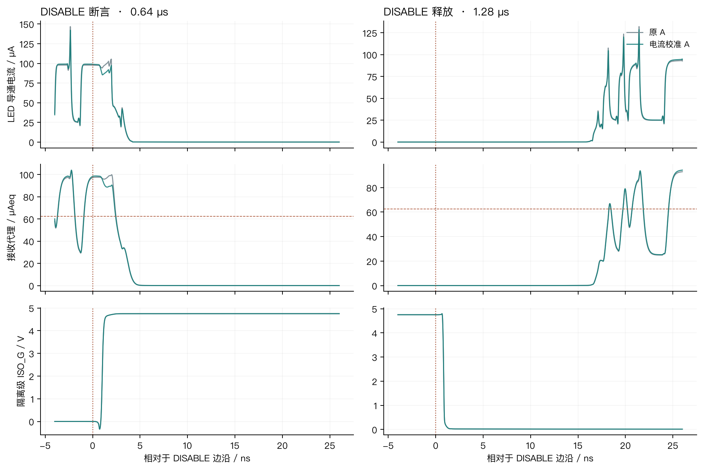
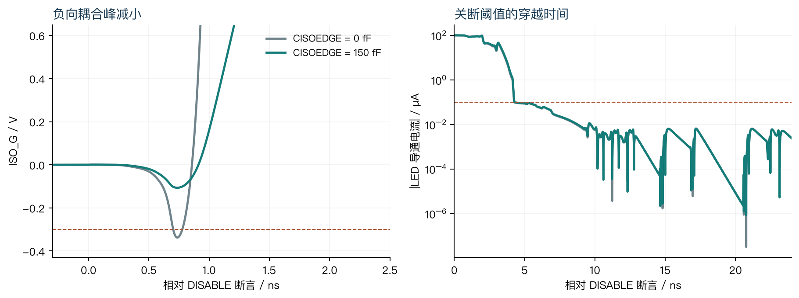

# 高速 MicroLED 驱动器的重接保护与电流精度

2026 年 11 月 18–19 日 · 单通道电流转向 B 与电压驱动 A · GF180MCU 原理图级实验

**研究问题**　驱动器从保护状态回到工作状态时，能否既守住 MOS 端间电压，又把单像素高电平电流保持在 99–101 µA？A 能否通过测量 LED 支路电流补偿电压驱动的误差？

**B 已把精度与保护做到同一电路中。** 46 MOS 电流转向驱动器在本轮 270 个直流点中均达到两档 ±1%，包括 45 个温压与工艺组合、3 个设定电阻取值、2 档电流。其中 100 µA 档为 99.093–100.373 µA。快冷完整故障序列通过端压筛查。慢热完整恢复帧仍有可用眼宽，原步长和半步长两次仿真均比门槛多约 2.21 ps。正常典型帧能耗从 1.116 升至 1.191 pJ/bit。

**A 的电流取样有效，慢热接收仍需改进。** 在每一工况用实际检测压降重做两点校准，100 µA 档最大误差从 1.270% 降到 0.129%。在保护电平转换器上增加 150 fF 又把慢热最坏体结正偏从 0.338 V 降到 0.224 V。相同完整帧的接收时间余量仍约 128 ps。

**验证边界**　两种电路沿用同一组 20 µm 黄光 MicroLED 静态 I–V，模型内并联 200 fF 结电容，封装串联 1 Ω 和 0.5 nH。光强用 200 ps 一阶响应近似，接收端用 1 GHz 一阶低通。单通道净速率固定为 1.6 Gb/s，用于与上版逐项对照。项目的 3.2 Gb/s 目标仍需单独验证。温度作用于工艺器件，LED 的电光温度依赖、硅片和实测误码率仍待测量。[上一版工艺角与保护报告](../driver-pvt-20261117/index.html) · [负载模型与公开数据](../microled-dynamic-validation-20261108/README.md)

**怎样读表**　每帧有 4736 个线路位，其中 4096 个是有效载荷。净 1.6 Gb/s 对应线路 UI 540.54 ps。接收通过要求训练与有效载荷均无观察错、最差幅度余量至少 7.5 µAeq、单侧时间余量至少 0.37 UI（200 ps）。µAeq 是接收模型折算到电流的单位。能耗 E+ 积分所有七个电源与命令端口的正向供能，再除以 4096。完整故障测试期间外部数据持续翻转，保护生效期间专门关灭像素，恢复后用完整第二帧评分。

## B 的两条电流路径

正常传输时，LED 阳极经高边 PMOS 接电源。参考放大器调节检测电阻上的压降，建立约 25 µA 的单位参考。与参考管等尺寸的一只镜像管接在 OUT 上，持续吸取基流。另一组并联的三只单位管产生约 75 µA 尾电流。差分开关把尾电流接到 LED 或假负载，因此一个数据位对应约 100 或 25 µA。分流到假负载时，尾电流继续消耗电能。固定电流的误差还受镜像管不同漏压、参考环误差和电阻容差影响。

保护命令到来后，高边开关断开，跨接 LED 的 6 V NMOS 钳位管经独立栅极电阻导通，数据门停止放行。解除保护时钳位先复位，三只高边 PMOS 的共用栅极经 RC 斜坡逐步导通，READY 延迟后才允许 DATA 进入转向开关。可以分别观察高边栅极 ISO_P、LED 阳极、驱动输出 OUT 和逻辑 DATA_SAFE，判断哪条路径先发生变化。

<figure><figcaption>6/3 µm 单位镜、保护通路和数据缓冲的连接。图注明了 PMOS/NMOS 体端，器件与网表使用同名网络。后文单独展开数据边沿补偿。</figcaption></figure>

## B 为什么在快冷重接时过冲

最容易误判的是看到 OUT 上冲就去减慢数据边沿。旧电路在快角、−40 °C、供电 +5% 的短窗里，OUT 峰值出现在释放后 13.16 ns。此时 DATA_SAFE 仍约为 0.09 mV，LED 导电支路约 0.063 µA，封装电流却已有 27.8 µA。当时阳极约 5.207 V，阴极约 3.682 V，正向压降约 1.525 V，处于 LED I–V 的低端延拓区。高边重接引起的阳极电压变化通过结电容耦合到阴极；封装电流同时包含结电容和钳位等支路的贡献。输出基流 NMOS 的漏极直接连到 OUT，源极接地，因此这个峰值也出现在其漏源之间。

只把高边栅极的 RGATE 从 100 kΩ 增至 220 kΩ，保留原钳位和电流镜，同一短窗的峰值从 3.6815 V 降到 2.9184 V，峰值时刻推迟到 26.40 ns。延长重接斜坡减少瞬时位移电流。同一实验中，LED 阳极 10–90% 上升时间由 5.16 ns 延长至 10.92 ns，平均斜率从 0.815 降为 0.385 V/ns。另一处 IB1 的容性耦合抬升发生在数据缓冲器内部，本轮单独增加 10 fF 对地电容，并将这部分充放电计入电源能量。

<figure><figcaption>快冷释放短窗。所有曲线使用相同数据片段并从局部直流工作点初始化。完整故障帧还包含关断边沿和此前的工作历史。</figcaption></figure>

## 关断边沿为什么需要另一只栅极电阻

降低重接速度以后，首次合并电路在相反的关断边沿又出现 3.6395 V。因为高边还没彻底隔离，钳位支路开始导通的时刻同样重要。保持 RGATE 在 220 kΩ，只把钳位栅的 RCLAMP 从 200 kΩ 调到 260 kΩ。在 4/2 µm 单位管版本，快冷完整故障中的全程最坏 OUT 由 3.6395 V 降到 3.5964 V；后者发生在关断边沿。释放后 160 ns 内的峰值约 2.8668 V。最终 6/3 µm 电路的快冷完整序列里，释放峰值进一步降至 2.76590 V，全程最高 OUT 为 3.59763 V，距筛查线 32.37 mV。单报释放窗口会漏掉前者所揭示的关断应力。[逐器件应力与两次边沿数值](../../../evidence/driver-ab-20261118/b_review/final-FF-fault.json)

<figure><figcaption>左图看高边重接，中图看钳位与高边切换的相对时序，右图看保护断言 20 ns 后 LED 支路电流。6/3 合并版在这组短窗中使用 31.275 fF 数据前馈。</figcaption></figure>

## B 的 100 µA 档能留下多少制造余量

参考设定约为 0.5 V，校准电阻 19.976 kΩ。理想单位电流约 25.03 µA。以前使用的一只尾管与参考管几何不同。采用四个输出单位（一个基流加三个尾流），并让五个镜像器件含参考管保持相同 W/L，可以减少镜像比对几何差异的敏感性。即使 W/L 相同，参考管与输出管的漏源电压仍不同。

在原九点之外，交叉检查五个 MOS 角、三档温度和三档供电的全部 45 个组合。每组又把设定电阻独立改变 −0.1%、0、+0.1%，分别测两档。每种电路共 270 次直流求解。固定 4/2 µm 单位管时，标称电阻的 100 µA 档在 45 点均通过，但电阻增加 0.1% 时，慢热低压降到 98.936 µA。电阻降低 0.1% 时，快冷高压的低档升到 25.264 µA，也出了 ±1% 窗口。

保持五只镜像管相同尺寸与相同 W/L 比，一起把 W/L 从 4/2 增至 6/3 µm。较长沟道有助于减小不同漏压产生的镜像误差；保持 W/L 比使一阶模型中的跨导参数 μCox·W/L 基本不变。实际收益由以下网表结果给出。五只管的几何栅面积之和从 40 增至 90 µm²，新增 50 µm²。完整单元还需扩散、间距、隔离及连线，额外电容对速度的影响由下一节整帧检验。

| 电路与设定电阻 | 25 µA 档范围（µA） | 100 µA 档范围（µA） | 合格点 |
|---|---:|---:|---:|
| 4/2，标称 RSET，45 个组合 | 24.949–25.239 | 99.033–100.382 | 90/90 |
| 4/2，RSET 三挡合计 | 24.924–25.264 | 98.936–100.481 | 268/270 |
| 6/3，标称 RSET，45 个组合 | 24.940–25.181 | 99.191–100.274 | 90/90 |
| 6/3，RSET 三挡合计 | 24.915–25.206 | 99.093–100.373 | 270/270 |

<figure><figcaption>每根竖线连接 45 个工况中的最小、最大直流误差。绿色区域为允许区间。实线端点是实际模拟点。</figcaption></figure>

最紧的是 100 µA 档的下限，仅余 0.093 µA。三个原有温压点用于比较八组几何；其余 42 个组合用于检查此次尺寸选择。另一组 8/4 µm 在这三个筛选点将最坏误差进一步压到 0.827%，五只管的几何栅面积会增至 160 µm²，尚欠完整动态验证。[4/2 µm 全矩阵](../../../evidence/driver-ab-20261118/b-grid-merged220c10.json) · [6/3 µm 合并版全矩阵](../../../evidence/driver-ab-20261118/b-grid-unit6-r260.json) · [含 36 fF 与加宽预驱动的最终网表复测](../../../evidence/driver-ab-20261118/b-grid-unit6-n4ff36.json) · [尺寸筛选原始数字](../../../evidence/driver-ab-20261118/b-unit-screen.json)

## B 的完整故障、接收与能耗

合并电路首先改变了数据波形。6/3 µm 镜像管在标称电阻下满足精度，但在慢热低压的恢复帧，仅有 191.42 ps 时间余量。4096 位的判决都正确，其中 145 位没有达到 200 ps。136 位的前一个下降沿太晚，另外 9 位的后一个上升沿太早，均发生在接收“0”时。

将 GB 到 OUT 的前馈电容从 31.275 增至 36 fF。当 GB 上升、刚要关小 LED 电流时，这个电容先抬高阴极 OUT，协助减小 LED 正向压差。原来最差的码位 3511，下降沿一侧由 0.3541 改善到 0.3792 UI。但是新的最差码位变成 2129，后一个上升沿过早。仍有 22 位时间余量不足；此时进一步增加对两个边沿都起作用的电容会有风险。

<figure><figcaption>同一恢复帧、同一接收门槛。圆点为接收波形跨过 62.5 µAeq 的位置。颜色区要求无阈值交点。只增前馈时，右图还有交点落在颜色区内；最终版在这两个码位同时越过要求。</figcaption></figure>

保留 36 fF，把 XINV2N 的宽度从 2.5 增至 4 µm。GB 上升时这只 NMOS 给转向管 XLED 的栅极 GP 放电，改变关断边沿以及两次交点相对采样点的位置；相反方向仍由原 PMOS 充电。慢热低压的整帧单侧时间余量提升至 202.21 ps，幅度余量 15.374 µAeq。逐码元验收和故障恢复均通过。

<figure><figcaption>实际节点与 MOS 支路。两项修改分别利用电容耦合和 MOS 栅极充放电，均由原供电端口提供能量。</figcaption></figure>

## B 在同一采样规则下的净收益和代价

旧电路为 44 MOS 保护版；最终合并版含 46 MOS、6/3 µm 单位管、220/260 kΩ 两个栅极电阻、IB1 上的 10 fF、36 fF 前馈和加宽的 XINV2N。每行取一样的负载、同一工况、同一数据帧以及同一种能耗统计。正常首帧和恢复第二帧分别与同类帧对照。

| 工况（旧 → 最终） | 单侧时间（ps） | 幅度余量（µAeq） | E+（pJ/bit） | E+ 变化 |
|---|---:|---:|---:|---:|
| 典型，正常首帧 | 214.82 → 217.13 | 18.53 → 19.27 | 1.1160 → 1.1915 | +6.76% |
| 慢热低压，恢复第二帧 | 221.41 → 202.21 | 16.50 → 15.37 | 1.0285 → 1.1021 | +7.16% |
| 快冷高压，恢复第二帧 | 208.30 → 209.83 | 19.56 → 20.90 | 1.2516 → 1.3323 | +6.45% |

三组的新旧评分帧均为训练零错、载荷 0/4096 错。旧电路在快冷高压超过端压筛查，且慢热低压的 100 µA 档仅 97.455 µA。最终版换得精度和保护余量，同时慢热时间余量减少 19.20 ps。典型首帧的平均正向供能约 1.79 → 1.91 mW。IB1 电容每次由低充到高，供电源提供约 C·V² 的能量；以该帧的 1188 次充电估算，10 fF 一项约占 0.032 pJ/bit。另有单位管、前馈和栅极驱动变化。

| 完整故障帧 | 关断电流最后越线（ns） | 20 ns 后最大电流（µA） | 恢复上界（ns） | 关断窗口正向供能（mW） |
|---|---:|---:|---:|---:|
| 慢热低压，旧 → 最终 | 5.07 → 5.97 | 0.04358 → 0.04285 | 81.00 → 81.04 | 0.880 → 0.939 |
| 快冷高压，旧 → 最终 | 3.83 → 4.61 | 0.00958 → 0.00663 | 60.79 → 55.41 | 1.048 → 1.107 |

关断窗口仍有外部输入翻转，参考与逻辑仍取电。恢复上界要求沿用故障前训练相位，之后至少 1 µs 的采样持续满足幅度与时间门槛。最终版在九组工况的 18 个关断或释放短窗中均通过端压和体结筛查，最小 MOS 端间余量约 29.17 mV。完整接收覆盖表中三组工况及对应的数据帧。最大瞬态步长从每 UI 的 1/40 减至 1/80，重新运行最终版慢热完整故障序列。接收时间为 202.211 → 202.209 ps，E+ 为 1.102095 → 1.102099 pJ/bit，恢复上界仍为 81.039 ns。步长加密支持这次过线结果。约 2.21 ps 的工程余量仍须留给抖动、互连与模型误差。 [逐帧端口能量与净能量](../../../evidence/driver-ab-20261118/matched-frames.json)

## A 如何用实际电流修正电压设定

A 用两条受控阴极电压轨切换电流。LED 工作点附近约 3 mV 的端压偏差就可能改变 1% 的电流。只测电压轨会漏掉高边开关、输出开关和封装上的压降。这次在封装与输出驱动之间串入 100 Ω，采用两端取样，给测量输入并联 10 MΩ 和 50 fF。恒定码元的稳态取样包含 LED 导电电流，高速边沿还包含结电容位移电流。因此校准时先暂停业务并保持码元，再测量两档电流；传输时保持校准码。

<figure><figcaption>两路 8 位无源电阻串的抽头各经 47 MΩ 微调电阻进入原有反馈环。参考源补给电阻串的功率已计入。抽头选择、ADC 及数字搜索由外部校准器建模。</figcaption></figure>

采样电阻在 25 / 100 µA 时产生 2.5 / 10 mV 压降。量化步长 5 µV 对应 0.05 µA，即两档目标的 0.20% / 0.05%。控制器只读取量化后的压差，每档用二分搜索选择电阻串抽头。随后冻结两路码值，用独立 SPICE 导电支路电流核对精度。电阻耗散在两档分别约 0.063 / 1.0 µW；新电阻网络和前置驱动也消耗功率，整帧比较使用全端口积分。

## A 的校准能解决哪些误差

| 策略 | 25 µA 最大绝对误差 | 100 µA 最大绝对误差 | 两档通过数 |
|---|---:|---:|---:|
| 上版电压跟踪驱动 | 1.387% | 1.270% | 15/18 |
| 新取样电路，两个抽头均在中点 | 2.457% | 4.911% | 5/18 |
| 在典型工况校准一次，各工况沿用同一对码 | 1.667% | 1.835% | 11/18 |
| 每个工况停车重测，随后冻结码 | 0.180% | 0.129% | 18/18 |

典型工况两路校准码为 131 / 140，慢热低压为 129 / 138。逐工况重测后，九点低档为 24.955–25.008 µA，高档为 99.871–100.124 µA。另选典型 45 °C、供电 +2%，以及慢角 70 °C、供电 −3.5% 做留出测试。分别沿用最近一次典型或慢热的码值，两档均留在 ±1% 内。温压继续漂移，何时重新校准仍需定义。

慢热低压下，还将检测电阻 ±0.1%、ADC 增益 ±0.1%、偏移 ±10 µV 同向叠加，重新搜索，最大绝对误差为 0.694%。两次极值测试均能调入规格。参考漂移、ADC 噪声、开关电阻和校准等待时间仍需预算。[逐工况精度与留出数据](../../../evidence/driver-ab-20261118/a/dc-summary.json)

<figure><figcaption>同一标定电流下区分无修调、固定校准码、逐工况重新测流。动态接收另用整帧检验。</figcaption></figure>

## A 的接收与保护回归

| 净 1.6 Gb/s，完整帧 | 接收幅度（µAeq） | 单侧时间（ps） | E+（pJ/bit） | 全记录最大体结正偏（V） |
|---|---:|---:|---:|---:|
| 典型，原电路正常首帧 | 18.012 | 214.40 | 1.7865 | 0.105 |
| 典型，电流校准后正常首帧 | 18.021 | 220.51 | 1.8001 | 0.112 |
| 慢热低压，原电路恢复后第二帧 | 7.995 | 131.64 | 1.6504 | 0.338 |
| 同工况，增加电流校准 | 7.276 | 127.60 | 1.6739 | 0.338 |
| 同工况，再给 ISO_G 加 150 fF | 7.281 | 127.59 | 1.6739 | 0.224 |

典型工况下，增加测量和修调后的能耗上升约 0.76%，仍有 20.5 ps 的时间余量超过项目门槛。慢热低压时三个版本的第二帧都能还原全部 4096 位，但时间余量均低于 200 ps。引入校准后，幅度也略低于 7.5 µAeq。按保护前冻结的采样相位，最终版释放后的 7095 个评分位中仍有 1799 位未达到幅度或时间要求，1 µs 恢复未通过。[完整帧配对数据](../../../evidence/driver-ab-20261118/a/dynamic-summary.json)

<figure><figcaption>使用相同的 5.12 µs 故障输入。真正的应用还需为停车校准与外部测量电路计入能耗和停机时间。</figcaption></figure>

## A 的保护失效发生在哪里

关断后约 0.74 ns，电平转换器节点 ISO_G 被电容耦合拉到地电位以下。其 NMOS 体端接地，体结正偏达到 0.338 V。给 ISO_G 加 150 fF 对地电容后，相同局部关断窗的谷值从 −0.338 V 收至 −0.107 V。局部释放时另一处体结峰值由 0.177 升至 0.209 V，仍在 0.30 V 门槛内。将局部仿真最大步长减半，关断窗最坏体结结果约为 0.2261 V。

完整故障回归中，电流最后一次超过 0.1 µA 在断言后 4.264 ns，20 ns 后峰值为 0.00687 µA，最大体结正偏 0.2244 V。加电容前对应为 4.245 ns、0.00687 µA 和 0.3378 V。接收时间余量仍约 128 ps。这个单变量实验把保护瞬态与数据驱动带宽的问题区分开了。

<figure><figcaption>短窗采用相同外部码型，分别绘出关断时的 ISO_G 电压和 LED 电流绝对值。短窗从局部直流初态开始，上段另列完整历史回归结果。</figcaption></figure>

## 研发决策与复现

1. **B 进入寄生验证前，先把 2 ps 的时序预算做实。** 固定本轮 6/3 µm 尺寸和最终驱动，优先提取镜像漏端、GB–OUT 前馈、GP 和高边栅极的寄生。对时钟抖动、输入边沿、ISI 和封装差异分别核算剩余 2.21 ps。还需在更多码型和工况复核，才能上调速率。
2. **B 的 100 µA 规格还需要独立的误差预算。** ±0.1% 设定电阻已测，最接近 99 µA 下限仅差 0.093 µA。下一步同时引入参考漂移、匹配梯度和器件随机失配。布局宜让五只单位管方向一致、走线对称，检查不同漏压对镜像比的影响。
3. **A 把低速精度修调和高速边沿分别设计。** 保留两点测流法，优先补上慢热状态下预驱动、阴极轨输出阻抗与 LED 电流边沿的分级延迟。再确定校准周期、ADC 输入共模/偏置、零点、噪声和实际耗电。此次保护修订可保留为同条件对照。

本轮产出是原理图级、固定光源模型的研究结果。新电路尚需实际版图、DRC/LVS、提取后回归与光学台架测试。本轮数据支持在净 1.6 Gb/s 条件下比较方案；判断芯片速率与误码率还需要独立证据。

工艺矩阵采用 GF180 的典型、快、慢及两个混合 MOS 角。扩展直流矩阵将五角与 −40 / 27 / 85 °C、相对标称 95 / 100 / 105% 供电交叉。A 的 VIN 标称 5 V，B 的 VIN 标称 3.3 V；两者 VDD 标称 3.3 V、VLED 标称 5 V，独立 VREF 固定 2.5 V。MOS 局部失配、LED 温变和参考源漂移需要独立统计或台架数据。对 3.3 V / 6 V 管的端间幅值分别采用 3.63 V / 6.00 V 筛查，体结正偏采用 0.30 V。0.1 µA 以下的关断电流取决于静态 I–V 的低端延拓。[GF180 官方固定角定义](https://gf180mcu-pdk.readthedocs.io/en/latest/analog/model_parameters/LV/LV_2_4.html) · [实验脚本、数据和复现入口](reproduce.html)
