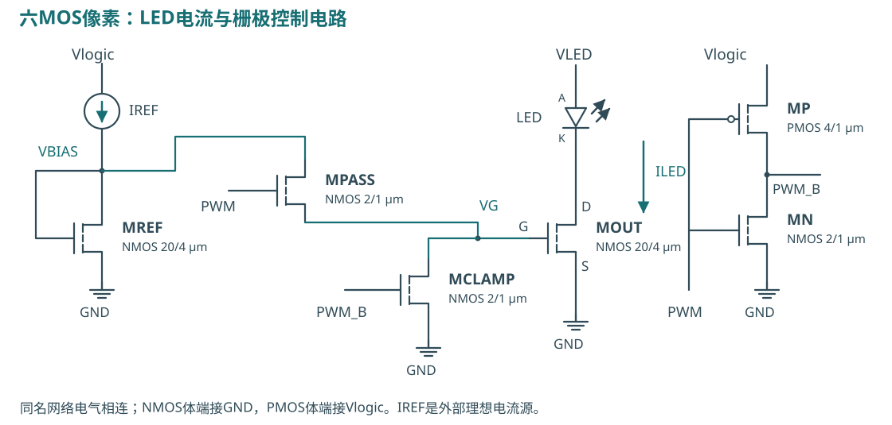
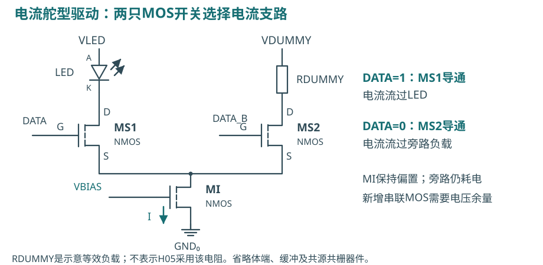
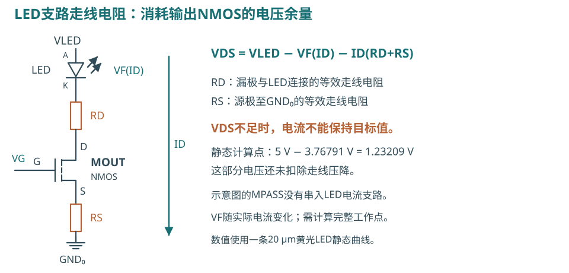
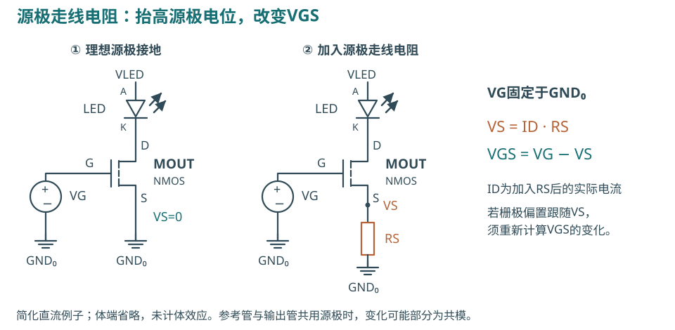
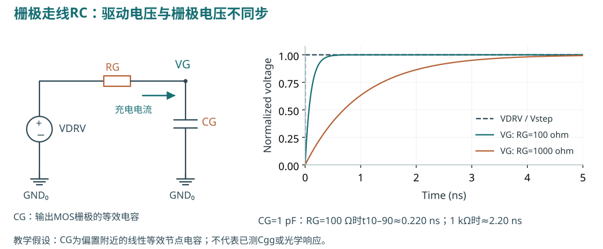
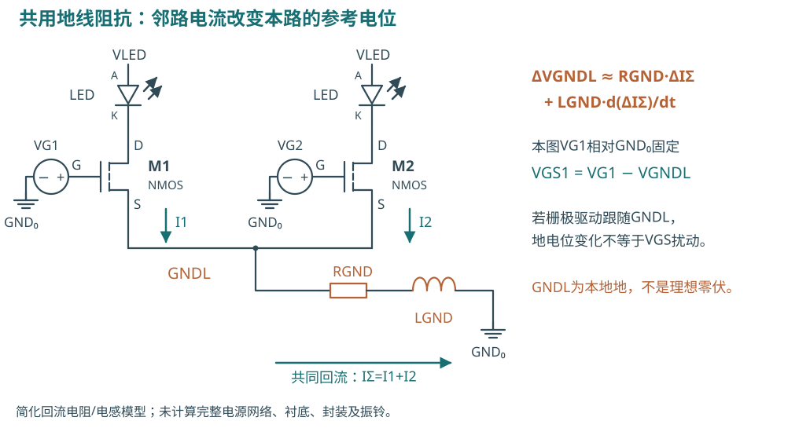

# MicroLED驱动电路的晶体管与布线设计

2026-10-12 · 实验性研发方法验证与教学 · 电路与图示修订版

**研究方向：保持单像素，先实现参考电流源和独立关断电路，再验证电源、地与信号互连寄生，随后比较匹配版图及电流舵电路。** 选择材料和工艺时，应同时考虑器件耐压、输出电流、动态响应和制造条件。

本文使用MOSFET、LED、电阻、电容和接地符号说明电路。重点解释四类问题：源极走线电阻改变栅源电压；漏极走线电阻消耗电压余量；栅极RC延迟开启/关闭；多路共用地线产生电气耦合。

| 阅读顺序 | 主要问题 | 页码 |
| --- | --- | --- |
| 入门 | MOS端子、电流镜及六MOS像素 | 2–3 |
| 电路 | 电流舵、尺寸、耐压和电压余量 | 4–6 |
| 布线 | 源极、栅极、共用地线、匹配与工艺 | 7–11 |
| 研究决策 | 已验证结果、下一步实验和价值 | 12–14 |

**证据类型。** 文献实测来自对应论文；项目仿真采用锁定模型与注明的电路；计算来自公式和明确输入；拟采用的电路/版图需要另行验证。示意图不属于新EDA、芯片或光学测量。

本文选择8篇直接相关研究论文与7条官方/数据来源，共15条，不是穷尽综述或性能排名。[来源索引](index.html)保留定位与条件；[计算输入](calculations.json)和[图示假设](figure-ledger.json)可复核。此前21篇论文的广泛索引继续保留。

图中带电流标注的青色箭头表示常规电流，LED旁灰色斜箭头表示发光；橙色器件表示走线寄生。原理图省略的体端、线性近似和参考地条件在图注或正文中说明；不要把简化图直接当作提取后电路。

<!-- PAGE -->

## 2　MOS端子与驱动器件选型

以NMOS低侧驱动为例：LED连接在正电源与漏极D之间，源极S接地；栅极G控制沟道导电程度。`VGS=VG−VS`是栅源电压；`VDS=VD−VS`是漏源电压。两者共同影响电流。MOS还有体端B；图中省略处注明连接。电流镜不能在任意VDS下保持目标值。

GaN/InGaN等材料可以形成LED发光区，硅CMOS可以构成驱动电路，再经键合与金属互连连接。CMOS是工艺与电路体系，ASIC是用途类别；BCD、SOI并不表示GaN/SiC沟道。SiGe BiCMOS中的高速器件可能是双极型HBT。

| 技术 | 器件或制造特征 | 驱动设计需要关注 |
| --- | --- | --- |
| Si CMOS | 硅NMOS/PMOS，可集成逻辑与模拟电路 | 耐压、输出电阻、匹配与寄生 |
| LTPS / oxide / LTPO | 多晶硅、氧化物薄膜晶体管，或二者结合 | 阈值变化、漏电、保持与补偿 |
| GaN MIS-HEMT | 氮化物电子器件，可与LED单片研究 | 常开/常关状态、负压、隔离与接触 |
| MoS₂ / 有机TFT | 二维或有机沟道与无机LED集成 | 界面、过孔、热预算与一致性 |

本项目模拟六MOS像素采用GF180MCU的6 V硅MOS，标准单元输出缓冲器属于另一库配置。官方最小绘制沟道长度：3.3 V NMOS/PMOS为0.28/0.28 µm，6 V为0.70/0.55 µm。“180 nm工艺”不是每只MOS的最小L。

两类器件典型单位面积栅氧电容Cox为4.4/2.3 fF/µm²。Cox不能代替总栅极电容、LED结电容或互连提取电容。选择耐压类别还需检查实际VGS、VGD、VDS、电源顺序及可靠性条件。[G03：尺寸](https://gf180mcu-pdk.readthedocs.io/en/latest/physical_verification/design_manual/drm_07_08.html) / [G04：Cox](https://gf180mcu-pdk.readthedocs.io/en/latest/analog/spice/elec_specs/elec_specs_5_3.html)

<!-- PAGE -->

## 3　六MOS像素的连接与动作

MREF的栅极与漏极短接，外部IREF建立偏置VBIAS。MOUT与MREF均为W=20 µm、L=4 µm，构成1:1电流镜。LED电流从VLED经LED流入MOUT漏极，再由源极流向GND。

MPASS将VBIAS接到MOUT栅极，MCLAMP在关闭时把栅极拉向地。MP/MN组成反相器。MPASS、MCLAMP和MN为2/1 µm，MP为4/1 µm。图中的M标号对应网表XREF/XOUT/XPASS/XCLAMP/XINV_P/XINV_N的MOS子电路实例。

| 控制状态 | 栅极开关 | MOUT与LED |
| --- | --- | --- |
| PWM高，PWM_B低 | MPASS导通，MCLAMP关断 | 栅极接入偏置，LED开启 |
| PWM低，PWM_B高 | MPASS关断，MCLAMP导通 | 栅极下拉，LED关闭 |

**参考偏置持续建立；PWM充放电的是输出管栅极。** MPASS没有串入LED主电流支路。IREF仍为外部理想源，尚无片上参考电流源。

理想矩形电流的平均值等于开启电流乘占空比；实际应积分`Q=∫ILED(t)dt`。上升/下降时间、尾流与瞬态尖峰影响最短点亮脉冲的电荷。电流与电荷是电气指标，不等于测得光输出。

<!-- PAGE -->

## 4　电流舵电路与公开实验

电流舵型驱动用MS1/MS2将MI的电流导向LED或旁路负载，减少电流源状态的重复建立。RDUMMY仅表示教学等效负载，不是论文电路复制。共源共栅结构可提高输出电阻，但需要更多漏源电压；旁路支路持续耗电，开关和输出节点仍需充放电。

| 原研究 | 实测条件与结果 | 解释 |
| --- | --- | --- |
| [H05 Jalajakumari 2017](https://doi.org/10.1109/LPT.2016.2624281) | 4-bit LVDS→16-bit温度计码；16电流单元。365 Mbit/s，200 MHz时钟，16-QAM OFDM，5 cm，误码率门槛10⁻³；约8 mA/单元，LED电源8.2 V | 16颗LED属于同一转换器，不是16条独立通道 |
| [H03 Zhang 2013](https://doi.org/10.1109/JLT.2013.2246138) | 四路×375 Mbit/s＝总1.5 Gbit/s；OOK-NRZ，PRBS 2⁷−1，LED偏置6.5 V，作者误码率标准<10⁻¹⁰ | 存在实际CMOS高速驱动；不能移作本项目能力 |
| [H06 Rajbhandari 2017](https://doi.org/10.1109/JLT.2017.2694486) | AMS 0.18 µm，四个8-bit电流舵DAC；四路总原始速率1.23–1.30 Gbit/s，1 m，约45 mA/LED，门槛3.8×10⁻³ | 九路7.48 Gbit/s另用AWG替换DAC，不能归给ASIC |

公平比较要固定外部LED、电流、电源、封装和输入条件，各电路保留自身器件与内部寄生。新增旁路电源及缓冲器功耗单列；电气边沿不能直接换算为已验证通信速率。

<!-- PAGE -->

## 5　器件尺寸 精度与动态响应

长沟道、强反型饱和区的教学近似为`ID≈½μCox(W/L)(VGS−VTH)²`。固定VGS、忽略其它变化时，`ΔI/I≈−2ΔVTH/(VGS−VTH)`，说明阈值失配会造成电流误差。最终需使用PDK器件模型，不能只靠平方律。

固定W/L同时增大W和L，可能改善随机失配和输出电阻，也会改变栅极电荷、结电容、面积及互连。输出电阻ro是电流对VDS变化的敏感性指标，不是串入LED的一只实体电阻。

| 历史仿真 | 10/2 µm | 实际20/4 µm |
| --- | --- | --- |
| W/L | 5 | 5 |
| 两只镜像管栅极几何面积 | 40 µm² | 160 µm² |
| 输出电流标准差，局部失配各n=256 | 0.79380 µA | 0.38428 µA |
| 模拟单元外接矩形面积 | 2532.7 µm² | 3577.7 µm² |

面积增加41.26%，该模型样本电流标准差约降51.6%。结果来自2026-10-04 v0.2模拟电路RC研究，不是当前联合电路MC或制造良率。NMOS模型中的迁移率失配参数`par_k=0`；空间梯度与实际应力也未被此抽样验证。[原证据](https://github.com/Kevin-Kaiyo/open-microled-driver-asic/blob/781ceb266eb1f1dc16780d806cdcd0d5005716ae/docs/research/reference-and-matching.md)

**计算：** 典型6 V Cox×单管20×4 µm²＝184 fF，只是栅氧几何电容尺度。真实Cgg由偏置下栅极电荷的微分、重叠区等决定；漏/源与体端结电容另由MOS模型计算。不能将184 fF直接当成完整输入电容。

尺寸比较应同时观察电流误差、建立时间、最低码电荷误差和面积。较小标准差不自动代表更好的短脉冲性能。

<!-- PAGE -->

## 6　LED支路的电压余量与能量

输出管得到的电压为`VDS=VLED−VF(ID)−ID(RD+RS)`。VF随电流变化，完整工作点要联立求解。VDS不足时，MOUT无法维持目标电流；共源共栅或串联开关还需额外电压。

**静态计算：** 一条20 µm黄光LED曲线在100 µA插值得VF≈3.76791 V；5 V电源剩余约1.23209 V，尚未扣走线压降。曲线温度未确认，不包含可校准动态电容、热模型或光电转换。[Lin 2026数据](https://doi.org/10.5281/zenodo.20034288)

**项目仿真：** TT/27°C、3.3 V逻辑电源、100 µA理想IREF、标称联合信号寄生及已校准静态LED曲线下，5 V源与LED阳极之间外加0/1/5/10 kΩ，电流为99.8403/99.7142/98.9203/88.2660 µA；10 kΩ误差−11.734%，未达±5%。这是外接电阻扫描，不是实际电源线阻值，也没有改LED内部模型。[仿真依据](https://github.com/Kevin-Kaiyo/open-microled-driver-asic/blob/781ceb266eb1f1dc16780d806cdcd0d5005716ae/docs/research/robustness.md)

能量要按各电源积分`E=Σ∫Vk(t)Ik(t)dt`。LED关闭后，当前理想参考仍从3.3 V取100 µA，即约330 µW；不含真实发生器成本。电流舵还须计旁路电源、输入缓冲和解码功耗，不能按LED占空比缩放整个功耗。

<!-- PAGE -->

## 7　源极走线电阻与源极退化

左图源极直接接GND₀，VS=0；右图在源极串入走线电阻RS，`VS=ID·RS`，因此`VGS=VG−VS`。图中VG相对远端GND₀固定，ID是加入RS后的实际自洽电流，没有假定它仍等于目标值。

在这一条件下，VS抬高使VGS减小，改变输出电流，称为源极退化。若参考管与输出管共用同一源极电位，部分变化可能是共模；如果偏置也跟随本地地，需重新计算栅源电压与镜像电流比。简化图省略体效应。

**版图设计检查：** 检查MREF/MOUT的源极接触、过孔和地线电阻；尽量减少不对称连接。不能只比较栅极和漏极几何尺寸。体端连接也会影响器件电性，应按实际工艺和提取网络验证。

**当前模型缺口：** 项目联合信号模型把电源、地、源极和体端连接电阻理想化，尚不能给出图中RS的实际影响幅度。下一步应恢复这些电阻，在相同LED和参考电流条件下比较电流误差，再与栅极偏置的实际参考点一起分析。

本图解释因果关系，不给出实际芯片误差百分比，也不是“地线电压上升必然等量造成镜像误差”的通用公式。

<!-- PAGE -->

## 8　栅极走线RC与栅极电压波形

栅极驱动器经走线电阻RG给节点电容CG充电。输入电压VDRV跳变后，栅极电压VG逐渐上升。图中CG是输出管栅极节点的线性等效电容，不是额外增加的实体电容。

在理想电压驱动、固定源极电位和单极RC假设下，`τ=RG·CG`，阶跃响应`VG/Vstep=1−exp(−t/τ)`，10%到90%上升时间为`ln(9)τ`。

**教学计算：** CG=1 pF时，RG=100 Ω得到0.220 ns；RG=1 kΩ得到2.20 ns。右图画的是电压，不是LED电流、光功率或眼图。真实CGS/CGD、驱动器输出电阻、开关电阻与LED响应会改变实际波形。

栅极走线越长，电阻与耦合电容通常越值得关注。加宽金属可降低电阻，但也会改变电容与面积；屏蔽线必须连接到实际可用的参考地。应比较提取后的栅极波形、输出电流和脉冲电荷。

较快VG不自动等于较短光学脉冲。最低灰阶需要联合检查PWM时序、MOS开启/关断、电流尾巴和LED动态数据。现有1 µs电气测试与假设pF负载不能直接建立通信带宽。

<!-- PAGE -->

## 9　共用地线阻抗与通道耦合

I1与I2汇合为IΣ，再经RGND/LGND返回GND₀。GNDL是芯片本地地，GND₀是远端基准地。图中的VG1以GND₀为参考，此时`VGS1=VG1−VGNDL`。

近似电压变化为`ΔVGNDL≈RGND·ΔIΣ+LGND·d(ΔIΣ)/dt`。若VG1固定，邻路电流可通过共同阻抗改变本路VGS，属于共用阻抗耦合与地弹噪声。若驱动器理想跟随GNDL，地变化不直接等于VGS扰动，但仍需检查VDS、供电和外部接口。

**文献实测：** H03四路×375 Mbit/s时，四路相对单路接收功率惩罚2.88 dB，作者讨论电气串扰和地弹噪声；不代表本项目有同样幅度。[H03 PDF p5](https://doi.org/10.1109/JLT.2013.2246138)

[C01](https://doi.org/10.1109/TED.2015.2416915)的0.35 µm CMOS原型采用网格电源线，把LED_VDD/GND电阻降到旧值的1/3、1/4；8.3 V、10 ns、100 Hz实验中，随点亮像素增多，按像素面积归一化的峰值光功率约下降一半。需按其公共LED电极和工作点理解，不能移植数值。

图示R/L只是简化回流模型。封装电感、焊盘保护、分布电容及实际开关电流要另外建立；恒定尾电流也不保证LED电源和旁路电源电流恒定。

<!-- PAGE -->

## 10　晶体管匹配版图与可靠性

相同单位管交错、同朝向、相似周围环境和对称连接处理不同误差。图中A/B组的加权质心一致：若参数近似`p(x,y)=p0+ax+by`，一阶梯度项可在平均值中相消。随机失配、二阶梯度、不同VDS和局部应力仍存在。

D表示边缘虚设晶体管，用于改善匹配环境；它不同于电流舵的旁路负载，也不同于密度填充导体。添加虚设管后，应重新提取寄生。

GF180 MP.1–13包含相同尺寸、相同环境、虚设管、交错、相似连接及相同偏置；这些匹配要求不全部由自动DRC覆盖。[匹配规则](https://gf180mcu-pdk.readthedocs.io/en/latest/physical_verification/design_manual/drm_10_6_2.html)

**当前版图：** MREF/MOUT是两个独立参数化单元，位置为(10,26)、(25,26) µm；已做尺寸变更和提取，未实现该共质心排列或周边虚设管。

| 检查项 | 需要验证 |
| --- | --- |
| 电源/地压降 | 实际金属、接触、过孔与各路电流 |
| 电迁移EM | 温度、金属厚度、波形定义和过孔电流 |
| 静电放电ESD/闩锁 | 保护器件、指定引脚组合、布局要求及验证方法 |

[EM规则](https://gf180mcu-pdk.readthedocs.io/en/latest/physical_verification/design_manual/drm_14_2.html)的双向电流不能用正负相消后的零平均替代。DRC、正常PWM仿真也不构成[ESD验证](https://gf180mcu-pdk.readthedocs.io/en/latest/physical_verification/design_manual/drm_14_4.html)。

<!-- PAGE -->

## 11　新材料的偏置 接触与过孔

| 论文事实 | 电路与工艺影响 |
| --- | --- |
| [T03 Furusawa 2025](https://doi.org/10.1002/pssa.202500044)：实际2×2 GaN MIS-HEMT/LED；常开，VDD=7 V默认点亮，row1=−5 V使LED1/2关断；描述布线/缓冲层寄生肖特基漏电 | 默认关断状态、负压与隔离需先验证；不是硅MOS直接替换 |
| [T04 Han 2023](https://doi.org/10.1038/s41467-023-42443-8)：有机TFT/GaN，48×48、100 µm间距、60 Hz，≤150°C集成 | 先过孔后OTFT的刻蚀影响表面；先OTFT后过孔避免先损伤界面 |
| [T08 Meng 2021](https://doi.org/10.1038/s41565-021-00966-5)：MoS₂/GaN，32×32、20 µm间距；单像素250 kHz；设备限制的10–90%输入边沿约330 ns；QR图案128个应亮开路、2个短路 | 较厚旋涂玻璃层的过孔未刻穿是讨论的原因；不是全1024像素良率分母 |
| [T05 Kim 2026](https://doi.org/10.1007/s44469-026-00024-7)：LTPO 14T4C；实测器件拟合后的HSPICE电流下降时间0.3 µs，90→10%；γ=2.2、VTH±0.5 V，平均电流误差<5%覆盖至6G | 反馈建立和低灰阶电压裕量需同时验证；完整像素结果为仿真 |

MoS₂另行高温生长后转移，LED后约200°C集成不能称整个材料栈低温生长。有机TFT仍驱动无机LED，并不是OLED。

保持节点电压误差可先用`ΔV≈I漏电·T保持/C存储`估算。假设1 pA、100 µs、100 fF得到1 mV；缺少漏电和电容实测时，不能据此声明灰阶精度。

新材料需要I–V/C–V、接触电阻、漏电、温度/应力、噪声、模型适用范围和过孔/绝缘数据。单只器件曲线不能代替完整阵列的制造与电气验证。

<!-- PAGE -->

## 12　项目仿真的实际范围

主线为RTL PWM→3.3 V分段线性电压激励→缓冲器/像素MOS→LED模型。1 µs时隙、256时隙一帧；duty=0…256共257状态。平均支路电流仍是电气亮度代理量。

| 已保存证据 | 条件与结果 | 未建立的结论 |
| --- | --- | --- |
| 标称RC下满开直流 | TT/27°C/3.3 V逻辑/5 V LED：100.7528 µA；SS/85°C/2.97/4.5 V：100.1130 µA；FF/0°C/3.63/5.5 V：101.4234 µA | 不是同温度/电源的仅器件角扫描，也不是光学均匀性 |
| 联合信号寄生模型 | 12 MOS、45信号电阻、77显式电容、34邻近节点 | 不是完整电源分配网络、封装或ESD模型 |
| 输出Z到模拟接入点 | 17.394804 Ω | 不是LED电源/地阻抗 |
| 显式电容总和 | 86.12439 fF | 不是全部接在PWM的一个电容，也不含全部MOS固有电容 |
| 早期上电实验 | 理想IREF提前供电时偏置比未上电参考电源高约1.372 V | 安全上电顺序尚未验证完成 |

上述直流使用100 µA理想IREF、合成LED和理想0 V邻居。电源、地、源极及体端电阻被省略，只有部分信号与电源之间的电容被保留。34个邻近节点含实际浮动/内部节点，默认0 V不能替代活跃或浮动状态。

20 pF动态假设的低码积分涉及未测低正向段，不能当成实测LED误差。更改模型必须先校准直流，再重跑联动仿真。工程输入固定于基线781ceb2，hash见provenance。[联合模型](https://github.com/Kevin-Kaiyo/open-microled-driver-asic/blob/781ceb266eb1f1dc16780d806cdcd0d5005716ae/docs/research/joint-pex.md) / [参考与匹配](https://github.com/Kevin-Kaiyo/open-microled-driver-asic/blob/781ceb266eb1f1dc16780d806cdcd0d5005716ae/docs/research/reference-and-matching.md)

<!-- PAGE -->

## 13　下一步设计与受控实验

保持单像素，每次明确改变的器件或寄生；验证要求在仿真前确定。

| 顺序 | 方法 | 观察与处理 |
| --- | --- | --- |
| A　参考源与关断 | 实现参考电流源，扫描供电、温度、最低工作电压与上电顺序；加入独立故障关断 | 分开参考误差与镜像比例；记录关断延迟、尾流、正/负电荷与峰值 |
| B　实际互连 | 恢复电源/地、源极/体端电阻，再加入邻近信号、焊盘/保护和封装 | 与理想连接比较电流、建立时间、瞬态电压和各电源能量，定位共用阻抗 |
| C　匹配版图 | 保持有效尺寸，采用单位管对称排列/虚设管；做DRC、LVS、PEX与同条件统计 | 比较随机误差、空间梯度敏感性、面积和动态，分别报告 |
| D　驱动拓扑 | 栅极偏置切换与电流舵固定同一外部LED、开启电流、电源和封装，各自保留内部寄生 | 比较脉冲电荷、建立时间、恒流范围及各电源能量；新增旁路电源单列 |

既有v0.4规定1 µs时隙、最低码电荷误差±2%、50%阈值高/低时间≥950 ns。新电路的关断时限、能耗、更短脉冲或通信速率要求需另定；±5%电流误差可作为新实验候选要求。

每次保存模型/输入hash、版本、波形、图案与积分窗口。正负电荷相消不证明故障关断成功，应同时观察持续关断、正负电荷、峰值和节点电压。

单像素参考源、关断和实际供电影响解释清楚后，再进入阵列。高速通信另外需要可追踪动态LED模型、输入输出/封装模型、眼图、光学响应和误码率；当前电气平台不继承论文码率。

<!-- PAGE -->

## 14　研究方向与资料索引

近期交付参考电流源、独立关断、电源/地寄生及匹配版图对照。中期用同一测得LED数据比较两类驱动电路，形成参数化仿真和测量方法。后期分开研究显示的低灰阶/保持/阵列供电，以及通信的调制/串扰/误码率。

方法平台的价值是让初学者理解每一只MOS、每段连接和每项电气误差，同时使工程师能够复算、定位失败并选择下一步实验。它可以用于教学、模型校准和驱动设计验证；制造良率、量产成本和市场收益需要另外的实物及需求证据。

| 阅读问题 | 原来源与定位 |
| --- | --- |
| 器件耐压/匹配 | GF180 Poly2、Cox、MP.1–13、工作条件、EM/ESD |
| 共用电气连接 | Herrnsdorf 2015 §II-A/Fig2/TableI、§II-D/Fig7；Zhang 2013作者稿PDF p5 |
| 电流舵 | Jalajakumari 2017 §II-A、§IV-B |
| 速率归属 | Rajbhandari 2017 §IV-C为CMOS，§IV-D为AWG |
| 工艺与低码 | Furusawa 2025 §2.4；Han 2023 Uniformity/Methods；Meng 2021 p1235/Fig4；Kim 2026 §3/Fig5 |

[来源索引](index.html)提供15条原文入口与条件。[figure-ledger.json](figure-ledger.json)记录原理图的参考地、器件映射和RC假设；[calculations.json](calculations.json)记录独立计算。所有图均为原创示意或计算，没有复制论文图或源PDF。

本修订使用行业常用器件和电路术语，补充六MOS、简化电流舵及四类布线原理图；没有改变工程模型、原数据或新增EDA/光学结果。渲染和核查记录见validation.json。原理图用于解释机制，实际误差与版图收益仍需由完整电路和测量验证。
