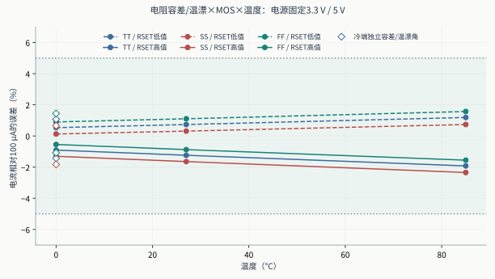
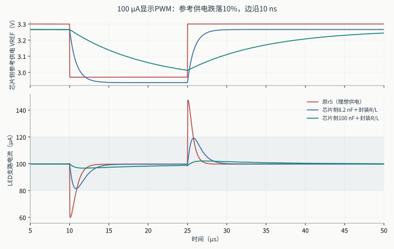
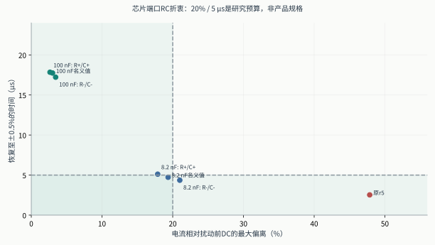
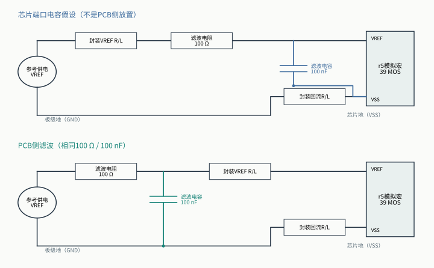
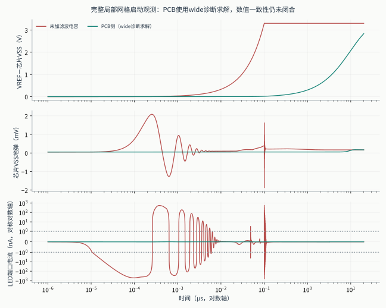

# PWM显示路线：100 µA参考源、独立保护及片外扰动

**结论：**39MOS原有完整PEX单像素可以作为本轮研究基线。精密片外RSET的确定性角落、供电扰动和封装R/L已补测；参考轨快速变化仍是主要电流扰动源。100Ω+100nF参考供电滤波可明显抑制瞬变，电容回流位置必须单独处理，代价是更长恢复时间。8.2nF名义点较快，但容差点越过本轮研究预算，不能宣布鲁棒性闭合。

**启动边界：**新增每路1Ω/5nH后，无滤波启动位移电流约626.7nA，原1nA支路门槛失败。PCB侧滤波的启动求解/数值闭合状态另列；供电幅度、故障和PWM通过不能替代启动结论。

## 1. 路线、负载与证据范围

本章只讨论显示PWM的100µA单像素。1MHz逻辑时钟、256µs帧和duty=1最小码电荷，与高速NRZ眼图、UI、接收门限无关。VSET=0.5V，RSET=5kΩ；误差放大器使SENSE跟随VSET，PREG/POUT形成参考电流，隔离传输门连接MREF/BIAS，MOUT控制LED支路。10管独立保护门、真实buf_2、参考隔离和LED钳位共同工作。FAULT可在停钟时切断PWM，恢复仍需实际RTL的许可序列。

负载保持原合成LED：Vf(100µA,27°C)=2.8V，N=3、RS=50Ω、CJO=2pF、TT=1ns。电气支路电流和电荷不是光功率。片外RBIAS/RRELEASE=100kΩ、RBLEED=10MΩ，CCOMP/CSENSE各30pF。模拟宏仍为r5实际39MOS/345R/288C名义提取网表；本轮没有重新布局或新增DRC/LVS/PEX结论。

原有证据来自2026-10-15最终套件：270点DC/PVT、10组启动、3组故障、4组PWM以及物理报告。这些是历史证据。本轮新增的每个仿真及失败候选另存于`evidence/pwm-robustness/20261024/`，没有将旧6MOS或0.1–7mA扫描借来作为39MOS证据。

## 2. 独立片外电阻与温度角落

RSET按±1%及±100ppm/°C；RBIAS、RRELEASE、RBLEED按±5%及±200ppm/°C。温度基准27°C，使用R(T)=Rnom·(1+tol)·[1+TC·(T−27)]。这是独立、确定性的工程试验范围，不是foundry片上电阻统计模型，也不是采购元件或良率保证。

TT/85°C下四个电阻的16个独立顶点；RSET两个同号tol/TC方向与TT/SS/FF、0/27/85°C的18点交叉，并补0°C三个MOS角的反号tol/TC六点以覆盖冷端真正极值（R/Rnom=0.987327和1.012727）；其余电阻逐一变化；另用原SS/FF供电包络作组合护栏。RSET±5%/±200ppm保留为精度失败对照。

| 新实验 | 电流/误差结果 | 判断 |
|---|---|---|
| RSET独立MOS/温度交叉（18点） | -2.3432% ～ +1.5710% | 所测点均在±5% |
| 冷端独立tol/TC反号（6点） | -1.8267% ～ +1.4428% | 所测点均在±5% |
| 四电阻独立16顶点（16点） | -1.9330% ～ +1.2003% | 所测点均在±5% |
| ±5% RSET反例（2点） | -6.5365% ～ +5.4977% | 保留失败 |
| SS/FF包络+封装护栏（2点） | -4.0573% ～ +1.3456% | 所测点均在±5% |



单看MOS角会漏掉设定电阻误差：RSET的变化直接进入I≈VSET/RSET。RRELEASE在正常DC下几乎不改变电流，但不能因此推导其故障释放动态无关。VSET仍是理想0.5V，尚未加入其精度、温漂或噪声。所有供电、温度、元件组合尚未全笛卡尔交叉；本轮没有统计失配、热耦合或RC提取工艺角。

## 3. 供电变化与真实片外滤波候选

10%跌落发生于10µs，25µs恢复；分别扫描参考轨、LED轨、所有四条供电，10ns/100ns边沿。VSET和数字输入高电平仍以板级地为参考。新提出的“峰值偏离≤20%、恢复±0.5%≤5µs”均以同一试验扰动前/恢复后的DC电流为基准，静态100µA精度另算；这些线仅用于显示设计折衷；它不是用户给定或已经建立的产品规格。

| 电路/条件 | LED支路范围 / µA | 最大偏离 | 恢复 / µs | 两项研究预算 |
|---|---:|---:|---:|---|
| 原r5，参考轨100ns | 60.161–147.240 | 47.625% | 2.490 | 未同时满足 |
| 原r5，参考轨10ns | 60.025–147.467 | 47.852% | 2.532 | 未同时满足 |
| 原r5，LED轨10ns | 96.557–102.412 | 3.191% | 0.001 | 均满足 |
| 原r5，全部轨10ns+封装 | 59.749–147.419 | 47.805% | 2.535 | 未同时满足 |
| die端100Ω+100nF | 96.736–102.056 | 3.006% | 17.743 | 未同时满足 |
| die端100nF，R−5%/C−10% | 96.299–102.584 | 3.444% | 17.223 | 未同时满足 |
| die端100nF，R+5%/C+10% | 97.093–101.637 | 2.647% | 17.840 | 未同时满足 |
| 100Ω+10nF，已否决折衷点 | 83.237–117.019 | 17.332% | 5.270 | 未同时满足 |
| die端100Ω+8.2nF | 81.411–119.028 | 19.346% | 4.727 | 均满足 |
| die端8.2nF，R−5%/C−10% | 79.938–120.676 | 20.998% | 4.359 | 未同时满足 |
| die端8.2nF，R+5%/C+10% | 82.743–117.559 | 17.873% | 5.117 | 未同时满足 |
| PCB侧100Ω+100nF | 96.681–102.124 | 3.061% | 17.713 | 未同时满足 |
| PCB侧100nF，全部轨10ns | 91.574–106.276 | 8.182% | 17.714 | 未同时满足 |



100ns参考轨旧扰动重现约60.16–147.24µA及2.49µs恢复，与旧报告一致。10ns扰动中SENSE在约0.4166–0.5820V之间变化；有限带宽的参考环路不能瞬时维持0.5V，镜像电流随之下冲和上冲。封装R/L不是这一主要幅度的来源。

第一批候选是宏端口侧100Ω串联电阻、电容接die-VSS，属于die端口/封装内局部电容假设，不能称为真实PCB片外放置。后续board100n候选保持100Ω/100nF数值，把R和C都移到封装R/L之前、C回板级地。39MOS及其PEX均不变。电阻DC压降、滤波启动及数字故障回放重新计算。100nF强抑制方案可以继续作为研究候选，但是否容许其恢复时间需由系统要求决定。容差扫描对应早期die端口拓扑，不能当作PCB侧拓扑的容差验证；8.2nF的名义通过无法覆盖所测元件容差。未为使候选通过而修改20%/5µs比较线。



## 4. 封装、启动、故障和最小PWM码

封装用五条独立串联R/L路径：VREF、VSAFE、VBUF、LED_A和共用VSS回流。名义每条0.2Ω/2nH，应力每条1Ω/5nH。这里没有pad/ESD、引脚互感、LED_K/SENSE/VSET等信号脚的串联寄生、封装场求解、完整板级网络或阵列共用回流；参数是试验假设。SENSE原有30pF预算、片外电阻及外部VSET参考点均保留。

启动仍预先供好安全/缓冲/LED电源，参考轨100ns上升，外部FAULT保持20µs；不是任意顺序或同时上电验证。故障在50.125µs施加，时钟47.7µs停止，使用实际RTL事件及10ns模拟引脚边沿。前期duty=1对完整两帧积分；板侧100nF确认采用258.5–514.5µs单个完整帧，已远离10µs参考滤波时间常数的初始过程。两者均与相同网络的DC电流比较，具体窗口记录在case和结果中。

| 本轮耦合复验 | 主要数据 | 判定 |
|---|---|---|
| `startup_package_stress` | 启动保持峰值 627.2691nA；恢复 99.7384µA | 失败：startup_held_fault_1nA |
| `fault_package_stress` | 关闭 205.784ns；Q+ 0.5048pC；Q− -7.3635pC | 所列门槛通过 |
| `pwm_package_stress` | duty=1电荷误差 -0.07132% | 所列门槛通过 |
| `startup_filtered8p2n` | 启动保持峰值 381.4308nA；恢复 99.7335µA | 失败：startup_held_fault_1nA |
| `fault_filtered8p2n` | 关闭 205.801ns；Q+ 0.5047pC；Q− -7.3635pC | 所列门槛通过 |
| `pwm_filtered8p2n` | duty=1电荷误差 -0.06674% | 所列门槛通过 |
| `startup_filtered` | 启动保持峰值 377.5422nA；恢复 99.7573µA | 失败：startup_held_fault_1nA |
| `fault_filtered` | 关闭 205.778ns；Q+ 0.5047pC；Q− -7.3635pC | 所列门槛通过 |
| `pwm_filtered` | duty=1电荷误差 -0.06297% | 所列门槛通过 |
| `startup_board100n` | doAnalyses: TRAN:  Timestep too small; time = 6.14467e-11, timestep = 2.5e-21: trouble with node "vpermit#branch" | 求解未完成，不能验收 |
| `fault_board100n` | 关闭 205.793ns；Q+ 0.5047pC；Q− -7.3635pC | 所列门槛通过 |
| `pwm_board100n` | duty=1电荷误差 -0.07135% | 所列门槛通过 |
| `startup_board100n_gear1` | doAnalyses: TRAN:  Timestep too small; time = 2.727e-10, timestep = 2.5e-21: trouble with node "vpermit#branch" | 求解未完成，不能验收 |
| `startup_board100n_wide` | 启动保持峰值 0.0283nA；恢复 99.7546µA | 单一wide配置的功能门槛通过；数值一致性未闭合 |
| `startup_package_stress_refined` | 启动保持峰值 626.7084nA；恢复 99.7384µA | 失败：startup_held_fault_1nA |
| `startup_filtered_refined` | doAnalyses: TRAN:  Timestep too small; time = 1.01695e-07, timestep = 2.5e-21: trouble with node "vpermit#branch" | 求解未完成，不能验收 |





同一R/C值的回流路径是本轮新增的重要边界。die端电容的充电电流经过共同封装VSS阻抗，会抬高局部地；PCB侧电容先在板级地闭合充电回路。以下使用完整局部网格的20µs窗口；未收敛数据不画成有效波形，PCB侧只显示wide诊断配置。图中PCB曲线的求解容差与严格基线不同，不能作为同数值设置下的修复闭合证明：

| 完整网格启动 | 支路峰值 / nA | 导电峰值 / nA | 位移峰值 / nA | die-GND峰值 / mV |
|---|---:|---:|---:|---:|
| `startup_package_stress_refined` | 626.708443 | <0.001（近零数值量） | 626.708496 | 2.083238 |
| `startup_board100n_wide` | 0.028308 | <0.001（近零数值量） | 0.028308 | 0.174542 |

无滤波的约627nA峰在完整网格下仍为约626.7nA，因此新封装下的启动暗态支路失败不能归零为数值伪影。板侧启动的Gear2/Gear1严格求解失败均保留；wide组合为同电路的数值诊断（reltol=1e−8、abstol=1pA、vntol=100nV）。即使单个wide配置能完成，也没有独立细化一致性闭合，不能据此宣称startup验证完成。网格变化与回流拓扑变化分开记录。

关断判断包含LED总支路1nA门槛、正负电荷分别积分、停止时钟时的释放导电电流和恢复电流。端口位移电流不能被当成实测发光，正负电荷不能抵消后宣布安全。

## 5. 端电压与数值可信度

r5含33只06v0器件、6只05v0 buf_2器件；没有高速NRZ对照路线中的3.3V薄氧核心器件，因此不能套用3.63V筛查。新瞬态记录每只MOS实际分布式RC端点的|VGS|、|VGD|、|VGB|、|VDS|、|VBS|、|VBD|。前期DC及早期候选仅记录5对（未含VGB），摘要明确保留其195项与新234项的区别，不能相减峰值补出VGB。它们是terminal-voltage inventory，不是foundry绝对额定、寿命、ESD或可靠性验收。

- 完整六对记录中，05v0最大端点差：3.629276V，`dc_guard_ff` / `s_x24_gd`。
- 完整六对记录中，06v0最大端点差：5.499898V，`dc_guard_ff` / `s_x12_gs`。

最大步长2ns与1ns代表对照：

- `step_ref_10ns`：最大插值电流差4.50518nA，恢复时间差0.17217ns。
- `step_all_10ns_package_stress`：最大插值电流差1.73780nA，恢复时间差0.58178ns。
- `step_ref_10ns_filtered8p2n`：最大插值电流差0.63917nA，恢复时间差0.68517ns。

全部指标从完整波形计算；CSV只用于绘图。每份raw先计算SHA-256，再gzip压缩，解压回读哈希相符后才移除未压缩副本。失败、旧instrumentation尝试及ngspice日志保留在build，未把图形降采样当作数值验证。

## 6. 可继续的研究与复现

优先确认显示系统对瞬时电流、暗态位移电荷和恢复时间的真实要求，再决定是否采用强滤波片外方案；随后完成任意上电/掉电、POR/欠压及pad/ESD和封装网络。统计失配、电阻实际料号与TC、电容偏压效应、真实LED标定及阵列回流仍未覆盖。

```sh
.venv/bin/python scripts/pwm_robustness/run.py --suite dc --reuse
.venv/bin/python scripts/pwm_robustness/run.py --suite transient --reuse
.venv/bin/python scripts/pwm_robustness/run.py --suite selected --reuse
.venv/bin/python scripts/pwm_robustness/run.py --suite strong --reuse
.venv/bin/python scripts/pwm_robustness/run.py --suite board --reuse
.venv/bin/python scripts/pwm_robustness/run.py --suite summarize
.venv/bin/python scripts/pwm_robustness/report.py
.venv/bin/python scripts/pwm_robustness/topology_figure.py
```

主证据：`evidence/pwm-robustness/20261024/summary.json`、`compact-metrics.csv`、`validation.json`与`input-manifest.json`。完整原始波形/冻结模型/输入网表位于`build/pwm-robustness/20261024/`。本轮未建立光学、硅片、整芯片、MPW或foundry可靠性结论。
