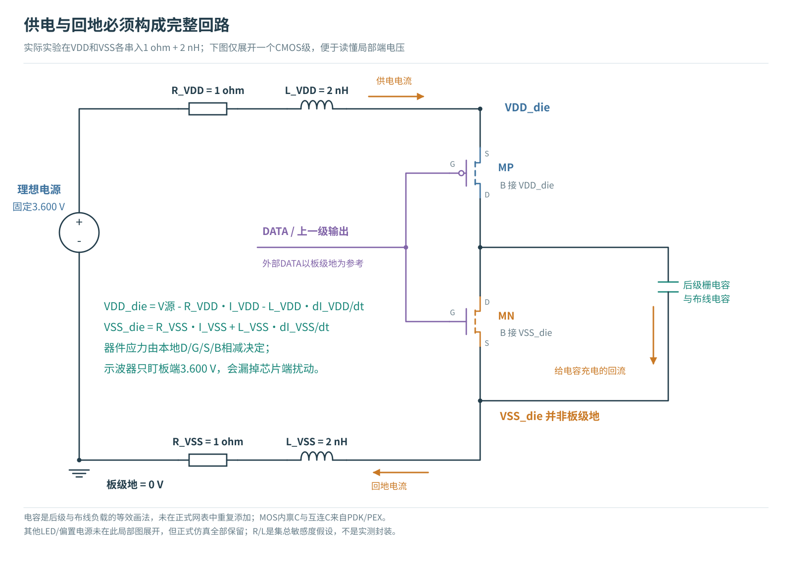
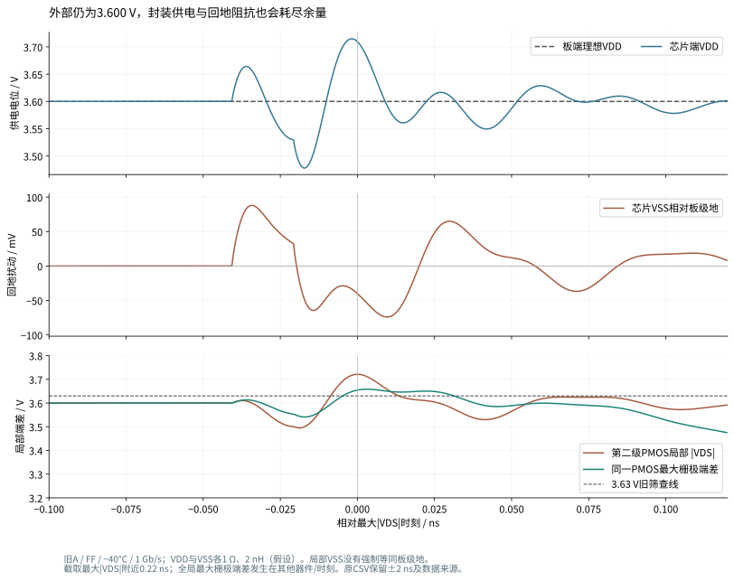
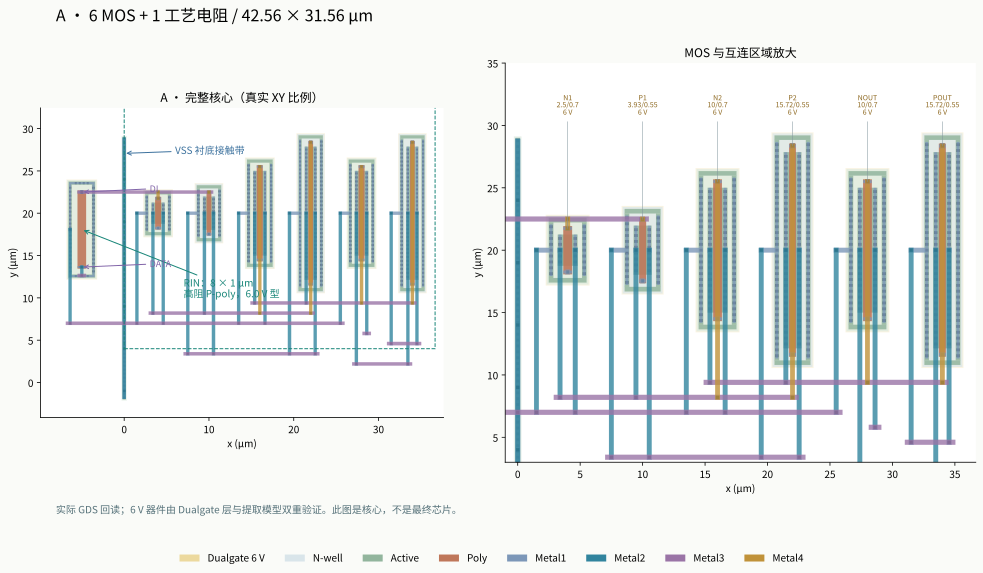
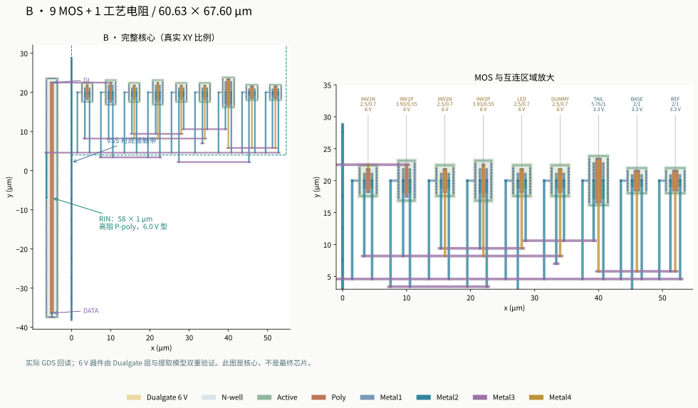
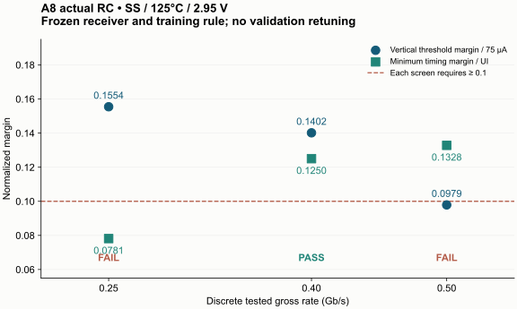
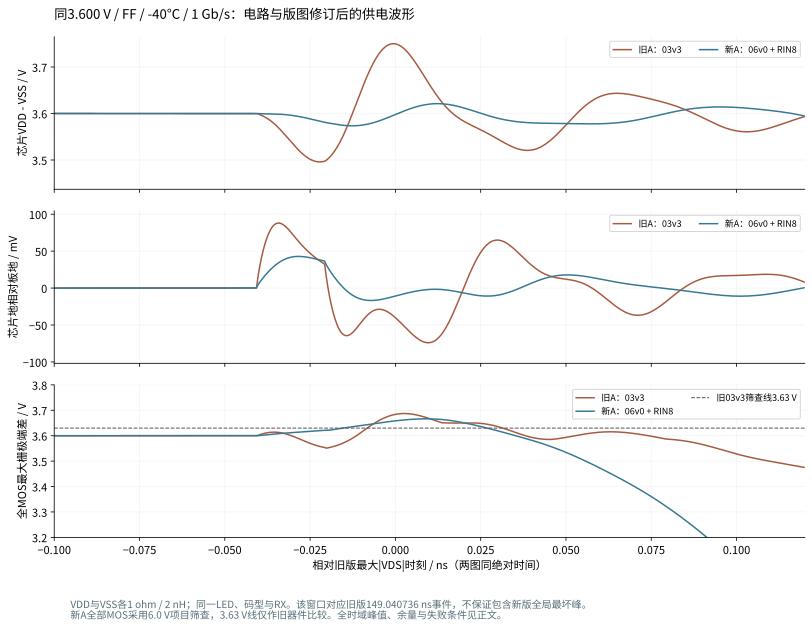
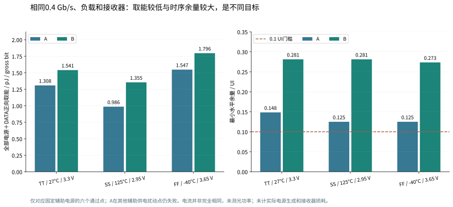

# MicroLED 驱动器：供电、电阻角与封装扰动验证

**结论：原9–11 mV电压余量不足。** 电源仅增加50 mV，或仅加入声明的供电与回地封装阻抗，旧核心就超过电压筛查线。我们更换实际MOS器件、修改输入电阻和版图并重新提取寄生，已经增大相对器件筛查限值的电压余量；但接收与供电扰动仍必须独立验证。

本报告把**显示PWM**与**高速光通信**分开。先看失败的物理原因，再看实际修改和同条件数据；“仿真成功”“接收通过”“电压筛查通过”“版图检查通过”各有证据，不能互相代替。当前成果属于实验性研发方法验证，尚不是产品规格或流片签核。

<nav><a href="#split">两种应用</a><a href="#voltage">电压余量</a><a href="#nrz">高速电路与版图</a><a href="#nrzresults">高速数据</a><a href="#pwm">PWM显示驱动</a><a href="#limits">验证边界与方向</a><a href="#appendix">原始依据</a></nav>

<h2 id="split">1. 先把显示PWM与高速光通信分开</h2>

两者都需要建立 LED 电流，但优化目标不同。PWM 显示用一个较稳定的导通电流乘以导通时间来控制平均电流；高速 NRZ 则必须让每个数据位在有限时间内形成接收器能够区分的两个光强状态。本项目的“光强”仍是电流经过动态模型后的代理量，没有实测光功率或 BER。

|项目|像素显示 PWM|高速光通信 NRZ|
|---|---|---|
|当前电路|39 MOS 模拟宏：参考源、独立保护、缓冲、像素镜像、LED钳位；另有RTL控制|A：6 MOS受限输出摆幅；B：9 MOS基线电流＋电流转向|
|主要控制量|导通电流约100 µA；PWM码控制亮灯时间|目标电平25/100 µA；PRBS数据控制两电平切换|
|工作尺度|1 MHz时钟，256 µs帧，最小码约1 µs脉冲|本章实际测试0.25/0.4/0.5/1 Gb/s点；0.4 Gb/s的UI为2.5 ns|
|需要检查|电流准确性、积分电荷、启动、故障关断、恢复时间|接收错误、眼图余量、采样时序、端电压、每比特能量|
|本轮主要风险|参考供电扰动、设置电阻误差、滤波电容的回流路径|薄栅氧余量太小、独立电源变化、输入RC、供电与回地寄生|
|LED模型|合成模型，100 µA/27°C时约2.8 V，CJO=2 pF、TT=1 ns|同一公开20 µm黄色LED静态I–V拟合；外加200 fF及动态代理|

**两种应用内部保持各自的原负载；没有在两种应用之间共用同一LED模型。** 因此不能把PWM的电流精度与NRZ的误码结果直接横向排序。39 MOS是本项目具体测试宏的器件数量，“六MOS”也只是早期像素实现的数量描述，均不是行业标准架构名称。

PWM完整连接与历史版图见[单像素闭环研究报告](../single-pixel-closure-20261015/report.html)；高速旧版见[2026-10-23报告](../highspeed-nrz-pvt-20261023/index.html)。本章聚焦新增扰动、失败复现和修订证据。

<h2 id="voltage">2. 原9–11 mV余量不能承担本轮扰动</h2>

原真实RC核心在FF/−40°C、VDD=3.6 V时，A的最大端差为3.620623 V，B为3.618943 V。与3.63 V相减仅余9.377/11.057 mV。现在只把逻辑供电与DATA高电平提高到3.65 V，A/B的端电压均超过原筛查线；A在1 Gb/s仍为0/511错误，但端差已达3.670677 V。接收通过与器件电压通过必须分别判断。

{{voltagefigure}}

近似预算可以写成：**电压预算 = 器件允许的边界 − 直流工作电压 − 动态过冲 − 电源误差 − 回地扰动**。各项并非一定独立；最终用局部D/G/S/B波形检查，不能机械相加当作签核。对于3.6 V工作点，持续+50 mV偏移本身已使满摆幅达到3.65 V，输入电阻再大也不能消除这个直流事实。

另一项独立控制在外部电源仍为3.600 V时，仅向VDD和VSS路径各加入1 Ω、2 nH。旧A的最大端差升到3.721199 V，所有MOS中最大栅极到其他端子的差为3.687489 V。此时仍是0/511错误。这些R/L是声明的集总敏感度参数，尚非某个真实封装的提取值；它们证明现有余量不能覆盖这一明确案例，不证明芯片已发生实际击穿。

[该窗口CSV与所有节点电压](../../../evidence/highspeed-nrz-robustness/baseline-A-supply-return-window.csv) · [原始波形与器件映射](../../../evidence/highspeed-nrz-robustness/baseline-A-supply-return-window.json)

### 补全可靠性依据

公开[GF180 DRM 14.1](https://gf180mcu-pdk.readthedocs.io/en/latest/physical_verification/design_manual/drm_14_1.html)规定薄栅氧栅极到其他端子的绝对直流电压上限为3.63 V。此前报告仅引用Ioff电气测试表，依据不完整，现已补正。周期性超限还涉及占空比、TDDB寿命与HCI等条件；本研究对全部六组端对的瞬态统一筛查，不等同晶圆厂的完整可靠性签核。

<h2 id="nrz">3. 高速方向：换器件必须同时重做电路与版图</h2>

本轮试验采用同一GF180硅CMOS工艺中的06v0厚栅氧器件，未引入GaN或SiGe等新半导体材料。A的六只MOS均替换；B仅替换四只反相器MOS和两只转向MOS，三只低电压偏置MOS保留03v3。后者仍单独受3.63 V项目筛查，不能因为同一电路里有6 V器件就放宽所有管子的判断。

真实6 V NMOS/PMOS的最小沟道长度为0.70/0.55 µm，原3.3 V器件为0.28 µm。初始宽度按原W/L比例放大并对齐制造网格；这是起点，不能据此推断驱动能力、速度或电容完全相同。[GF180 Poly2规则](https://gf180mcu-pdk.readthedocs.io/en/latest/physical_verification/design_manual/drm_07_08.html)

本轮对实际06v0器件采用6.0 V全端对保守筛查，对03v3继续采用3.63 V。不是把旧器件的门限放宽，而是更换实际PDK模型、实际器件层结构并重新提取。也没有根据6 V名称直接采用6.6 V统一门限；上述公开DRM对6 V工艺的栅节点直流限制写为6 V。

{{aschematic}}

{{bschematic}}

A仍依赖VH=1.611025 V、VL=1.172154 V两条理想可吸收电流的电源轨；B的RREF=88.386106 kΩ仍接已有VDUMMY=3.3 V，RDUMMY=28 kΩ。本轮不在PEX后重新校准这些值。电源生成、闭环稳压及其损耗尚未包含在核心设计中。

### 电阻长度与体接触是两个独立设计问题

厚栅氧器件增加了实际器件尺寸和输入负载。保留旧A的48 µm电阻时，新RC在SS/125°C、2.95 V、0.5 Gb/s虽然没有比特错误，垂直余量只有0.06716，小于0.1。将实际电阻改短到8 µm并重新生成版图后，余量提高到0.09787，**仍然不通过**；不得四舍五入成0.1。

短电阻还改变了提取的局部衬底返回网络。后续增加体接触的版图试验没有改善该网络的关键电阻，不能称为成功修复。对提取图逐条分析发现，RIN衬底端与XN2体端是不同节点，但后者是无其他DC负载的叶节点；这解释了单位电流诊断中两者电位相同。该结果描述当前提取电阻图，不能据此确定真实晶圆里的三维衬底耦合。

### 实际版图与几何代价

| 核心 | 外框 / µm | 外框面积 / µm² | MOS＋工艺电阻 | 提取互连R / 显式C | 显式C总和 / fF |
|---|---|---:|---|---:|---:|
| 旧A，03v3＋RIN48 | 42.31×57.60 | 2437.06 | 6＋1 | 84 / 61 | 35.880 |
| 新A，06v0＋RIN48 | 42.555×57.92 | 2464.79 | 6＋1 | 79 / 62 | 49.069 |
| 选定A，06v0＋RIN8 | 42.555×31.56 | 1343.04 | 6＋1 | 79 / 64 | 49.055 |
| 旧B，03v3＋RIN58 | 60.63×67.60 | 4098.59 | 9＋1 | 127 / 76 | 35.655 |
| 选定B，混合06/03＋RIN58 | 60.63×67.60 | 4098.59 | 9＋1 | 127 / 76 | 39.252 |

A的外框变小主要来自直条电阻缩短，不能据此得出厚栅氧晶体管更小。显式C不含MOS和工艺电阻模型内部电容；上述总和不是一个可直接代入带宽公式的集中负载。

[打开可切换层和网络的实际GDS查看器](layout-viewer.html)。图中Dualgate层及真实抽取型号共同确认6 V器件，不能靠网表改名替代工艺结构。所选核心已完成原生/回读Magic DRC、独立KLayout DRC、LVS、全网R提取、C矩阵检查与RC折叠LVS；实际GDS开路/短路反例也被LVS拒绝。[最终物理来源与哈希](../../../evidence/highspeed-nrz-robustness-layout/final-selection.json)

所有面积仅是实验核心包围盒，尚无pad、ESD、电源生成、封装和全芯片填充签核。

<h2 id="nrzresults">4. 高速仿真：把接收、应力和能量分别列出</h2>

共同条件保持不变：静态LED模型、CLED=200 fF、20 ps数据边沿；32位预热、254位PRBS7训练、511位PRBS9验证及32位尾部；光学代理时间常数200 ps、接收一阶带宽1 GHz、阈值62.5 µA，归一化跨度75 µA。训练确定采样位置，验证段不再调参。温度只作用于有温度模型的MOS与电阻，没有给LED静态曲线捏造温度特性。

联合通过要求：零错误、垂直余量≥0.1（7.5 µA判决距离）、最小水平余量≥0.1 UI，以及每一器件的电压筛查均通过。输入码长、噪声模型和接收代理限制了证据范围，不能把0/511说成产品BER。

{{nrztargets}}

### 换用厚栅氧后，速度与辅助电源成为主要限制

A的RIN从48 µm缩到8 µm后，在固定辅助电源的TT/27°C/3.3 V、SS/125°C/2.95 V、FF/−40°C/3.65 V三个条件下，**0.4 Gb/s离散点通过**。SS/2.95 V下，0.5 Gb/s垂直余量0.09787未通过；0.25 Gb/s水平余量0.078125 UI也未通过。不能把这三个点拟合成一个“最高带宽”。

原因之一是接收算法在训练段以垂直判决距离选定采样相位，并未联合优化水平余量。0.25 Gb/s与0.4 Gb/s的右侧零错误时间约312.5 ps，换算成UI后分别是0.078125与0.125。减慢发送不必然使这个冻结判据单调改善；本轮没有为通过而修改接收器。

**A的辅助电源扰动包络没有闭合。** FF/3.65 V时，仅VLED增加50 mV，或仅VH/VL共同降低50 mV，虽均为0/511错误，水平余量都只有0.09375 UI，低于0.1。SS下VDD=2.95 V、VLED=4.95 V、VH/VL共同增加50 mV的联合控制出现256/511错误；器件端电压仍合格。该联合条件的DC检查进一步得到A的I0=16.541 µA、I1=57.196 µA：连稳态高电平都低于62.5 µA判决阈值，单纯降速不能修复。B相应I0=23.148 µA、I1=89.960 µA。电压型输出直接由电源轨决定LED两端电压，电源差值变化会经LED非线性I–V改变电流，安全电压不能保证接收光强代理足够。

B在同类联合慢热控制下（VDD=2.95 V、VLED=4.95 V、VDUMMY=3.25 V），0.5 Gb/s为0/511，垂直余量0.16475、水平余量0.24219 UI。恒流偏置降低了供电差值变化对电流的影响，但仍受参考源、转向管余量和实际负载限制。

### 静态+50 mV条件：耐压余量增加，但峰值和取能没有下降

{{matchedcomparison}}

这是相同FF温度、同一路线相同速率、相同LED与RX的对照。A的峰值由3.670677 V升到3.714158 V，B也略升；**修复来自实际厚栅氧器件的更高电压承受范围，不是消除了过冲**。两路线的输入RC、器件电容与切换过程变化，也使这个条件下的正向取能分别增加约14.47%与8.98%。A在快冷1 Gb/s通过不能推广到慢热1 Gb/s：后者仍有75/511错误。

B的“最小器件余量”须逐只计算后取最小，不能用6 V减去全电路最大端差；它保留的03v3偏置器件仍使用3.63 V筛查。两类限值分别绑定实际器件型号。

### 新版供电和回流封装复测

在VDD与VSS各1 Ω/2 nH的假设下，新增A/0.4 Gb/s、B/0.5 Gb/s快冷3.65 V测试均通过接收与器件电压筛查。最大端差分别为3.716228 V、3.780691 V，逐器件最小余量分别为2.283772 V、1.865131 V。封装引起的过冲仍然存在。

另外专门把新A恢复到旧封装反例的**同3.600 V、同1 Gb/s、同FF/−40°C**，得到最大端差3.666489 V，旧版为3.721199 V；这一特定封装条件下峰值确实下降。不能将它与前面3.65 V无供电封装的结果混成同一比较，也不能凭快冷1 Gb/s通过声称慢热1 Gb/s通过。

该图两个电路使用相同绝对时间窗口；它用于观察同一数据事件，整个仿真中的最大值仍以上表/完整CSV为准。[窗口数据与哈希](../../../evidence/highspeed-nrz-robustness/final-A-supply-return-window-matched.json)

### 同为0.4 Gb/s时的能量与时序取舍

{{sameenergy}}

以上六个点均通过本轮接收与端电压筛查。A在这些固定辅助电源的条件下取能较低，B有更大的水平余量；A在其他辅助电源扰动点失败，所以不能单凭这张能量表选出完整系统方案。回灌能量单独保存，未假定实际电源一定能把它回收。

### 直流电流没有在PEX后重新校准

{{nrzdc}}

同一负载和电源设定不保证不同电路、温度下实际电流相同。这里保留25/100 µA原目标并列出偏差，不能把供能差异自动换算成相同实测光功率的能效。

### 为什么单独扫描电阻角

电阻的res_typical/res_ss/res_ff分别由PDK独立选择；不能假定“慢MOS必然配高阻、快MOS必然配低阻”。完整三端poly模型包括端部、本体温度系数和衬底电容。本轮既运行电阻独立DC校准，也将交叉电阻角放回真实RC电路。**高速部分的独立电阻角仅覆盖工艺RIN；B的RREF与RDUMMY仍是固定理想电阻，没有把它们的容差纳入本轮角落结果。**片电阻的800/1000/1200 Ω/□只是模型参数的一部分，不等于完整器件在所有温度下的电阻。

独立DC校准共27点（A48、A8、B58各9点），完整模型与解析计算一致。选定A8在所测温度/电阻角组合下为6.253–10.900 kΩ，B58为44.637–77.160 kΩ。电阻最大值出现在高阻角/冷端，不能只检查慢MOS/热端；实际动态影响仍由全RC瞬态决定。

本模型的公开器件表未提供该高阻poly的局部统计失配模型；角落扫描不构成阵列均匀性或良率证明。[电阻模型](https://gf180mcu-pdk.readthedocs.io/en/latest/analog/model_parameters/LV/LV_4.html) · [器件支持范围](https://gf180mcu-pdk.readthedocs.io/en/latest/analog/model_parameters/LV/LV_1_4_4.html)

### 动态电源的能量必须重新积分

每条电源及DATA均以实际端口电压和源电流计算 **P(t)=−V(t)I源(t)**，在同一511个输入UI窗口积分。正向取能、返回能量和净能量分别保存。加入供电封装R/L后，供电功率在阻抗之前取样，片内VDD和VSS另存，避免漏算供电回路损耗。理想电源轨、数据源及核心取能不包含尚未实现的稳压器、串行器、接收器或实际光电效率。

速率不相同的fJ/bit不能直接用于“同条件胜负”排序；失败点的取能也不能称作成功传输能效。下方完整表保留所有完成的正式实验，另提供[CSV](nrz-final-data.csv)与输入身份。

展开最终候选的全部正式数据（含失败点）

{{nrzmatrix}}

展开原薄栅氧核心的扰动数据

{{baselinematrix}}

<h2 id="pwm">5. 显示PWM方向：参考电流、保护与滤波回路</h2>

<!-- PWM_SECTION -->

<h2 id="limits">6. 如何据此决定下一步</h2>

1. **显示PWM：先收敛参考供电与保护的动态设计。** 电流设置电阻的精度与温漂须形成独立预算；滤波器应明确放在板侧还是芯片侧，并核查启动位移电流、积分电荷及恢复时间。单一RC同时满足扰动抑制和快速恢复的证据尚不足，下一步应比较参考源PSRR、缓冲驱动能力与有控上电，而非继续盲目增大电容。
2. **高速：优先继续B电流转向的供电和真实参考设计；A保留为对照。** B本轮扰动表现较稳健，但尚有固定理想RREF/RDUMMY、电源生成和模型边界。A首先需要实际可调、可吸收电流的VH/VL控制，稳定LED两端的电压差；仅缩短输入电阻或提高MOS耐压不能解决辅助电源导致的接收失效。实际电源环路引入后再用相同RX复查。
3. **物理验证：从集总假设推进可测的封装/PCB模型。** 本轮已证明供电与回地的R/L会改变局部D/G/S/B电压。下一阶段须以选定封装的引脚、键合/凸点、走线和去耦位置建立提取或测量模型，并补全pad/ESD、电源网和电源调节器，再讨论全芯片余量。

本轮没有完成实测LED温度/动态拟合、噪声与随机抖动BER、MOS失配统计、完整封装/PCB电磁提取、ESD、pad ring、EM/IR、HCI/TDDB寿命签核或硅后光学测量。这里的GDS是实验核心；DRC/LVS/PEX分别证明对应规则、连接与所声明提取模型的工作，不能把它们升级为整芯片可流片或可销售的证据。

<h2 id="appendix">7. 复现、审计与技术依据</h2>

本轮高速正式旧核心扰动矩阵为42个有效实验；最终候选矩阵为65个，全部完成求解和分析，最终候选保留7个接收筛查失败，器件电压筛查失败为0。65个包含DC、速率探针、供电/电阻/封装扰动与数值对照；不是65个独立统计样本，也不代表所有工艺和系统扰动已穷举。早期候选与管理中止另列于阶段执行清单。

6组高速数值控制均满足预先声明的对照容差：最大端压变化约62.93 µV、垂直余量变化0.0001661、水平余量变化0 UI，正向能量相对变化约0.0140%。数值稳定不能修复电路自身失败。

PWM共有101个运行身份（59 DC、26供电阶跃、8启动、4故障、4 PWM），98完成、3未收敛；其中包含5个仅扩充端电压观测的重复，不能作为额外独立样本。已完成每个case的输入、网表、日志、压缩及解压波形哈希核验，并保留旧5端对与新6端对观测范围的区别。

- [NRZ原始留存重分析与最终摘要](../../../evidence/highspeed-nrz-robustness/summary-verified.json)
- [NRZ数值控制](../../../evidence/highspeed-nrz-robustness/numerical-audit.json)
- [独立端电压与能量复算](../../../evidence/highspeed-nrz-robustness/independent-selected-audit.json)
- [PWM最终审计](../../../evidence/pwm-robustness/20261024/final-audit.json)
- [A实际GDS独立复核](../../../evidence/driver-robustness-audit/physical-A.json) / [A48与B实际GDS独立复核](../../../evidence/driver-robustness-audit/physical-AB-first.json)

新目录的小输入复跑也已实测：NRZ只恢复本轮inputs/stimulus/manifest，PWM只恢复8个冻结输入及case清单，即可重新生成新路径网表并完成DC检查；这不替代在另一操作系统上跑完全部矩阵。详细命令见[本轮README](README.md)。

实验幅度和研究预算先于相应用例声明，结果没有全部通过。被替代候选的未运行计划与真正仿真失败分别记录；仿真失败不赋予接收性能值。早期分析器执行来源记录的问题由独立重分析补救，历史文件保留，补救记录不冒充当时就正确冻结了来源。

[实验设计](experiment-design.md) · [报告输入与图形SHA-256](report-provenance.json) · [跨机器恢复说明](../../development-handoff.md)

展开PDK、版图规则、电阻角与提取方法的详细依据

<!-- PHYSICAL_SECTION -->

