# MicroLED高速驱动：A/B/C同条件晶体管比较

**研究阶段：原理图级（SCHEM），2026-10-25研究批次，2026-10-26完成整理。** 本轮从共同负载、共同电流目标和共同输入能量边界重新建立比较。已完成 **24/24 个直流点、45/45 个完整帧瞬态**。通信筛查失败 20 点均保留，并完成统一绝对延迟v2接收重分析，未据此预选架构。

初版v1按0.5～2symbol搜索，给NRZ/PAM4不同绝对预算，会把搜索上限混入高速限制。原v1源/结果全部保留；本报告性能表统一使用v2，对同一原生波形重分析，不重调电路、不重跑供电能量。

这份报告回答三个问题：加入实际辅助供电后A的能量是多少；真实参考下B与A的电流目标是否相同；把C变成MOS译码与四电平电路后，符号率减半能否换来可用的接收余量。所有结论只适用于本次尺寸与偏置的候选，不能代表这些拓扑的性能极限。

## 1．先看比较对象与边界

| 路线 | 本轮真实电路 | 完整MOS数量 | 数据如何控制LED |
|---|---|---|---|
| A：电压输出NRZ | 两级缓冲、互补输出、两路实际shunt辅助轨 | 20（6核心＋14辅助轨） | 改变OUT电位，以LED的I–V曲线形成两档电流 |
| B：电流转向NRZ | 9MOS核心＋12MOS真实V-to-I参考/禁止/keeper | 21 | 基础电流保持，额外电流在LED/dummy间转向 |
| C：电流DAC/PAM4 | 14MOS真实Gray译码、三路7MOS单元、REF/BASE与12MOS参考 | 49 | 每符号2bit，开启0/1/2/3个单位电流，形成四档 |

PAM4是调制格式，不是独立的输出电路拓扑。本轮C是在电流转向上增加DAC和四电平调制。MOS数量只是器件账本，不能替代芯片面积、版图面积、成本或完整收发器能效。

### 共同条件

| 项目 | 本轮固定条件 |
|---|---|
| MicroLED | Lin2026 yellow20µm静态I–V；同一冻结SPICE文件，LED温度、L–I与动态尚未测量 |
| 负载寄生 | CLED200fF；RPKG1Ω、LPKG0.5nH；VLED5V经0.25Ω |
| 输出目标 | A/B：25/100µA；C：25/50/75/100µA；每路线仅TT校准两个自由度 |
| 电源 | VIN5V：0.25Ω/0.5nH；VDD：1Ω/2nH；均100nF与0.2ΩESR；VREF2.5V经0.2Ω |
| 数据输入 | D0/D1端口20ps边沿、100Ω输出阻抗；RIN统一8µm×1µm PDK电阻 |
| MOS模型 | GF180公开模型子集；03v3/06v0；结面积/周长统一公式估计，并非PEX |
| 角落 | TT27°C/3.3V、SS125°C/2.95V、FF−40°C/3.65V；仅PDK输入RIN的电阻角随MOS配对；其他理想R/C暂不含容差/温漂 |
| 接收代理 | 电流→200ps光学一阶代理→1GHz接收一阶；无实体PD/TIA/时钟恢复电路 |
| 接收门槛 | NRZ62.5µA；PAM4 37.5/62.5/87.5µA；最小判决距离7.5µA、单侧时序余量100ps |


<figure><a href="figures/common-testbench.svg">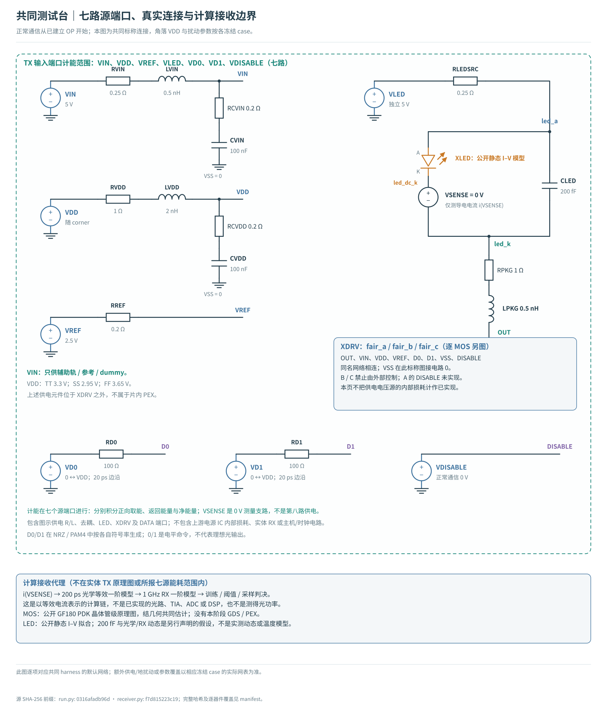</a><figcaption>共同负载、供电和输入端口；所有路线使用同一电气测试台（点击查看大图）</figcaption></figure>


**已计入能量：** VIN、VDD、VREF、VLED、D0、D1、DISABLE七个输入端口，包含实际实例化的参考源、shunt、dummy、译码与R/C。分别记录正向取能、回流和净能量。流入A辅助轨的LED电流由真实shunt耗散；另有瞬态能量返回上游端口，独立列示。净额只是带符号端口账本，不代表上游能无损回收。

**尚未计入：** 上游5V/3.3V转换器和精密2.5V基准IC自身的静态电流/效率、时钟/主机、实体接收器及FEC；D0/D1端口计入其对输入网络的充放电，但不包含外部数据发生/串行器IC的内部耗电；上电充电/启动与空闲也未纳入本次已建立OP的正常通信帧。它们仍是端口边界之外的理想源，电源阻抗与去耦只是明确的电气模型；因此本文的pJ/bit称“输入端口能量”，不能称完整TX或完整光链路能量。

## 2．相同净吞吐怎样定义

测试帧共4736bits：64预热＋512训练＋4096验证＋64尾部。η=4096/4736≈0.864865。最终v2仅用其中448bits（bit64～511）评分，末64bits作共同隔离保护；在最高已扫2Gb/s下仍足以隔离8ns最大延迟。输入数据、训练总开销、验证4096bits和能耗分母都不变。

`Rline=Rnet/η`；NRZ的`Rs=Rline`，PAM4的`Rs=Rline/2`。例如计划净吞吐0.5Gb/s时，两者线路比特率均0.578125Gb/s，NRZ0.578125GBd，PAM40.2890625GBd。整帧时长8.192µs，两者均提供4096个验证比特。这个帧开销是实验定义，未实现产品协议或FEC。

最终v2训练阶段在共同0～8ns、5ps绝对网格内选采样延迟，随后冻结。8ns和5ps是本项目实验假设，不是已实现CDR/时钟精度，也不是行业规格。这个窗口在相同净率下给三条路线相同的绝对时延预算和搜索分辨率。目标是最大化训练段最小有符号判决距离；1pA内的幅度等价平台，按训练段最小时序余量破同分，再取最早延迟。阈值和验证标签不参与调参。部分低速点的所选延迟落在8ns边界，只能解释为该共同预算内的最优点，不冒称无时延约束的极限。时序门槛统一用**100ps绝对时间**，同时保留symbol UI与bit UI。

能量按`E+=Σ∫max(−Vsrc·Isrc,0)dt / 4096`计算，回流另报。积分覆盖整个4736-bit帧。**失败点的pJ/bit只是每个计划payload bit的取能，不是已可靠交付比特的能量**，不进入达标性能排序。零错也仅指这4096个确定性验证比特，不是BER资格证明。

## 3．直流目标是否对齐：与接收结果分别验收

A校准RH/RL，B校准RSET/WTAIL，C校准RSET/WUNIT；各两个自由度，之后所有角落固定。B的WTAIL和C的WUNIT按5nm尺寸网格取值。C中间两档没有独立修正。

| 角落 | 路线 | LED DC电流 / µA | 相对各自目标误差 | 全部电平±5% |
|---|---|---|---|---|
| TT | A | 25.000 / 99.994 | -0.001% / -0.006% | 通过 |
| TT | B | 25.001 / 100.015 | +0.003% / +0.015% | 通过 |
| TT | C | 25.002 / 50.063 / 75.055 / 99.998 | +0.008% / +0.127% / +0.073% / -0.002% | 通过 |
| SS | A | 23.143 / 75.595 | -7.429% / -24.405% | 未通过 |
| SS | B | 24.913 / 97.023 | -0.346% / -2.977% | 通过 |
| SS | C | 24.915 / 49.823 / 74.685 / 99.504 | -0.341% / -0.355% / -0.419% / -0.496% | 通过 |
| FF | A | 26.359 / 111.399 | +5.438% / +11.399% | 未通过 |
| FF | B | 25.107 / 103.059 | +0.426% / +3.059% | 通过 |
| FF | C | 25.108 / 50.288 / 75.387 / 100.435 | +0.432% / +0.576% / +0.516% / +0.435% | 通过 |


<figure><a href="figures/dc-corners.svg">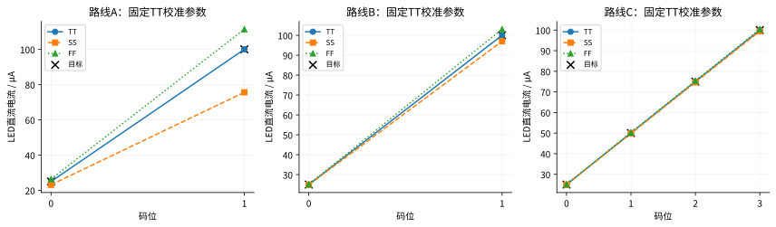</a><figcaption>同一TT校准参数跨角落的直流漂移，黑叉为预先声明目标（点击查看大图）</figcaption></figure>


**A的跨角落电流精度尚未通过。** SS高档约75.59µA（目标100µA，−24.41%），FF高档约111.40µA（＋11.40%）。它靠电压与MOS导通电阻形成电流，电路PVT改变后，不会自动维持目标电流。B的高档变化约−2.98%～＋3.06%；C本轮四档在三角落均接近目标。这里仍固定LED静态曲线，不能据此声称真实LED跨温度光功率稳定。

## 4．电路逐层展开

### A：实际辅助轨承担了什么

D0经RIN与两级反相器形成CTRL。CTRL低时XPOUT导通，将OUT连接至较高VH，LED压差较小、电流约25µA；CTRL高时XNOUT导通，将OUT连接至较低VL，LED压差增大、电流约100µA。两只输出管的体端分别接VH和VSS，不能随意省略。

<figure><a href="figures/a-core.svg">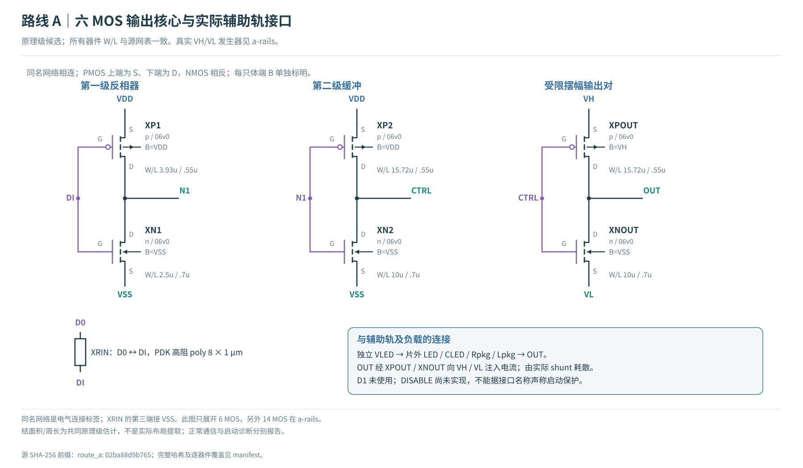</a><figcaption>A的六MOS输出核心：每只D/G/S/B、尺寸和网络明确（点击查看大图）</figcaption></figure>

<figure><a href="figures/a-rails.svg">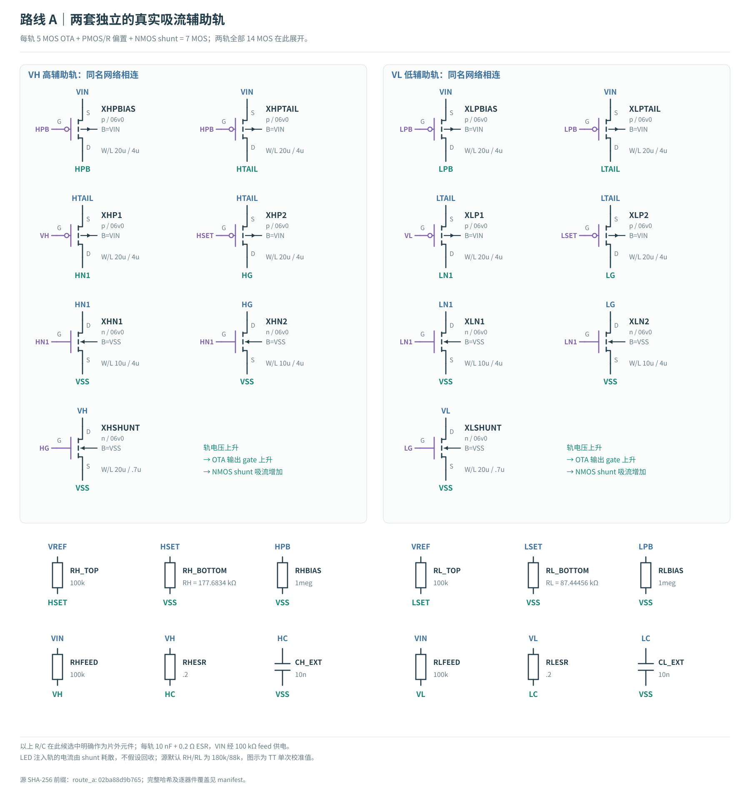</a><figcaption>两路真实辅助电源：反馈shunt吸收回流，外接10nF去耦（点击查看大图）</figcaption></figure>


每路辅助轨包含7MOS反馈shunt、100kΩ从VIN馈电与10nF片外去耦；VREF分压给HSET/LSET。它是可运行的耗散式实验实现，并非A拓扑的最低功耗设计。正常OP通信测试与冷启动测试分开；A没有实现DISABLE或自主上电保护。

### B：真实参考、基础电流和75µA转向

VREF经200k/50k分压约0.5V，V-to-I环路驱动SENSE/RSET形成参考电流。理想关系是ISET≈VSET/RSET；本次B的实际SENSE约0.5004996V、RSET20.126535kΩ，故ISET约24.8677µA，对应LED基础电流25.0007µA。真实环路与镜像条件下两者有偏差，使用实际仿真数值校准，不能把理想等式当作已实现精度。XREF把它转换成BIAS，XBASE形成约25µA基础LED电流，XTAIL提供额外约75µA；互补栅极GP/GB把尾电流转到LED或dummy。dummy不是免费路径，VIN持续为它供电。

<figure><a href="figures/b-core.svg">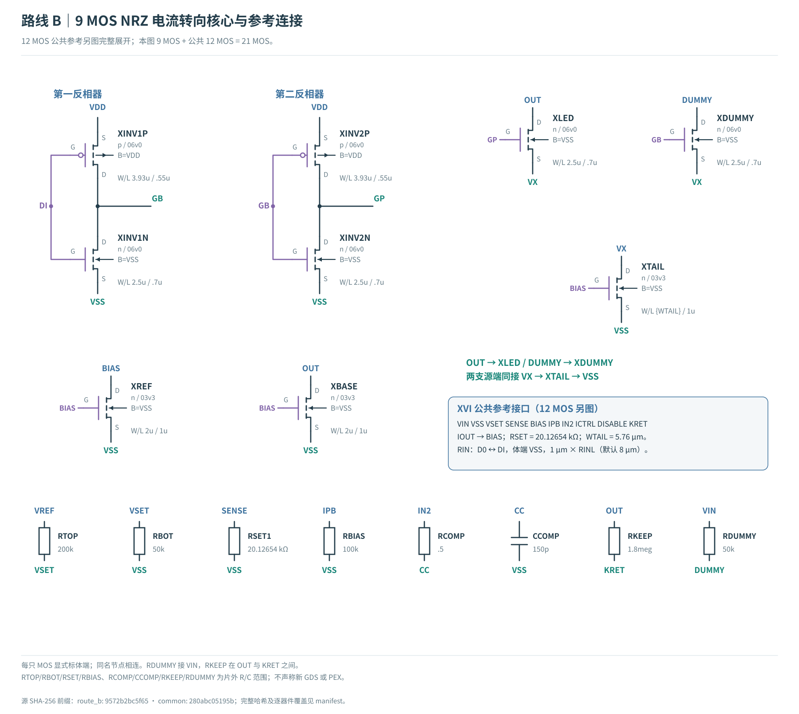</a><figcaption>B的9MOS核心与真实参考接口，RSET/补偿/dummy/keeper均纳入端口能量（点击查看大图）</figcaption></figure>

<figure><a href="figures/common-reference.svg">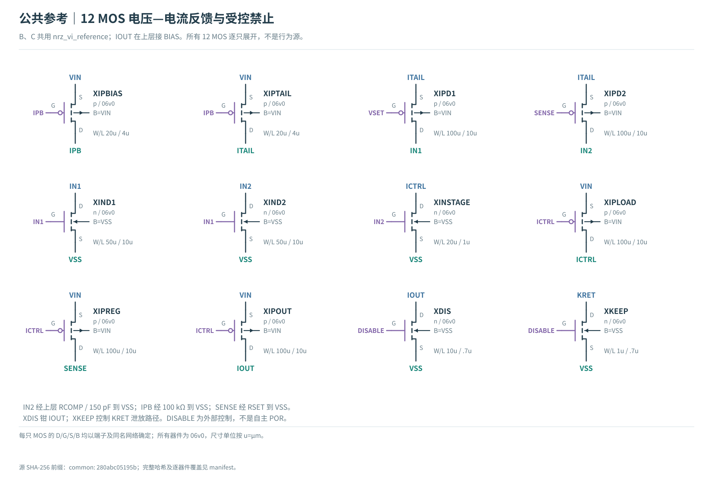</a><figcaption>B/C共用的12MOS参考模块；包含真实放大与输出器件及禁止/keeper（点击查看大图）</figcaption></figure>


### C：Gray数据如何成为四档电流

D1D0=00/01/11/10依次对应0/1/2/3个开启单元。真实静态CMOS产生`T1=D1 OR D0`、`T2=D1`、`T3=D1 AND NOT D0`。三单元各增加约25µA，与基础25µA叠加；单元开关/缓冲沿用同一组06v0尺寸作为可运行起点，尚未针对25µA单位优化，故本轮能量不是PAM4的理论下界。未送LED的电流走各自dummy。PAM4较低符号率来自每符号2bit，但相邻目标间距只有25µA，不能假定比NRZ更抗噪。

<figure><a href="figures/c-overview.svg">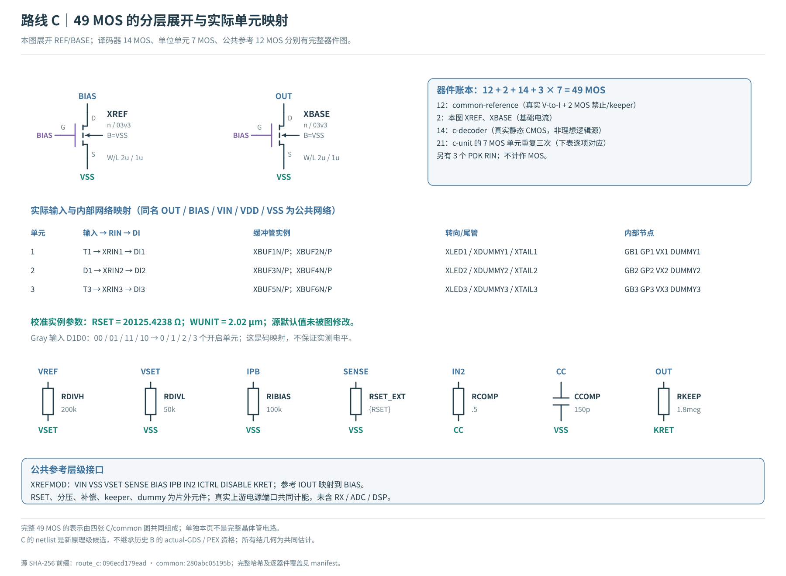</a><figcaption>C的49MOS账本与三路实际网络映射：12＋2＋14＋3×7（点击查看大图）</figcaption></figure>

<figure><a href="figures/c-decoder.svg">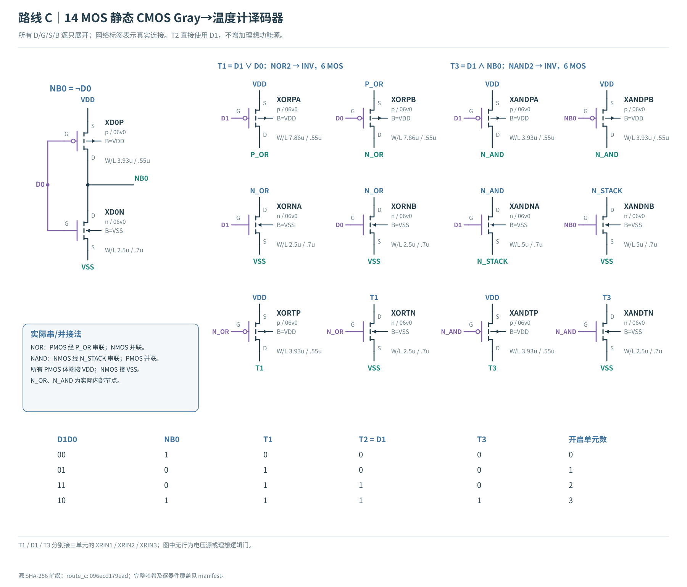</a><figcaption>C的14MOS真实Gray到温度计码译码；没有理想逻辑源隐藏能量（点击查看大图）</figcaption></figure>

<figure><a href="figures/c-unit.svg">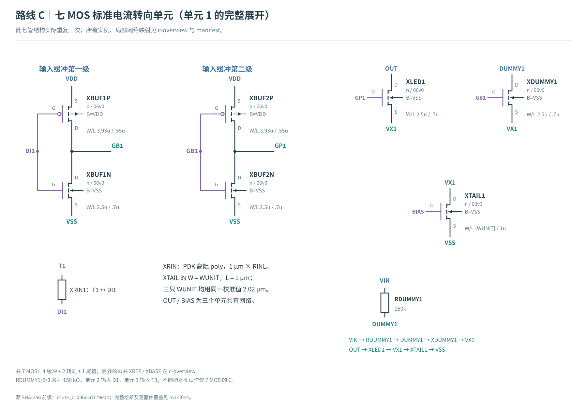</a><figcaption>C的7MOS标准单位电流单元，重复三次并明确D/G/S/B（点击查看大图）</figcaption></figure>


下表按声明25µA理想步长计算：`DNLk=(Ik+1−Ik)/25µA−1`，`INLk=(Ik−Iideal,k)/25µA`。单位均为LSB；它是本次无失配DC模型的线性度，不是量产DAC规格。

| 角落 | 三个步长DNL / LSB | 四档INL / LSB |
|---|---|---|
| TT | +0.00245 / -0.00035 / -0.00225 | +0.00008 / +0.00253 / +0.00219 / -0.00006 |
| SS | -0.00369 / -0.00549 / -0.00728 | -0.00341 / -0.00710 / -0.01258 / -0.01986 |
| FF | +0.00720 / +0.00396 / +0.00191 | +0.00432 / +0.01152 / +0.01548 / +0.01739 |


## 5．相同0.5Gb/s目标下的接收与能量

固定的是稳态电流目标和共同激励/负载，动态平均电流按实际波形报告，没有为任一路线再单独调平均值。TT本组整帧导电均值如下；它不是测得光功率，也不证明三者实际光OMA、平均光功率或真实噪声相同。

| 路线 | 整帧平均LED导电电流 / µA |
|---|---|
| A | 63.051 |
| B | 63.711 |
| C | 63.226 |


| 角落 | 路线 | 正向pJ/bit | 净pJ/bit | 错误数 | 最小判决距离µA | 最小时间ps | 最大体结正偏V | 通信/端压筛查 |
|---|---|---|---|---|---|---|---|---|
| TT | A | 2.1093 | 2.0289 | 0/4096 | 36.736 | 388.5 | 0.151 | 通过 |
| TT | B | 2.5886 | 2.5868 | 0/4096 | 18.144 | 612.2 | 0.145 | 通过 |
| TT | C | 2.8385 | 2.8080 | 0/4096 | 4.846 | 411.6 | 0.858 | 未通过 |
| SS | A | 1.8227 | 1.7762 | 0/4096 | 7.034 | 248.4 | 0.182 | 未通过 |
| SS | B | 2.4878 | 2.4866 | 0/4096 | 15.041 | 573.5 | 0.170 | 通过 |
| SS | C | 2.7255 | 2.7005 | 0/4096 | 4.288 | 449.4 | 0.722 | 未通过 |
| FF | A | 2.3264 | 2.2163 | 0/4096 | 35.846 | 289.8 | 0.146 | 通过 |
| FF | B | 2.6918 | 2.6891 | 0/4096 | 18.603 | 629.2 | 0.122 | 通过 |
| FF | C | 2.9712 | 2.9332 | 0/4096 | 4.998 | 398.6 | 0.935 | 未通过 |


通信筛查要求训练/验证零错、最小判决距离≥7.5µA、时序余量≥100ps、全部有向转换覆盖，并通过逐型号六对端压筛查。**表中通过不包含DC±5%、启动、真实噪声或光学测量通过。** A的DC失败不能被零错接收掩盖。C在TT本组内部体结正偏约0.858V；这个独立风险也不能被绝对端压小于6V掩盖。

<figure><a href="figures/eyes-tt-0p5G.svg">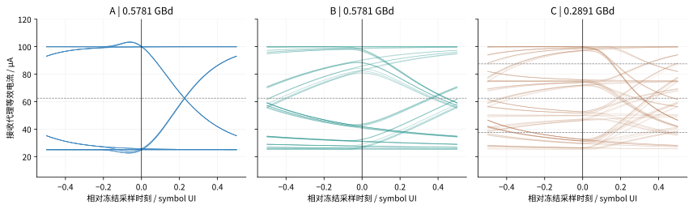</a><figcaption>TT同净吞吐接收眼图：固定取首160个验证symbol叠加示意；判据使用全部4096bits。横轴为各自symbol UI，标题保留绝对符号率（点击查看大图）</figcaption></figure>

<figure><a href="figures/energy-ports.svg">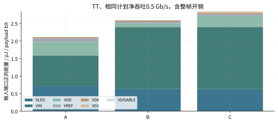</a><figcaption>七个源端口分项能量；VIN同时包含各自参考、辅助或dummy，不能把全部VIN取能都归为参考功耗（点击查看大图）</figcaption></figure>


### 5.1．为什么C零错仍没有足够余量

完整帧统计发现：TT、0.5Gb/s时，C有261/2048个符号的判决距离不足7.5µA，全部来自2→0（131次）和3→0（130次）。最差3→0是Gray10→00，仅D1变化，不能直接归咎于两bit同时变化。详见[逐转换统计](../../../evidence/fair-driver-v1/transition-review-v2.json)。

为区分栅极传播与负载建立，另做112symbol的短诊断：12种有向转换逐一保持4symbol前/4symbol后。这是独立诊断，未冒充4096bit随机帧。3→0后，GP2/3/1穿过固定1.65V（名义半VDD）分别约304/537/567ps；半电平时刻不等于完整关断。在用于这份短诊断的v1观测延迟3.8919ns处（与最终v2性能表分开），实际支路sink=25.265µA，而LED导电仍31.177µA。

<figure><a href="figures/c-current-tail.svg">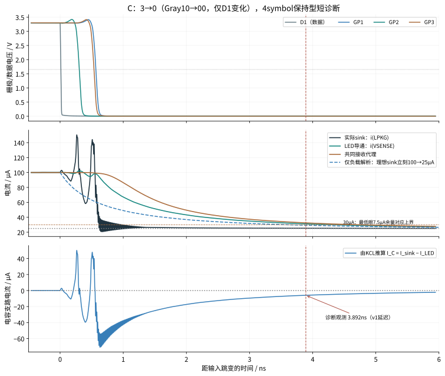</a><figcaption>从数据、MOS栅极、实际sink到LED导电/接收代理；竖线是短诊断借用的v1延迟，最终性能表已统一v2；短序列上下文另列（点击查看大图）</figcaption></figure>


关键方程是并联负载的KCL：`I_sink = I_LED(VF) + C_LED × dVF/dt`。此时差值约−5.912µA，表示电容电压正在下降；3→0的电流差积分约−80.944fC，与`C×ΔVF≈−80.980fC`相差0.0443%，12转换最大相对差0.1366%。驱动已接近新电流，不代表发光支路的导电电流已到位；早期sink在1ns仍约29.31µA，也显示实际驱动建立参与了过程。

用同一静态PWL曲线计算局部动态电阻`r_d=dVF/dI`，再乘本轮**假设**的200fF（这不是测得的载流子寿命；常数C与另加的光学一阶均待同一器件动态数据拟合）：

| 电流µA | VF / V | 局部r_d / kΩ | r_d×200fF / ns |
|---|---|---|---|
| 25 | 3.361339 | 10.768 | 2.154 |
| 50 | 3.566364 | 6.028 | 1.206 |
| 75 | 3.686024 | 3.985 | 0.797 |
| 100 | 3.767910 | 2.955 | 0.591 |


即使理想sink立刻由100降到25µA，仅此PWL＋电容的解析对照，到32.5µA也需约2.807ns，到30µA需约3.586ns；这里30µA正是最低眼达到7.5µA判决距离的上界。这个对照排除了实际驱动/封装/光学/RX，**只隔离电气负载作用，不进入三路线能耗比较，也不证明真实LED有该时间常数**。原始电流还要再经过共同200ps光学代理和1GHz接收代理。四电平虽降低符号率，窄眼仍要求更充分的建立；NRZ拥有更宽的两电平间距。这是本次候选差异的具体机制，不能推广为所有PAM4都会较差。

<figure><a href="figures/c-body-forward.svg">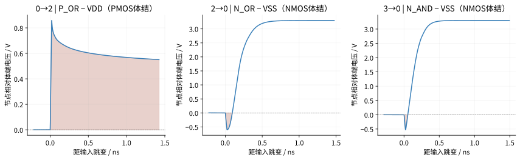</a><figcaption>另一个独立限制：真实CMOS译码内部节点的瞬态体结正偏，不能用六对绝对端压通过来覆盖（点击查看大图）</figcaption></figure>


短波形还复现P_OR相对VDD约＋0.858V、N_OR相对地约−0.604V、N_AND约−0.527V。这是节点电压层面的体结风险证据；尚未分离内部Miller耦合/浮置节点的各自贡献，也未以体端电流或工艺可靠性数据闭合。应继续做输入缓冲/内部节点控制的单因素设计与验证。参见[负载解析计算](../../../evidence/fair-driver-v1/load-dynamics.json)、[短诊断原始摘要](../../../build/fair-driver-v1/c-transition-probe/diagnostic-summary.json)与[图来源哈希](../../../evidence/fair-driver-v1/load-diagnostic-figures.json)。

## 6．速率扫描与局限：只报告已采样的可行点

| 路线 | 三角落通信筛查均通过的已采样净速率 / Gb/s | 解释 |
|---|---|---|
| A | 0.1、0.25 | 稀疏网格，不是连续Fmax；另看DC精度和启动 |
| B | 0.1、0.25、0.5 | 稀疏网格，不是连续Fmax；另看DC精度和启动 |
| C | 0.1、0.25 | 稀疏网格，不是连续Fmax；另看DC精度和启动 |


<figure><a href="figures/energy-rates.svg">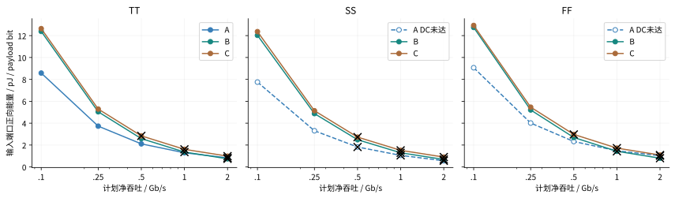</a><figcaption>相同净目标的端口能量：黑叉为通信失败，虚线为DC电流精度未达；C体结风险另列，图不构成安全合格能效排名（点击查看大图）</figcaption></figure>

<figure><a href="figures/receiver-margins.svg">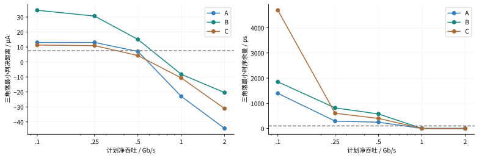</a><figcaption>每个净速率取三角落最差幅度和时序余量；虚线为共同门槛（点击查看大图）</figcaption></figure>


<details><summary>展开全部45点数值（包括失败点）</summary>

<table>
<thead>
<tr>
<th>case</th>
<th>正向pJ/bit</th>
<th>错误bits</th>
<th>最小距离µA</th>
<th>最小时间ps</th>
<th>通信筛查</th>
</tr>
</thead>
<tbody>
<tr>
<td>RX-FF-A-0.1G</td>
<td>9.0658</td>
<td>0</td>
<td>36.114</td>
<td>1393.9</td>
<td>通过</td>
</tr>
<tr>
<td>RX-FF-B-0.1G-retry900</td>
<td>12.7460</td>
<td>0</td>
<td>36.511</td>
<td>1850.9</td>
<td>通过</td>
</tr>
<tr>
<td>RX-FF-C-0.1G-retry900</td>
<td>12.9281</td>
<td>0</td>
<td>11.388</td>
<td>5147.4</td>
<td>通过</td>
</tr>
<tr>
<td>RX-SS-A-0.1G</td>
<td>7.7534</td>
<td>0</td>
<td>13.000</td>
<td>3374.9</td>
<td>通过</td>
</tr>
<tr>
<td>RX-SS-B-0.1G</td>
<td>12.0250</td>
<td>0</td>
<td>34.499</td>
<td>2021.0</td>
<td>通过</td>
</tr>
<tr>
<td>RX-SS-C-0.1G</td>
<td>12.3632</td>
<td>0</td>
<td>11.285</td>
<td>4695.8</td>
<td>通过</td>
</tr>
<tr>
<td>RX-TT-A-0.1G</td>
<td>8.5779</td>
<td>0</td>
<td>37.303</td>
<td>1960.4</td>
<td>通过</td>
</tr>
<tr>
<td>RX-TT-B-0.1G</td>
<td>12.3842</td>
<td>0</td>
<td>36.574</td>
<td>1895.4</td>
<td>通过</td>
</tr>
<tr>
<td>RX-TT-C-0.1G-retry900</td>
<td>12.6374</td>
<td>0</td>
<td>11.401</td>
<td>5024.7</td>
<td>通过</td>
</tr>
<tr>
<td>RX-FF-A-0.25G</td>
<td>4.0130</td>
<td>0</td>
<td>36.116</td>
<td>289.8</td>
<td>通过</td>
</tr>
<tr>
<td>RX-FF-B-0.25G</td>
<td>5.2061</td>
<td>0</td>
<td>30.652</td>
<td>938.5</td>
<td>通过</td>
</tr>
<tr>
<td>RX-FF-C-0.25G</td>
<td>5.4623</td>
<td>0</td>
<td>10.929</td>
<td>617.5</td>
<td>通过</td>
</tr>
<tr>
<td>RX-SS-A-0.25G</td>
<td>3.3063</td>
<td>0</td>
<td>13.019</td>
<td>295.4</td>
<td>通过</td>
</tr>
<tr>
<td>RX-SS-B-0.25G</td>
<td>4.8726</td>
<td>0</td>
<td>31.098</td>
<td>816.1</td>
<td>通过</td>
</tr>
<tr>
<td>RX-SS-C-0.25G</td>
<td>5.1361</td>
<td>0</td>
<td>10.953</td>
<td>643.2</td>
<td>通过</td>
</tr>
<tr>
<td>RX-TT-A-0.25G</td>
<td>3.7277</td>
<td>0</td>
<td>37.418</td>
<td>756.1</td>
<td>通过</td>
</tr>
<tr>
<td>RX-TT-B-0.25G</td>
<td>5.0380</td>
<td>0</td>
<td>30.856</td>
<td>885.2</td>
<td>通过</td>
</tr>
<tr>
<td>RX-TT-C-0.25G</td>
<td>5.2898</td>
<td>0</td>
<td>10.994</td>
<td>600.8</td>
<td>通过</td>
</tr>
<tr>
<td>RX-FF-A-0.5G</td>
<td>2.3264</td>
<td>0</td>
<td>35.846</td>
<td>289.8</td>
<td>通过</td>
</tr>
<tr>
<td>RX-FF-B-0.5G-retry900</td>
<td>2.6918</td>
<td>0</td>
<td>18.603</td>
<td>629.2</td>
<td>通过</td>
</tr>
<tr>
<td>RX-FF-C-0.5G-retry900</td>
<td>2.9712</td>
<td>0</td>
<td>4.998</td>
<td>398.6</td>
<td>未通过</td>
</tr>
<tr>
<td>RX-SS-A-0.5G</td>
<td>1.8227</td>
<td>0</td>
<td>7.034</td>
<td>248.4</td>
<td>未通过</td>
</tr>
<tr>
<td>RX-SS-B-0.5G</td>
<td>2.4878</td>
<td>0</td>
<td>15.041</td>
<td>573.5</td>
<td>通过</td>
</tr>
<tr>
<td>RX-SS-C-0.5G</td>
<td>2.7255</td>
<td>0</td>
<td>4.288</td>
<td>449.4</td>
<td>未通过</td>
</tr>
<tr>
<td>RX-TT-A-0.5G</td>
<td>2.1093</td>
<td>0</td>
<td>36.736</td>
<td>388.5</td>
<td>通过</td>
</tr>
<tr>
<td>RX-TT-B-0.5G</td>
<td>2.5886</td>
<td>0</td>
<td>18.144</td>
<td>612.2</td>
<td>通过</td>
</tr>
<tr>
<td>RX-TT-C-0.5G</td>
<td>2.8385</td>
<td>0</td>
<td>4.846</td>
<td>411.6</td>
<td>未通过</td>
</tr>
<tr>
<td>RX-FF-A-1G</td>
<td>1.4791</td>
<td>0</td>
<td>26.563</td>
<td>266.5</td>
<td>通过</td>
</tr>
<tr>
<td>RX-FF-B-1G</td>
<td>1.4328</td>
<td>162</td>
<td>-4.320</td>
<td>0.0</td>
<td>未通过</td>
</tr>
<tr>
<td>RX-FF-C-1G</td>
<td>1.7212</td>
<td>460</td>
<td>-7.001</td>
<td>0.0</td>
<td>未通过</td>
</tr>
<tr>
<td>RX-SS-A-1G</td>
<td>1.0593</td>
<td>830</td>
<td>-22.966</td>
<td>0.0</td>
<td>未通过</td>
</tr>
<tr>
<td>RX-SS-B-1G</td>
<td>1.2938</td>
<td>142</td>
<td>-8.248</td>
<td>0.0</td>
<td>未通过</td>
</tr>
<tr>
<td>RX-SS-C-1G</td>
<td>1.5175</td>
<td>531</td>
<td>-10.655</td>
<td>0.0</td>
<td>未通过</td>
</tr>
<tr>
<td>RX-TT-A-1G</td>
<td>1.2958</td>
<td>0</td>
<td>26.320</td>
<td>357.8</td>
<td>通过</td>
</tr>
<tr>
<td>RX-TT-B-1G</td>
<td>1.3627</td>
<td>117</td>
<td>-5.849</td>
<td>0.0</td>
<td>未通过</td>
</tr>
<tr>
<td>RX-TT-C-1G</td>
<td>1.6093</td>
<td>467</td>
<td>-8.913</td>
<td>0.0</td>
<td>未通过</td>
</tr>
<tr>
<td>RX-FF-A-2G</td>
<td>1.0297</td>
<td>512</td>
<td>-6.207</td>
<td>0.0</td>
<td>未通过</td>
</tr>
<tr>
<td>RX-FF-B-2G</td>
<td>0.7997</td>
<td>889</td>
<td>-16.861</td>
<td>0.0</td>
<td>未通过</td>
</tr>
<tr>
<td>RX-FF-C-2G</td>
<td>1.0877</td>
<td>1109</td>
<td>-29.128</td>
<td>0.0</td>
<td>未通过</td>
</tr>
<tr>
<td>RX-SS-A-2G</td>
<td>0.5667</td>
<td>1424</td>
<td>-44.370</td>
<td>0.0</td>
<td>未通过</td>
</tr>
<tr>
<td>RX-SS-B-2G</td>
<td>0.6831</td>
<td>936</td>
<td>-20.442</td>
<td>0.0</td>
<td>未通过</td>
</tr>
<tr>
<td>RX-SS-C-2G</td>
<td>0.9029</td>
<td>1223</td>
<td>-31.117</td>
<td>0.0</td>
<td>未通过</td>
</tr>
<tr>
<td>RX-TT-A-2G</td>
<td>0.8272</td>
<td>1044</td>
<td>-18.139</td>
<td>0.0</td>
<td>未通过</td>
</tr>
<tr>
<td>RX-TT-B-2G</td>
<td>0.7456</td>
<td>918</td>
<td>-17.396</td>
<td>0.0</td>
<td>未通过</td>
</tr>
<tr>
<td>RX-TT-C-2G</td>
<td>0.9877</td>
<td>1118</td>
<td>-29.257</td>
<td>0.0</td>
<td>未通过</td>
</tr>
</tbody>
</table>
</details>

A在SS/FF即使接收通过，DC电流目标也未达到；尤其SS高档电流更小，不能把由此降低的能量称为同输出性能优势。C的内部体结风险尚未闭合，也不能将低速接收通过写成完整安全合格。

能量随速率提高而降低的一部分原因，是固定参考/辅助电源功率被更多比特分摊；不能只看更低pJ/bit，而忽略该点已经闭眼、出错或违反时序门槛。C的符号率减半并不消除译码路径差异、瞬间误码和三个眼的最小间距约束。

## 7．数值审查、失败与待闭合项目

所有通信从已建立的DC工作点开始，等效光学与接收状态也从初始电流开始。本轮不借此声称上电已经稳定。A独立探针（VIN同时给LED供电，与正式七端口测试台分开）在1µs共同供电斜坡诊断中，两档峰值约449.6µA和1319.3µA；电源全幅后约117µs/41.3µs仍最后一次位于目标±5%区间之外（随后保持在区间内至1ms终点），且XPOUT体结正偏约0.823/0.792V。**A启动未闭合。** 原始失败保留在`build/fair-driver-v1-a-probe/`，定义和精确窗口见A设计说明。

B/C有真实DISABLE/keeper器件，但本轮正常通信固定DISABLE=0，未实现自主POR，也不能把历史受控启动结果移植为当前新网表的通过。逐型号端压通过只是一项模型内筛查，不代表体结注入、ESD、可靠性和流片签核通过。全部45个基线点中，最大已观察体结正偏约0.935V；各实例/角落的具体值保留在summary.json的stress列表中。

为控制存储量，最终矩阵保留**全部原始自适应求解时刻和LED导通电流**，直接送入共同接收器，不作等间隔抽样。七端口能量和全部MOS应力在求解器原始网格计算；正/负功率积分都扣除线性过零的三角形修正。完整内部节点B波形另留作独立对照。曾试用的均匀导出原型保留，但不进入最终矩阵，避免C在同净率下被更粗的导出步长影响。

计算超时属于执行资源限制，不直接判电路失败；原超时日志/回执保留，重跑只延长wall-clock到900s，使用带retry900后缀的新case且不改电路/精度/接收条件。结果表优先引用已完成重跑，并保留执行名称。

源文件、数据帧、模型与接收器均哈希冻结。参数变更或容差控制另起case，不覆盖原结果。能量、接收和步长细化的独立复核与全局v2重分析身份见下方证据文件；分析器通过与电路通过是不同事项。

仍待确认：真实LED的L–I、偏置/温度/电容/载流子寿命；PD/TIA噪声、shot noise、时钟抖动和FEC；DAC/电流镜失配及阵列串扰；上游电源效率和实际可共享参考比例；配对版图的互连、封装、PEX及启动/关断安全。本文不把这些未建模项默认为相同或为零。

### 单因素容差、供电与数值控制

下列结果与45点基线分开：32个TT直流点覆盖VREF±0.2%，B/C的RSET±0.1%，A两只分压下电阻同向±0.1%；未枚举所有电阻的独立组合、温漂或PVT组合。瞬态控制保持原LED/RX：每symbol最大步长40→80、PDK RIN单独res_ss、上游VDD＋50mV周期扰动，以及C的D1相对D0±20ps偏斜。VDD源扰动从200ns起、2ns边沿、20ns宽、800ns周期，经过相同1Ω/2nH和100nF/0.2Ω网络，覆盖训练与验证。每case仍采用同一训练预算，不用验证数据调相。扰动case的端口账本还包含共同100nF去耦的往返充放电，因此必须同时看返回和净能量；它用于扰动响应，不进入稳定供电下的正常通信能效排名。

| 控制case | 正向pJ/bit | 返回pJ/bit | 净pJ/bit | 错误bits | 最小距离µA | 最小时间ps | 通信筛查 |
|---|---|---|---|---|---|---|---|
| RX-A-RINresSS-0.25G | 3.7288 | 0.0800 | 3.6488 | 0 | 37.418 | 758.45 | 通过 |
| RX-A-VDDpulse50mV-0.25G | 17.5642 | 13.5379 | 4.0264 | 0 | 37.439 | 751.68 | 通过 |
| RX-A-step80-0.5G | 2.1094 | 0.0805 | 2.0289 | 0 | 36.736 | 388.54 | 通过 |
| RX-B-RINresSS-0.25G | 5.0385 | 0.0016 | 5.0369 | 0 | 30.847 | 886.07 | 通过 |
| RX-B-VDDpulse50mV-0.25G | 19.1096 | 13.6948 | 5.4148 | 0 | 30.855 | 885.11 | 通过 |
| RX-B-step80-0.5G | 2.5886 | 0.0018 | 2.5868 | 0 | 18.141 | 612.07 | 通过 |
| RX-C-RINresSS-0.25G | 5.2905 | 0.0305 | 5.2600 | 0 | 10.994 | 605.71 | 通过 |
| RX-C-VDDpulse50mV-0.25G | 19.1752 | 13.5366 | 5.6386 | 0 | 10.993 | 600.71 | 通过 |
| RX-C-skew+20ps-0.5G | 2.8361 | 0.0306 | 2.8055 | 0 | 4.846 | 411.56 | 未通过 |
| RX-C-skew-20ps-0.5G | 2.8427 | 0.0312 | 2.8115 | 0 | 4.846 | 411.56 | 未通过 |
| RX-C-step80-0.5G | 2.8386 | 0.0306 | 2.8080 | 0 | 4.839 | 411.35 | 未通过 |


数值对照差值均为80相对40；事先设定能量≤0.2%、判决距离≤0.2µA、时间≤20ps、体结峰≤5mV且错误数一致的复核门槛。它检验所报指标的离散敏感性，不新增物理资格。三个数值控制均一致，C在该点仍未达到电流判决余量，不能将数值一致写成电路通过。

| 路线 | 能量变化 | 距离变化µA | 时间变化ps | 体结峰变化mV | 数值检查 |
|---|---|---|---|---|---|
| A | +0.002988% | -0.000368 | +0.008 | -0.004 | 一致 |
| B | +0.000239% | -0.003030 | -0.105 | -0.000 | 一致 |
| C | +0.000412% | -0.006882 | -0.216 | +0.000 | 一致 |


<details><summary>展开32个参考/电阻容差DC结果</summary>

<table>
<thead>
<tr>
<th>case</th>
<th>LED电流µA</th>
<th>相对目标误差</th>
</tr>
</thead>
<tbody>
<tr>
<td>DC-A-Rtol+0.001-L0</td>
<td>24.9548</td>
<td>-0.1809%</td>
</tr>
<tr>
<td>DC-A-Rtol+0.001-L1</td>
<td>99.8106</td>
<td>-0.1894%</td>
</tr>
<tr>
<td>DC-A-Rtol-0.001-L0</td>
<td>25.0447</td>
<td>+0.1789%</td>
</tr>
<tr>
<td>DC-A-Rtol-0.001-L1</td>
<td>100.1771</td>
<td>+0.1771%</td>
</tr>
<tr>
<td>DC-A-VREF+0.002-L0</td>
<td>24.7498</td>
<td>-1.0007%</td>
</tr>
<tr>
<td>DC-A-VREF+0.002-L1</td>
<td>99.3070</td>
<td>-0.6930%</td>
</tr>
<tr>
<td>DC-A-VREF-0.002-L0</td>
<td>25.2493</td>
<td>+0.9974%</td>
</tr>
<tr>
<td>DC-A-VREF-0.002-L1</td>
<td>100.6843</td>
<td>+0.6843%</td>
</tr>
<tr>
<td>DC-B-Rtol+0.001-L0</td>
<td>24.9760</td>
<td>-0.0959%</td>
</tr>
<tr>
<td>DC-B-Rtol+0.001-L1</td>
<td>99.9166</td>
<td>-0.0834%</td>
</tr>
<tr>
<td>DC-B-Rtol-0.001-L0</td>
<td>25.0254</td>
<td>+0.1015%</td>
</tr>
<tr>
<td>DC-B-Rtol-0.001-L1</td>
<td>100.1137</td>
<td>+0.1137%</td>
</tr>
<tr>
<td>DC-B-VREF+0.002-L0</td>
<td>25.0502</td>
<td>+0.2007%</td>
</tr>
<tr>
<td>DC-B-VREF+0.002-L1</td>
<td>100.2127</td>
<td>+0.2127%</td>
</tr>
<tr>
<td>DC-B-VREF-0.002-L0</td>
<td>24.9512</td>
<td>-0.1954%</td>
</tr>
<tr>
<td>DC-B-VREF-0.002-L1</td>
<td>99.8173</td>
<td>-0.1827%</td>
</tr>
<tr>
<td>DC-C-Rtol+0.001-L0</td>
<td>24.9774</td>
<td>-0.0905%</td>
</tr>
<tr>
<td>DC-C-Rtol+0.001-L1</td>
<td>50.0140</td>
<td>+0.0281%</td>
</tr>
<tr>
<td>DC-C-Rtol+0.001-L2</td>
<td>74.9808</td>
<td>-0.0256%</td>
</tr>
<tr>
<td>DC-C-Rtol+0.001-L3</td>
<td>99.8999</td>
<td>-0.1001%</td>
</tr>
<tr>
<td>DC-C-Rtol-0.001-L0</td>
<td>25.0267</td>
<td>+0.1069%</td>
</tr>
<tr>
<td>DC-C-Rtol-0.001-L1</td>
<td>50.1128</td>
<td>+0.2256%</td>
</tr>
<tr>
<td>DC-C-Rtol-0.001-L2</td>
<td>75.1288</td>
<td>+0.1718%</td>
</tr>
<tr>
<td>DC-C-Rtol-0.001-L3</td>
<td>100.0971</td>
<td>+0.0971%</td>
</tr>
<tr>
<td>DC-C-VREF+0.002-L0</td>
<td>25.0516</td>
<td>+0.2062%</td>
</tr>
<tr>
<td>DC-C-VREF+0.002-L1</td>
<td>50.1625</td>
<td>+0.3249%</td>
</tr>
<tr>
<td>DC-C-VREF+0.002-L2</td>
<td>75.2033</td>
<td>+0.2710%</td>
</tr>
<tr>
<td>DC-C-VREF+0.002-L3</td>
<td>100.1963</td>
<td>+0.1963%</td>
</tr>
<tr>
<td>DC-C-VREF-0.002-L0</td>
<td>24.9525</td>
<td>-0.1899%</td>
</tr>
<tr>
<td>DC-C-VREF-0.002-L1</td>
<td>49.9643</td>
<td>-0.0715%</td>
</tr>
<tr>
<td>DC-C-VREF-0.002-L2</td>
<td>74.9062</td>
<td>-0.1251%</td>
</tr>
<tr>
<td>DC-C-VREF-0.002-L3</td>
<td>99.8005</td>
<td>-0.1995%</td>
</tr>
</tbody>
</table>
</details>

完整控制与实际执行身份见[controls-summary.json](../../../evidence/fair-driver-v1/controls-summary.json)。本组测试也未包含真实电源IC效率、噪声、实体接收器或完整容差签核。

## 8．下一步怎样决定架构

先把“目标吞吐＋误差/噪声要求＋电流精度＋启动安全＋面积/电源预算”同时固定，再比较满足约束的端口能量。本轮没有把B选为默认优胜者，也没有把C的较低符号率当作必然优势。A的当前实现需先补跨角落电流控制和启动；B需降低真实参考/dummy开销并检验布局寄生；C需降低内部节点体结正偏、量化负载电容/低电平建立，再验证失配、光学非线性与实体三阈值接收代价。共同方向包括获得偏置相关C与L–I测量；若研究预加重，应先同时限定峰值/平均电流和能量，不能只给某一路线额外驱动预算。

下一阶段应保留这三份独立候选，先按暴露出的限制做单因素修改，随后进行**同等级实际布局与PEX**。已有历史B版图不等于本轮B或C的版图；本轮没有新增GDS、DRC/LVS、PEX、硅或实测光链路。

## 9．来源、证据与复现

LED数值来自[Lin等公开源数据，Zenodo DOI](https://doi.org/10.5281/zenodo.20034288)的I-V.xlsx、Sheet1 A3:B102；本项目冻结的是该曲线的PWL电气模型，见[模型卡与未支持项目](../../../analog/models/measured-led/model-card.json)、[数据署名/许可](../../../analog/models/measured-led/NOTICE.md)和[模型来源锁定](../../../analog/models/measured-led/source-lock.json)。本轮网页访问源数据返回429，未用网页可达性替代已有归档哈希证据。

GF180模型种类参见[GlobalFoundries官方0.18µm、3.3V/6V模型说明](https://gf180mcu-pdk.readthedocs.io/en/latest/analog/model_parameters/LV/LV_1.html)，本轮具体版本以冻结文件SHA为准。03v3按3.63V、06v0按6V的六对绝对端差是本项目筛查规则，不能替代工艺完整SOA/可靠性规范。

- [冻结规格](../../superpowers/specs/2026-10-25-fair-driver-v1.md)；[执行计划](../../superpowers/plans/2026-10-25-fair-driver-v1.md)。
- [当前共同结果JSON](../../../evidence/fair-driver-v1/summary.json)；[A说明](../../../evidence/fair-driver-v1/a-design.md)；[C说明](../../../evidence/fair-driver-v1/c-design.md)。
- [接收合同](../../../evidence/fair-driver-v1/rx-contract.md)；[独立能量/应力审计](../../../evidence/fair-driver-v1/independent-audit.json)；[v1三点独立解析滤波审计](../../../evidence/fair-driver-v1/rx-audit.json)；[最终共同延迟v2合同](../../../evidence/fair-driver-v1/rx-equal-latency-v2-contract.md)；[v2全数据索引](../../../evidence/fair-driver-v1/rx-equal-latency-v2-index.json)；[v2三点独立解析滤波审计](../../../evidence/fair-driver-v1/rx-audit-v2.json)。
- [备份与小输入恢复说明](../../../scripts/backup/fair-driver-20261025/README.md)；[项目交接与验收回执](../../development-handoff.md)。
- [源网表](../../../analog/fair_driver_v1/)；[运行器](../../../scripts/fair_driver_v1/run.py)；[矩阵](../../../scripts/fair_driver_v1/suite.py)；[图/器件哈希清单](../../../evidence/fair-driver-v1/circuit-figure-manifest.json)。

完整矩阵目录：`build/fair-driver-v1/matched-r2`。冻结输入manifest SHA-256：`d7bf8eaba3169347b91f054d576248222541b0af0440c8a1c35f2bd2bab48cba`。冻结manifest中的source_commit是实验启动时的checkout基线；新增工作源以inputs/execution-sources的SHA为准。最终GitHub交付标签另绑定包含这些源的公开提交，不混为同一身份。每个case保留实际deck、ngspice退出状态/日志、执行器源身份、原始波形与gzip哈希；新压缩波形经解压哈希核对后才移除未压缩副本。

以下命令是**全量归档恢复后**的缓存检查/报告重建；需要inputs、results、waveforms三个分组及report-font，已有case会被跳过，不代表新的独立仿真。只恢复小输入/结果时，应使用备份说明中的独立新work DC smoke，不直接执行全矩阵重分析。

```sh
build/layout/venv/bin/python -m unittest discover -s scripts/fair_driver_v1 -p 'test_*.py' -v
build/layout/venv/bin/python scripts/fair_driver_v1/suite.py --jobs 2 --timeout-s 900
build/layout/venv/bin/python scripts/fair_driver_v1/controls.py --jobs 1
build/layout/venv/bin/python scripts/fair_driver_v1/reanalyze_equal_latency_v2.py --jobs 2 --finalize
build/layout/venv/bin/python scripts/fair_driver_v1/report.py
```

若要从输入产生新的全量实验，应另建版本化work并重新冻结电路/计划/分析分母；不能把复用旧result的命令称为新仿真。本次交付会另做新检出目录的单DC复跑，未承诺第二套全矩阵重跑。

执行前须恢复冻结模型输入与本项目Python环境，`analog/models/pdk-lock.json`仅是模型子集。恢复与远端备份回执另附，不宣称完整物理PDK或跨操作系统签核。
