# 高速光发射 Driver 研究报告

**2026-11-10 · 单通道实验平台 · MicroLED 位错诊断与 VCSEL 净 32 Gb/s 复核**

## 结论与下一轮实验

- **器件尺寸与最终架构继续作为变量。** 先用单通道净 3.2 Gb/s 做可重复的工程检查点。同一 GaN 尺寸论文中，60 µm 的 OFDM 实验速率高于 20 µm。约 6–7 µm 器件曾在独立测试板上跑到 10 Gb/s NRZ，同一研究的 16 nm 集成电路抽测为 3.3 Gb/s/路。电路、光耦合与接收条件足以改变速率排序。VCSEL 的公开单通道高速结果支持并行开展偏置与调制实验。
- **下一步优先补齐输入到门极的电气预算。** 本轮前置驱动实验里，3.7 GBd、每路 10 fF 时，对称支路将观测的互补过阈时差从 128.37 ps 降至 13.09 ps。负载升到每路 50 fF，两种接法即使调整采样时间也过不了门极摆幅筛查。先抽取真实门极负载和输入路径，再决定驱动尺寸、级数、摆幅和工艺。
- **冻结条件下，三条 MicroLED 路线仍有接收错误，VCSEL r10 的典型仿真帧为零错。** 这足以决定下一步查哪里。路线选择要等待真实输入 PHY、同口径链路功耗、发光器件动态量测和新核心版图的验证。已有二维和 Blender 三维来自历史 A/B 核心的真实 GDS，完整高速 TX 有单独的布局方案图。
- **新增位错诊断和十倍目标。** MicroLED 净 3.2 Gb/s 下，B 的低寄生对照已出现零位错，仍需增加时序余量，建议优先试 B 的换流改版并保留 A 对照。VCSEL 新目标是净 **32 Gb/s**。旧 r10 在 37 GBd NRZ 的典型角复跑出现 **1,462/4,096** 位错，波形显示预驱动门极失去短脉冲。用理想门极直驱仍需解决输出过冲，光器件与接收端也要单独验证。

[位错误、改电路和路线选择](bit-errors.html) · [器件文献与数据](literature.html) · [二维与三维版图](physical/index.html) · [制造交付路线](fabrication.html) · [复现与跨电脑恢复](reproduce.html)

## 1. 从 FPGA 到发光器件

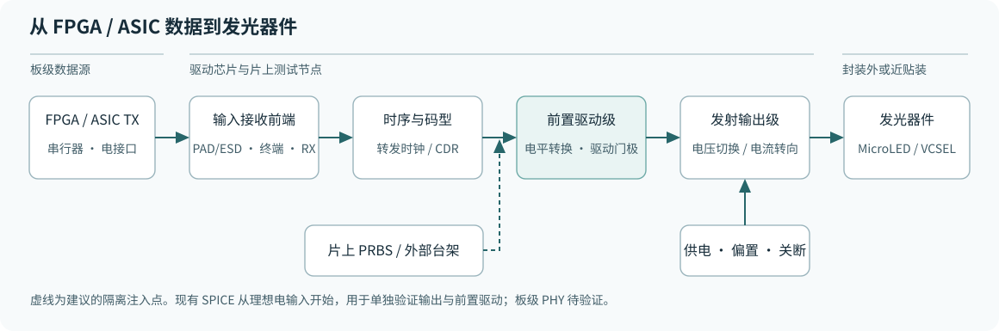

“缓冲”可以指两个电路。**输入接收前端**负责把板上差分电信号变成芯片内部可用的逻辑信号。**前置驱动级**负责把内部逻辑转换到输出晶体管所需的电压和电流，快速给门极充放电。接口电路可以在若干输出路线之间共用，预驱动摆幅、强度、时差、共模和功耗要按各输出级确定。远端光接收器 PD/TIA 属于另一侧。

| 接法 | 适用实验 | 需要确定的内容 |
|---|---|---|
| 台架或 FPGA 硬收发器，经差分传输线接入 | 验证实际板级接口和光链路 | 终端参考、差分摆幅、共模、耦合方式、S 参数、ESD 电容、抖动。根据链路长度和损耗决定 CTLE、限幅、重定时或 CDR。 |
| 同封装短距、源同步的低摆幅接口 | 将输入时钟和数据作为独立可控变量 | 转发时钟相位、建立/保持时间、跨域、两线及跨通道 skew、局部供电和回流。 |
| 片上 PRBS 或台架理想注入点 | 单独查预驱动和光输出级 | 本轮采用理想激励。片上 PRBS、可测试复用、独立时钟和关断可用于将来定位故障。 |

FPGA 普通 GPIO 与硬收发器的电气能力和引脚标准各有约束。以 AMD GTX/GTH 为例，输出是可配置的差分电流模式发射器，连接到 ASIC 前需明确发送端口设置和对端兼容条件。给定差分端接与共模后，再测实际板级眼图。PAM4 若直接从板上接入，前端须保留四电平线性。本项目 C 采用两路二值输入和本地电流 DAC。[AMD UG476 第 3 章](https://docs.amd.com/v/u/en-US/ug476_7Series_Transceivers) · [TI 高速差分接口 AC/DC 耦合](https://www.ti.com/lit/an/scaa056/scaa056.pdf)

## 2. 前置驱动实验

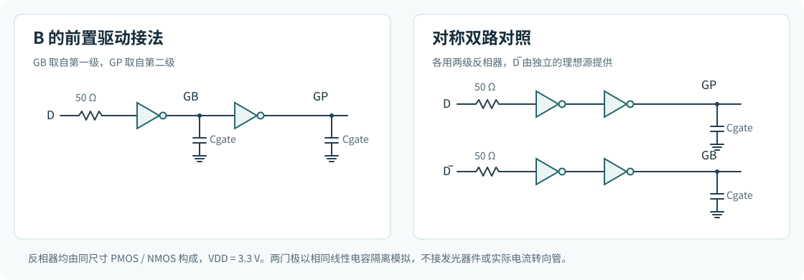

用 B 路线的 GF180 6 V 型 MOS 尺寸，按 3.3 V 电源构建两个隔离试验。两路门极各接相同的线性电容，输入为 50 Ω 源阻抗、20 ps 边沿。串接取样用两只 CMOS 反相器，从第一级取 GB、第二级取 GP。对称双路各用两级反相器，输入端另给理想 D̅。外部反相、差分接收、ESD、连线及实际输出管的非线性门电容单独待测。r10 网表也有两条独立支路，但采用另一组 3.3 V MOS 和尺寸，本小实验的数值不能搬到 r10。

24 项共覆盖 TT 27°C 的 1、3.7、6 GBd × 10、50、150 fF，另查 3.7 GBd / 50 fF 的 SS 125°C、FF −40°C 和最大步长由 2 ps 改到 1 ps。16 位热身后检查 127 位 PRBS7，先看固定 0.5 UI 的双门极 20%/80% 阈值。另以 0.005 UI 步长，在 0–2 UI 扫描同一个接收延迟，124 位共用相位，检查是否能消除固定延迟。相位最优点来自同一波形，用于诊断。电能按电源和理想输入源的净积分除以 127 线路位。

| TT 算例 | 串接取样 | 对称双路 | 工程解释 |
|---|---|---|---|
| 1 GBd、10 fF | 固定中心通过，最大 GP/GB 时差 128.37 ps，0.1393 pJ/线路位 | 固定中心通过，最大时差 13.09 ps，0.2245 pJ/线路位 | 增加两个反相器，可明显减小不对称。 |
| 3.7 GBd、10 fF | 0.5 UI 失败。最大时差 128.37 ps，最佳相位余量 +2.28 mV，仅一个采样网格点，0.1287 pJ/线路位 | 0.5 UI 失败。最大时差 13.09 ps，最佳相位余量 +571.70 mV，连续网格跨度 0.570 UI，0.2176 pJ/线路位 | 时差和绝对延迟是两件事。对称对照有较大的可用延迟窗，并增加端口能量。 |
| 3.7 GBd、50 fF | 0.5 UI 失败。最佳相位余量 −2.549 V，0.1760 pJ/线路位 | 0.5 UI 失败。最佳相位余量 −1.176 V，0.3136 pJ/线路位 | 调相无法补足电压摆幅，接下来要改驱动和负载。失败行的电能仅作尝试比较。 |

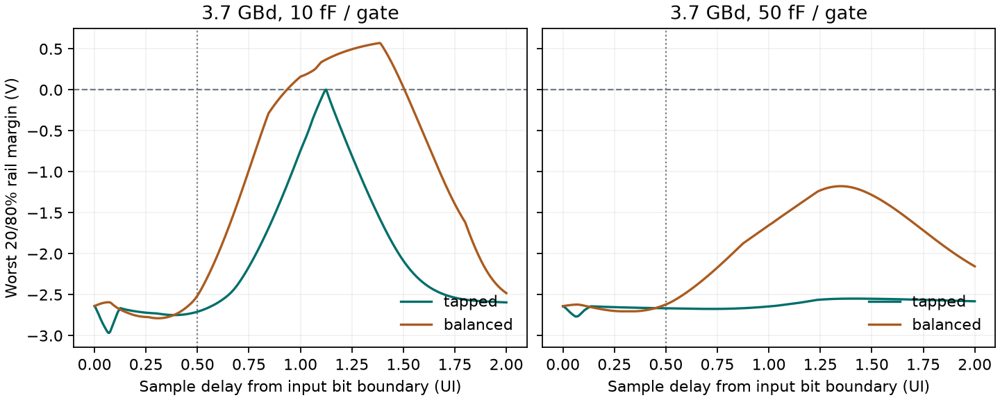

50 fF 的 SS、FF 均无通过相位。TT 50 fF 改为 1 ps 最大步长后，两种接法的最佳余量分别变化约 0.04 mV、0.11 mV，失败判定一致。6 GBd 所扫电容在同一延迟范围内均未通过。50% 交越时差仅统计同一输入 UI 内两门都各有一次交越的边沿。3.7 GBd / 50 fF 的串接和双路分别只配对 3/63 和 0/63 个边沿，时差指标缺乏可比性。20%/80% 是本实验的逻辑筛查线，实际开关电流、同时导通和换流死区要从输出管电流验证。

给预驱动做一阶估算时，`Q = C × ΔV`。例如 50 fF 门极在 3.7 GBd 的四分之一 UI（约 67.6 ps）内摆动 3.3 V，所需平均充电电流约 2.44 mA。实际门极应使用 PDK 的电荷、串联电阻及 PEX，再做脉冲电流、尖峰、电源回跳和电迁移检查。优化按 **抽负载 → 扫尺寸和级比 → 配对布线 → 联跑末级** 进行。

[电压波形及能耗图](predriver-waveforms.png) · [24 点电气结果](../../../evidence/highspeed-workbench-20261110/predriver-metrics.csv) · [相位扫描](../../../evidence/highspeed-workbench-20261110/predriver-phase.csv) · [运行及源 SHA-256](../../../evidence/highspeed-workbench-20261110/predriver-manifest.json)

## 3. A/B/C 与 VCSEL 晶体管复跑

比较帧含 4,736 线路位与 4,096 payload 位。3.7 Gb/s 线速对应净 3.2 Gb/s。NRZ 每符号 1 bit，3.7 GBd 和 270.27 ps/UI。PAM4 每符号 2 bit，1.85 GBd 和 540.54 ps/UI。GHz 描述频响，GBd 描述符号变化速率，BER 要靠明确的接收器和码型验证。Nyquist 检查点分别是 1.85 GHz 和 0.925 GHz。

| 路线 | 电流或电压如何被数据切换 | 主要代价 |
|---|---|---|
| A 电压驱动 NRZ | 两级缓冲后驱动 PMOS/NMOS 推挽，在 VH/VL 间切换 MicroLED 阴极。两只分流型供电环建立两轨。 | 阳极电压固定时，局部小信号有 `ΔI≈−ΔV_OUT/(r_d+R_s)`。Vf 温漂、两轨的偏差和负载储能会改变幅度与边沿。 |
| B 电流转向 NRZ | 基础支路设低位，尾电流通过两只 NMOS 在 LED 与 dummy 间切换。 | 需保留尾级与开关的合规电压，dummy 也耗电。门极与回流不对称会影响换流。 |
| C 单元电流 PAM4 | Gray 译码为三路 thermometer 控制，三个单位电流单元与基础支路合成四电平。 | 每个眼的理想幅度间隔约为同总摆幅 NRZ 的 1/3。失配、译码时差、体结正偏和发光非线性要单独验证。 |
| VCSEL r10 NRZ | 独立反馈偏置和调制尾电流，经对称预驱动及 NMOS 转向送到激光或 dummy。独立调节激光供电和门极驱动供电。 | 低位要结合阈值、消光比和温度来定。常开的 mA 级偏置、dummy 和稳压环耗电，冷启动另有端压风险。 |

<figure class="pair">
<a href="../fair-driver-comparison-20261025/figures/a-core.svg">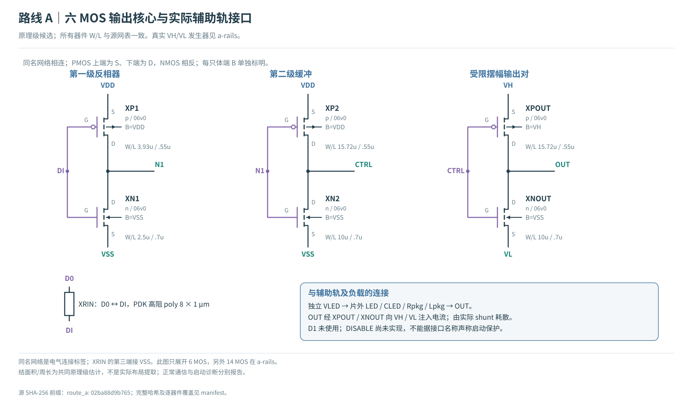</a>
<a href="../fair-driver-comparison-20261025/figures/b-core.svg">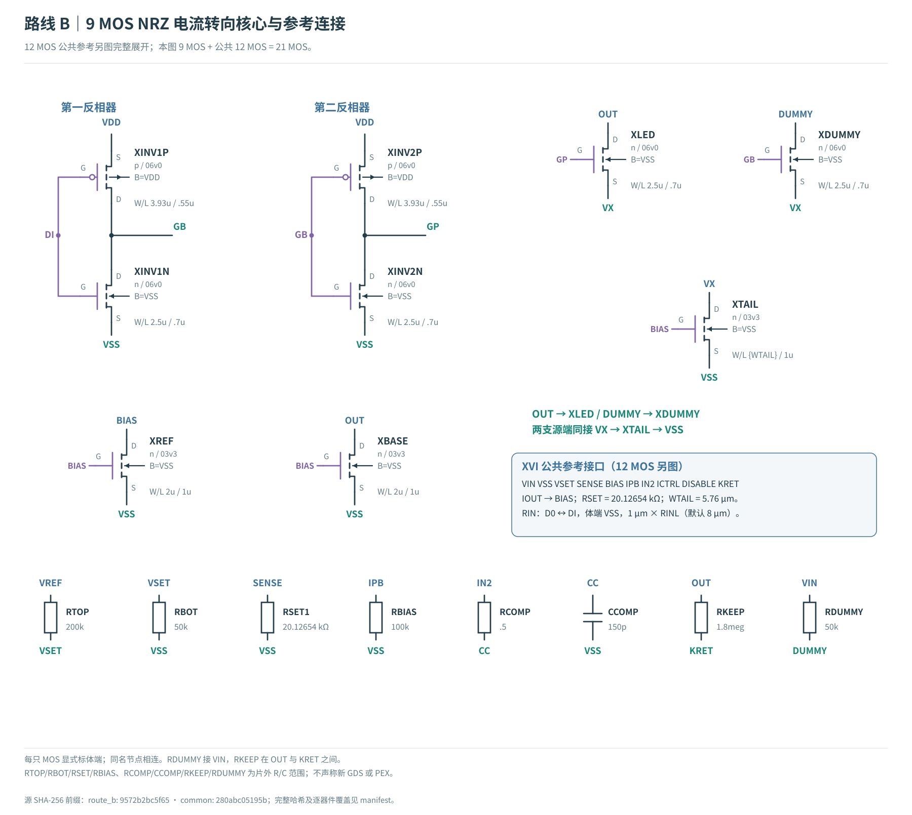</a>
<figcaption>图示 A/B 仅画电路核心。A 的分流稳压、B 的 V–I 参考见原报告，复跑使用完整网表。</figcaption>
</figure>

<figure class="pair">
<a href="../fair-driver-comparison-20261025/figures/c-overview.svg">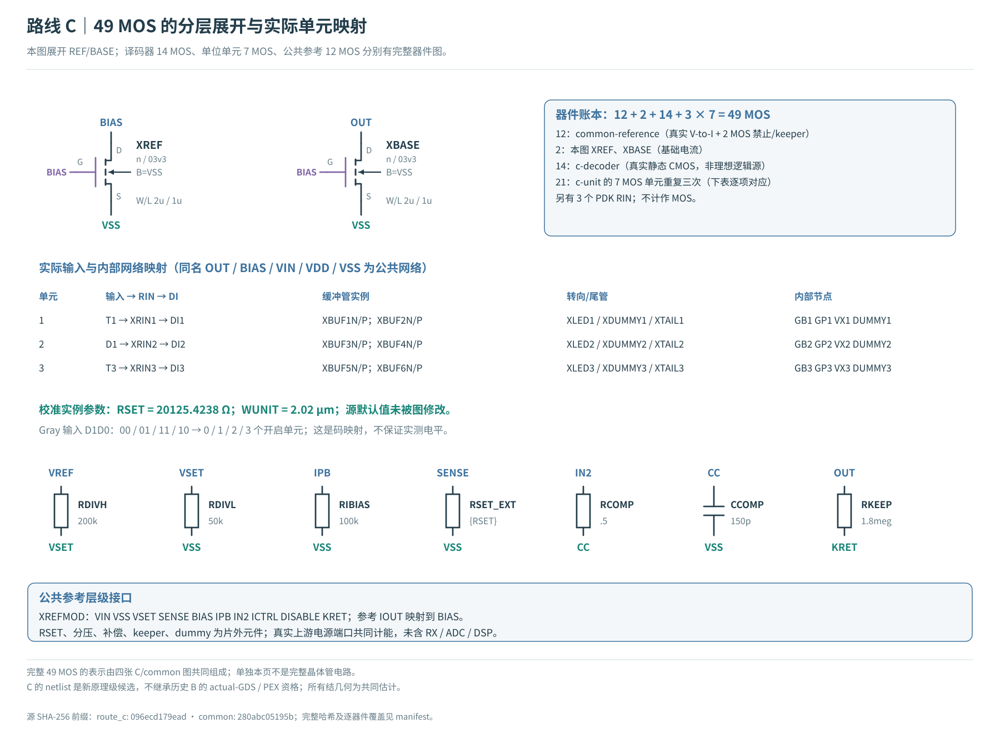</a>
<a href="../vcsel-reference-microled-dynamics-20261029/figures/servo-current-core.svg">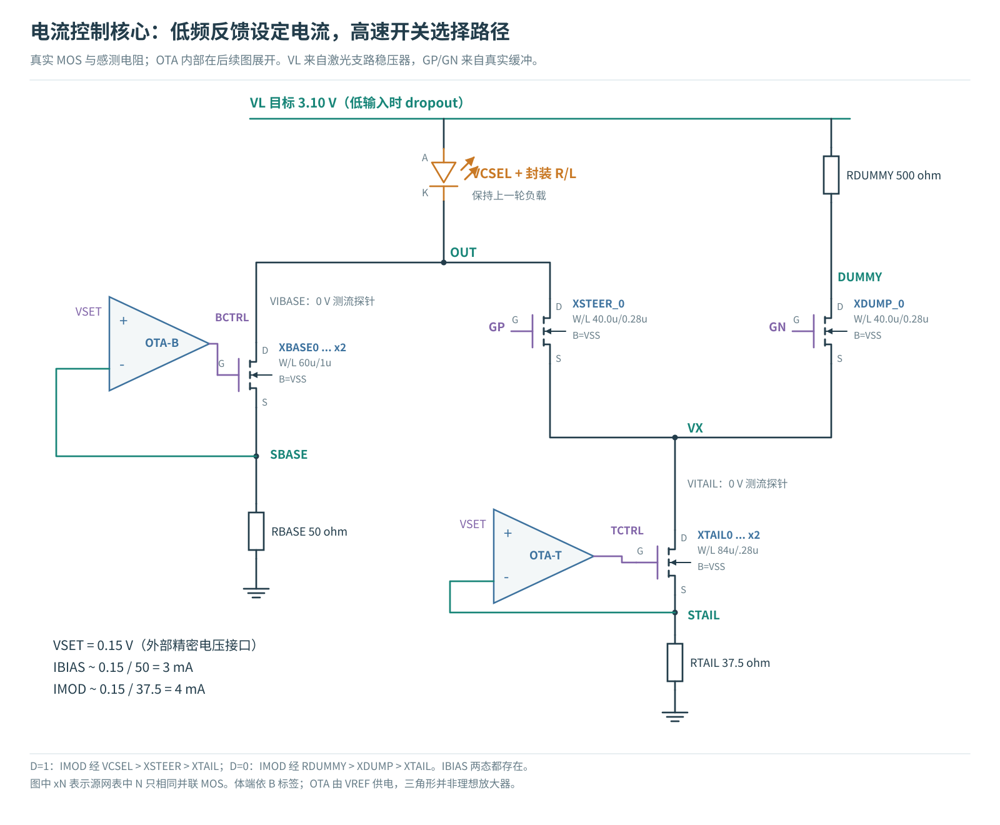</a>
<figcaption>图示 C 的电流 DAC 和 VCSEL 的偏置与调制核心。VCSEL 的双前置驱动与电源环可继续在下方查看。</figcaption>
</figure>

[A 两路供电](../fair-driver-comparison-20261025/figures/a-rails.svg) · [B/C V–I 参考](../fair-driver-comparison-20261025/figures/common-reference.svg) · [VCSEL 门极驱动](../vcsel-reference-microled-dynamics-20261029/figures/buffer-detail.svg) · [VCSEL 供电反馈](../vcsel-reference-microled-dynamics-20261029/figures/regulated-rails.svg)

ngspice 47 实跑四个冻结典型角算例，均退出 0。A/B/C 使用同一 20 µm 静态 I–V 拟合、假设 200 fF 结电容、1 Ω / 0.5 nH 封装，TT 27°C，v2 使用 200 ps 发光极点和 1 GHz 接收极点。VCSEL 用 850 nm 图读模型、假设 150 fF、0.5 Ω / 0.2 nH、TT 25°C，v3 使用该光功率代理与 5 GHz 接收极点。四者输入帧一致，所有解压的原生波形与历史哈希逐字节一致。VCSEL 网表的绝对 include 路径在规范化后相同。

<!-- REPLAY_TABLE_BEGIN -->
| 路线 | 位错误 / 比较位 | 最小阈值余量 | 最小单侧时间 | E+ / E净 (pJ/尝试净位) |
|---|---:|---:|---:|---:|
| A · v2 | 844 / 4,096 | -38.842 µAeq | 0.00 ps | 0.52563 / 0.49536 |
| B · v2 | 1,440 / 4,096 | -29.041 µAeq | 0.00 ps | 0.50139 / 0.49974 |
| C · v2 | 1,399 / 4,096 | -36.790 µAeq | 0.00 ps | 0.74452 / 0.71398 |
| VCSEL · v3 | 0 / 4,096 | +34.105 µAeq | 130.72 ps | 11.16200 / 11.14101 |
<!-- REPLAY_TABLE_END -->

每个接收代理的筛查线是训练与验证均零错，最小阈值距离 7.5 µAeq，最小单侧时间余量 100 ps。负阈值距离表示存在采样落到错误判决区。VCSEL 的 +34.105 µAeq 是将 3/7 mA 对应光功率归一化后的最差距离。不同接收条件下的 µAeq 不宜横向排行。典型角零错表示该确定性帧通过筛查，实际 BER、光路预算和峰值速率仍待测。此前 r10 快冷 20 ns 上电的端间压超筛查线约 0.879 mV，本次数据帧在已建立偏置下运行。[r10 快冷上电与保护边界](../vcsel-reference-microled-dynamics-20261029/index.html)

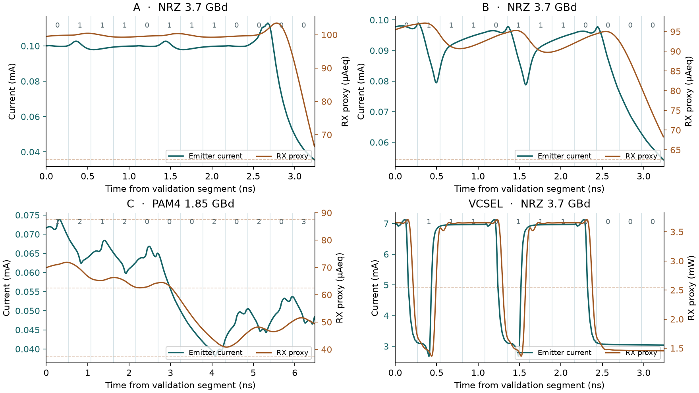

图用各自的时间和量纲显示验证段最初 12 个符号。上方数字是期望发送符号，曲线保留原始延迟，判决依据完整帧、训练后的采样延迟和各路线阈值。下采样仅用于图示。

- **B 先查下降沿。** 1→0 有 858/1,029 个符号错误，0→1 为 261/1,029。A 的同两类转移为 429/1,029 与 311/1,029。B 值得优先检查电荷释放、dummy 负载和转向控制。这里的转移统计支持定位方向，尚待用逐节点测量隔离物理原因。
- **C 先查四电平转换。** 1,399 个位错误对应 1,300 个符号错误。0→3 和 3→0 分别是 128/128 与 130/130 个符号错误。将码型译码和三支路逐个理想替换，确认同时切换、输出摆幅和假设电容的影响。
- **A/B/C 都有电气端的余量缺口。** 旁路发光和 RX 两极点、直接取 LED 导通电流并独立训练采样延迟后，仍分别有 1,205 / 1,045 / 1,281 位错。单独提高 RX 带宽无法解释或消除目前所有失败。两次训练独立，错数差不能直接拆成每一级的贡献。

E+ 为七个激励/电源端口的正向交付能量，E净扣除回灌，二者都用 4,096 尝试净位为分母。A 与 B 在 E+ 和 E净 上的次序不同。VCSEL 的 VLASER 端口约占 E+ 的 71.5%，VDD 约 1.760 pJ/尝试净位，两条理想数据激励合计约 1.275 pJ/尝试净位。端口积分包括当前网表和供电反馈结构，完整 FPGA/ASIC SerDes、时钟与真实 RX 待纳入。

[运行记录、端口能量与错误分桶](../../../evidence/highspeed-workbench-20261110/replay-summary.json) · [波形采样 CSV](../../../evidence/highspeed-workbench-20261110/replay-waves.csv)

### 位错如何影响架构选择

仿真位错表示固定采样时刻落到了错误判决区。这些 A/B/C 帧包含错误。只把 RX 从 1 GHz 提至 5 GHz，三条路线仍有大量错误。B 在 10 fF、25 ps 光响应及 5 GHz RX 下达到零位错，联合选相后单侧余量为 73.02 ps。独立的晶体管门极旁路在 10 fF、25 ps、1 GHz RX 下也零错，余量由 17.36 ps 增到 73.33 ps，仍低于 100 ps 门槛。建议先做 B 的互补门驱、低寄生与主动放电对照，保持 A 作同条件控制。达到相同接收和可靠性门槛后，再比较每个有效交付净位的能量。[错误影响、原因与改版顺序](bit-errors.html)

### VCSEL 的十倍速率检查

净 32 Gb/s 对应 37 Gb/s 线速，NRZ 为 37 GBd、27.03 ps/UI。旧 r10 只升级 RX 后仍错 1,412 位，把输入边沿从 20 ps 缩到 5 ps 后也未恢复门极短脉冲。理想导通电流与假设的 25 GHz 光学/RX 双极点联合对照达到零错与 12.55 ps 单侧余量。这给出一组可通过筛查的波形条件，实际设计要重新配合预驱动、换向输出、光源与接收器。[32 Gb/s 波形、能量与公开先例](bit-errors.html#vcsel)

## 4. 器件、能耗与路线选择

### MicroLED 的 20 µm 只是已知模型条件

同一 c-plane 蓝光 GaN 研究里，20/40/60/80/100/300 µm 样品分别报告 8.294/8.394/10.547/10.019/9.398/7.294 Gb/s 的 OFDM 最高点。论文摘要支持该顺序，不提供逐尺寸一致距离、偏置和 FEC 口径。缩小发光面，在同电流下提高电流密度并通常减小结电容。复合寿命、焊盘寄生、侧壁与收光仍会影响最终速率。以正方形和 100 µA 为例，10/20/40 µm 分别是 100/25/6.25 A/cm²。[尺寸扫描原始论文](https://doi.org/10.1109/JLT.2024.3363729)

转印到金刚石的黄光样品给出另一组可追溯的工作点。20 µm、25 µA 的公开工作簿在对应测量链路上给出 −3 dB 约 2.136 GHz，−6 dB 约 2.850 GHz。1 m、1.5 Gb/s OOK 数据受约 1 GHz APD 约束，LED 偏置估算 0.056 pJ/bit。该文的高电流 OFDM 档使用不同偏置。用 10/20/40/60 µm 或相近可获得的样品类别，分别固定电流密度与固定接收目标做两组比较。实际发光面积、台面尺寸和注入口径分开登记。[Lin 等 Fig.4–5](https://doi.org/10.1038/s41467-026-74151-4) · [数据工作簿](https://doi.org/10.5281/zenodo.20034288)

### VCSEL 独立设定低位偏置和调制幅度

驱动电流超过阈值 `Ith` 后，腔内受激振荡可建立，阈值以下仍有自发辐射。采用低侧叠加结构时，`I0=IB`、`I1=IB+IM`。靠近或高于阈值的偏置有利于限制跨阈值开启延迟，同时提高低位光功率和静态耗能。接收眼图需要同时看 OMA、消光比、抖动和温漂。已有 65 nm CMOS + 850 nm 外接 TOSA 的 25 Gb/s 光眼实验，采用 CML、CTLE、限幅前置放大和独立偏置/调制。200G 级论文使用 106.25 GBd PAM4 的 212.5 Gb/s 线路位速率，属于另一代发光器件、接口、接收与编码条件。[VCSEL 阈值、温度和频响实验](https://doi.org/10.1088/2515-7647/add1a2) · [25 Gb/s 电路原文](https://arxiv.org/pdf/2006.11728) · [200G 级原文](https://doi.org/10.3390/photonics13010090)

### 把每 pJ 送达的有效位数算对

同一供电与链路边界下，`E_net=P_avg/R_payload`。1 pJ/bit 在净 3.2 Gb/s 下对应 3.2 mW。降低偏置电流能否提高 bit/pJ，取决于相同光路、误码目标、吞吐以及输入、偏置、dummy、输出和接收端的固定功耗。文献的 LED-only 偏置估算、这里的 SPICE 源端积分、最终 TX/RX 完整能耗分开登记。定量决策以通过同一接收目标的有效净位为分母。

下一轮把相同输入边沿、真实封装/负载参考面与输出电流目标固定，分别替换理想预驱动、理想末级和光/RX 模型，逐级核对波形。MicroLED 先量或索取多偏置下 I–V、L–I、复数 S11/S21 和脉冲留出数据。VCSEL 再加 Ith、斜率效率、RIN、热漂移及快速关断。实物条件具备后，以同一误码目标、净吞吐、光程和各波长接收响应为条件，复核能量和余量，最后选择尺寸、光源与驱动路线。[文献条件与联合验证矩阵](literature.html)

## 5. 二维、三维与 ASIC 版图

[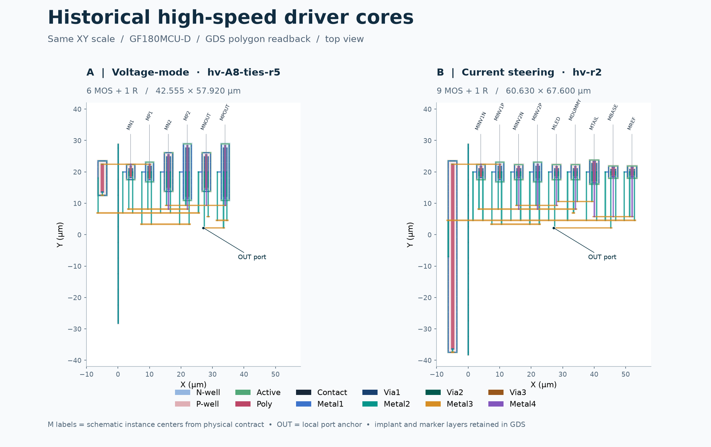](physical/index.html)

实际 GDS 的 A 核心为 6 MOS + 1 R，bbox 42.555 × 57.920 µm。B 核心为 9 MOS + 1 R，bbox 60.630 × 67.600 µm。旧核心有各自的 DRC/LVS/PEX 记录，A 95 R / 64 C，B 127 R / 76 C。二维及 Blender 三维可追溯到同一 GDS 的 XY 图形。Blender 将相邻层沿 Z 展开来观察连接，Z 比例为教学设置。新 A/B/C 参考源和 VCSEL r10 的完整电路仍处于原理图层级，需为新版网表重新跑物理验证。

[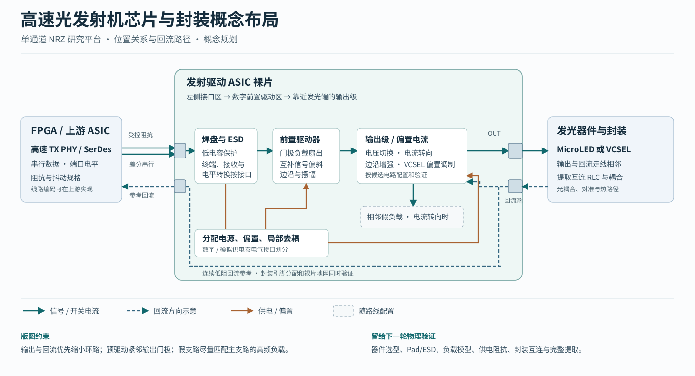](physical/index.html)

布局方案把输出开关放到光器件 pad 附近，发光器件到驱动、回流、去耦要构成尽量小的环路。先对齐两路门极的连接长度、负载和屏蔽，再放置偏置、感测与电源块。参考电流和尾级关键器件做匹配和 guard ring。VCSEL 的 mA 电流、快速关断和光学装配增加了峰值压降、发热和短互连预算。最终要用 PEX、实际封装 S 参数和完整供电网确认，概念图用于审查相对位置。

[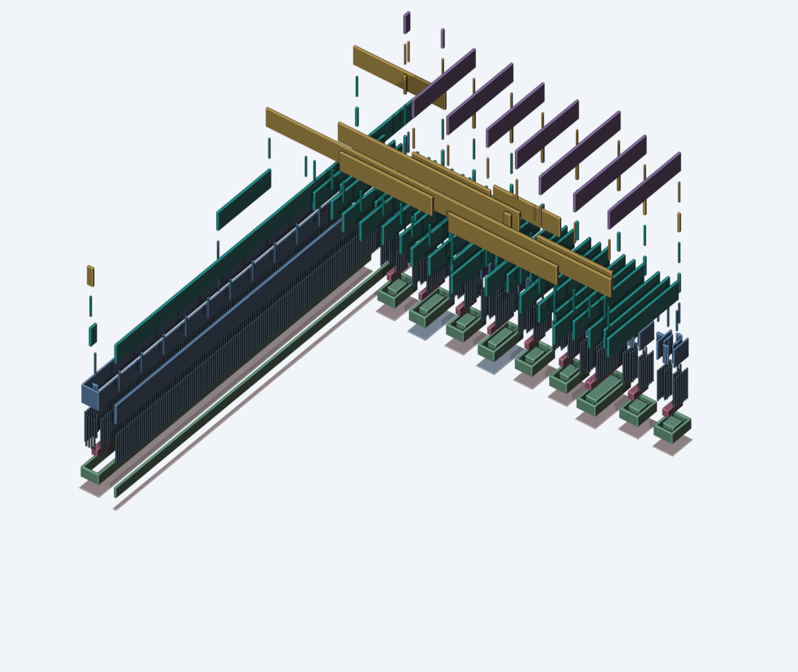](physical/index.html)

[实际分层、版图证据与 3D 导览](physical/index.html) · [Blender 工程](physical/highspeed-cores.blend)

## 6. 从 EDA 到晶圆和样品

首个验证芯片可以把输入测点、PRBS 注入、输出与参考源测试引脚一起保留，使用外接发光器件拆开电气与光学风险。研究宏使用 GF180MCU D 的五层配置，图示 A/B 核心的实际布线到 M4。材料上，硅 CMOS 做 Driver，GaN 系 MicroLED 或 GaAs 系 850 nm VCSEL 各自制造并装配。本轮从历史 GDS 重新提取几何并复核归档 DRC/LVS/PEX。对新全通道，先定工艺、I/O、封装与光源接口，再用对应规则和 EDA 做顶层、签核和实测。最终 die 面积由含 PAD/ESD、seal ring、电源网、fill 和 test access 的实际顶层 GDS 计算。

**发给制造方的核心是经双方规则验收的完整顶层 GDSII**，以及工艺/层选项、层映射、顶层及边界、版本/哈希、签核结果与 waiver 清单。封装方还需要 pad/bump 坐标、die 方位、bond map、光轴、公差和热路径。成测方需要供电顺序、测试模式、限制与失效关断。服务方确认可接受的工艺、签核 deck、制版和验收格式后才能锁定交付。现阶段已有旧宏 GDS 和新测试芯片的交付路线，尚待完整芯片签核与服务方受理。[GF180MCU 数据提交设计清单](https://gf180mcu-pdk.readthedocs.io/en/latest/physical_verification/design_manual/drm_06.html) · [文件清单与回片验证](fabrication.html)
