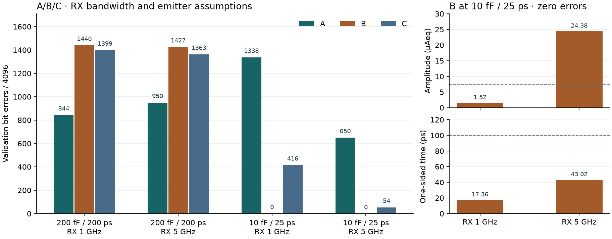
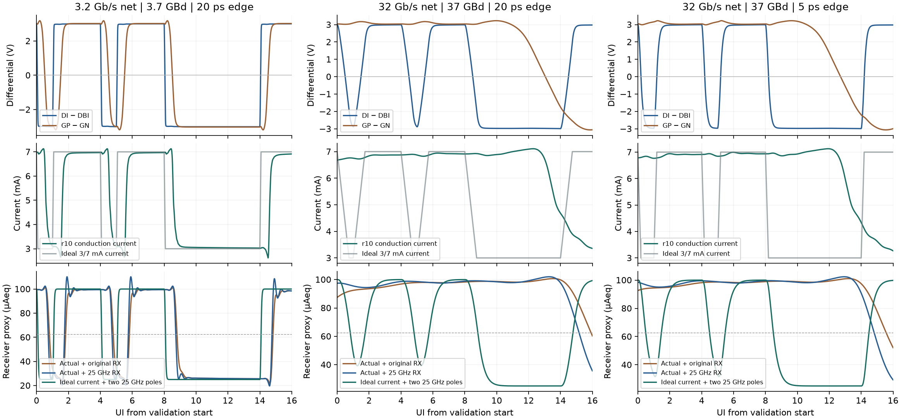

# 位错误、改电路和路线选择

**2026-11-10 · 单通道 · MicroLED 净 3.2 Gb/s / VCSEL 净 32 Gb/s**

**后续扫速更新**：[新版阶段报告](../blue-emitter-speed-review-20261110/index.html)已补原电路低至高速与负载对照。在原负载下 A 比 B 有更高的已验证通过点；C 低速零错仍有译码器体结正偏。本篇所述 B 优先验证是当时基于理想旁路的机理实验建议，后续改为 A 作实际基线、A/B 成对改进。历史诊断数值保留原接收规则。

## 一位错误意味着什么

以 NRZ 的 1→0 为例，发送端要求输出低光电平。若上一位留下的电荷或光响应在采样时仍把信号抬到阈值上方，接收端就会把 **0 判成 1**。PAM4 用三个阈值区分四个电平，一次符号判错可以影响一位或两位。C 的 1,399 位错对应 1,300 个符号错。

在净 3.2 Gb/s 的确定性仿真帧里，A/B/C 分别有 **20.61% / 35.16% / 34.16%** 的验证位判错。原样交付这帧会造成数据损坏。若链路使用 CRC，检测到错误的帧会被丢弃或重传。FEC 能否恢复取决于码字、突发错误长度和码率。项目目前用固定实验帧，尚无这些协议机制，也不能从单个确定性帧推算实物 BER、帧丢失率或 FEC 后吞吐。[四路复跑及错误分桶](../../../evidence/highspeed-workbench-20261110/replay-summary.json)

当前 A/B/C 实现未过净 3.2 Gb/s 筛查。评估拓扑是否有机会，要改变单个条件并复跑。作为可行性证据，公开实验使用约 6–7 µm 有效口径的 MicroLED、外部 50 Ω 激励和一抽头 FIR 得到 10 Gb/s NRZ，光源、偏置和接收条件均与本项目不同。[公开原始实验 Fig.4–7](https://csmantech.org/wp-content/uploads/2025/05/10A.1-Final.2025.pdf)

## 先定位，再改电路

| 路线 | 失效证据 | 改电路的顺序 |
|---|---|---|
| **A 电压驱动** | 基准位错最少，最坏的阈值欠量却比 B 更大（−38.84 对 −29.04 µAeq）。历史 0 fF / 0 ps 对照仍有 1,328 位错。 | 沿 D0 → DI → CTRL → OUT → I_LED 查看 RC 延迟、脉宽失真和上下拉不对称。先独立旁路 CTRL 和两条供电轨，再调整输入电阻、预驱动和推挽尺寸。保持 25/100 µA 稳态并复查温漂与过冲。 |
| **B 电流转向** | 1→0 错 858/1,029，0→1 错 261/1,029。降到 10 fF 且光响应缩短到 25 ps 时出现 0/4,096，幅度/时间仍只有 1.52 µAeq / 17.36 ps。 | 先验证互补门极换流，再缩短输出回路。比较下降沿主动拉高阴极与上升沿短脉冲加强下拉。检查峰值电流、LED 反偏、合规电压和 dummy 端能耗。 |
| **C PAM4** | 0→3 和 3→0 分别错 128/128 与 130/130 个符号。历史 0 fF / 0 ps 对照仍有 466 位错。 | 分离 Gray 译码与三支路，先对齐控制时序，再校准四级电流和光学间隔。以最差的三只眼和全部方向转换作为验收。 |

[固定负载及光响应敏感性](../microled-dynamic-validation-20261108/index.html)

### B 的下降沿为何慢

按被动电流方向，低侧开关吸收的电流 I_sink = I_LED + C × d(V_A − V_K)/dt。切到低位后，I_sink 降低，二极管两端电压仍要经过放电才能降到低位。电荷尚未移走时，导通电流和发光仍会延续。以公开 I–V 拟合在 25/100 µA 的端压摆幅约 0.407 V 作量级估算，200 fF 要移动约 **81 fC**。若目标是在半个 NRZ UI（135 ps）内完成这段摆幅，平均需要约 **0.60 mA 的净电容电流**。10 fF 时约 **30 µA**。这是全摆幅电荷预算，实际跨阈值的要求由波形决定。

因此优先确认真实器件、PAD/ESD 和封装电容。如果互连缩短后仍无法满足时序，给输出增加受控的拉高阴极通路，或在上升沿短暂加强下拉，能直接增加充放电电流。保留相同稳态电流，对照短脉冲长度与峰值的影响。贸然增加持续尾电流，会同时改变稳态电流、功耗和光功率。B 的具体控制仍须通过晶体管级和 PEX 复跑。

### 23 组对照复算读出了什么

- **只加快 RX，基准仍失败。** 保持 200 fF 和 200 ps 光响应，RX 从 1 GHz 提到 5 GHz，A/B/C 的错误分别变成 **950 / 1,427 / 1,363**。原 1 GHz 算例在训练扫描中仍有相邻电平重叠，单纯重设静态阈值也无法区分所有训练样本。
- **同时缩短电气和光学尾巴后，B 的主要问题变成时序。** 在 10 fF、25 ps、5 GHz 对照中，B 为 **0/4,096**，最小幅度余量 24.38 µAeq、单侧时间 43.02 ps。以独立训练同时优化幅度和时间后，分别是 **20.33 µAeq / 73.02 ps**，仍差约 27 ps。相位选择有作用，还需要更快、也更对称的输出电流波形。
- **理想波形对照证明有设计空间。** 以理想 20 ps 导通电流替换电路，在 25 ps 光代理、5 GHz RX 和同一套联合选相下，NRZ 和 PAM4 都能通过 7.5 µAeq、100 ps 与零错筛查。这是给电路的波形目标，不能计入实际电路能效或光学资格。

[全部控制组、源哈希和相位扫描](../../../evidence/highspeed-workbench-20261110/microled-errors-controls.json)

### B 的理想门极直驱对照

用同一帧的 20 ps 数据边沿直接生成 0/3.3 V 理想互补门极，旁路原输入电阻和四只反相管。保留原参考源、转向 MOS、稳态电流目标及封装假设。两组 ngspice 均跑完 4,736 位，接收器固定为 1 GHz，按原训练规则选相。

| 假设电容 | 原 200 ps 光响应 | 25 ps 光响应 |
|---|---|---|
| 200 fF | 1,193/4,096 位错 | 1,167/4,096 位错 |
| 10 fF | 313/4,096 位错 | 0/4,096 位错，+10.49 µAeq / 73.33 ps |

在同一 200 fF / 200 ps 条件下，原 B 为 1,440 位错，理想直驱减到 1,193 位错。只改门驱仍有明显错误。在 10 fF / 25 ps 条件下，理想门驱把原 B 的 **17.36 ps** 单侧余量增加到 **73.33 ps**，仍差约 27 ps。下一轮应同时验证门极换流、输出充放电和实际光学响应。理想源没有可比较的实现能耗。初次旁路运行在 300 s 超时，保留日志，随后复用单一 PWL 输入和受控源完成满帧。[旁路网表、运行和接收结果](../../../evidence/highspeed-workbench-20261110/b-gate-bypass.json)

## 主线按什么选

**建议 B 做下一轮 MicroLED 电路验证，A 留作同条件对照，C 单独推进四电平。** B 在低寄生对照里已达到短帧零位错，仍需扩大余量。A 当前位错更少，适合作为对照，但低电容还不足以使现实现通过。C 可降低符号率，需要验证四级线性、最小眼高和时序。这个排序用于分配下一轮实验资源，最终架构要由改版后的同条件结果决定。

1. **先过可靠性门槛。** 固定净速率、发光器件与接收条件。零错误、幅度/时间余量、峰值电压、启动保护和 PVT 一起检查。短帧确定性零错之后加不同码型、噪声、抖动、失配与实测 BER。即便在误码独立且概率不变的实测统计模型下，零错 4,096 位的 95% 单侧上界也约为 3/4,096，即 7.3×10⁻⁴。要用零错观测支持 10⁻¹² 量级，上述假设下约需 3×10¹² 位。当前仿真没有这个统计含义。
2. **再比有效交付能量。** 相同的 TX、RX、时钟和供电边界下，用总能量除以通过链路校验的净位数。当前 A/B 的正向能量为 0.526/0.501 pJ 每尝试净位，扣除回灌后为 0.495/0.500，次序已反转。失败的尝试帧无法用这些数据给出有效交付能效排名。
3. **最后比面积和制造。** 在通过的实现间比较参考与稳压功耗、温度敏感性、PAD/封装难度与并行串扰。

## VCSEL 十倍速率目标与新验证

MicroLED 的项目比较点为单通道净 3.2 Gb/s。VCSEL 新的高速设计点定为**单通道净 32 Gb/s**。沿用 4,096/4,736 的实验帧效率，线路速率为 37 Gb/s。NRZ 对应 **37 GBd、27.03 ps/UI**。若后续验证 PAM4，对应 **18.5 GBd、54.05 ps/UI**。两者的基带 Nyquist 频率分别为 18.5 和 9.25 GHz，用于读频响预算。链路最终还取决于光调制幅度、噪声、时钟和均衡。

37 GBd 下，原 20 ps 输入边沿已经占 **0.74 UI**。旧光学代理在 18.5 GHz 约衰减 **14.28 dB**，旧 5 GHz 接收单极点再衰减 **11.67 dB**，串联约 **25.95 dB**，尚未计入驱动和封装。旧 100 ps 单侧门槛也需随 UI 重新定标。新诊断使用 **0.37 UI** 单侧筛查（37 GBd 为 10.00 ps），保留 7.5 µAeq 判决距离与训练、验证零错。硬件需另做时钟抖动和噪声预算。[历史 VCSEL 模型参数](../../../analog/models/vcsel_research_20261027/parameters.json) · [代理的原始实验 Fig.8B](https://doi.org/10.3389/fphy.2021.672941)

### r10 晶体管级复跑结果

在相同 TT、25°C、150 fF、0.5 Ω / 0.2 nH 假设下，用原 GF180 r10 跑完整的 4,736 位帧。相位仅用训练段选择，验证段沿用同一个相位。

| 算例 | 仅导通电流位错 | 原光学 + 5 GHz RX 位错 | 原光学 + 25 GHz RX 位错 | 原电路 E+（pJ/尝试净位） |
|---|---:|---:|---:|---:|
| 净 3.2 Gb/s / 20 ps 边沿 | 0 | 0 | 0 | 11.162 |
| 净 16 Gb/s / 20 ps 边沿 | 1,077 | 1,070 | 1,018 | 2.395 |
| **净 32 Gb/s / 20 ps 边沿** | **1,468** | **1,462** | **1,412** | **1.134** |
| 净 32 Gb/s / 5 ps 边沿 | 1,454 | 1,470 | 1,397 | 1.179 |

图上方是前置驱动入口 DI−DBI 与开关门极 GP−GN。32 Gb/s 下，输入差分极性仍可正确判出，门极极性却有 **1,622/4,096** 判错，短低脉冲还没到换流门槛就遇到下一位。把源端边沿从 20 ps 缩到 5 ps，门极极性仍错 1,620 位，说明只加强输入激励无法恢复信号。即使直接旁路发光动态并使用 25 GHz RX，原电路仍有 1,461 位错。

反向对照把导通电流换成理想 3/7 mA、20 ps 的波形。37 GBd 时保留原光代理与 5 GHz RX 仍有 **549 位错**，单把 RX 改到 25 GHz 仍有 **340 位错**。同时换成假设的 25 GHz 光极点与 25 GHz RX 才得到 **0/4,096、+23.22 µAeq 和 12.55 ps** 单侧余量。这给出一组可满足筛查的理想条件，光源与接收器能否做到须靠器件和链路验证。

32 Gb/s 电路的 **1.134 pJ/尝试净位**约对应 **36.3 mW** 正向平均功率，与 3.2 Gb/s 的 **35.7 mW** 相近。高速帧缩短十倍，持续偏置的能量被分摊到更多尝试位，且帧里仍有大量错误。对比有效净位能耗，须先让链路通过。当前典型角的端压检查与历史快冷启动超限是两组独立测试。

**门极旁路揭示了第二个问题。** 用 5 ps 理想互补信号直接控制两只换向 MOS，保留真实末级、参考、负载和封装，导通电流判决恢复为 0/4,096，但只有 **1.03 µAeq / 1.68 ps** 余量。电流振铃超出原模型 2–7.5 mA 的评估范围，达到 **1.696–9.548 mA**。dummy 管的漏—体电压峰值达到 **3.868 V**，超过本项目 3.63 V 筛查线。峰值出现在门极上升时，局部激光供电约 3.099 V，应先分离栅漏耦合、dummy 支路和换流瞬态的贡献。原光学与 5 GHz RX 下仍有 519 位错。改成假设的双 25 GHz 极点虽零错，余量也仅 0.39 µAeq / 0.32 ps。该光学对照包含超域输入，仅供定位。

**步长和采样复验。** 原 20 ps 源边沿下，将最大仿真步长从 UI/40 缩到 UI/80，原光学和 RX 仍错 1,462 位，门极仍错 1,622 位，正向取能变化约 −0.0027%。纯导通电流从 1,468 变为 1,469 位错，失效判定一致。将训练延迟的扫描范围从 8 UI 扩到 32 UI，门极、导通电流和原链路的训练段仍无法零错。

[全帧数据、端口能量及模型旁路](../../../evidence/highspeed-workbench-20261110/vcsel-x10-summary.json)

### 37 GBd 下一步怎样设计

- **预驱动与输出级。** 把低摆幅差分接收、预驱动、快速电流转向和慢速偏置环分开。先抽取输入与门极电容，设计短回流，并检验门极摆幅与开关电流。根据输出脉冲波形再试一至两抽头 FFE 或受控 peaking，同时测过冲、峰值电流和取能。
- **光源与接收。** 按候选 VCSEL 的波长、偏置和温度重新约束 L–I–V、复数 S 参数、调制响应、RIN 和封装。独立设计 PD/TIA、均衡和采样时钟。先跑 NRZ，再以同净率验证 PAM4，给四级线性和眼高留预算。
- **工艺与能耗。** GF180 r10 保留作偏置与供电参考。若隔离测试确认末级和预驱动的寄生与延迟超过预算，对照更快 CMOS 或公开 SiGe BiCMOS，复用负载、接收和能量边界，分别验收晶体管、布局和整链。[IHP 开放工艺说明](https://www.ihp-microelectronics.com/services/research-and-prototyping-service/open-source-design-enablement)

公开实测给 37 GBd 提供了工程依据。28 nm CMOS 驱动 1060 nm VCSEL 得到 **40 Gb/s NRZ 光眼**，约 **0.50 pJ/线路位**为论文的发射端口径，该眼图未给出 BER。另一项 **850 nm、40 Gb/s 单通道 CMOS 链路**报告 BER < 10⁻¹²、**3.4 pJ/线路位**，采用整链口径。按项目帧效率换算，40 Gb/s 线路对应约 34.59 Gb/s 净率。文献光源、封装和均衡需分别保留，数据用于验证目标有实物先例。[28 nm Driver 原文 §IV](https://www.eecg.utoronto.ca/~tcc/Sharif-Bakhtiar_cicc17.pdf) · [40 Gb/s CMOS 链路原文](https://ieeexplore.ieee.org/document/8527238/)

[返回主报告](index.html) · [器件文献与能耗口径](literature.html)
