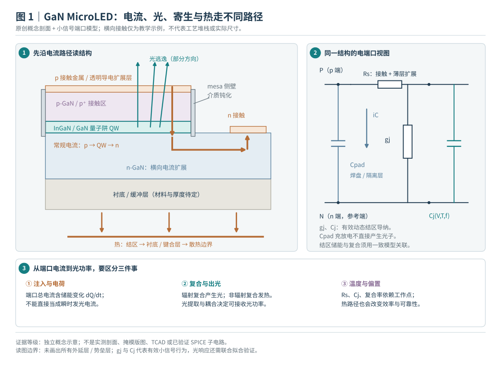
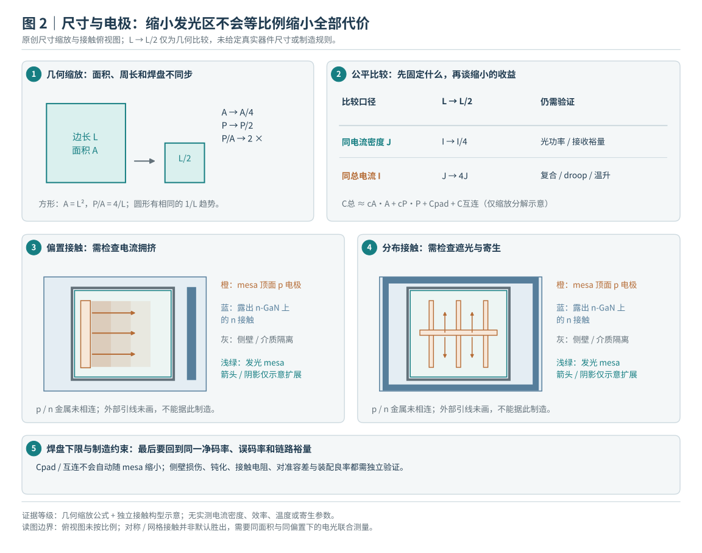
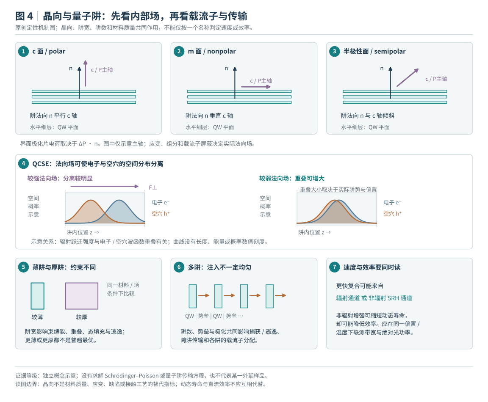
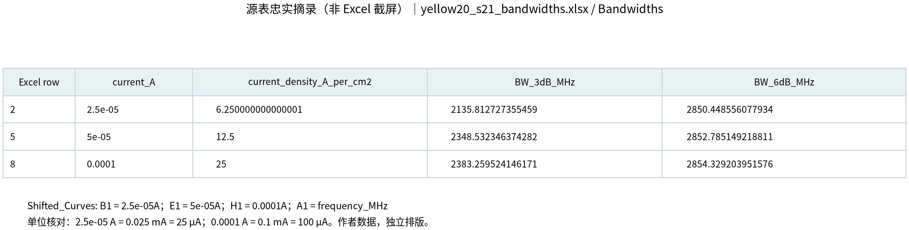
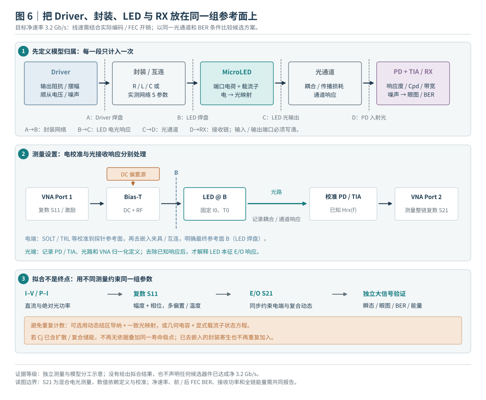

# 面向单通道净 3.2 Gb/s 的 MicroLED 器件与 Driver 联合设计

2026-10-29 · 器件研究报告 · 从物理结构、论文证据到可执行验证方案

**提高调制带宽，需要同时处理电荷充放电、载流子复合、光提取与散热。缩小尺寸、改变晶向或减薄量子阱，都可能改善其中一项，也可能损害光效率、接收信噪比或制造一致性。当前证据不足以预选器件或 Driver 路线。**

本报告为实验性研发方法验证与教学。新增内容是文献核查、原创结构示意、可复算的解析计算和待执行方案；**没有新增器件流片、TCAD、晶体管瞬态、版图 PEX 或光学 BER 测量**。历史 A/B/C 电路及其负载没有被本报告替换。

建议读法：先看第 1–3 节理解问题，再看第 4–7 节比较证据与取舍，最后用第 8–10 节安排设计和实验。文中“实测”指论文作者测量，除非明确注明为本项目。

## 1. 先定义目标：我们要传数据，而不仅是得到 GHz 数字

当前实验帧用 4,736 个线路位承载 4,096 个 payload 位，效率为 `4096/4736 = 32/37`。因此，净 3.2 Gb/s 对应 **NRZ 线路 3.7 Gb/s、3.7 GBd、UI≈270.27 ps**。1.85 GHz 是此 NRZ 符号率的 Nyquist 频率，适合选作频域检查点；它不是“LED 只要有 1.85 GHz 带宽就一定成功”的门槛。

实际判据需要同时包括：到达接收器的光调制幅度 OMA、噪声、眼图幅度与时间余量、时钟抖动、温度、失配和误码率。更换调制方式、编码或训练长度后，应重新核算净吞吐。若把两位映射到一个 PAM4 符号，频谱压力可能下降，但相同满幅下相邻电平距离缩小，线性度与多阈值判决要求提高；均衡/DSP 能耗按实际实现计量。

本轮不把某篇论文的 OFDM、离线均衡 PAM 或多通道总速率当成“单通道净 3.2 Gb/s NRZ”已经实现。也不把 LED 直流耗电除以线路数据率得到的 fJ/bit，当作完整光互连的能效。

| 要回答的问题 | 比较时必须一起固定或披露 |
|---|---|
| 哪种器件更快？ | 激励参考面、尺寸定义、J、温度、光波长、检测器与去嵌、截止定义 |
| 哪种器件更省电？ | 相同净吞吐、接收端 OMA/误码条件、耦合损耗、供电与 Driver/DSP 统计范围 |
| 哪种结构更容易做？ | 外延与衬底供应、工艺步骤、容差、转移/键合、热管理、良率和寿命 |
| 能否接到当前 ASIC？ | 端电压、电流、输出阻抗、焊盘与封装寄生、参考/供电功率、可靠性筛查 |

## 2. 从剖面看懂器件：材料、结构和 Driver 各负责什么

*图 1｜原创原理示意，非工艺截面或掩膜。导电电流进入有源区后才可能产生光；焊盘/结电容的充放电电流不能直接当成发光电流。真实结构可能采用垂直电极、倒装或不同接触层。*

这里的材料至少有四层含义。**InGaN 量子阱**是发光有源区；GaN 或其他势垒/包层承担载流子约束与输运；蓝宝石、Si、GaN、SiC 或转移后的金刚石是生长/承载/散热平台；ITO 与金属接触负责电流注入。它们不能都简称为“GaN 材料”。

Driver 的 MOS 则是另一套器件。项目现用 GF180 模型描述硅 CMOS 晶体管，并不生成 InGaN 外延、量子阱或侧壁缺陷。LED 与 Driver 可以通过封装、微凸点或混合集成连接；“LED 用 GaN”并不要求 Driver 的 MOS 也用 GaN。

把整个通道分成以下几段，便于定位问题：数字编码与缓冲 → Driver 输出网络 → 封装/电极 → LED 电荷和载流子 → 出射及耦合光 → PD/TIA → 判决。**只有知道每个测量参考面，才能决定某个 GHz 数据应该放在哪一段。**

## 3. 带宽、效率和能耗为什么会相互牵制

### 3.1 先区分电学极点和光学动态

对于均匀载流子浓度、固定温度、忽略逃逸与输运等效应的简化 ABC 模型：

`R(n)=A·n+B·n²+C·n³`；`1/τdiff=dR/dn=A+2Bn+3Cn²`。

其中 A 表示 SRH 等非辐射通道，B 对应辐射复合项，C 对应高注入损失的等效项。常数与适用域必须拟合，不能从不同颜色或晶向的论文直接借来。小信号单一寿命模型下，按标准 `20log10` 幅度响应的半功率（约 −3.01 dB）定义，`frec≈1/(2π·τdiff)`。提高注入常可缩短微分寿命，却也可能增加非辐射损耗、载流子泄漏和发热；**让 A 变大也能让响应变快，但会把更多电能变成热，而不是光。**

最小电学模型的极点约为 `felec≈1/(2π·Reff·Ctot)`。但 Reff 取决于激励：理想电流输入到 `rd∥C` 时，导电支路归一化响应的时间常数是 `rd·C`；低阻电压源经过 Rs 时，则是 `(Rs∥rd)·C`。真实 MOS 输出阻抗具有状态和频率依赖，不能简单把 A 等同理想 50 Ω 电压源，或把 B 等同无限输出阻抗电流源。

独立的一阶环节串联时，响应相乘；总半功率带宽小于任一单独极点。两个相同一阶极点按上述 `20log10` 半功率约定，截止频率约为单极点的 0.644 倍。实际 LED 的载流子、结电荷与注入耦合时，应使用守恒的联合模型，不能机械叠加两个互相重叠的低通。

### 3.2 不混用带宽定义

报告响应时优先保存线性传递函数及参考面，再注明 dB 约定。仪器电压幅度通常用 `20 log10(|Vout/Vin|)`；光功率的时间调制幅度 ΔP 与平均光功率是不同的量，来源可能另用 `10 log10` 定义。必须逐篇核对。若把一阶幅度响应按 `10log10(ΔP/ΔP0)` 表示，其约 −3.01 dB 点约为 `√3/(2πτ)`，不能继续用 `1/(2πτ)` 反推寿命。**同一条归一化曲线的 −3 dB 和 −6 dB 截止点，不是两次独立测试，也不能任意换标签。**

只有幅频、没有相位和绝对增益，不能唯一确定瞬态响应。给传递函数乘上纯延迟，幅度完全不变，但判决时刻已经改变；低信噪比下的归一化曲线也不证明有足够接收光功率。

### 3.3 能效要分三个边界

`EQE = 出射光子数/注入电子数`；`WPE = 出射光功率/LED 端电功率`。窄谱、稳态近似下 `WPE≈EQE·hν/(qVf)`，但光学收集口径和温度必须一致。到接收器还要乘耦合与传输效率；低电流的高 EQE 不必然提供足够 OMA。

`ELED = ∫VLED(t)·ILED(t)dt / Npayload`。在当前实验中积分覆盖完整 4,736 线路位、1.28 µs 的帧，分母为其中 4,096 个 payload 位；不能只积分验证段却沿用整帧净率。

`ETX = Σ∫Vk(t)·Ik(t)dt / Npayload`，仅对声明统计面上互不重叠的供电及数据源端口求和，包含范围内的数字/模拟/参考/缓冲/稳压及预加重。统一取“向统计区域供能”为正，分别记录正向、返回和净能量。若 LED 已由这些电源供能，ELED 只是内部能量分解，不能再加一次。外部电源转换、时钟、串行器、DSP 和 RX 若未计入，分别列出。ELED 使用 LED 参考面的总端口电流（含 dQ/dt），因此短帧还要报告电荷/电容净储能；它不等于辐射复合能量，不能把电容放电当作稳态节能。

**解析示例**：若 LED 端压近似恒定为 3 V、平均电流 100 µA，在净 3.2 Gb/s 连续发送时，仅 LED 端耗电为 0.09375 pJ/bit。电压与电流均变化时，应积分瞬时乘积，不能直接相乘两个均值。此例没有包含 Driver 或证明误码性能。增加偏置、预加重或均衡可能提高吞吐，但应以符合接收条件后的总能耗评价。

## 4. 尺寸与电极：缩小什么，保留什么？

*图 2｜原创尺寸和电极原理图。方形边长与圆形直径分开；同 J 和同 I 是两种不同实验。平面图表达电流拥挤及扩展路径，非实际版图。*

面积 S 以 cm² 计算，`J=I/S`。对边长 L 的正方形，`S=L²`、侧壁周长/面积比为 `4/L`。圆形直径 D 则为 `S=πD²/4`，不能把“20 µm 器件”的两种面积混用。

<!-- SIZE_TABLE -->

在同电流下，缩小面积会提高 J，也可能改变复合寿命；这时不能把带宽提高全部归因于电容减小。在同 J 下，小像素的总电流和总光功率一般更低，须实测效率、光提取和耦合后才能判断接收效果。缩小还会提高侧壁占比，放大刻蚀损伤、表面复合和接触定位的影响。

`Ctot` 可能含面积项、侧壁项、焊盘/互连固定项与偏置相关储存电荷。像素缩小后，焊盘项不会自动按面积同比缩小。透明接触层和金属扩展可减小电流拥挤与串联电阻，却可能增加遮光、吸收或电极电容；深刻蚀与隔离可减小寄生，但增加损伤、刻蚀深度和钝化控制要求。

**应采用两类比较**：先用同一外延片、同 J、相同温度与校准面，看尺寸本身的影响；再固定净速率与接收 OMA/BER，允许各器件调整偏置和调制，比较完整 Driver+LED 能耗。前者解释物理，后者支持系统选择。

## 5. 材料、晶向和量子阱：改变的是复合与输运

*图 4｜原创机制图。晶向图仅表示极化方向相对于阱面的关系，实际内建场还受应变与组分影响；空间分布示意不代替自洽能带求解。*

### 5.1 材料与波长：不要把基板、发光层和 MOS 混为一谈

| 路径 | 可能带来的器件收益 | 对系统与制造的取舍 |
|---|---|---|
| InGaN/GaN 蓝/绿及高 In 长波长结构 | 调整组分、应变、局域态、波函数重叠与光谱 | 波长改变后 PD 响应、光学损耗和耦合也改变；高 In 结构的效率、缺陷与均匀性须实测，不能从蓝光推到黄/红光 |
| AlGaInP 红光 | 另一套有源材料、载流子输运与红光平台 | 小尺寸侧壁损失显著，需要特定钝化与转移/接触工艺；本轮尺寸论文不能证明其 GHz 性能优于 InGaN |
| 蓝宝石/Si/GaN/SiC 生长平台，或转印至金刚石 | 改变外延条件、热流与集成形式 | 高热导承载体有望改善工作温度，但键合界面、热边界电阻、转移良率与成本仍需验证；不直接改变发光材料身份 |

这是设计空间，不是材料优劣排行榜。不同波长跨材料比较时，同时报告绝对接收功率与响应度；不能只固定电流或接收电压阈值。

### 5.2 晶向：减小 QCSE 不等于没有代价

常见 c-plane 极性结构中，极化场可使电子和空穴波函数分离，即量子限制斯塔克效应（QCSE），降低重叠。非极性或半极性生长可以减小阱法向的极化分量，可能提高辐射复合速度。实际效果仍依赖组分、应变、缺陷、阱宽及载流子屏蔽。

Xu 2023 的半极性样品提供低注入下的高速证据，详见第 6 节。但不能只凭这一个结果推断它一定是最省电或最容易量产的方案。非传统晶向的衬底、外延窗口、缺陷和片内均匀性需要供应及工艺验证；本文没有对应报价或良率数据。

### 5.3 量子阱：不是越薄、越少越好

减薄阱可能降低电场造成的空间分离，提高波函数重叠；也会改变束缚态、载流子逃逸、注入效率与可用发光体积。减少阱数可减小跨阱分布不均，但在相同总电流下提高单阱负荷，可能加重损耗、热和寿命问题。势垒厚度、组分与掺杂还会改变输运，不能只扫阱宽而假装其他参数不变。

Rajabi 2018 的超薄阱/势垒样品在指定注入下提高了截止频率；Li 2025 的另一组固定 In 组分样品却在低 J 下呈现过薄阱的效率损失。后者发射波长随阱厚跨约 465–570 nm，也不是同波长对照；高 J 下部分薄阱效率趋近，不能把低 J 结论外推到整个工作区。它们说明应比较**成套可制造结构及其工作区间**。2025 年文献的最佳约 2.7 nm 仅适用于那组样品，不是所有 MicroLED 的设计规则。

## 6. 论文数据：哪些支持下一步，哪些还不能横比？

下表保留论文自己的截止定义和接收条件。未核实的项直接写“未核实”，不按带宽排序。全文核查和摘要核查的证据深度不同。

<!-- LITERATURE_TABLE -->

### 6.1 三个最有决策价值的现象

**第一，结构改善应优先看同一研究内的配对。** Rajabi 的 QW/势垒变化和 Zhu 的电极/刻蚀变化，都在各自指定 J 下给出前后值。它们支持相应机制值得验证，却不能把两者增益直接相乘，或把别的样品减少的 24.9 pF 填入我们假设为 200 fF 的负载。

<!-- PAIRED_FIGURE -->

**第二，快不一定亮。** Wang 2019 的光子晶体结果同时涉及光学模式与刻蚀损伤；同尺寸器件的输出光功率降低。若非辐射通道参与了寿命缩短，接收链路可能需要更多电流补偿。微透镜、表面纹理和收光结构主要改变提取/耦合；没有自发辐射速率证据时，不能把收光提高称为内禀寿命缩短。

**第三，GHz 级小信号与净 3.2 Gb/s 是不同证据。** Li 2024 的纳米工程有源区论文摘要给出 GHz 响应与单通道 NRZ 实验，但其自由空间 3.07 Gb/s 结果仍不能写成我们所需的净 3.2 Gb/s。Ferreira 2016 则说明系统设计可以改变可用吞吐：带宽 397 MHz 的 B 器件，在 0.75 m、1 GHz PD、离线处理下，论文正文按所述 7% FEC 开销给出 PAM4 净 3.5 Gb/s（含 DFE）及 OFDM 净 5 Gb/s。它是带条件的公开链路证据，不是我们已实现的同条件成绩；摘要的 PAM 数字为 3.4 Gb/s，与正文不同，台账保留这一差异。不能把这些条件与 A 器件的最高 833 MHz 拼成一个系统。

### 6.2 与我们现有负载直接相关的 Lin 2026 数据

下面保留作者公开工作簿的忠实单元格摘录，先看原始单位，再看派生解释。数据集为 CC BY 4.0；图是已有阶段对表头和数值的忠实呈现，非论文受限图像的替代品。

来源：[Zenodo 20034288](https://doi.org/10.5281/zenodo.20034288)，`yellow20_s21_bandwidths.xlsx` 的 `Bandwidths` 与 `Shifted_Curves`；测量结构为 20 µm **正方形**黄色 InGaN/GaN、转印至金刚石。更完整的原始定位与复算见[动态证据章节](../vcsel-reference-microled-dynamics-20261029/microled-dynamic-evidence.html)。

<!-- LIN_TABLE -->

能耗也有可核查的论文数字：在其 **1.5 Gb/s OOK、约 1 GHz 检测器**的低功耗实验中，20 µm 器件取 25 µA、DC 端压 3.360 V，作者按 `I×V` 得到 84.0 µW，再除以报告的数据率得 **0.056 pJ/bit**；40 µm 器件取 50 µA、3.308 V，对应 165.4 µW 和约 **0.110 pJ/bit**。这说明小电流器件的研究价值，同时要保留分母：这些是作者的 **LED 直流端功耗估算**，不包含完整 RF Driver、编码、RX 或瞬时调制能量，也没有建立我们净 3.2 Gb/s 下的同条件能效排名。[原文 Fig.5l–n 与低功耗实验说明](https://pmc.ncbi.nlm.nih.gov/articles/PMC13433930/)

这是同结构公开数据对我们模型的约束：低电流工作区不能被直接假定为很慢。但测试链含 VNA、bias tee、光学和额定 3 GHz 检测器，缺少相位、复数阻抗和独立去嵌；不能把整个 S21 再接到已含 LED RC 与 RX 低通的链路后面。现有 200 fF、200 ps 和 1 GHz RX 仍是旧实验假设。论文把同曲线 −3 dB/−6 dB 分别称为 E–E/E–O，本报告保留其定义。

低电流数据也不能外推到更高 J。完整带宽表呈非单调变化，不能由 25–100 µA 五点得出“电流越大越快”。目前只对该五点曲线进行了独立截止复算；高电流变化的机制仍待按噪声、温度、载流子和测量条件逐项确认。

## 7. 取舍地图：以接收要求约束带宽，而不是只追最高带宽

| 设计变量 | 可能改善什么 | 可能损失什么 | 制造与验证重点 |
|---|---|---|---|
| 缩小发光面积 | 降低部分电容、减小总电流；同 I 下提高 J | 侧壁复合、总光功率、接触容差；固定焊盘项占比提高 | 同片尺寸分组；侧壁/接触一致性；同 J 与同接收 OMA 两套比较 |
| 改电极/减寄生 | 减小 R、C、拥挤和振铃 | 遮光/吸收、接触面积、电流密度局部热点 | RF dummy、四端/Kelvin 结构、热像；电极金属与回流一并提取 |
| 半极性/非极性 | 减小 QCSE，可能提高辐射复合速度 | 外延/衬底供应、缺陷与均匀性风险 | 同波长相近结构比较；厚度/组分与应变不能忽略 |
| 超薄/少阱/势垒工程 | 改善重叠或跨阱输运 | 逃逸、注入效率、单阱高负荷、厚度敏感性 | 单层厚度及组分统计；P–I/效率与复杂动态共同拟合 |
| 纳米有源区/量子点 | 改变局域化、复合和载流子分布 | 生长一致性、缺陷、工艺及模型复杂度 | 区分有源 InGaN 量子点和外部颜色转换 QD；验证重复性 |
| 光子晶体/微腔 | 改变模式、提取，特定条件下改变辐射速率 | 出光方向/谱宽约束、刻蚀损伤、对准容差 | 实测寿命与效率；排除“非辐射变快”；需光场仿真与实测 |
| 更高偏置/预加重 | 缩短建立，改善高频眼图 | 静态耗电、峰值 J、过冲、热、老化 | DC+AC 电流与端压、光过冲、热耦合及全 TX pJ/bit |
| 转移与热平台 | 减小热阻或缩短电连接 | 转移/键合步骤、界面热阻、良率和修复 | 测实际热路径和接触；评估阵列热串扰与装配容差 |

表中制造难度是**工程推断**，不是供应商已确认的成本或量产结论。比较“多少层”时应分别说明外延层、器件金属/介质层与 CMOS BEOL 金属层，三者不能互换。没有外延、掩膜、封装、测试与良率报价，无法据本文给出单颗量产价格。

## 8. 联合仿真与实验：先校准器件，再比较 Driver

*图 6｜原创验证框架。电学 S11 与电光 S21 需要共同参考面、检测器校准和样品身份；电容电流与复合发光分别处理，避免重复计算寄生或光学低通。*

<!-- JOINT_PLAN -->

## 9. 当前开源环境能完成什么，还缺什么？

| 层级 | 当前可用路径 | 产出与限制 |
|---|---|---|
| 文献/解析/参数管理 | 本报告 Python、CSV/JSON、SHA 清单 | 可复算几何、J、RC 敏感性、吞吐/能耗边界；本轮已执行 |
| 电路联合仿真 | 已有 ngspice、GF180 模型子集、A/B/C 原理图研究；校准后新增负载模型 ID | 可分析参考/供电、端压、电荷、时序与能量；本轮没有新增电路成绩 |
| 行为动态器件 | 电荷守恒等效电路、可用的 Verilog-A/等效状态模型及参数拟合 | 需要先确认当前仿真器的语言支持或模型编译路径；不能只凭“有 SPICE”认定任意模型可运行 |
| LED 器件物理 | 漂移扩散/Poisson、量子阱与复合、热模型；必要时 Schrödinger–Poisson | 开源求解器可用于简化方程研究，但本项目没有经过实测校准的 GaN TCAD 工艺/材料卡；GF180 不提供它 |
| 光场与封装 | 需要波长相关材料数据的光场/模式分析，及封装电磁、热联合提取 | 可以建立方法和简单几何；没有校准参数/边界就不能当作实物性能预测或制造签核 |
| ASIC 物理实现 | 完整匹配 PDK、规则与工具下的 DRC/LVS/PEX | 旧版图证据只属于相应冻结电路；新的 Driver+LED 联合方案需要新一轮寄生、端压和接收回归 |
| 硬件验证 | 外延/器件样品、RF 探针/封装、校准 PD/TIA、BERT/采样、温控和光功率测量 | 仪器带宽、噪声、接口和样品需采购/合作确认；本轮未建立硬件台架 |

对设计决策最有价值的可视化依次是：器件剖面与电流密度分布、复数阻抗和去嵌前后响应、不同偏置/温度的 P–I 与效率、瞬态电荷/光功率、同尺度眼图与 pJ/bit–接收余量图。二维/三维结构图适合解释几何，但没有解方程和校准数据时，不是器件仿真。

## 10. 下一阶段的三项优先工作与决策门槛

1. **把现有黄色 20 µm 负载的动态证据补齐。** 优先取得同一像素的 IV、PI、复数 S11/S21、温度和检测器响应；拿不到时，保持参数敏感性研究身份，不给出新的真实光学 BER 预测。
2. **建立同外延的尺寸–电极–钝化小矩阵。** 先区分面积、侧壁和焊盘三类限制，再决定是否投入晶向或 QW 外延变更；这表示减少混杂变量的实验顺序，不表示已选 c-plane 或任一商业工艺。
3. **用统一链路合同回归 A/B/C。** 每个合法 LED 模型都测试所有 Driver 候选；达到净 3.2 Gb/s、规定接收余量与可靠性条件后，才比较完整能耗、热和制造可行性。若没有方案同时满足，记录失败机制并继续修改，不能从失败点选出“最省电”。

项目接下来需要的决策不是“哪篇带宽最高就采用哪种材料”，而是：**在可取得、可校准的器件上，哪个器件–Driver 组合能在温度、寄生和噪声变化下，以可接受的功耗持续交付净 3.2 Gb/s？** 本报告给出回答这个问题的路径，尚未给出路线胜负。

## 11. 证据、原文与复现

<!-- REFERENCES -->

- [完整文献数据台账](../../../evidence/microled-device-codesign-20261029/literature.json)与[原文核查记录](../../../evidence/microled-device-codesign-20261029/source-notes.md)：记录条件、定位、阅读深度及不可推导结论。
- [解析计算结果](../../../evidence/microled-device-codesign-20261029/calculations.json)、[独立联合验证方案](joint-validation-plan.md)、[复现说明](reproduce.md)。
- [历史动态数据合同](../../../evidence/microled-dynamic-20261029/response-contract.json)与[前一阶段总报告](../vcsel-reference-microled-dynamics-20261029/index.html)。

公开报告使用原创结构图、独立计算、事实数据表和明确许可的数值数据。论文原图的公开复用需分别核查；本轮核查用的原始页面/图表保留在忽略目录 `build/microled-device-codesign-20261029/literature/`，不随 Git 上传。Lin 论文原 Fig. 4 是此前私有原文证据，亦未纳入本轮公开文件；其独立数据集另有 CC BY 4.0 许可。不能把“可在线阅读”当作“可复制发布”。

本轮所有图中的器件几何和层厚均为原理示意，不能交付晶圆厂制造。最终制造需要经工艺方接受的外延与器件工艺、掩膜/版图、规则与可靠性验证；本报告只建立研究方法和下一步实验合同。
