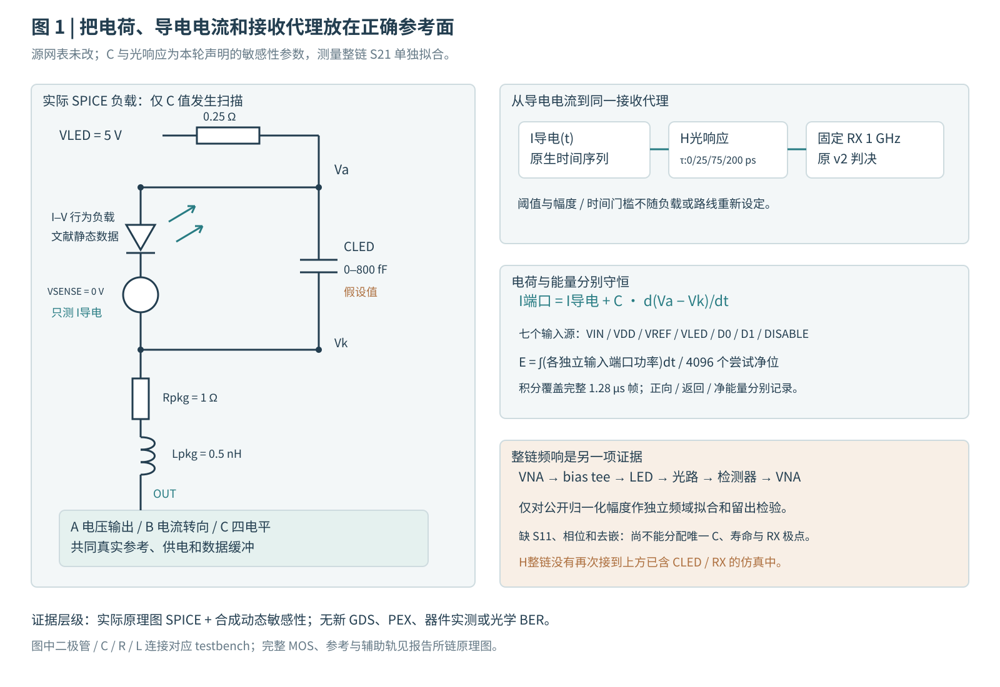
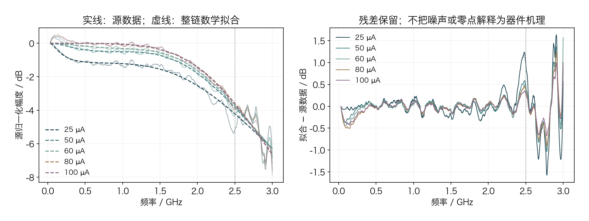
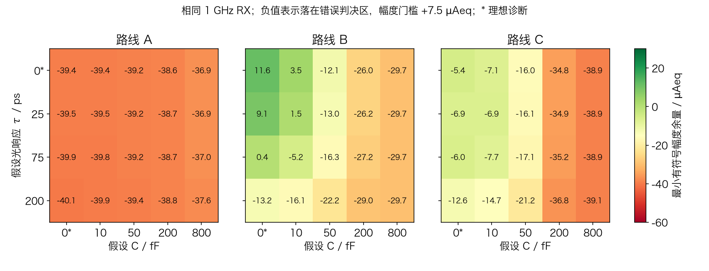
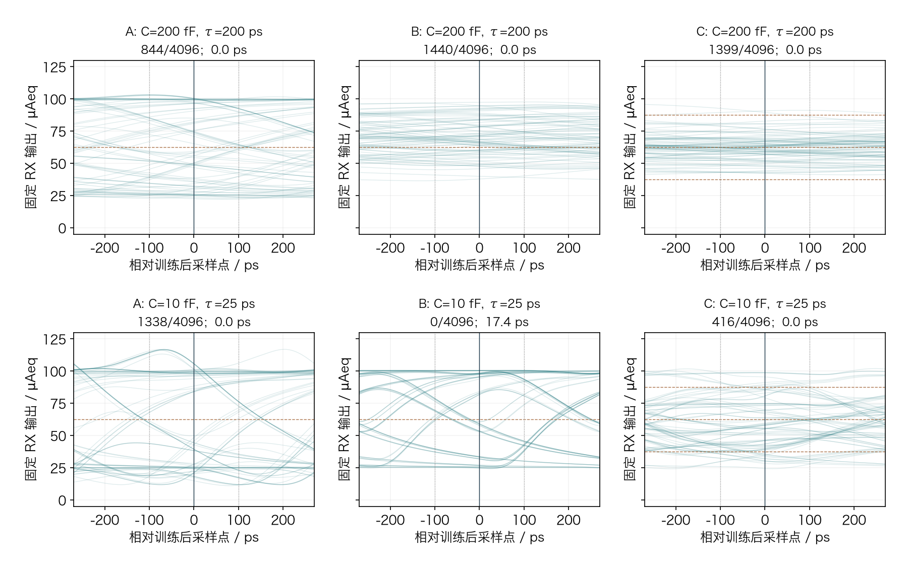
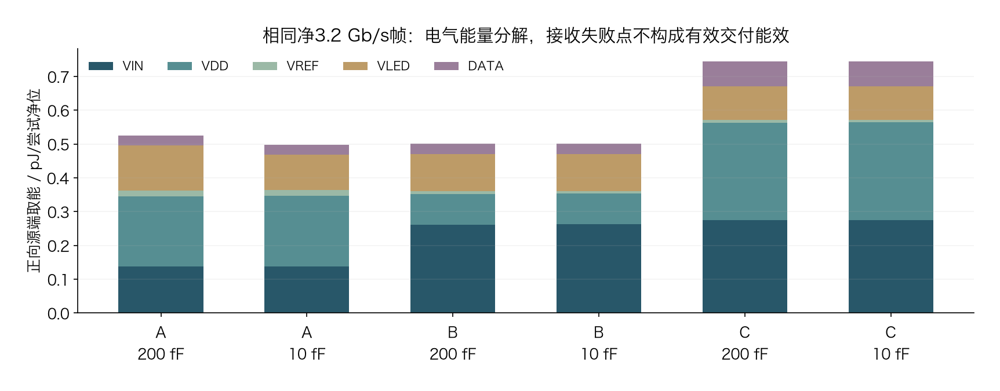

# 20 µm MicroLED 动态负载：校准边界、敏感性与净 3.2 Gb/s 的 A/B/C 验证

2026-11-08 · 中文研究报告 · 原理图级晶体管仿真、公开数据拟合与接收代理分析

**本轮完成公开幅频的条件化拟合，并以冻结 A/B/C 电路进行动态负载敏感性实验。电气计划 49/49 项已记录，典型条件全链假设点 60 个（含 24 个理想限制诊断），其中原接收与 MOS 端对压差联合筛查通过 0 个。**

这些通过或失败只属于明确的 C/τ 假设和电流域接收代理。幅频拟合仍只能解释已测整链幅度，尚不能作为真实器件瞬态预测；器件物理动态校准未闭合。暂不预选路线。

本轮继承[器件与 Driver 共设计研究](../microled-device-codesign-20261029/index.html)，将其中的验证方案推进到实际数据处理和晶体管实验。项目定位仍是实验性研发方法验证与教学。**文献数据、条件化模型、仿真接收结果与真实光学链路是不同证据层级。**

## 1. 固定什么，改变什么？

对象为黄色 InGaN/GaN、20 µm **正方形**、面积 400 µm² 的文献样品类别。静态 I–V 来自作者公开数值文件；25–100 µA 对应 6.25–25 A/cm²。I–V、P–I 与 S21 是否来自同一颗物理像素仍无法确认。

| 项目 | 本轮条件 | 证据边界 |
|---|---|---|
| A / B / C | 原 20 / 21 / 49 MOS 候选及原校准参数 | 原理图级；没有新增布局/PEX |
| 发射格式 | A/B 为 NRZ；C 为 Gray PAM4 | 只比较当前实现，不能据一版电路否定整个架构类别 |
| 目标 | 净 3.2 Gb/s；4,736 线路位中 4,096 payload | A/B 3.7 GBd；C 1.85 GBd；帧长 1.28 µs |
| 序列与训练 | 同一 PRBS15；448 位训练评分、64 位保护、4,096 位验证 | 训练选择算法取自冻结 v2 源码，不使用验证标签调相 |
| 接收器 | 1 GHz 一阶响应；原固定阈值、7.5 µAeq 幅度和 100 ps 单侧时间筛查 | 电流等效代理，无已标定 PD/TIA、噪声或光学 BER |
| 负载电容 | 0 / 10 / 50 / 200 / 800 fF | 全部为敏感性假设；0 fF 仅作理想诊断 |
| 光响应时间 | 0 / 25 / 75 / 200 ps | 全部为独立状态模型假设；0 ps 仅作理想诊断 |
| LED 封装 | 原 1 Ω / 0.5 nH，原供电网络不变 | 未从新实测提取，不能称新 PEX |
| 角落 | TT 27°C/3.3 V；SS 125°C/2.95 V；FF −40°C/3.65 V | 变化作用于 MOS/电阻及供电；LED 没有实测温度模型 |

现有 A/B/C 的设置均沿用同一冻结输入包，不在每个电容或角落重新校准电流。给 C 更长符号 UI 是两位一符号的必然结果；它没有获得更低的接收幅度门槛或额外验证训练。

“固定接收条件”指传函、阈值、门槛和训练规则固定；每个 case/光响应假设仍用自己的训练段选择 0–8 ns、5 ps 网格中的 delay，再冻结用于验证。它们不强制共用同一个采样时刻。文中的联合筛查字段只包含原 v2 接收检查与原 MOS 端对压差筛查；DC 精度、体结正偏、模型域和完整可靠性需另行审查。

## 2. 电路连接：导电电流、电容电流和光响应要分清

*图 1｜本轮实际 testbench 的负载连接及后处理参考面。BIV/二极管符号表示文献 I–V 的行为负载；VSENSE 只测导电支路。光响应是假设的因果状态模型，未由整链幅频唯一校准。*

LED 两端总电流包括导电支路与储能变化：`I端口 = I导电 + dQ/dt`。本轮电容为常数，故 `dQ/dt=C·d(Va−Vk)/dt`。导电电流是接收代理的输入；七个源端口的能量统计则自然包含负载充放电与所有实际辅助电路的取能。两者不能互换。

电压驱动 A 通过输出级与实际 VH/VL 辅助轨改变 LED 阴极电压；B 把尾电流在 LED 和 dummy 支路之间转向；C 使用译码和多单位电流形成四个发光电平。相同负载下，它们对电容的充放电能力、内部节点建立和静态功耗不同。

实际器件展开沿用已核查的原理图：[A 输出核心](../fair-driver-comparison-20261025/figures/a-core.svg)、[A 辅助轨](../fair-driver-comparison-20261025/figures/a-rails.svg)、[B 核心](../fair-driver-comparison-20261025/figures/b-core.svg)、[公共参考](../fair-driver-comparison-20261025/figures/common-reference.svg)、[C 总览](../fair-driver-comparison-20261025/figures/c-overview.svg)、[C 译码](../fair-driver-comparison-20261025/figures/c-decoder.svg)与[C 单位电流](../fair-driver-comparison-20261025/figures/c-unit.svg)。本轮不改变这些源网表，新增的是负载假设扫描和模型检验。

## 3. 校准了什么？还不能从幅频反推出什么？

### 3.1 静态与 DC 回归

| 路线/电容/电平 | 目标 / µA | 导电电流 / µA | 误差 / % |
|---|---|---|---|
| A / 200 fF / L0 | 25 | 24.99972 | -0.0011 |
| A / 200 fF / L1 | 100 | 99.99377 | -0.0062 |
| B / 200 fF / L0 | 25 | 25.00067 | 0.0027 |
| B / 200 fF / L1 | 100 | 100.01501 | 0.0150 |
| C / 200 fF / L0 | 25 | 25.00203 | 0.0081 |
| C / 200 fF / L1 | 50 | 50.06337 | 0.1267 |
| C / 200 fF / L2 | 75 | 75.05472 | 0.0730 |
| C / 200 fF / L3 | 100 | 99.99843 | -0.0016 |
| A / 10 fF / L0 | 25 | 24.99972 | -0.0011 |
| A / 10 fF / L1 | 100 | 99.99377 | -0.0062 |
| B / 10 fF / L0 | 25 | 25.00067 | 0.0027 |
| B / 10 fF / L1 | 100 | 100.01501 | 0.0150 |
| C / 10 fF / L0 | 25 | 25.00203 | 0.0081 |
| C / 10 fF / L1 | 50 | 50.06337 | 0.1267 |
| C / 10 fF / L2 | 75 | 75.05472 | 0.0730 |
| C / 10 fF / L3 | 100 | 99.99843 | -0.0016 |

16 点的最大绝对目标误差为 **0.126733%**。这是冻结晶体管模型对目标电流的仿真偏差，不包含真实样品测量、失配或生产公差，也没有为本轮重新调整电流参数。

改变常数并联电容不改变稳态电容电流。两个电容组的 DC 一致性控制单独保存，不能用动态幅频拟合重新调整目标电流。

### 3.2 公开动态数据的独立拟合和留出检验

原始数据为 [Lin 等人的独立公开数据集](https://doi.org/10.5281/zenodo.20034288)中 `yellow20_s21_bandwidths.xlsx`：每条曲线 2,001 点、30 MHz–3 GHz、25/50/60/80/100 µA，首点归一化为 0 dB。它不是复数 VNA 原始采集。论文测量链还含 bias tee、光路和检测器，缺少把这些环节移到 LED 参考面所需的独立校准。

| 偏置 / µA | 整链数学模型 | 30M–3G：RMSE / 峰值 dB | ≤2.5G：RMSE / 峰值 dB |
|---|---|---|---|
| 25 | 三极点/一零点条件模型 | 0.410 / 1.637 | 0.247 / 1.239 |
| 50 | 三极点/一零点条件模型 | 0.273 / 1.365 | 0.145 / 0.591 |
| 60 | 三极点/一零点条件模型 | 0.267 / 1.571 | 0.145 / 0.500 |
| 80 | 三极点/一零点条件模型 | 0.262 / 1.251 | 0.161 / 0.508 |
| 100 | 三极点/一零点条件模型 | 0.212 / 0.998 | 0.135 / 0.431 |

这些是**条件化幅频拟合**，不是器件动态参数校准完成。高频残差、频率外推、偏置留出与参数触边见[完整拟合验证](../../../evidence/microled-dynamic-v1/fit-validation.json)。不把拟合零点解释为 LED 物理机制，也不把最小相位当成测量结果。

模型族及阶数使用完整源曲线选择；以下留出仅在既定模型族下重新拟合或预测，未进行嵌套选模或独立器件盲测，因此属于条件化内部检验。≤2.5 GHz 只是截取的频域范围，缺少仪器噪声数据时不能称已验证的高信噪比区间。

| 频率留出类型（五个偏置） | 留出 RMSE 范围 /dB | 留出峰误差范围 /dB |
|---|---|---|
| 连续留出 0.8–1.2 GHz | 0.086–0.131 | 0.172–0.261 |
| 高频外推 2.6–3.0 GHz | 0.496–1.319 | 1.147–2.300 |
| 交错留出：每 5 点取 1 点 | 0.211–0.409 | 0.961–1.613 |

另以**假定 50 Ω 激励源和 3 GHz 一阶检测器**测试 C/τ 简化组合，属于对源测量链的兼容性检验。这一假定检测器与下文 A/B/C 固定 1 GHz RX 属不同参考面。简单组合的残差不能证明真实电容或寿命不合格，只说明这些参数与测量链尚未联合识别。

*图 2｜公开整链幅频与独立数学拟合；测量链、归一化和高频噪声仍在数据内。*

即使一个稳定的最小相位数学模型能拟合幅度，也不能据此证明其相位、复合寿命、电容或检测器分配正确。`H(s)` 与 `H(s)·exp(−sTd)` 幅度相同；纯延迟可能被现有训练窗口吸收，但未知的频率相关相位、群延迟和大信号状态仍会改变眼图。不能用幅频唯一推断瞬态接收。

因此，新模型卡分别记录 **静态数据校准状态、整链幅频拟合状态、动态物理参数识别状态**。整链拟合留在频域证据层；下面的晶体管实验使用单独编号的敏感性模型，不把整链 S21 再串到 CLED 和 1 GHz RX 后面。

## 4. 同一接收器下的 A/B/C 结果

### 4.1 先复核旧基线，再看修改负载后的变化

| 路线 | 历史错误 /4096 | 新重跑错误 /4096 | 新正向 pJ/尝试净位 | 新时间余量 /ps |
|---|---|---|---|---|
| A | 844 | 844 | 0.525627 | 0.0 |
| B | 1440 | 1440 | 0.501387 | 0.0 |
| C | 1399 | 1399 | 0.744521 | 0.0 |

[原生求解复现回执](../../../evidence/microled-dynamic-v1/electrical-baseline-reproduction.json)独立核对样本数、七端口能量、器件端压和旧接收判决；新增导出电压用于诊断，不改变电路参数。

### 4.2 电容与光响应时间的完整敏感性矩阵

*图 3｜三路线使用相同色标与 RX；这是负载假设扫描，不是实测器件性能。*

每格为 **观察错误数 / 最小有符号幅度 µAeq / 最小单侧时间 ps**。幅度需≥7.5 µAeq、时间需≥100 ps，并满足其余接收与电气筛查。

| 路线 | C / fF | τ=0 ps * | τ=25 ps | τ=75 ps | τ=200 ps |
|---|---|---|---|---|---|
| A | 10 | 1337 / -39.44 / 0.00 | 1338 / -39.46 / 0.00 | 1343 / -39.84 / 0.00 | 1276 / -39.93 / 0.00 |
| B | 10 | 0 / 3.49 / 23.52 | 0 / 1.52 / 17.36 | 658 / -5.21 / 0.00 | 888 / -16.07 / 0.00 |
| C | 10 | 410 / -7.06 / 0.00 | 416 / -6.90 / 0.00 | 500 / -7.71 / 0.00 | 761 / -14.71 / 0.00 |
| A | 50 | 1339 / -39.17 / 0.00 | 1339 / -39.17 / 0.00 | 1345 / -39.22 / 0.00 | 934 / -39.38 / 0.00 |
| B | 50 | 950 / -12.14 / 0.00 | 985 / -12.97 / 0.00 | 1089 / -16.28 / 0.00 | 1129 / -22.22 / 0.00 |
| C | 50 | 876 / -16.00 / 0.00 | 879 / -16.11 / 0.00 | 900 / -17.11 / 0.00 | 1000 / -21.16 / 0.00 |
| A | 200 | 1158 / -38.63 / 0.00 | 1155 / -38.70 / 0.00 | 948 / -38.67 / 0.00 | 844 / -38.84 / 0.00 |
| B | 200 | 1404 / -26.02 / 0.00 | 1397 / -26.22 / 0.00 | 1399 / -27.19 / 0.00 | 1440 / -29.04 / 0.00 |
| C | 200 | 1347 / -34.79 / 0.00 | 1347 / -34.85 / 0.00 | 1354 / -35.23 / 0.00 | 1399 / -36.79 / 0.00 |
| A | 800 | 1569 / -36.94 / 0.00 | 1572 / -36.95 / 0.00 | 1601 / -36.99 / 0.00 | 1226 / -37.56 / 0.00 |
| B | 800 | 1809 / -29.67 / 0.00 | 1811 / -29.67 / 0.00 | 1809 / -29.67 / 0.00 | 1807 / -29.74 / 0.00 |
| C | 800 | 1689 / -38.93 / 0.00 | 1689 / -38.94 / 0.00 | 1692 / -38.94 / 0.00 | 1708 / -39.11 / 0.00 |
| A | 0 | 1328 / -39.45 / 0.00 | 1336 / -39.47 / 0.00 | 1342 / -39.87 / 0.00 | 1288 / -40.05 / 0.00 |
| B | 0 | 0 / 11.60 / 27.69 | 0 / 9.06 / 31.98 | 0 / 0.38 / 7.82 | 773 / -13.19 / 0.00 |
| C | 0 | 466 / -5.45 / 0.00 | 392 / -6.87 / 0.00 | 391 / -5.97 / 0.00 | 756 / -12.61 / 0.00 |

完整记录与精度见[RX 矩阵 CSV](../../../evidence/microled-dynamic-v1/rx-matrix.csv)。* 0 fF 或 0 ps 为理想限制控制，不能据此宣称器件可制造。

这里的 µAeq 不是实测接收光功率。改变光响应时间不会反过来改变本轮晶体管电气取能，所以同一个电容/电路下，四种光响应假设共享同一电气能量。这是当前分块模型的适用边界，不能冒充已完成电–光–热双向耦合。

### 4.3 相同坐标眼图与分层诊断

*图 4｜上排旧200 fF/200 ps，下排另一假设10 fF/25 ps；共同纵轴和±270.27 ps观察窗，虚线标±100 ps；展示80个窗口，指标取全部验证位。C符号UI为540.54 ps，A/B为270.27 ps。*

| 路线 | C / fF | 仅电气 | 电气+同 RX（τ=0） | 电气+光响应200ps+同 RX |
|---|---|---|---|---|
| A | 200 | 1205 / -38.43 / 0.00 | 1158 / -38.63 / 0.00 | 844 / -38.84 / 0.00 |
| A | 10 | 619 / -39.30 / 0.00 | 1337 / -39.44 / 0.00 | 1276 / -39.93 / 0.00 |
| B | 200 | 1045 / -18.38 / 0.00 | 1404 / -26.02 / 0.00 | 1440 / -29.04 / 0.00 |
| B | 10 | 0 / 28.27 / 26.01 | 0 / 3.49 / 23.52 | 888 / -16.07 / 0.00 |
| C | 200 | 1281 / -31.84 / 0.00 | 1347 / -34.79 / 0.00 | 1399 / -36.79 / 0.00 |
| C | 10 | 46 / -6.55 / 0.00 | 410 / -7.06 / 0.00 | 761 / -14.71 / 0.00 |

**分层结果怎样解释。** 在10 fF假设下，A的仅电气观察错误为619位，加入同一RX后为1337位：当前输出波形及其与RX的配合仍有问题，不能只把光响应做快。B的仅电气为零观察错误，但最小时间仅26.01 ps；加入同RX后幅度仅3.49 µAeq、时间23.52 ps，仍达不到两项门槛。C仅电气仍有46位错误，需继续分离译码、单位电流建立和电平间串扰；这里没有把某一个内部机制当成已经独立证实的唯一原因。

完整矩阵中0 fF/0 ps控制仍未恢复所有联合门槛，排除了“只减小并联电容就足够”的解释；但它保留真实Driver、封装和固定RX，不能进一步断言所有电路或接收方法都不可行。

**固定接收规则本身的控制实验。** 另外给出具有20 ps线性边沿的理想导电电流，全帧和接收规则完全相同。它不含真实 Driver，也没有可比较的电路取能。

| 格式 | 光响应 τ /ps | 错误 /4096 | 幅度 /µAeq | 时间 /ps | 原接收筛查 |
|---|---|---|---|---|---|
| NRZ | 0 | 0 | 22.968 | 83.521 | 未通过 |
| NRZ | 25 | 0 | 21.223 | 99.791 | 未通过 |
| NRZ | 75 | 0 | 14.860 | 104.020 | 通过 |
| NRZ | 200 | 0 | 0.496 | 25.953 | 未通过 |
| PAM4 | 0 | 0 | 9.814 | 34.244 | 未通过 |
| PAM4 | 25 | 0 | 9.387 | 50.485 | 未通过 |
| PAM4 | 75 | 0 | 7.764 | 63.159 | 未通过 |
| PAM4 | 200 | 215 | -1.559 | 0.000 | 未通过 |

这些是特定波形和既定幅度优先训练规则的结果，不是任意波形的可行性上界。零观察错误仍可能不满足100 ps时间门槛；τ更短也未保证所有指标单调改善。因此，不能把每个失败都归因于 Driver 或 LED。

绕过某一级滤波只用于定位限制，不能把绕过后的结果当成完整链路通过。也不能把 C=0 fF 或 τ=0 ps 的结果当成可制造器件。

## 5. 能耗：统计范围和失败点的含义

统计面为 `VIN、VDD、VREF、VLED、D0、D1、DISABLE` 七个独立输入端口，覆盖完整 1.28 µs 帧。定义向电路输入功率为正，正向、返回和净能量分别报告；分母为 4,096 个尝试发送的 payload 位。已经由这些端口供能的 LED 或电容，不再单独相加。

*图 5｜七输入端口正向取能分解；DATA 合并 D0/D1/DISABLE，返回能量另外列出。*

| 路线 | C / fF | 正向 pJ/尝试净位 | 返回 pJ/尝试净位 | 净值 pJ/尝试净位 | 平均导电 /µA |
|---|---|---|---|---|---|
| A | 200 | 0.525627 | 0.030267 | 0.495360 | 67.180 |
| A | 10 | 0.497904 | 0.003961 | 0.493943 | 65.961 |
| A | 0 | 0.495624 | 0.001549 | 0.494075 | 66.013 |
| B | 200 | 0.501387 | 0.001646 | 0.499741 | 70.997 |
| B | 10 | 0.501511 | 0.001525 | 0.499985 | 70.340 |
| B | 0 | 0.501547 | 0.001518 | 0.500029 | 70.252 |
| C | 200 | 0.744521 | 0.030544 | 0.713976 | 63.649 |
| C | 10 | 0.744638 | 0.030481 | 0.714157 | 63.338 |
| C | 0 | 0.744647 | 0.030481 | 0.714166 | 63.284 |

例如A从200 fF到10 fF，正向取能变化-5.27%，净取能变化-0.29%；返回能量也同时改变。B/C在表中变化很小，与持续尾流、参考和数字等取能仍然存在相符；仅凭这组相关变化不能给出各内部损耗的唯一分解。所有这些点还需通过相同接收条件，才能讨论有效交付能效。

该数值不包括上游电源/精密基准芯片内部、串行器/时钟、实体光接收器与编码/DSP 的全部功耗。电容净储能和建立过程也需要单独检查。接收失败点的低 pJ/bit 是**尝试发送的取能**，不能解释成有效交付效率更优。

## 6. 为什么失败？角落、数值分辨率和模型域

| 组合条件 | 路线 | C / fF | 错误 / 幅度 / 时间（τ=75ps） | MOS端压筛查 | 最大体结正偏 /V |
|---|---|---|---|---|---|
| ss | A | 200 | 1817 / -47.90 / 0.00 | True | 0.217 |
| ss | B | 200 | 1834 / -34.44 / 0.00 | True | 0.172 |
| ss | C | 200 | 1627 / -50.83 / 0.00 | True | 0.722 |
| ss | A | 10 | 1326 / -58.48 / 0.00 | True | 0.576 |
| ss | B | 10 | 1721 / -38.49 / 0.00 | True | 0.172 |
| ss | C | 10 | 1134 / -41.41 / 0.00 | True | 0.722 |
| ff | A | 200 | 891 / -41.43 / 0.00 | True | 0.146 |
| ff | B | 200 | 1108 / -22.96 / 0.00 | True | 0.122 |
| ff | C | 200 | 1348 / -35.51 / 0.00 | True | 0.935 |
| ff | A | 10 | 773 / -33.03 / 0.00 | True | 0.564 |
| ff | B | 10 | 0 / 2.01 / 44.66 | True | 0.122 |
| ff | C | 10 | 149 / -5.99 / 0.00 | True | 0.935 |

这里 τ=75 ps 只是列示相同假设，未根据哪个结果更好而逐角选择。其他光响应和电气失败见完整矩阵。SS/FF 的 LED 光学温漂仍未建模。

**端对电压通过不等于体结/可靠性通过。** 下面单独列出同一TT帧的最大体结正向偏置及器件。较小电容可能暴露新的切换过冲；没有匹配工艺的可靠性规则，不能把此类点当作产品候选。

| 路线 | C /fF | 最大体结正偏器件 | 正偏 /V | 原MOS端对筛查 |
|---|---|---|---|---|
| A | 200 | xdrv.xpout | 0.157 | True |
| A | 10 | xdrv.xpout | 0.584 | True |
| A | 0 | xdrv.xpout | 0.731 | True |
| B | 200 | xdrv.xinv1p | 0.144 | True |
| B | 10 | xdrv.xinv1p | 0.144 | True |
| B | 0 | xdrv.xinv1p | 0.144 | True |
| C | 200 | xdrv.xorpa | 0.858 | True |
| C | 10 | xdrv.xorpa | 0.858 | True |
| C | 0 | xdrv.xorpa | 0.858 | True |

体结正偏定义与栅压不同：NMOS取 `max(VB−VS, VB−VD)`，PMOS取 `max(VS−VB, VD−VB)`。正值表示相应体PN结受到正向偏置。原有端对筛查检查的是任意两端电压差上限，两者不能互相代替。A小电容与C译码器的这些现象，需要在后续修改电平兼容、回路与体端连接后独立复验；本文不依据该现象直接选B。

具体连接也可回到源网表检查：A的 `XPOUT` 为 D=OUT、G=CTRL、S=B=VH；C的 `XORPA` 为 D=P_OR、G=D1、S=B=VDD。两只PMOS的源与体同网，因此记录到的正偏来自漏端瞬间高于体端。这里记录的是电压现象；各耦合路径、电荷注入和体结电流的贡献仍需额外内部节点/电流探针实验，不能仅由一个峰值断言唯一原因。

需要区分三类失败：一是电气电流未在给定 UI 内进入目标判决区；二是电气有变化，但后续光响应/RX 的码间干扰使判决失败；三是接收代理可能有开口，但器件端压、体结、DC 目标或模型适用域检查失败。它们对应不同的下一步修改。

数值复核分别报告状态积分、旧基线复现、DC电容控制和 S40/S80 最大步长减半。它们验证数值路径，不替代新实测参数。详见 [RX 验证](../../../evidence/microled-dynamic-v1/rx-validation.json)和[电气回执](../../../evidence/microled-dynamic-v1/electrical-summary.json)。

当前 24 组 τ 条件的半步长检查：幅度变化最大 0.011744 µAeq，时间变化最大 0.045101 ps，正向取能变化最大 0.008783%。观察错误数变化最大 1 位；通过/失败判定保持不变的条件为 24/24。这些差异完整保留，不能写成所有数值完全相等。

## 7. 下一步的实验与设计门槛

1. **补齐同像素电学与电光动态数据。** 同一像素/温度下测 IV、绝对 PI、复数 S11/Z、S21 幅相、RF 幅度和噪声底；校准 PD/TIA、光路、焊盘与夹具。缺少这些数据时，电容和光学状态只能保持条件化身份。
2. **按分层失败机制修改电路。** 若小电容/快光响应仍受电气建立限制，研究输出级、内部节点和译码时序；若主要受接收响应限制，先量化相同接收器下的预加重/均衡代价。每次修改仍保持净吞吐、误码和端压条件，再重新统计参考/供电和数字代价。
3. **最后才选择路线。** 候选需要在器件模型留出、数值收敛、角落/封装、绝对光功率与噪声测量下同时保留余量。单一典型点、少量零错误位或最小取能都不足以决定 A/B/C。

本轮的价值是把“文献说有 GHz”与“当前驱动器在这个 UI 内实际交付什么”用明确的参考面和可重跑证据连接起来。项目还没有完成实物光学链路、阵列或流片签核。

## 8. 证据、来源和复现

复现说明、工具/源码哈希和备份范围见[reproduce.md](reproduce.md)。[模型卡](../../../analog/models/microled_dynamic_v1/MODEL_CARD.md)、[频域验证](../../../evidence/microled-dynamic-v1/fit-validation.json)、[电气矩阵](../../../evidence/microled-dynamic-v1/electrical-summary.json)与[接收矩阵](../../../evidence/microled-dynamic-v1/rx-summary.json)均可检查。

- 静态来源：[模型卡](../../../analog/models/measured-led/model-card.json)、[源数据通知](../../../analog/models/measured-led/NOTICE.md)。
- 动态来源：[原始定位与许可台账](../../../evidence/microled-dynamic-20261029/source-ledger.json)、[数据提取章节](../vcsel-reference-microled-dynamics-20261029/microled-dynamic-evidence.html)。
- 原论文：[Transfer-printed yellow and red InGaN micro-LEDs on diamond…](https://pmc.ncbi.nlm.nih.gov/articles/PMC13433930/)；本轮公开文件只复用已明确许可的数值数据及原创图，不重新发布受限论文图像。
- 本轮原始输出在 `build/microled-dynamic-v1/`；本轮模型和 compact evidence 在 `analog/models/microled_dynamic_v1/` 与 `evidence/microled-dynamic-v1/`。源版本、文件 SHA、数值验证、失败和备份范围分别记录。
