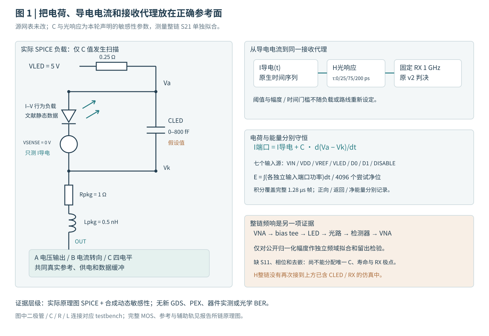

# 20 µm MicroLED 动态负载：校准边界、敏感性与净 3.2 Gb/s 的 A/B/C 验证

2026-11-08 · 中文研究报告 · 原理图级晶体管仿真、公开数据拟合与接收代理分析

<!-- SUMMARY -->

本轮继承[器件与 Driver 共设计研究](../microled-device-codesign-20261029/index.html)，将其中的验证方案推进到实际数据处理和晶体管实验。项目定位仍是实验性研发方法验证与教学。**文献数据、条件化模型、仿真接收结果与真实光学链路是不同证据层级。**

## 1. 固定什么，改变什么？

对象为黄色 InGaN/GaN、20 µm **正方形**、面积 400 µm² 的文献样品类别。静态 I–V 来自作者公开数值文件；25–100 µA 对应 6.25–25 A/cm²。I–V、P–I 与 S21 是否来自同一颗物理像素仍无法确认。

| 项目 | 本轮条件 | 证据边界 |
|---|---|---|
| A / B / C | 原 20 / 21 / 49 MOS 候选及原校准参数 | 原理图级；没有新增布局/PEX |
| 发射格式 | A/B 为 NRZ；C 为 Gray PAM4 | 只比较当前实现，不能据一版电路否定整个架构类别 |
| 目标 | 净 3.2 Gb/s；4,736 线路位中 4,096 payload | A/B 3.7 GBd；C 1.85 GBd；帧长 1.28 µs |
| 序列与训练 | 同一 PRBS15；448 位训练评分、64 位保护、4,096 位验证 | 训练选择算法取自冻结 v2 源码，不使用验证标签调相 |
| 接收器 | 1 GHz 一阶响应；原固定阈值、7.5 µAeq 幅度和 100 ps 单侧时间筛查 | 电流等效代理，无已标定 PD/TIA、噪声或光学 BER |
| 负载电容 | 0 / 10 / 50 / 200 / 800 fF | 全部为敏感性假设；0 fF 仅作理想诊断 |
| 光响应时间 | 0 / 25 / 75 / 200 ps | 全部为独立状态模型假设；0 ps 仅作理想诊断 |
| LED 封装 | 原 1 Ω / 0.5 nH，原供电网络不变 | 未从新实测提取，不能称新 PEX |
| 角落 | TT 27°C/3.3 V；SS 125°C/2.95 V；FF −40°C/3.65 V | 变化作用于 MOS/电阻及供电；LED 没有实测温度模型 |

现有 A/B/C 的设置均沿用同一冻结输入包，不在每个电容或角落重新校准电流。给 C 更长符号 UI 是两位一符号的必然结果；它没有获得更低的接收幅度门槛或额外验证训练。

“固定接收条件”指传函、阈值、门槛和训练规则固定；每个 case/光响应假设仍用自己的训练段选择 0–8 ns、5 ps 网格中的 delay，再冻结用于验证。它们不强制共用同一个采样时刻。文中的联合筛查字段只包含原 v2 接收检查与原 MOS 端对压差筛查；DC 精度、体结正偏、模型域和完整可靠性需另行审查。

## 2. 电路连接：导电电流、电容电流和光响应要分清

*图 1｜本轮实际 testbench 的负载连接及后处理参考面。BIV/二极管符号表示文献 I–V 的行为负载；VSENSE 只测导电支路。光响应是假设的因果状态模型，未由整链幅频唯一校准。*

LED 两端总电流包括导电支路与储能变化：`I端口 = I导电 + dQ/dt`。本轮电容为常数，故 `dQ/dt=C·d(Va−Vk)/dt`。导电电流是接收代理的输入；七个源端口的能量统计则自然包含负载充放电与所有实际辅助电路的取能。两者不能互换。

电压驱动 A 通过输出级与实际 VH/VL 辅助轨改变 LED 阴极电压；B 把尾电流在 LED 和 dummy 支路之间转向；C 使用译码和多单位电流形成四个发光电平。相同负载下，它们对电容的充放电能力、内部节点建立和静态功耗不同。

实际器件展开沿用已核查的原理图：[A 输出核心](../fair-driver-comparison-20261025/figures/a-core.svg)、[A 辅助轨](../fair-driver-comparison-20261025/figures/a-rails.svg)、[B 核心](../fair-driver-comparison-20261025/figures/b-core.svg)、[公共参考](../fair-driver-comparison-20261025/figures/common-reference.svg)、[C 总览](../fair-driver-comparison-20261025/figures/c-overview.svg)、[C 译码](../fair-driver-comparison-20261025/figures/c-decoder.svg)与[C 单位电流](../fair-driver-comparison-20261025/figures/c-unit.svg)。本轮不改变这些源网表，新增的是负载假设扫描和模型检验。

## 3. 校准了什么？还不能从幅频反推出什么？

### 3.1 静态与 DC 回归

<!-- DC -->

### 3.2 公开动态数据的独立拟合和留出检验

原始数据为 [Lin 等人的独立公开数据集](https://doi.org/10.5281/zenodo.20034288)中 `yellow20_s21_bandwidths.xlsx`：每条曲线 2,001 点、30 MHz–3 GHz、25/50/60/80/100 µA，首点归一化为 0 dB。它不是复数 VNA 原始采集。论文测量链还含 bias tee、光路和检测器，缺少把这些环节移到 LED 参考面所需的独立校准。

<!-- FIT -->

即使一个稳定的最小相位数学模型能拟合幅度，也不能据此证明其相位、复合寿命、电容或检测器分配正确。`H(s)` 与 `H(s)·exp(−sTd)` 幅度相同；纯延迟可能被现有训练窗口吸收，但未知的频率相关相位、群延迟和大信号状态仍会改变眼图。不能用幅频唯一推断瞬态接收。

因此，新模型卡分别记录 **静态数据校准状态、整链幅频拟合状态、动态物理参数识别状态**。整链拟合留在频域证据层；下面的晶体管实验使用单独编号的敏感性模型，不把整链 S21 再串到 CLED 和 1 GHz RX 后面。

## 4. 同一接收器下的 A/B/C 结果

### 4.1 先复核旧基线，再看修改负载后的变化

<!-- BASELINE -->

### 4.2 电容与光响应时间的完整敏感性矩阵

<!-- MATRIX -->

这里的 µAeq 不是实测接收光功率。改变光响应时间不会反过来改变本轮晶体管电气取能，所以同一个电容/电路下，四种光响应假设共享同一电气能量。这是当前分块模型的适用边界，不能冒充已完成电–光–热双向耦合。

### 4.3 相同坐标眼图与分层诊断

<!-- EYES -->

绕过某一级滤波只用于定位限制，不能把绕过后的结果当成完整链路通过。也不能把 C=0 fF 或 τ=0 ps 的结果当成可制造器件。

## 5. 能耗：统计范围和失败点的含义

统计面为 `VIN、VDD、VREF、VLED、D0、D1、DISABLE` 七个独立输入端口，覆盖完整 1.28 µs 帧。定义向电路输入功率为正，正向、返回和净能量分别报告；分母为 4,096 个尝试发送的 payload 位。已经由这些端口供能的 LED 或电容，不再单独相加。

<!-- ENERGY -->

该数值不包括上游电源/精密基准芯片内部、串行器/时钟、实体光接收器与编码/DSP 的全部功耗。电容净储能和建立过程也需要单独检查。接收失败点的低 pJ/bit 是**尝试发送的取能**，不能解释成有效交付效率更优。

## 6. 为什么失败？角落、数值分辨率和模型域

<!-- FAILURES -->

需要区分三类失败：一是电气电流未在给定 UI 内进入目标判决区；二是电气有变化，但后续光响应/RX 的码间干扰使判决失败；三是接收代理可能有开口，但器件端压、体结、DC 目标或模型适用域检查失败。它们对应不同的下一步修改。

<!-- VALIDATION -->

## 7. 下一步的实验与设计门槛

1. **补齐同像素电学与电光动态数据。** 同一像素/温度下测 IV、绝对 PI、复数 S11/Z、S21 幅相、RF 幅度和噪声底；校准 PD/TIA、光路、焊盘与夹具。缺少这些数据时，电容和光学状态只能保持条件化身份。
2. **按分层失败机制修改电路。** 若小电容/快光响应仍受电气建立限制，研究输出级、内部节点和译码时序；若主要受接收响应限制，先量化相同接收器下的预加重/均衡代价。每次修改仍保持净吞吐、误码和端压条件，再重新统计参考/供电和数字代价。
3. **最后才选择路线。** 候选需要在器件模型留出、数值收敛、角落/封装、绝对光功率与噪声测量下同时保留余量。单一典型点、少量零错误位或最小取能都不足以决定 A/B/C。

本轮的价值是把“文献说有 GHz”与“当前驱动器在这个 UI 内实际交付什么”用明确的参考面和可重跑证据连接起来。项目还没有完成实物光学链路、阵列或流片签核。

## 8. 证据、来源和复现

<!-- REPRODUCE -->

- 静态来源：[模型卡](../../../analog/models/measured-led/model-card.json)、[源数据通知](../../../analog/models/measured-led/NOTICE.md)。
- 动态来源：[原始定位与许可台账](../../../evidence/microled-dynamic-20261029/source-ledger.json)、[数据提取章节](../vcsel-reference-microled-dynamics-20261029/microled-dynamic-evidence.html)。
- 原论文：[Transfer-printed yellow and red InGaN micro-LEDs on diamond…](https://pmc.ncbi.nlm.nih.gov/articles/PMC13433930/)；本轮公开文件只复用已明确许可的数值数据及原创图，不重新发布受限论文图像。
- 本轮原始输出在 `build/microled-dynamic-v1/`；本轮模型和 compact evidence 在 `analog/models/microled_dynamic_v1/` 与 `evidence/microled-dynamic-v1/`。源版本、文件 SHA、数值验证、失败和备份范围分别记录。
