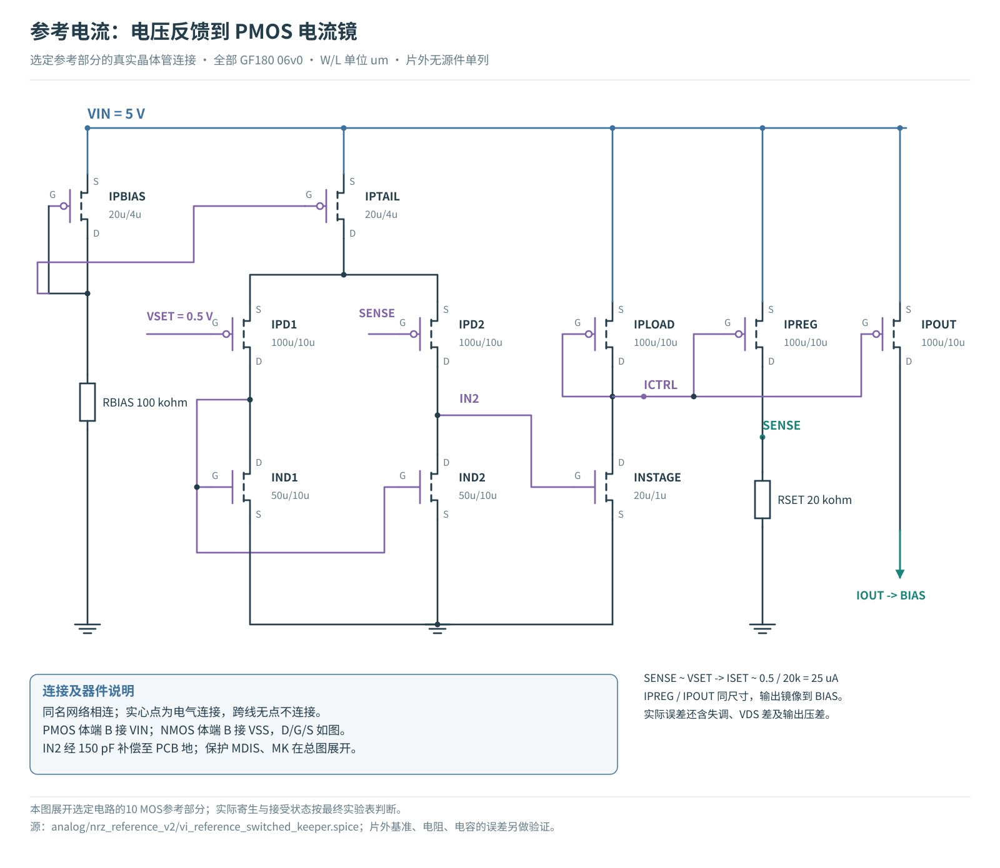
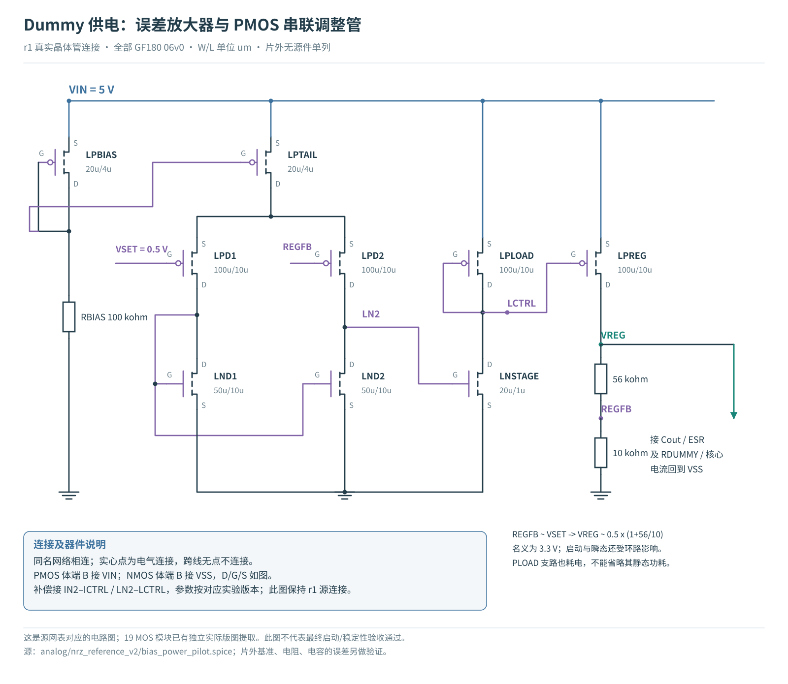
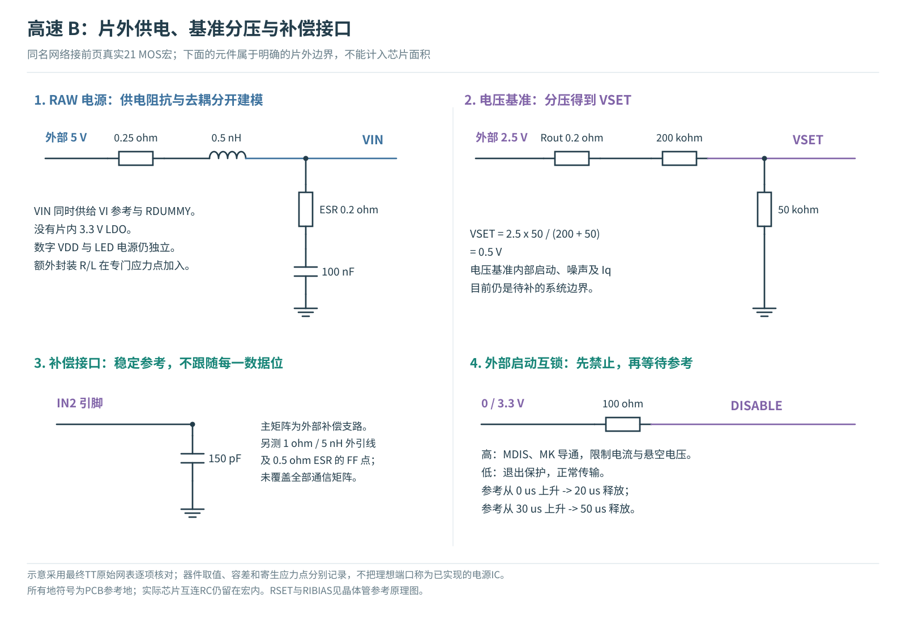

# 高速 MicroLED B 路线：真实参考、电源与启动保护

<p class="lead">这轮把理想偏置边界换成可检查的晶体管参考与供电网络。高速数据路径、MicroLED 负载和接收算法保持；新增电路必须同时回答启动是否受控、参考电阻误差怎样传到 LED，以及增加了多少功耗。</p>

## 本轮结论与决策

**晶体管参考、受控启动和真实联通版图已经接上原 B 数据通路。** 0.5 Gb/s 是本轮固定验证点；本轮没有重新搜索最大速率。采用 10 MOS 电流反馈参考、两只受外部 DISABLE 控制的保护管与 RAW 5 V dummy 供电。外部精密电压基准尚未片内实现。

112 个 DC 点全部求解，器件端压筛查全部通过，但 **4 个电流精度点失败**，包括宽容差联合角和 ±5% 负控制。11 个启动/重启点中 10 个满足原功能与绝对端压条件；其中残余电源重启仍有 **0.747 V 体结正向偏置，尚未闭合**。提前解除关断负控制同时违反准备时间与 03v3 端压条件；5 个慢时标控制通过。10 个固定速率通信测试点中 **10 个通过** 接收与端压联合筛查。详细数据如下，失败没有从分母中删除。

目前的工程决策是：保留 RAW 供电与 150 pF 补偿作为正常启动及通信研究基线，RSET 采用 ±0.1% / ±25 ppm/°C 的研究规格，外部控制必须在参考建立后才解除 DISABLE。下一步优先实现参考就绪检测、掉电时内部补偿节点的复位/隔离并检查结电流；当前不能宣布残余电源重启已经可靠。


[TOC]

## 先读当前采用的连接

<figure><a href="figures/selected-b-circuit.svg"></a><figcaption>10 MOS 电流参考加 MDIS、MK，与原 9 MOS 高速核心连接。MDIS 钳位 BIAS，MK 使 RKEEP 仅在禁止期间泄放；正常通信时断开该支路。两者解决不同问题，泄漏及寄生仍在完整模型中。</figcaption></figure>

主供电 VIN 为 5 V，经有限供电阻抗与去耦进入电路，RDUMMY 改为 50 kΩ。原来理想 3.3 V VDUMMY 的任务是提供 dummy 支路的电压余量；它不是接收器规定的电平，也不是必须保留的片内稳压电源。本轮先尝试过真实 LDO，但长时间稳定性未通过，因此改用更直接的供电路径，并重新检查 5 V 带来的器件端压。

原核心的[四 MOS 数字缓冲、输入电阻及转向管详细原理图](../driver-robustness-20261024/figures/steering-schematic.svg)可作连接说明；其中旧 RREF / VDUMMY 部分已由本报告新参考电路替代，不能同时接入。

## 从数据到光：本轮改的是偏置与供电

数据通路仍然是 **DATA → 反相器及缓冲 → 两只转向 MOS → LED / dummy 支路**。尾电流决定高、低电平的差，基础电流使 LED 在低电平时仍有电流。数据每 2 ns 换一位，这是本轮的 0.5 Gb/s 测试点；不是 PWM 显示的灰度周期。

本轮保持 Lin 等 2026 年公开数据中的 20 µm 方形黄色 InGaN MicroLED 静态 I–V 曲线（Zenodo `10.5281/zenodo.20034288`，`I-V.xlsx` 的 Sheet1 A3:B102）。其测量温度未注明；100 µA 附近约 3.77 V。200 fF 电容、200 ps 光学一阶时间常数和接收器仍是另行声明的假设。SS/125°C、FF/−40°C 是所扫 MOS/电路条件，不能据此声称已验证该 LED 的温度相关光电性能。启动时低于首个实测点的模型延伸也不当作测量证据。

参考源不需要逐位跟随数据。它要在较慢时间尺度上稳定电流，并在启动、供电变化和温度改变时保持受控。稳压器同样不能用“一个微秒内接收正确”证明稳定：输出电容和反馈环路的变化可以持续几十至几百微秒。因此本轮把通信测试与长时间启动、负载阶跃测试分开，分别判定。

通信窗口从已经建立的工作点运行；100 µs 启动测试使用固定数据电平。两者通过不等于已经在同一条全晶体管波形中验证“上电→第一包数据→接收重新训练”，该联动应随实际 ready 控制一起补齐。

### 1. 电压基准如何变成参考电流

外部 2.5 V 精密电压输入经过 200 kΩ / 50 kΩ 分压，得到约 0.5 V 的 VSET。误差放大器比较 VSET 与 SENSE，调节 PMOS IPREG 的栅极，使 RSET 上的电压逼近 VSET。

> ISET ≈ VSENSE / RSET ≈ 0.5 V / 20 kΩ = 25 µA。

这里的 25 µA 是设计目标，不是写进理想电流源的保证。差分对失调、有限环路增益、RSET 误差都会改变它。IPOUT 与 IPREG 同尺寸、同栅极，把电流送到原 B 核心的 BIAS 二极管连接 MOS；两支路漏源电压不同，又会产生镜像误差。之后原核心再按镜像比例建立基础电流和转向电流。**稳定了 ISET，也必须重新测量 LED 的实际高低电流。**

<figure><a href="figures/vi-servo-selected.svg"></a><figcaption>选定电路的 10 MOS 电流参考部分。器件连接、W/L 与源网表逐只对应；新增两只保护 MOS 在前面的总图展开。图中同名网络相连，PMOS 体端接 VIN，NMOS 体端接 VSS。</figcaption></figure>

正常负反馈可以逐步理解：SENSE 升高 → 右侧 PMOS 输入支路电流减小 → IN2 降低 → INSTAGE 下拉减弱 → ICTRL 升高 → IPREG 的 VSG 减小 → 电流下降。这个方向检查是必要条件；是否振铃，还取决于每一级的增益、寄生电容和补偿。

### 2. 第一版 LDO 为什么需要单独验证

原设计由理想 3.3 V 的 VDUMMY 同时供给 RREF 和 RDUMMY。它能瞬间提供或吸收仿真需要的电流，但没有稳压器的静态损耗、充电时间和输出阻抗。本轮首先尝试独立的 5 V VIN，经 9 MOS 误差放大器及 PMOS 调整管产生 VREG，给 RDUMMY 供电。这一方案后来因启动和长时间振铃未通过而未被采用，保留为设计对照。逻辑 VDD 继续采用原来的 TT 3.3 V、慢热 2.95 V、快冷 3.65 V。

反馈电阻是 56 kΩ / 10 kΩ，因此目标为 `VREG ≈ VSET × (1 + 56/10) = 3.3 V`。给 LDO 独立 5 V 输入，是为了保留调节压差；没有假定 2.95 V 电源能经过普通 LDO 产生 3.3 V。

<figure><a href="figures/ldo-r1.svg"></a><figcaption>第一版 LDO 的实际 MOS 连接。输出电容、ESR 和补偿值按各实验网表记录，不能把初版电路图当成最终启动或稳定性验收。</figcaption></figure>

输出 10 nF 电容升到 3.3 V，需要充入 `Q = CΔV = 33 nC`。如果要求在 20 µs 内建立，仅电容充电就需要平均 1.65 mA，还没有加负载电流。这个计算解释了为什么需要明确启动预算，并不能代替对调整管瞬态电流的仿真。

### 3. “真实参考源”的完成边界

<figure><a href="figures/board-power-circuit.svg"></a><figcaption>供电与基准分压按最终 TT 网表逐项核对。RAW、2.5 V 电压基准、GPIO 仍是外部接口；“真实参考”指宏内的晶体管反馈与电流镜，未包含完整电源 IC。</figcaption></figure>

本轮的 MOS 放大器、电流镜和禁止 MOS 是所选电路的晶体管实现；早期 LDO 也完成过独立版图提取，但未满足电气验收。外部精密电压输入仍是带明确误差条件的端口模型。没有完成片内 bandgap，也没有把这个通用电压输入称为某款产品的验证过的 SPICE 宏模型。

RSET、参考分压、LDO 分压、偏置电阻和补偿/去耦电容目前按片外器件建模。它们可以支持电路方法验证，但不是“已经全部集成到 ASIC”。最终整片面积还需要 pad、ESD、供电、测试及物理集成约束。

## 电阻容差为什么必须独立检查

对于单一电阻，`ΔI/I ≈ ΔVSET/VSET − ΔRSET/RSET` 是一阶估计。对分压器，设 VSET = VREF × Rbottom / (Rtop + Rbottom)，则分压误差不仅由电阻的绝对值决定，还由上下两只的相对误差决定。同向变化可能抵消，相反方向变化会放大误差。因此不能让所有电阻共用一个比例系数，就声称覆盖了参考电阻容差。

本轮将 RSET、RDUMMY、参考分压及偏置电阻区分；失败 LDO 的稳压分压只属于历史对照。独立工艺角与板级容差也不是同一件事。确定性 ±1% / ±100 ppm/°C 扫描用于暴露敏感性，±5% 是较大的偏差对照。最终选定 RSET 的研究规格收紧为 **±0.1% / ±25 ppm/°C**，标称仍为 20 kΩ，没有为不同工艺角逐点调值。它们不是统计良率或量产保证，也不代替实际器件规格和匹配数据。

## 能耗如何算，才不会把新增电路的代价漏掉

对全部电源和 DATA 驱动端口计算实际 `v(t) × i(t)`。正向取能与净取能分别保留；再除以相同统计窗口内发送的 gross bits。静态参考与稳压器持续耗电，速率降低时摊到每位的能耗会升高。DATA 端口的驱动功耗也不能忽略。

外部电压参考端口对电路交付的能量已经可以积分，但参考芯片内部的静态电流及其上游转换损耗没有包含在通用理想端口内，必须另外列预算。这里不把“晶体管电路输入端口能耗”冒充完整光链路的系统能耗；接收器、时钟、编码及光学效率仍有独立边界。


## DC：电阻规格如何改变实际 LED 电流

先看参考架构修改的实际收益：旧参考电阻从理想 3.3 V 供电，电流随 BIAS MOS 的 VGS 改变；新参考对 RSET 电压闭环控制。下面保持对应 MOS 角、温度、数字电源与 LED 负载。三条件下，高电流的误差范围由约 −8.06%～+7.71%，缩小到 −2.55%～+3.37%，代价是后文所列真实参考静态功耗。

| 同条件 | 旧理想 VDUMMY + RREF，I0 / I1 µA | 新实际参考，I0 / I1 µA |
|---|---|---|
| TT | 24.986 / 99.707 | 25.154 / 100.395 |
| SS | 23.656 / 91.945 | 25.065 / 97.448 |
| FF | 26.343 / 107.714 | 25.261 / 103.372 |

目标 I0/I1 为 25/100 µA，误差预算均为 ±5%。联合条件同时改变 RSET、RDUMMY、外部基准与 RAW；SS/FF 是指定组合，不是完整笛卡尔积。VSET 分压误差、100 Ω 源阻抗等另作独立控制，未声称全部极值已经同时叠加。

| 条件 | I0 µA | I1 µA | 相对目标误差 I0 / I1 | ±5% 判定 |
|---|---|---|---|---|
| TT / 27°C | 25.154 | 100.395 | +0.616% / +0.395% | 通过 |
| SS / 125°C | 25.065 | 97.448 | +0.262% / -2.552% | 通过 |
| FF / −40°C | 25.261 | 103.372 | +1.045% / +3.372% | 通过 |
| SS 宽容差联合 | 24.504 | 95.263 | -1.985% / -4.737% | 通过 |
| FF 宽容差联合 | 25.725 | 105.247 | +2.900% / +5.247% | 未通过 |
| SS 精密 RSET 联合 | 24.900 | 96.804 | -0.400% / -3.196% | 通过 |
| FF 精密 RSET 联合 | 25.370 | 103.811 | +1.480% / +3.811% | 通过 |

<figure><a href="figures/rset-tolerance.svg"></a><figcaption>阴影是 ±5% 研究预算。FF 宽容差联合点越界；收紧 RSET 后回到预算内。各角点使用同一标称 20 kΩ，没有逐点校准。</figcaption></figure>

<details><summary>查看全部 4 个未通过电流精度的 DC 点</summary>

| 失败 DC 条件 | 逻辑位 | 电流误差 |
|---|---|---|
| DC_FF_RSET_-0.01_100 | 1 | +5.0747% |
| DC_NEG5_RSET_-0.05 | 0 | +5.8408% |
| DC_NEG5_RSET_-0.05 | 1 | +5.5942% |
| DC_FF_joint | 1 | +5.2465% |

</details>

完整数据：[112 点 DC](../../../evidence/nrz-reference-v2/selected-final-r2-dc.json)。旧分析字段 `combined_screen_passed` 在 DC 中只代表器件端压；本报告另算电流误差，避免把两个判据混淆。

## 启动：保护作用、代价与失败边界

DISABLE 高时，MDIS 把 BIAS 钳到地，MK 接通 1.8 MΩ 泄放，避免 OUT 悬空；低时，两管关闭，正常低电平不再附加约 1 µA 的 keeper 电流。启动保持仍有约 1.3 µA 电流，合同为 ≤2 µA，**不是零电流关断**。正常释放后须在 2 µs 内进入 100 µA ±5%，完整峰值须 ≤125 µA。

正常冷启动：外部电源与参考用 1 µs 斜坡建立，20 µs 后释放。迟到参考在 30 µs 开始时，释放也推迟到 50 µs。若仍在 20 µs 提前释放，实际 21 MOS PEX 中最大 03v3 端差约 **4.862 V**，超过 3.63 V 项目筛查，并延迟约 13.53 µs 才进入目标带。这是尚未实现自主 POR/ready 检测的实际风险，不能写成任意上电顺序安全。

| 启动条件 | 保持峰值 µA | 完整峰值 µA | 释放到稳定 ns | 型号端压余量 V | 原判据及补充检查 |
|---|---|---|---|---|---|
| TT 正常启动 | 1.2765 | 100.670 | 89.06 | 0.9995 | 原判据通过 |
| SS 正常启动 | 1.2753 | 97.657 | 93.59 | 0.9998 | 原判据通过 |
| FF 正常启动 | 1.2901 | 103.710 | 88.75 | 0.9993 | 原判据通过 |
| 基准迟到，正确延迟释放 | 1.2764 | 100.670 | 89.05 | 0.9995 | 原判据通过 |
| 基准迟到，错误提前释放 | 1.2764 | 100.395 | 13529.71 | -1.2319 | 失败：负控制 |
| FF：补偿 -20% | 1.2901 | 103.752 | 88.83 | 0.9991 | 原判据通过 |
| FF：补偿 +20% | 1.2901 | 103.680 | 88.87 | 0.9994 | 原判据通过 |
| FF：去耦与 keeper 应力 | 1.2705 | 103.709 | 88.80 | 0.9993 | 原判据通过 |
| FF：保留 LED 电源的重启 | 1.2681 | 103.835 | 88.78 | 0.9979 | 功能/绝对端压满足，体结未闭合 |
| FF：更紧数值配置 | 1.2891 | 103.708 | 88.88 | 0.9993 | 原判据通过 |
| FF：补偿外引 R/L | 1.2900 | 103.709 | 88.79 | 0.9993 | 原判据通过 |

<figure><figcaption>上图为 100 µs 完整窗口，下图放大释放附近。波形来自全分辨率结果；本轮的 20 µs 外部等待是一项明确接口条件。</figcaption></figure>

<figure><figcaption>左：参考 30 µs 到、50 µs 释放；右：参考仍在 30 µs 到，却提前于 20 µs 释放。右图 OUT 悬空期间 03v3 端压越界。图中 anchor 为外部电压基准，DISABLE 为外部禁止信号；这两种时序故意不同。</figcaption></figure>

最后两行分别检查更紧数值配置、补偿外引 1 Ω / 5 nH 与 0.5 Ω ESR；不能外推为全部启动与通信矩阵都覆盖了补偿引脚寄生。完整数据：[启动/重启](../../../evidence/nrz-reference-v2/selected-final-r2-startup.json)。

### 补充复审：残余电源重启尚未闭合

当 VLED 与外部基准仍供电、RAW 在 20–21 µs 从 5 V 降到 0 V 时，DISABLE 已经置高，但它只处理 BIAS 与 OUT，没有主动复位内部 IN2。原 IPD2 的扩散区在约 21.174 µs 仍为 0.749006 V，nwell 仅为 0.002357 V，形成 **0.746649 V 正向结压**。超过 0.7 V 的插值持续时间约 1.400 µs；0.7 V 仅用于描述波形，不是新声明的 foundry 允许值。

<figure><figcaption>图示是对已观察波形的机制解释。扩散区与阱电压已直接核对；储能路径的完整电流分解仍待专门实验。</figcaption></figure>

这里原功能/六对绝对端压判据通过，仍不能排除衬底/阱注入风险。原始波形没有保存该结电流，不能由电压单独宣称具体注入电荷、闩锁或寿命结果。本轮把它列为独立未闭合项；不能用“最后电流恢复了”覆盖这个问题。[带时间与节点定位的补充审查](../../../evidence/nrz-reference-v2/restart-body-review.json)

## 慢时标反馈与快数据通路分别验收

最终实际 PEX 的局部双注入估计，TT/SS/FF 的交越频率约 450.4/283.5/668.7 kHz，相位裕量约 72.96°/78.34°/66.25°；闭环与注入工作点最大差约 3.59×10⁻¹¹。它是局部环路估计，需结合 100 µs 启动与阶跃波形理解。

<figure><figcaption>实际 21 MOS PEX，DATA 高低分别检查。该估计不是严格多环路稳定性或 foundry 签核。</figcaption></figure>

<figure><figcaption>用于解释机理的单因素控制：同一 11 MOS 前布局候选、同一 10 MΩ keeper，仅改补偿。它支持修正方向，不冒充最终 21 MOS PEX 结果。</figcaption></figure>

FF 的 RAW 5→4.75→5 V、10 ns 边沿测试中，LED 电流范围为 98.01–108.81 µA，2 µs 后相对 100 µA 的误差不超过 3.413%。RAW 端扰动首先改变供电侧端压，反馈随后恢复；这与数据通路每 2 ns 转向一次是不同时间尺度。[5 点慢时标数据](../../../evidence/nrz-reference-v2/selected-final-r2-slow.json)保留每项峰值与晚期波动。

## 相同接收条件下，能量和余量怎样变化

<figure><a href="figures/energy-comparison.svg"></a><figcaption>旧版理想偏置不含真实参考内部代价；首版 LDO 即使短通信窗口零错码，仍因启动及长时波动被拒绝。完整端口能量逐源积分，不能据此宣布系统能效最优。</figcaption></figure>

新增能量主要花在哪里？另外对六个相同 DC 工作点增加内部电流观测，LED 电流与原结果差为 0 A。TT 的 RAW 5 V 分配中，OTA 控制支路约 **451.26 µW**，检测参考支路约 **124.97 µW**，输出参考支路约 **124.53 µW**；三者合计约 **700.76 µW**，在 0.5 Gb/s 下约 1.40 pJ/bit。因而下一轮降低参考 OTA 偏置电流值得研究，但每次都要重新检查稳定性和启动。这里按电源侧 MOS 漏电流分配预算，模型体端电流等造成约 0.09–0.17 µW 闭合残差，已明列；没有强迫分支和相等。[观测原始数据](../../../evidence/nrz-reference-v2/power-dc-r2.json)

| 实际 PEX 测试点 | 错码 / 511 | 接收阈值余量 | 时序余量 UI | 正向能量 pJ/bit | 型号端压最小余量 V |
|---|---|---|---|---|---|
| TT 名义 | 0 | 0.2435 | 0.2891 | 2.6883 | 0.8728 |
| SS 慢热 | 0 | 0.2332 | 0.2734 | 2.5194 | 0.9137 |
| FF 快冷 | 0 | 0.2476 | 0.3203 | 2.9174 | 0.8314 |
| SS 精密 RSET 联合 | 0 | 0.2293 | 0.2656 | 2.3829 | 1.1616 |
| FF 精密 RSET 联合 | 0 | 0.2462 | 0.3125 | 3.0644 | 0.5841 |
| FF：RAW +250 mV 脉冲 | 0 | 0.2286 | 0.3047 | 786.6702 | 0.6162 |
| FF：VLED +50 mV 脉冲 | 0 | 0.2477 | 0.3125 | 2.9193 | 0.8313 |
| FF：VDD +50 mV 脉冲 | 0 | 0.2472 | 0.3203 | 2.9222 | 0.8290 |
| FF：供电与 LED 封装组合 | 0 | 0.2481 | 0.3125 | 2.9166 | 0.8342 |
| FF：更紧数值配置 | 0 | 0.2475 | 0.3203 | 2.9175 | 0.8309 |

**扰动行的能量不能作为正常通信能耗。** RAW pulse 是 5→5.25 V、2 ns 边沿、每 254 ns 重复且高态 64 ns 的供电应力，会反复给 100 nF 输入电容充放电。这个窗口的全源正向取能 **786.67 pJ/bit**、返还 **741.95 pJ/bit**、净取能 **44.72 pJ/bit**；返还给理想端口的能量不代表实际电源能全部回收。正常三 PVT 的能量对照图仅用没有该扰动的案例。

接收阈值余量以固定 75 µA 高低电流跨度归一化；时序余量单位 UI，0.5 Gb/s 时 1 UI = 2 ns。阈值 62.5 µA、200 ps 光学一阶响应、1 GHz RX、训练与 511 位验证序列保持。供电 pulse 是预声明的局部端口扰动，package 行叠加指定供电/回流/LED R/L；不是完整封装场解。0/511 仅是该有限序列的观察，不是 BER 或最大速率保证。

完整记录：[10 点 NRZ](../../../evidence/nrz-reference-v2/selected-final-r2-nrz.json)、[绘图及汇总输入 SHA](figures/results-data.json)。器件端压按 03v3 的 3.63 V、06v0 的 6.0 V 分开筛查，都是项目研究门槛；未完成寿命、SOA 或 ESD 资格验证。


## 版图：先改善供电网络，再验证完整连接

“连接正确”与“连接阻抗足够低”是两件事。首版 19 MOS 参考/LDO 模块的 DRC 和 LVS 通过，但提取的 VIN/VSS 路径很长。电气对照进一步表明：把该模块互连 R/C 去掉，长时间振铃仍然存在，所以布线不是原 LDO 失败的唯一原因。

随后对**相同 10 MOS 电流参考**做了单因素真实版图对照：器件型号、W/L、位置和原制造图形保留，仅增加供电布线与通孔。新的电源干线采用 6 µm 宽 M5，近端源/体连接和多层通孔按实际规则生成。没有把提取电阻手工调小来制造改善。

| 相同 10 MOS 模块指标 | 原布线 | 加强供电布线 | 含义 |
|---|---:|---:|---|
| VIN 至最远源/漏端提取电阻 | 88.47 Ω | 17.31 Ω | 供电路径降低 80.4% |
| VSS 至最远源/漏端提取电阻 | 46.34 Ω | 13.17 Ω | 回流路径降低 71.6% |
| IOUT 至器件端提取电阻 | 42.53 Ω | 13.18 Ω | 输出参考路径降低 69.0% |
| VIN 最大体端路径 | 141.01 Ω | 108.44 Ω | 仍明显大于源/漏供电路径 |
| VSS 最大体端路径 | 127.40 Ω | 107.39 Ω | 不能称体端问题完全解决 |
| 模块包围框面积 | 39,633.97 µm² | 40,670.00 µm² | 增加 2.61% |
| 显式互连电容总和 | 1.28659 pF | 1.33592 pF | 增加 3.83%；不含器件本征 C |

<figure><a href="../../../evidence/reference-v2-layout/visuals/vi-power-comparison.svg"></a><figcaption>两份实际 GDS 使用相同 XY 比例，标出 VIN、VSS、VSET、IOUT/BIAS 和新增干线。图中的面积对照严格限于相同 10 MOS，不把删除 9 MOS LDO 带来的面积变化混称布线优化。</figcaption></figure>

这两份对照分别通过 Magic 与独立 KLayout DRC、原生/回读/RC 折叠 LVS，以及真实 GDS 断线/短路负控。逐层差分确认旧制造多边形保留、器件位置不变；[对照审计](../../../evidence/reference-v2-layout/vi-power-comparison.json)和[结果摘要](../../../evidence/reference-v2-layout/vi-power-summary.json)可逐项核查。

### 提取模型仍然不能回答什么

加强金属不能自动消除阱和衬底的等效阻抗。新 VIN 最远体端路径中，一条约 102.37 Ω 的度为一的导出支路占约 94.4%。这说明余下主导项不在已加宽的金属干线中；该模型对三维衬底电流传播的描述仍有边界。不能据此宣称已完成衬底隔离、EM/IR、热或寿命签核。

本项目保存原始 `.ext`、提取电阻网络和电容矩阵。电容记账检查验证的是来源与守恒，不是场解准确性。新 10 MOS 对照里遇到过金属间距 DRC 失败和文本电容精度检查问题，失败目录均保留。后者按原打印 token 的半末位精度界修正比较，未放宽 `.ext` 与最终组装电容矩阵的一致性要求。

### 最终 12 MOS 与高速核心集成

最终已经在真实顶层 GDS 中连接 **12 MOS 参考/保护模块 + 原 9 MOS 高速核心 + 原 RIN**。VIN 与数字 VDD 独立，BIAS、公共地和 KRET 均按实际布线提取。两种 DRC 为零违例，原生、GDS 回读、RC 折叠三次 LVS 匹配；故意切断实际 BIAS 桥线的 6 µm² 金属后，LVS 能正确拒绝。原 B 核心制造图形全部保留，11 个非布线层的多边形并集与来源一致。

<figure><a href="../../../evidence/reference-v2-layout/visuals/nrz-switched-keeper-joint-r1.svg"></a><figcaption>实际 GDS 的器件、金属和连接。旁边历史 19 MOS 含 LDO，功能不同，不能作为相同电路的面积优化对照。</figcaption></figure>

最终实验模块包围框为 **348.99 × 340.06 µm = 0.118678 mm²**；提取 **638 个互连 R、322 个显式 C、20 条网络**，显式电容总和 1.444159 pF。晶体管模型的本征电容另由器件模型计算。正式回归读取的 RC SHA-256 是 `925b0e98ede116b7d3dc0c0f326aa1704fd08b84dd8cabe39cf03ae4ac4f3d6a`，不能用同名但不同内容的文件替代。

完整顶层的最远 VIN 源/漏路径为 17.31 Ω，VSS 源/漏为 37.47 Ω；体端路径分别为 108.44 Ω 与 353.11 Ω。这些数值均留在回归中。它们也提醒我们：模块供电优化不等于完成完整芯片地回路、衬底或闩锁验证。

PEX 组装保存逻辑网络的完整电容矩阵，并采用显式接地电容分配修正；这是记录在案的近似，不是未经处理的原生 RC 或三维场解。GDS 回读中发现的 N+ 角落差异已从源图形恢复，共 0.0608 µm²，随后对最终 GDS 重新执行 DRC、LVS 和提取；没有在验收后偷偷修图。原始回读与失败尝试均保留。[完整物理摘要](../../../evidence/reference-v2-layout/nrz-switched-keeper-summary.json)提供所有检查及限制。

上述面积不含 pad、ESD、完整电源网和封装，外部精密基准、电阻、电容及 DISABLE 控制不在芯片面积中；目前仍是可验证的实验宏，尚非可交付晶圆厂的完整 ASIC。


## 如何复核与接续开发

本报告对应新目录，不覆盖旧阶段。阅读入口分三层：先看本页的电路与决策，再看表格及图旁的 JSON/CSV，最后恢复原始网表、求解器日志与全端子波形。Markdown、SVG、网表和 Python 脚本均开放；原始失败同样保存。

| 内容 | 入口 | 能证明什么 |
|---|---|---|
| 12 MOS 参考与保护的源连接 | `analog/nrz_reference_v2/vi_reference_switched_keeper.spice` | 每只 D/G/S/B、型号与 W/L |
| 实际 21 MOS 顶层 | [物理摘要](../../../evidence/reference-v2-layout/nrz-switched-keeper-summary.json) | 生成 GDS、DRC/LVS、提取身份及负控 |
| 电气矩阵与冻结范围 | [最终范围声明](../../../evidence/nrz-reference-v2/final-scope-amendment.json) | 条件、判据、负载及未覆盖项 |
| 条件 keeper 与精密 RSET 修订 | [修订声明](../../../evidence/nrz-reference-v2/final-scope-amendment-conditional-keeper.json) | 为什么改变电路与 BOM，保留原失败 |
| 独立复核 | [最终审查记录](../../../evidence/reference-v2-audit/review-final.md) | 来源身份、数值复算及发现的问题 |
| 原始仿真 | `build/nrz-reference-v2/selected-final-r2/` | 实际执行的 deck、输入、日志、全波形与分析 |
| 布局重建与跨目录依赖 | [物理恢复说明](../../../evidence/reference-v2-layout/RESTORE.md) | PDK、Magic、Netgen、KLayout、Lima 及最小流程 |

恢复 Release 中的新阶段输入后，可在同一仓库的新空目录复跑一个 DC 点，不复制旧求解结果：

```sh
build/layout/venv/bin/python scripts/nrz_reference_v2/reproduce.py \
  --source-work build/nrz-reference-v2/selected-final-r2 \
  --out build/nrz-reference-v2/my-reproduction-check --smoke-dc
```

脚本拒绝覆盖已有目录，核对冻结输入与实际运行源，再调用 ngspice。当前已做过同机不同目录的最小 DC 重跑；它不等于另一操作系统安装成功，也不等于重跑全部 138 个电气案例与 7 个 AC 条件。具体备份范围与恢复回执见[跨机交接说明](../../development-handoff.md)。

### 下一步怎样选实验

第一步应做真实的 reference-ready / undervoltage 监督和 fail-safe 启动互锁，覆盖 anchor 不到、掉电顺序、DISABLE 驱动丢失，并保持现有过压失败作为负控制。第二步把外部基准的实际启动、噪声和 Iq 加入模型，补分压器误差与 RSET 的最坏联合角、局部失配及更长码序列。第三步才适合研究多通道供电共享或更高数据速率。

高速补偿引脚、板级供电阻抗与真实封装还需测量或场解；当前缺少 pad/ESD、EM/IR、三维衬底及热验证。A 电压驱动路线在本轮未改动、未重新扫描，不能用 B 的新完整能耗与 A 的旧理想供电数据宣布最终技术路线胜负。


## 文献、模型与证据边界

下面的公开资料用于理解误差和验证方法。项目的仿真数字来自本仓库网表与波形；没有把产品规格自动当作本设计的实测表现。

1. [GF180MCU 公开 PDK 文档](https://gf180mcu-pdk.readthedocs.io/en/latest/)及仓库锁定的实际模型版本：用于器件类型、公开模型及几何规则。`06v0` 是本项目选择的器件选项；它不是对任何波形、温度和寿命都成立的通用安全保证。必须逐只检查实际端压，并保留 foundry 可靠性签核边界。
2. [TI REF33 数据手册，SBOS392I，2026-04](https://www.ti.com/lit/ds/symlink/ref33.pdf)：低功耗参考的规格示例。初始精度 ±0.15%，温漂 30 ppm/°C；静态电流最大值随温度范围变化：25°C 为 5 µA，−40～85°C 为 6.5 µA，−40～125°C 为 8.5 µA。不能把室温最大值用于全部温度。该版第一页对 REF3312 的文字与详细电气表存在差异，输出值按详细表及官方产品页的 1.25 V 解读。本轮没有采用厂商验证过的该型号 SPICE 宏模型。
3. [TI REF34 数据手册，SBAS804G，2026-04](https://www.ti.com/lit/ds/symlink/ref34.pdf)：另一种精度/功耗取舍示例，±0.05% 初始精度、6 ppm/°C 温漂、静态电流典型 72 µA、最大 95 µA。其启动时间与输出电容有关系，不能把外部精密参考画成没有启动过程和耗能的理想电池。
4. [TI AN-1482，LDO Regulator Stability Using Ceramic Output Capacitors](https://www.ti.com/lit/an/snva167a/snva167a.pdf)：解释输出极点、ESR 零点及环路稳定性。它是设计方法依据，不构成本项目 LDO 稳定的证据。本轮失败的补偿实验正说明不能只看“电容变大”就推断更稳定。

5. [Tian 等，Striving for Small-Signal Stability，IEEE 2001，DOI:10.1109/101.900125](https://kenkundert.com/docs/cd2001-01.pdf)：反馈分析方法参考。论文的双向两端口算法与局部电压/电流双注入估计不能混称。本项目保留注入方向、工作点核对及长时间瞬态验证，不把局部相位裕量当成全电路稳定性签核。

温漂手册中的 **box method** 是规定温度范围内最大、最小输出的变化除以整个温度范围；它不等于每个温度点都服从一条经过 25°C 的直线。仿真若使用线性 ppm/°C 公式，是明确声明的工程应力模型，不能称为完整复现了厂商 box 规格。

以功耗预算为例，若外部参考由 5 V 供电，95 µA 静态电流对应 475 µW，在 0.5 Gb/s 下是 0.95 pJ/bit；这还没有包括输出负载与上游转换损耗。该例仅说明静态电流会改变能耗排序，不是本电路已经使用 REF34 的宣称。

原始引用位置、版本和复核备注集中在[公开来源清单](../../../evidence/reference-v2-research/sources.json)。原 MicroLED 模型、PRBS 和接收算法沿用锁定输入；**没有新增实测 C–V、温度 I–V、光学响应或实际接收芯片**。0/511 错误只属于给定测试序列，不是量产 BER 证明。
