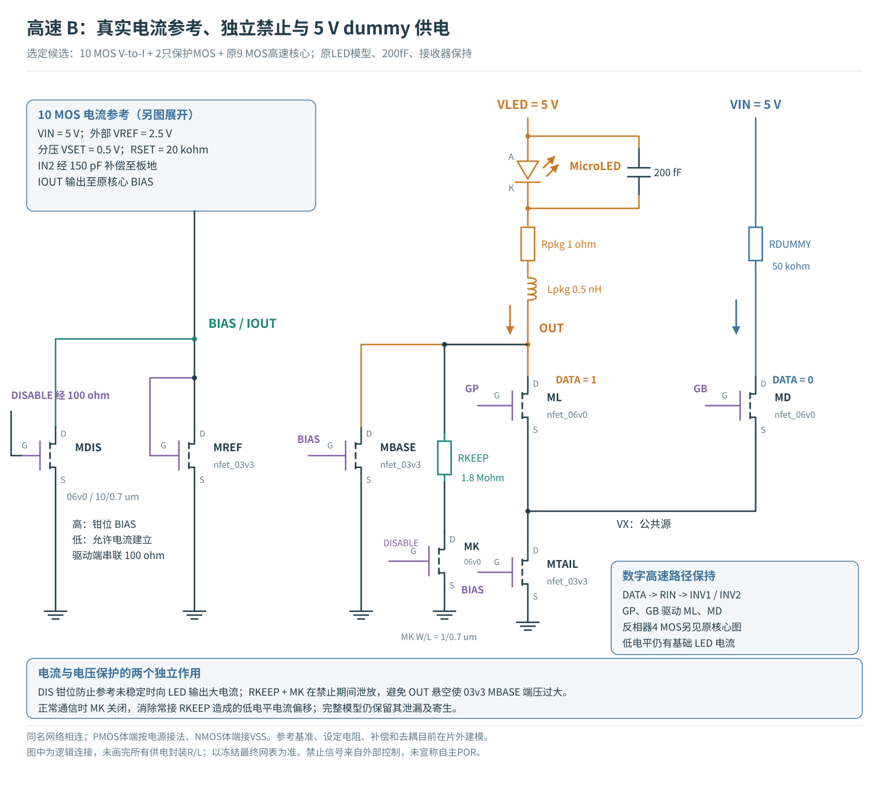

# 高速 MicroLED B 路线：真实参考、电源与启动保护

这轮把理想偏置边界换成可检查的晶体管参考与供电网络。高速数据路径、MicroLED 负载和接收算法保持；新增电路必须同时回答启动是否受控、参考电阻误差怎样传到 LED，以及增加了多少功耗。

{{OVERVIEW}}

[TOC]

## 先读当前采用的连接

<figure><figcaption>10 MOS 电流参考加 MDIS、MK，与原 9 MOS 高速核心连接。MDIS 钳位 BIAS，MK 使 RKEEP 仅在禁止期间泄放；正常通信时断开该支路。两者解决不同问题，泄漏及寄生仍在完整模型中。</figcaption></figure>

主供电 VIN 为 5 V，经有限供电阻抗与去耦进入电路，RDUMMY 改为 50 kΩ。原来理想 3.3 V VDUMMY 的任务是提供 dummy 支路的电压余量；它不是接收器规定的电平，也不是必须保留的片内稳压电源。本轮先尝试过真实 LDO，但长时间稳定性未通过，因此改用更直接的供电路径，并重新检查 5 V 带来的器件端压。

原核心的[四 MOS 数字缓冲、输入电阻及转向管详细原理图](../driver-robustness-20261024/figures/steering-schematic.svg)可作连接说明；其中旧 RREF / VDUMMY 部分已由本报告新参考电路替代，不能同时接入。

{{ARCHITECTURE}}

{{RESULTS}}

{{PHYSICAL}}

{{REPRODUCE}}

{{REFERENCES}}
