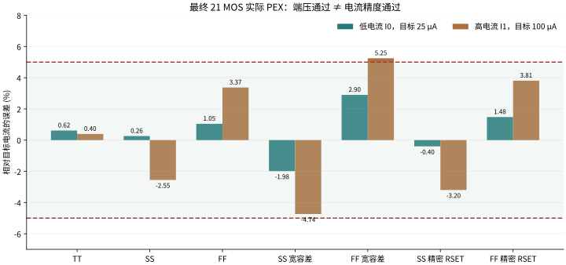
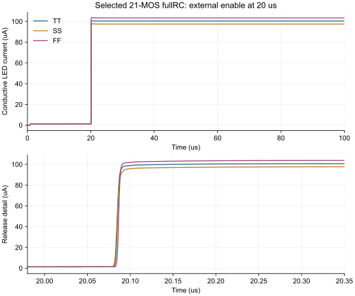
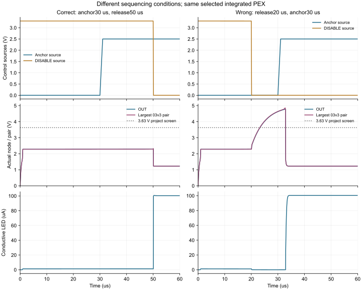
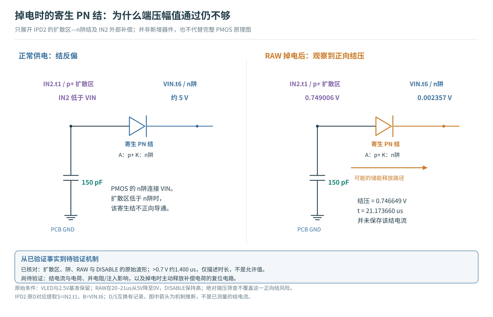
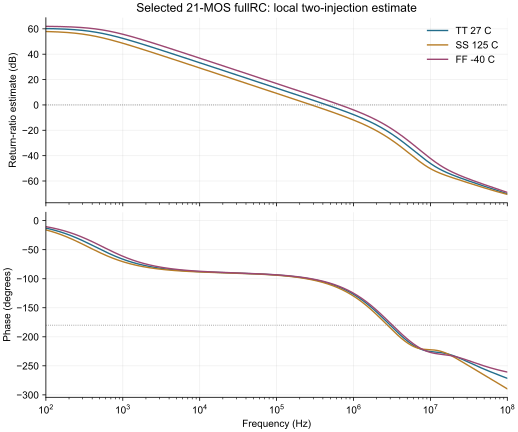
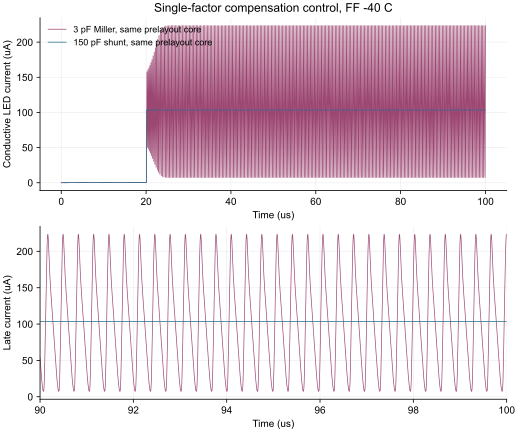
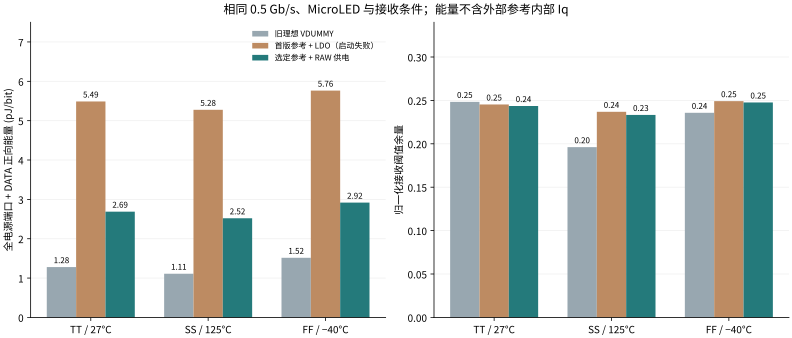

## 本轮结论与决策

**晶体管参考、受控启动和真实联通版图已经接上原 B 数据通路。** 0.5 Gb/s 是本轮固定验证点；本轮没有重新搜索最大速率。采用 10 MOS 电流反馈参考、两只受外部 DISABLE 控制的保护管与 RAW 5 V dummy 供电。外部精密电压基准尚未片内实现。

112 个 DC 点全部求解，器件端压筛查全部通过，但 **4 个电流精度点失败**，包括宽容差联合角和 ±5% 负控制。11 个启动/重启点中 10 个满足原功能与绝对端压条件；其中残余电源重启仍有 **0.747 V 体结正向偏置，尚未闭合**。提前解除关断负控制同时违反准备时间与 03v3 端压条件；5 个慢时标控制通过。10 个固定速率通信测试点中 **10 个通过** 接收与端压联合筛查。详细数据如下，失败没有从分母中删除。

目前的工程决策是：保留 RAW 供电与 150 pF 补偿作为正常启动及通信研究基线，RSET 采用 ±0.1% / ±25 ppm/°C 的研究规格，外部控制必须在参考建立后才解除 DISABLE。下一步优先实现参考就绪检测、掉电时内部补偿节点的复位/隔离并检查结电流；当前不能宣布残余电源重启已经可靠。

## DC：电阻规格如何改变实际 LED 电流

先看参考架构修改的实际收益：旧参考电阻从理想 3.3 V 供电，电流随 BIAS MOS 的 VGS 改变；新参考对 RSET 电压闭环控制。下面保持对应 MOS 角、温度、数字电源与 LED 负载。三条件下，高电流的误差范围由约 −8.06%～+7.71%，缩小到 −2.55%～+3.37%，代价是后文所列真实参考静态功耗。

| 同条件 | 旧理想 VDUMMY + RREF，I0 / I1 µA | 新实际参考，I0 / I1 µA |
|---|---|---|
| TT | 24.986 / 99.707 | 25.154 / 100.395 |
| SS | 23.656 / 91.945 | 25.065 / 97.448 |
| FF | 26.343 / 107.714 | 25.261 / 103.372 |

目标 I0/I1 为 25/100 µA，误差预算均为 ±5%。联合条件同时改变 RSET、RDUMMY、外部基准与 RAW；SS/FF 是指定组合，不是完整笛卡尔积。VSET 分压误差、100 Ω 源阻抗等另作独立控制，未声称全部极值已经同时叠加。

| 条件 | I0 µA | I1 µA | 相对目标误差 I0 / I1 | ±5% 判定 |
|---|---|---|---|---|
| TT / 27°C | 25.154 | 100.395 | +0.616% / +0.395% | 通过 |
| SS / 125°C | 25.065 | 97.448 | +0.262% / -2.552% | 通过 |
| FF / −40°C | 25.261 | 103.372 | +1.045% / +3.372% | 通过 |
| SS 宽容差联合 | 24.504 | 95.263 | -1.985% / -4.737% | 通过 |
| FF 宽容差联合 | 25.725 | 105.247 | +2.900% / +5.247% | 未通过 |
| SS 精密 RSET 联合 | 24.900 | 96.804 | -0.400% / -3.196% | 通过 |
| FF 精密 RSET 联合 | 25.370 | 103.811 | +1.480% / +3.811% | 通过 |

<figure><figcaption>阴影是 ±5% 研究预算。FF 宽容差联合点越界；收紧 RSET 后回到预算内。各角点使用同一标称 20 kΩ，没有逐点校准。</figcaption></figure>

查看全部 4 个未通过电流精度的 DC 点

| 失败 DC 条件 | 逻辑位 | 电流误差 |
|---|---|---|
| DC_FF_RSET_-0.01_100 | 1 | +5.0747% |
| DC_NEG5_RSET_-0.05 | 0 | +5.8408% |
| DC_NEG5_RSET_-0.05 | 1 | +5.5942% |
| DC_FF_joint | 1 | +5.2465% |

完整数据：[112 点 DC](../../../evidence/nrz-reference-v2/selected-final-r2-dc.json)。旧分析字段 `combined_screen_passed` 在 DC 中只代表器件端压；本报告另算电流误差，避免把两个判据混淆。

## 启动：保护作用、代价与失败边界

DISABLE 高时，MDIS 把 BIAS 钳到地，MK 接通 1.8 MΩ 泄放，避免 OUT 悬空；低时，两管关闭，正常低电平不再附加约 1 µA 的 keeper 电流。启动保持仍有约 1.3 µA 电流，合同为 ≤2 µA，**不是零电流关断**。正常释放后须在 2 µs 内进入 100 µA ±5%，完整峰值须 ≤125 µA。

正常冷启动：外部电源与参考用 1 µs 斜坡建立，20 µs 后释放。迟到参考在 30 µs 开始时，释放也推迟到 50 µs。若仍在 20 µs 提前释放，实际 21 MOS PEX 中最大 03v3 端差约 **4.862 V**，超过 3.63 V 项目筛查，并延迟约 13.53 µs 才进入目标带。这是尚未实现自主 POR/ready 检测的实际风险，不能写成任意上电顺序安全。

| 启动条件 | 保持峰值 µA | 完整峰值 µA | 释放到稳定 ns | 型号端压余量 V | 原判据及补充检查 |
|---|---|---|---|---|---|
| TT 正常启动 | 1.2765 | 100.670 | 89.06 | 0.9995 | 原判据通过 |
| SS 正常启动 | 1.2753 | 97.657 | 93.59 | 0.9998 | 原判据通过 |
| FF 正常启动 | 1.2901 | 103.710 | 88.75 | 0.9993 | 原判据通过 |
| 基准迟到，正确延迟释放 | 1.2764 | 100.670 | 89.05 | 0.9995 | 原判据通过 |
| 基准迟到，错误提前释放 | 1.2764 | 100.395 | 13529.71 | -1.2319 | 失败：负控制 |
| FF：补偿 -20% | 1.2901 | 103.752 | 88.83 | 0.9991 | 原判据通过 |
| FF：补偿 +20% | 1.2901 | 103.680 | 88.87 | 0.9994 | 原判据通过 |
| FF：去耦与 keeper 应力 | 1.2705 | 103.709 | 88.80 | 0.9993 | 原判据通过 |
| FF：保留 LED 电源的重启 | 1.2681 | 103.835 | 88.78 | 0.9979 | 功能/绝对端压满足，体结未闭合 |
| FF：更紧数值配置 | 1.2891 | 103.708 | 88.88 | 0.9993 | 原判据通过 |
| FF：补偿外引 R/L | 1.2900 | 103.709 | 88.79 | 0.9993 | 原判据通过 |

<figure><figcaption>上图为 100 µs 完整窗口，下图放大释放附近。波形来自全分辨率结果；本轮的 20 µs 外部等待是一项明确接口条件。</figcaption></figure>

<figure><figcaption>左：参考 30 µs 到、50 µs 释放；右：参考仍在 30 µs 到，却提前于 20 µs 释放。右图 OUT 悬空期间 03v3 端压越界。图中 anchor 为外部电压基准，DISABLE 为外部禁止信号；这两种时序故意不同。</figcaption></figure>

最后两行分别检查更紧数值配置、补偿外引 1 Ω / 5 nH 与 0.5 Ω ESR；不能外推为全部启动与通信矩阵都覆盖了补偿引脚寄生。完整数据：[启动/重启](../../../evidence/nrz-reference-v2/selected-final-r2-startup.json)。

### 补充复审：残余电源重启尚未闭合

当 VLED 与外部基准仍供电、RAW 在 20–21 µs 从 5 V 降到 0 V 时，DISABLE 已经置高，但它只处理 BIAS 与 OUT，没有主动复位内部 IN2。原 IPD2 的扩散区在约 21.174 µs 仍为 0.749006 V，nwell 仅为 0.002357 V，形成 **0.746649 V 正向结压**。超过 0.7 V 的插值持续时间约 1.400 µs；0.7 V 仅用于描述波形，不是新声明的 foundry 允许值。

<figure><figcaption>图示是对已观察波形的机制解释。扩散区与阱电压已直接核对；储能路径的完整电流分解仍待专门实验。</figcaption></figure>

这里原功能/六对绝对端压判据通过，仍不能排除衬底/阱注入风险。原始波形没有保存该结电流，不能由电压单独宣称具体注入电荷、闩锁或寿命结果。本轮把它列为独立未闭合项；不能用“最后电流恢复了”覆盖这个问题。[带时间与节点定位的补充审查](../../../evidence/nrz-reference-v2/restart-body-review.json)

## 慢时标反馈与快数据通路分别验收

最终实际 PEX 的局部双注入估计，TT/SS/FF 的交越频率约 450.4/283.5/668.7 kHz，相位裕量约 72.96°/78.34°/66.25°；闭环与注入工作点最大差约 3.59×10⁻¹¹。它是局部环路估计，需结合 100 µs 启动与阶跃波形理解。

<figure><figcaption>实际 21 MOS PEX，DATA 高低分别检查。该估计不是严格多环路稳定性或 foundry 签核。</figcaption></figure>

<figure><figcaption>用于解释机理的单因素控制：同一 11 MOS 前布局候选、同一 10 MΩ keeper，仅改补偿。它支持修正方向，不冒充最终 21 MOS PEX 结果。</figcaption></figure>

FF 的 RAW 5→4.75→5 V、10 ns 边沿测试中，LED 电流范围为 98.01–108.81 µA，2 µs 后相对 100 µA 的误差不超过 3.413%。RAW 端扰动首先改变供电侧端压，反馈随后恢复；这与数据通路每 2 ns 转向一次是不同时间尺度。[5 点慢时标数据](../../../evidence/nrz-reference-v2/selected-final-r2-slow.json)保留每项峰值与晚期波动。

## 相同接收条件下，能量和余量怎样变化

<figure><figcaption>旧版理想偏置不含真实参考内部代价；首版 LDO 即使短通信窗口零错码，仍因启动及长时波动被拒绝。完整端口能量逐源积分，不能据此宣布系统能效最优。</figcaption></figure>

新增能量主要花在哪里？另外对六个相同 DC 工作点增加内部电流观测，LED 电流与原结果差为 0 A。TT 的 RAW 5 V 分配中，OTA 控制支路约 **451.26 µW**，检测参考支路约 **124.97 µW**，输出参考支路约 **124.53 µW**；三者合计约 **700.76 µW**，在 0.5 Gb/s 下约 1.40 pJ/bit。因而下一轮降低参考 OTA 偏置电流值得研究，但每次都要重新检查稳定性和启动。这里按电源侧 MOS 漏电流分配预算，模型体端电流等造成约 0.09–0.17 µW 闭合残差，已明列；没有强迫分支和相等。[观测原始数据](../../../evidence/nrz-reference-v2/power-dc-r2.json)

| 实际 PEX 测试点 | 错码 / 511 | 接收阈值余量 | 时序余量 UI | 正向能量 pJ/bit | 型号端压最小余量 V |
|---|---|---|---|---|---|
| TT 名义 | 0 | 0.2435 | 0.2891 | 2.6883 | 0.8728 |
| SS 慢热 | 0 | 0.2332 | 0.2734 | 2.5194 | 0.9137 |
| FF 快冷 | 0 | 0.2476 | 0.3203 | 2.9174 | 0.8314 |
| SS 精密 RSET 联合 | 0 | 0.2293 | 0.2656 | 2.3829 | 1.1616 |
| FF 精密 RSET 联合 | 0 | 0.2462 | 0.3125 | 3.0644 | 0.5841 |
| FF：RAW +250 mV 脉冲 | 0 | 0.2286 | 0.3047 | 786.6702 | 0.6162 |
| FF：VLED +50 mV 脉冲 | 0 | 0.2477 | 0.3125 | 2.9193 | 0.8313 |
| FF：VDD +50 mV 脉冲 | 0 | 0.2472 | 0.3203 | 2.9222 | 0.8290 |
| FF：供电与 LED 封装组合 | 0 | 0.2481 | 0.3125 | 2.9166 | 0.8342 |
| FF：更紧数值配置 | 0 | 0.2475 | 0.3203 | 2.9175 | 0.8309 |

**扰动行的能量不能作为正常通信能耗。** RAW pulse 是 5→5.25 V、2 ns 边沿、每 254 ns 重复且高态 64 ns 的供电应力，会反复给 100 nF 输入电容充放电。这个窗口的全源正向取能 **786.67 pJ/bit**、返还 **741.95 pJ/bit**、净取能 **44.72 pJ/bit**；返还给理想端口的能量不代表实际电源能全部回收。正常三 PVT 的能量对照图仅用没有该扰动的案例。

接收阈值余量以固定 75 µA 高低电流跨度归一化；时序余量单位 UI，0.5 Gb/s 时 1 UI = 2 ns。阈值 62.5 µA、200 ps 光学一阶响应、1 GHz RX、训练与 511 位验证序列保持。供电 pulse 是预声明的局部端口扰动，package 行叠加指定供电/回流/LED R/L；不是完整封装场解。0/511 仅是该有限序列的观察，不是 BER 或最大速率保证。

完整记录：[10 点 NRZ](../../../evidence/nrz-reference-v2/selected-final-r2-nrz.json)、[绘图及汇总输入 SHA](figures/results-data.json)。器件端压按 03v3 的 3.63 V、06v0 的 6.0 V 分开筛查，都是项目研究门槛；未完成寿命、SOA 或 ESD 资格验证。
