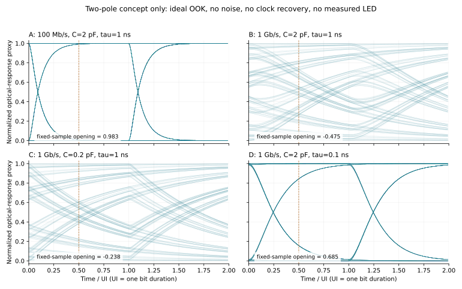
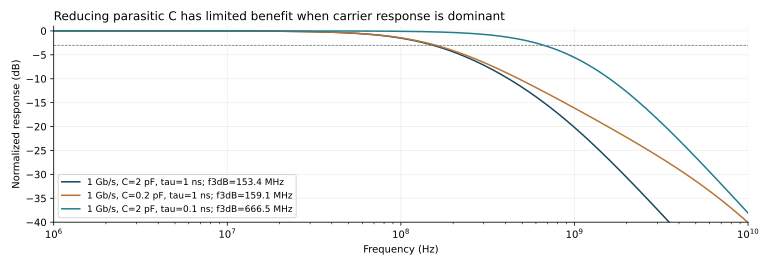

# 高速 MicroLED 光通信：从数据接口到驱动 ASIC 的研究框架

2026-10-14 · 本项目的独立技术路线说明与教学计算。当前仓库仍是单像素恒流＋PWM 研究平台；本章没有新增高速晶体管电路、通信 ASIC、光学测量或流片结果。

## 1. 先定义产品边界，再定义高速驱动器

照明／显示像素需要在一个调光周期内准确提供指定平均光输出；通信发送器需要在每个符号时间内提供可区分的光电平，并使接收器能够恢复数据。两者都需要可靠的偏置、供电、保护和互连，但验证的主要对象不同。

本项目的单像素经验可复用在参考源、直流工作点、MOS 端压检查、保护、仿真追踪和版图方法。现有 1 µs 量级 PWM 时隙、普通反相器和合成二极管不能直接作为 GHz 光通信发送器。高速支线应先做一个通道，保留独立的需求、模型和证据目录。

产品级输入规格至少包括：通道数、每通道 raw／net 速率、调制格式、最大时钟抖动、电气输入标准、LED 型号／电极方向／允许电流与温度、距离或光纤接口、接收器灵敏度、目标 BER、是否用 FEC、总功耗、封装及测试方式。没有这些条件，不能仅凭工艺节点决定 ASIC 能否满足需求。

## 2. 完整数据链路与各部分职责

| 数据流顺序 | 电路／算法职责 | 应交付的设计和验证资料 |
| --- | --- | --- |
| 数据、PRBS、帧与编码 | 产生可追踪的数据；按系统选择编码、扰码、CRC、FEC。测试 PRBS 不等同产品协议 | RTL、参考模型、数据格式、复位和丢帧测试、有效吞吐统计 |
| Serializer／输入 receiver／retimer | 并行数据转串行；或接收外部高速串行数据并重定时。并非每个架构都必须集成所有模块 | 输入摆幅／共模／终端阻抗、时钟来源、setup/hold、CDC、jitter 预算 |
| Pre-driver | 把数字状态变为适合模拟开关的电压摆幅、共模和驱动电流；必要时提供电平转换 | 实际晶体管原理图、负载电容、互补 skew、边沿、端压、动态功耗 |
| Bias／current steering／current DAC | 决定 LED 偏置和调制电流；OOK 选择两个状态，PAM／OFDM 需要多级幅度 | DC 精度、compliance、输出电阻、settling、glitch、失配、PVT、可靠性 |
| LED 与连接 | 电流经接触、键合／凸点、LED 有源区转为光；电容、热和载流子动态共同影响波形 | 同器件 I–V、C–V／阻抗、L–I、E/O S21、温度、封装寄生及模型拟合 |
| 光学通道 | 耦合、衰减、散射、串扰、波长选择、传输带宽 | 光路／光纤／透镜条件、损耗预算、接收功率、对准公差 |
| PD/APD → TIA → 后处理 | 光电流转换为电压，再判决、均衡、时钟恢复与解码 | 接收器噪声与带宽、饱和、阈值／CDR、眼图、BER、测试长度与置信度 |

ASIC 可以只实现表中的发送端模拟驱动，Serializer、时钟和接收器先放在 FPGA／仪器／外部芯片上。这样可以分别定位驱动、LED、光路与接收端的限制。后续是否把更多模块集成进同一芯片，需要由功耗、面积、时钟质量和接口成本决定。

## 3. 从数字数据到 LED 电流：三类可研究电路

### 3.1 两档直接驱动（direct OOK）

一种最小实验是固定偏置或固定电流源，加一个高速开关，在两档 LED 电流之间切换。定义 I₀ 为数据 0 时的电流、I₁ 为数据 1 时的电流，调制电流 ΔI=I₁−I₀。I₀ 可以大于零，以减少载流子重新建立的时间；代价是静态功耗和较低消光比。是否需要 I₀，以及大小多少，应由所选 LED 的 E/O 响应、光噪声和链路预算决定。

当电路完全关断 LED 时，下一次开通不仅要恢复电流源工作点，还要给连接电容充放电、恢复 LED 载流子。单看数字输出已变高，并不能说明光信号已经达到目标电平。

### 3.2 电流舵（current steering）

一个低侧 NMOS 教学拓扑有三个功能器件：尾电流源 MI，选择 LED 支路的 ML，选择 dummy 支路的 MD。ML、MD 的源极接共同节点 VX；MI 的漏极接 VX、源极接地、栅极接偏置 VBIAS。ML 的漏极接 LED 阴极，MD 的漏极接替代负载；两开关的栅极由 pre-driver 提供互补信号。LED 阳极与替代负载各自接满足电压余量的供电。实际电路还需要体端连接、偏置发生器、保护与输入缓冲，不能把这个简化三管图称为完整芯片。

DATA=1 时，调制电流流经 LED→ML→MI→地；DATA=0 时，调制电流流经替代负载→MD→MI→地。电流源保持偏置，有利于避免每 bit 从零重建尾电流。替代支路仍耗电；LED 供电支路的电流仍可能变化，不能因此删去电源完整性验证。

可在尾源上方加入 cascode，提高输出电阻和隔离输出扰动；它会增加电压余量需求、偏置网络和寄生电容。pre-driver 要保证开关具有足够的 VGS，同时限制共同源节点扰动、交叠、两支路短暂同时关闭及端压超限。相同长度的两条栅极线并不能自动保证相同延迟，实际负载和寄生同样重要。

电压预算从闭合电流路径逐段相加：

`VLED ≥ VF(I,T) + Vswitch + Vtail/compliance + I·Rinterconnect + supply margin`。

若增加 cascode、限流或检测器件，应把各段电压需求加入；MOS 必须在各动态时刻满足其实际端子约束，不能只核查 VDD。

### 3.3 电流 DAC 与预加重

PAM4 需要四个可判决的电平；OFDM 的时域波形需要多个幅度样本。可由二进制、温度计或分段编码驱动多个单位电流源，将电流相加后注入 LED。除 DNL/INL 外，需要核查大码跳转 glitch、动态 settling、时钟 feedthrough、通道延迟及 LED 非线性。

预加重（pre-emphasis）可在转换边沿短时增加电流，再回到稳态；均衡（equalization）也可在接收端处理。这些方法改变峰值电流、功耗与噪声预算，必须同时限制 LED 允许电流、MOS 应力和数据相关失真。有限带宽下的均衡收益需要和噪声放大及接收复杂度一起评估，不能只展示更尖锐的电流边沿。

公开论文已经证明这些电路路线可以落地，但其数字不能作为本项目指标：

| 原始研究与实证条件 | 窄结论 | 不能据此声称 |
| --- | --- | --- |
| Jalajakumari 等，2017：CMOS LVDS 接收／温度计编码／NMOS current steering 与 cascode；16 颗 LED 构成一个 digital-to-light converter。5 cm、200 MHz 时钟、16-QAM OFDM、BER 门槛 10⁻³，报告 365 Mbit/s | 集成 CMOS 电流舵可驱动实际 MicroLED 通信系统 | 500 MHz 电路切换描述等于 500 MHz 光学带宽；16 LED 等于16独立lane；本项目已达到此速率 |
| Rajbhandari 等，2017：AMS 0.18 µm CMOS，每芯片四路8-bit电流舵DAC。两芯片的四通道实验，1 m、4-PAM、约45 mA/LED、BER门槛3.8×10⁻³，总 raw 1.23–1.30 Gbit/s | 成熟硅 CMOS 可用于特定集成发送链路；瓶颈还包括 FPGA 采样率与接收系统 | 同文九路7.48 Gbit/s 属于该ASIC；该结果为单通道速率；AMS与GF180可以直接互换 |

原文定位：[Jalajakumari，Fig.2、§II-A、§IV-B](https://strathprints.strath.ac.uk/59246/1/Jalajakumari_etal_PTL_2017_High_speed_integrated_digital_to_light_converter_for_short_range_visible_light_communication.pdf)；[Rajbhandari，§II-A、§IV-C/D、Fig.9](https://pure.coventry.ac.uk/ws/files/7726769/gigabitcomb.pdf)。本轮重新获取全文并核对相关页。原始页面和必要图摘保留在 `build/product-framework-20261014/highspeed-sources/` 的本地研究卡中；公开报告使用原创解释和有限事实引用，不发布未确认再用许可的论文图。

## 4. 两个缓冲器不能混为一谈

**参考源缓冲**驱动的是电流镜的偏置栅极网络，目标是低误差、足够稳定和抗负载扰动。它不一定每 bit 大幅变化。需要分析环路稳定性、参考噪声、启动和功率预算。

**高速 pre-driver**驱动的是开关栅极，目标是按时充放栅极电荷、控制共模和互补时序。其平均电源电流与动态功耗受切换活动影响，输出级尺寸和前级级数要由目标边沿及实际栅极负载计算。

教学例：如果某输出节点的总电容为2 pF，要求在0.2 ns内改变1 V，仅电容位移电流的平均量级便为 `I=C·ΔV/Δt=10 mA`。这不是 LED 的 DC 电流，也不是现有100 µA像素的测量值。它说明为什么只增大数字管或只提高PWM时钟，不能代替输出级预算。若共用回流的等效电感假设为1 nH，同一电流变化引起的 `L·di/dt=50 mV` 也是需要检查的扰动量级；该1 nH尚未由本项目封装提取。

## 5. 用可复算的简化模型看清“布线快”与“发光快”

本轮新增一个**合成、线性、归一化**教学计算：

`H(s)=1/[(1+s·R_eff·C_total)·(1+s·τcarrier)]`。

第一个极点代表选定输出节点的等效电气 RC；第二个极点代表某偏置点附近的载流子小信号响应。R_eff不是恒流源的无穷大输出电阻，而是该简化节点的假设等效阻抗；真实模型需要从完整电路和LED阻抗推导。τcarrier是教学参数，不能直接把现有SPICE二极管的 `TT=1 ns` 当成实测载流子寿命。

使用PRBS9（511 bit，两个周期，第二周期统计），理想OOK输入、固定0.5 UI采样，没有噪声、jitter、CDR、均衡、非线性和接收器。求解对每段常量输入使用精确解析状态转移，并与50个子步比较；最大样值差小于3×10⁻¹⁵。这个数值自检只验证本数学计算，不能验证实际LED。

| 场景 | bit rate／UI | R_eff／C_total | τcarrier | 计算的两极点−3 dB频率 | 固定0.5 UI带符号开口 |
| --- | --- | --- | --- | --- | --- |
| A | 100 Mbit/s／10 ns | 100 Ω／2 pF | 1 ns | 153.35 MHz | +0.9832 |
| B | 1 Gbit/s／1 ns | 同A | 1 ns | 153.35 MHz | −0.4750 |
| C | 1 Gbit/s／1 ns | 100 Ω／0.2 pF | 1 ns | 159.09 MHz | −0.2376 |
| D | 1 Gbit/s／1 ns | 100 Ω／2 pF | 0.1 ns | 666.54 MHz | +0.6851 |

开口定义为该固定采样时刻的“全部1样值最小值−全部0样值最大值”；负值表示两组样值重叠，**并不是负光功率**。图中的UI为bit时间；没有优化接收采样相位，结果不能作为最大码率判据。

该计算支持两个设计判断：相同硬件带宽下，缩短符号时间会增加码间干扰；若载流子响应占主导，把C降低10倍也只让此假设下的−3 dB频率从153.35升至159.09 MHz。反过来，LED很快时，驱动器／pad／封装可能成为主要瓶颈。需要测量和分解链路响应后再决定优化晶体管、走线、封装还是LED。

复算命令：`build/layout/venv/bin/python scripts/research/product_framework_highspeed.py`。参数、结果和边界见 [highspeed-calculations.json](highspeed-calculations.json)，2044个采样点见 [highspeed-samples.csv](highspeed-samples.csv)；完整波形在 `build/`。这些曲线不包含GF180模型，不是光学实验，也没有产生BER结果。

## 6. 工艺与材料：速度要求改变器件选择，不自动要求换成GaN驱动器

当前路线的MOS沟道为硅，发光器件另为III–V材料MicroLED。蓝光／绿光常用的GaN/InGaN发光材料，不意味着驱动晶体管必须也是GaN。已经测得的CMOS驱动论文足以说明“通信必须使用特殊MOS材料”并非成立的前提。

GF180同一工艺提供不同电压器件。较短沟道、薄栅氧的器件有利于某些速度／能量目标，但必须满足其低电压端压要求；高压输出、LED开路、启动及封装振铃可能要求耐压器件、电平转换或堆叠。GF180官方明确把HCI和栅氧完整性作为不同约束；工艺名180 nm不是本项目6 V输出管的实际沟道长度。[GF180工作条件与可靠性](https://gf180mcu-pdk.readthedocs.io/en/latest/physical_verification/design_manual/drm_14_1.html)

高速研究可比较硅CMOS与SiGe BiCMOS。SiGe BiCMOS中的高速器件通常指SiGe HBT（异质结双极晶体管），不是“把所有MOS换成SiGe材料”。例如IHP公开SG13G2资料列出130 nm CMOS、1.2 V／3.3 V MOS、SiGe:C HBT以及5层薄金属＋2层厚金属。这是另一套PDK、器件库和版图规则，不能混入GF180布局；其公开发布状态仍标注preview，制造接受版本需另行确认。[IHP官方PDK](https://github.com/IHP-GmbH/IHP-Open-PDK)

GaN HEMT、先进硅CMOS、SiGe、特殊散热基板都应由实际电流、电压、能量／bit、热、输出负载及模型可得性决定。当前没有数据要求本项目换材料。封装导体、介质、LED基板和散热材料的改变也与晶体管沟道材料是不同决策。

## 7. 与恒流＋PWM相比，布局布线重点如何变化

| 层面 | 恒流＋PWM像素 | 高速通信驱动 |
| --- | --- | --- |
| 模拟匹配 | 参考／镜像匹配、梯度、DC电流均匀性、低码误差 | 电流单元匹配仍必要，同时关注switch skew、动态glitch与尾节点扰动 |
| 电流源 | 稳定偏置、compliance、PVT和trim | 要同时评价工作点、输出阻抗随频率变化、开关扰动、噪声和settling |
| 数字与时钟 | 帧边界更新、最小脉宽、占空比、故障优先 | clock/serializer/retimer、jitter、数据相关延迟、差分共模与采样窗口 |
| 输出连接 | 压降、短脉冲电荷、阵列同时切换 | pad、ESD、bond/bump、回流、传输损耗与反射一起进入通道模型 |
| 供电地 | IR drop、EM、参考与大电流回流隔离 | 高频阻抗、去耦谐振、ground bounce、同时开关噪声与串扰也要覆盖 |
| 物理集成 | 像素pitch、均匀性、散热、测试可达 | 驱动到LED距离、寄生电容、电感、RF pad／低电容ESD、lane间串扰与光耦合 |
| 结果判据 | DC误差、积分电荷、关断峰值／时间／余电荷 | 电气／光学带宽、眼高／眼宽、ISI、jitter、OMA、消光比、BER、能量／bit |

布线不能全部按“越粗越好”处理：加宽可降低电阻，但可能增加对基底／邻线电容；shield减小串扰也会增加负载；更强buffer降低输出阻抗但提高功耗、开关噪声和前级负载。需要在同一目标下做PEX／场求解前后对照。

也不能一律要求所有片内线均为50 Ω传输线。先比较电气长度和边沿时间，再决定采用集中RC、RLC还是分布模型。教学例：ε_eff=4时传播速度约c/2，10 mm连接传播时间约66.7 ps；对于100 ps边沿已不可忽略。100 µm线约0.667 ps，但其电阻、电容和局部回流仍可能影响小节点。实际片内／封装参数必须来自接受的叠层和提取，例子不等于本芯片测得参数。

## 8. 必要模拟验证：每个指标对应一个数据包

| 验证层 | 激励与变量 | 最低应保存的结果 | 本项目当前边界 |
| --- | --- | --- | --- |
| 需求／链路预算 | raw/net rate、距离、波长、PD/TIA、噪声、FEC | 预算表、假设、可测量判据和余量 | 需要为高速单通道另定 |
| DC／端压 | I₀/I₁、DAC codes、supply、T、process、LED VF | 电流、headroom、各管VGS/VGD/VDS/VBS、功率 | 目前为PWM主线证据，不能转归高速 |
| AC／小信号 | 偏置点、器件／互连／LED／接收器模型 | 电气与E/O幅相、极点、回路增益、模型有效范围 | 本章只提供合成两极点示例 |
| 大信号transient | PRBS、孤立bit、长连0/1、最坏码跳变 | 电流／光学proxy眼图、settling、glitch、峰值与能耗 | 需实际高速晶体管电路 |
| PVT／失配 | corners、supply/T、统计模型、unit mismatch | 极值与分布、yield定义、失败种子 | 没有合法统计模型时不能声称统计良率 |
| PEX／PI／SI | 信号＋完整PG＋pad＋package＋PCB | before/after、IR、EM、RLC/S参数、串扰及返回路径 | 旧selected PEX不覆盖这些高速边界 |
| BER／系统 | 接收器、采样／CDR、noise/jitter、FEC、长数据 | 分母N、错误数k、置信区间、raw/net与前／后FEC | 眼图不替代BER；本章无BER结果 |
| 保护／异常 | 丢时钟、输入悬空、过温／开短路、rail顺序 | 默认状态、关断时限、峰值、恢复与端压 | 复用方法，重新验证高速路径 |
| 实物相关 | 校准去嵌、LED/PD实测、供电与温度测量 | 模型拟合误差、复测、仪器带宽、校准文件 | 仍需实物与仪器 |

若零错误测试了N个独立、平稳bit，一侧95%置信上限为 `p_upper=1−0.05^(1/N)≈2.996/N`。因此，在这些统计假设下，支持10⁻¹²量级上限需要约3×10¹² bit；1 Gbit/s连续测试约50分钟。这个计算不把仿真零错误写成真实BER=0，也不覆盖突发错误、温漂、相关噪声和FEC后统计。

## 9. 开源环境能够做到哪些结果

RTL／PRBS／协议与时序可沿用Icarus/Verilator、Yosys、OpenSTA及相应实现流程；模拟电路可在模型与仿真器兼容时用ngspice/Xyce；布局、DRC、LVS、PEX可用PDK支持的Magic/Netgen/KLayout等。具体工具是否完成需要看实际日志，不能由软件列表推定。

高速互连可用openEMS做三维全波电磁计算，生成S参数、阻抗及电磁场分布；结果依赖真实材料参数、端口、边界、网格与收敛。官方文档说明FDTD的最小网格会约束时间步长，因此对整个芯片逐晶体管做高精度全波求解通常不是合适的首选。实际方法是对关键互连／封装块求解，再与晶体管SPICE和系统模型组合。[openEMS官方数值方法](https://docs.openems.de/en/latest/concepts/numerical_method.html)

S参数必须标清端口方向／参考面、参考阻抗、频率范围、去嵌、passivity／causality和插值方式。普通RC提取、版图三维挤出、封装3D渲染与完整电磁／热／半导体物理仿真是不同成果；显示一个好看的3D芯片模型不能证明通信性能或可制造性。

开源工具可以完成有价值的完整研究设计链和某些被制造方接受的流片流程；能否完成本产品的最终签核，仍取决于制造方接受的PDK/deck、I/O/ESD/IP、器件模型范围、可靠性规则、封装与测试数据。不能以“开源/商业”二分法替代具体签核覆盖清单。

## 10. 高速发送ASIC交付矩阵与进入顺序

| 接收方／阶段 | 主要交付 | 工程意义 |
| --- | --- | --- |
| 芯片设计团队 | 通道/接口规格、RTL、晶体管原理图、LED动态模型、时序/噪声/电压/功耗预算 | 约束电路而不是只指定“做高速” |
| 物理实现团队 | floorplan、analog hard macros、LEF/GDS/网表、pin placement、时序约束、PG/ESD/匹配规则 | 把电路变成受工艺约束的物理几何 |
| 封装/板级团队 | pad/bump map、bond/route、stackup、RLC/S参数、散热、测试参考面 | 高速输出连接成为芯片性能的一部分 |
| 晶圆厂／MPW | 已接受工艺对应的冻结GDS/OASIS、top/layer/尺寸/版本/校验和、规定的签核报告和waivers | 制作掩模与晶圆；并不替代功能保证 |
| 测试团队 | 输入PRBS/clock、power sequence、限流、测试mode、pad access、pass/fail limits、校准与去嵌 | 让实物可验证并能定位失效 |

建议按四个独立门槛推进：①建立同一个LED的动态与光功率模型，先用仪器分解链路；②在同一负载和目标下比较direct OOK与current steering的单通道晶体管电路；③完成包含pad/package/PG的版图后仿与实际可测试接口；④依据制造方接受资料制作测试芯片，再用测量更新模型。多通道、PAM/DAC和更复杂协议应在前一个门槛已有可解释证据后进入。

本章新增的是可检阅的高速开发框架、原始文献核查和合成敏感性计算。它未改变单像素主线的启动收敛状态，也未为现有布局增加高速能力声明。
