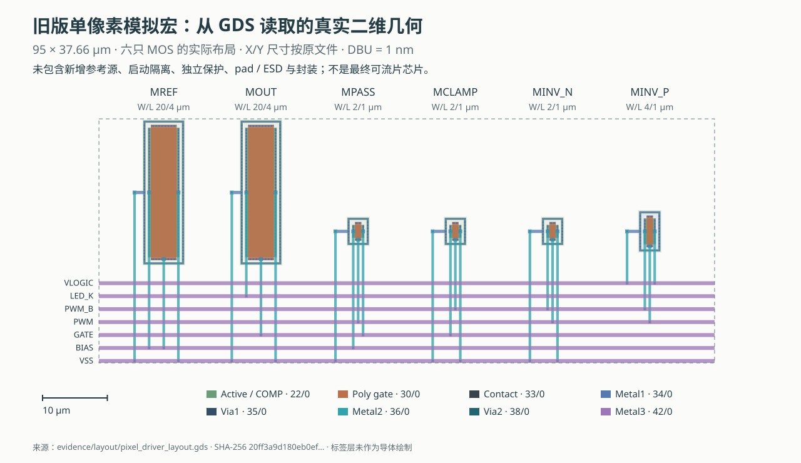
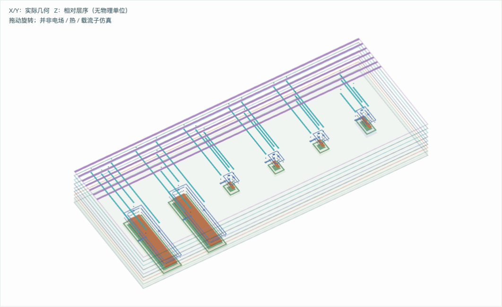

# 版图、可视化与制造交付：从实际文件理解下一步

本章更新于 2026-10-14。当前输出是对仓库已有 GDS 的重新读取和可视化，**没有新增或修改芯片版图，也没有执行新的电气或制造签核**。X/Y 几何来自已有文件；三维视图使用声明的相对层高。

## 1. 先看现有芯片几何

打开 [交互版图查看器](layout/viewer.html)，可切换“旧联合顶层”和“旧单像素模拟宏”，逐层开关、缩放和拖动。二维模式显示平面位置；三维模式将各层沿任意 Z 方向展开，帮助理解重叠的导线。查看器完全自包含，离线打开即可工作。


联合 top 左侧是六 MOS 单像素模拟宏，右侧是经过数字物理实现的 PWM 宏。两宏间已有 PWM 的 M3 连线、VDD 的 M4 连线和 VSS 的 M5 连线。这些细线都有实际 GDS 几何，图中的标注位置来自现有集成记录。数字宏中大量重复结构包括 filler / decap 等实现单元，不能把每个可见矩形都解释为一个逻辑功能门。



像素图上方的 MREF、MOUT 等名称对应旧版网表和生成脚本。MREF/MOUT 的 W/L=20/4 µm；版图左侧两个较大器件与右侧小开关尺寸不同。横向 M3 总线与纵向 M2 连接列跨越时，只有实际通孔位置才形成层间连接。“图上相交”不等于“电气相连”；必须由提取和 LVS 确认。

| 实际文件 | DBU | cell bbox（µm） | bbox 跨度面积 |
| --- | ---: | --- | ---: |
| `evidence/layout/pixel_driver_layout.gds` | 0.001 µm | `[0, -0.3, 95, 37.36]` | 3577.7 µm² |
| `evidence/integration/pixel_integrated.gds` | 0.001 µm | `[25, 25, 330, 205]` | 54900 µm² |

这些 bbox 是已有 cell 的边界跨度。联合 top 的边界包含数字宏 footprint；不是所有导体的净面积，更不是最终 die 面积。图中所绘物理层的几何 bbox 分别为像素 `[0, -0.3, 95, 37.28]`、联合 `[25, 40.25, 323.47, 186.15]` µm。不同 bbox 的差异来自显示层选择、工艺标记和边界图形，不能据此缩小原宏 footprint。

**新增参考源、传输门启动隔离、独立 fault 逻辑、LED 关断钳位尚未放入这份旧 GDS。** 新版还没有 pad ring、完整 ESD/POR、封装和可制造 die。把旧版图重新渲染成三维，并不会改变这一事实。

## 2. 图层怎样对应器件和导线

层映射来自锁定 gf180mcuD 的 KLayout `.lyp`、`.map` 和 DRC 层定义；版本及 SHA-256 记录在 [manifest.json](layout/manifest.json)。当前 D variant 使用五层互连金属 M1～M5。“五层金属”不等于只有五层材料或五张掩模。

| 所绘层 | GDS layer/datatype | 工程含义 |
| --- | --- | --- |
| Nwell / LVPWELL | 21/0、204/0 | 器件阱区；体端连接和隔离需要单独设计 |
| COMP | 22/0 | 有源区几何；不是带完整掺杂资料的器件截面 |
| Poly2 | 30/0 | 多晶硅层；跨过有源区的结构参与形成栅极 |
| Contact | 33/0 | 器件层与第一层金属的接触孔 |
| Metal1 / Via1 | 34/0、35/0 | M1 互连，以及 M1–M2 间通孔 |
| Metal2 / Via2 | 36/0、38/0 | M2 互连，以及 M2–M3 间通孔 |
| Metal3 / Via3 | 42/0、40/0 | M3 互连，以及 M3–M4 间通孔 |
| Metal4 / Via4 | 46/0、41/0 | M4 互连，以及 M4–M5 间通孔 |
| Metal5 | 81/0 | 当前栈的最高金属互连层 |

datatype=10 的 pin / label 图形及所有文字均未画作金属。联合文件的 7055 个文字对象全部排除导体统计。程序对每层的真实 polygon、box、path 应用层级变换，合并同层重叠区域、保留孔洞，然后输出图形；逐层保留原形状数、合并后多边形数和并集面积。**各层金属面积相加仍不是 die 面积**，因为它们叠在同一 X/Y 平面上。

## 3. “二维或三维模拟”需要区分四种工作



| 类型 | 回答的问题 | 所需输入 | 本次是否完成 |
| --- | --- | --- | --- |
| 二维 GDS 查看 | 导线和器件实际放在哪里？ | GDS、层映射、DBU | **完成**，实际文件可交互查看 |
| 三维几何展示 | 哪些平面层上下叠放？ | X/Y 多边形、声明的层序；精确截面还要真实厚度与间距 | **完成层序投影**；Z 仅示意 |
| 电路 / 寄生仿真 | 电压、电流、延迟、耦合怎样变化？ | 连接网表、MOS/LED 模型、PEX R/C、激励和边界 | 仓库已有指定范围证据；本次可视化不新增仿真 |
| 三维物理场 / TCAD | 电磁、温度、载流子在空间怎样分布？ | 真实三维材料、参数、网格、端口、边界、校准及收敛检查 | **未完成**；GDS 本身不足以提供全部输入 |

如果希望看高速互连的电场、S 参数或回流路径，可研究 openEMS：其公开文档提供传输线、端口、材料、网格、场结果和 S 参数流程。但要补齐材料栈、导电率、介电常数/损耗、封装与板级结构，并做网格收敛及实测或可信参考对照；不能把通用求解器默认参数叫作 GF180 签核提取。[openEMS 官方文档](https://docs.openems.de/en/latest/)

如果希望观察单个 MOS 的载流子和电势，可研究 DEVSIM 这类 TCAD 工具。它支持网格上的半导体方程求解及 1D/2D/3D 模型。但我们没有与 GF180 制程对应、由厂商认可的完整三维掺杂和制造配方，不能用自建示范 MOS 替换 PDK 紧凑模型或证明生产芯片性能。芯片设计通常依赖所选 PDK 的器件模型与提取规则，而不是重新模拟每一步晶圆制造。[DEVSIM 官方能力说明](https://devsim.org/introduction.html)

## 4. 下一版布局应解决哪些具体问题

先把新增参考源、传输门隔离、像素驱动和独立关断分别实现为可验证的模拟宏；数字安全存储和输出缓冲应进入实际综合与布局布线。然后统一供电域、井体连接、测试访问和完整 top。当前旧 top 的连接方法可以作为学习基础，尺寸和走线不应直接冻结为下一版产品方案。

| 区域 | 布局 / 布线重点 | 版图后需要回答的问题 |
| --- | --- | --- |
| 参考源与电流镜 | 匹配、同方向/同环境、dummy、实际电阻和补偿电容；敏感偏置线避开时钟/大摆幅导线 | PVT/失配、环路稳定性、供电和输出余量、实际寄生后的启动 |
| 数字 PWM 与 buffer | 正确负载、时钟树、门级延迟、跨域输入；大输出门的回流不要扰动参考 | STA/SDF、min-code 脉冲、电源地弹跳、clock-stop/fault 恢复 |
| LED 电流支路 | 依据电流和温度选择线宽、via 阵列、供电/回流路径 | IR drop、EM、热、fault 电荷、端子过压/体结偏置 |
| 独立保护 | fault 路径、状态存储、默认关断、井体与电源次序；不要依赖 PWM 软件正常工作 | 停钟、输入先到、上/掉电、brownout、反灌、失效后恢复 |
| 高速通信发射端 | 把 predriver、调制支路、LED 输出和回流紧凑布置；按目标频带处理互连与封装寄生 | RLC/EM、反射/振铃、ISI、jitter、眼图和真实光链路 BER |

“低速 PWM”也有快速边沿，因此也需要瞬态耦合检查。高速通信进一步要求每个 bit 的电流和光脉冲可分辨，版图、封装、LED 动态模型和接收机要在同一带宽预算中分析；不能只把 PWM 时钟调高。

## 5. 开源环境能完成到哪一层

现有平台已证明可以完成 RTL、晶体管仿真、数字综合与布局布线、模拟几何、指定 DRC/LVS、选定寄生回归和 GDS 输出。它提供了可执行的研发起点。下一版也可以在开源环境中继续这些工作；需要先锁定被交付通道接受的完整 PDK、器件/标准单元、各类 rule deck 和模型。

旧 `evidence/integration/summary.json` 记录 DRC/LVS 通过，但也声明 density / antenna 选项未开启、模型属性比较范围有限，以及全 power-grid、封装、可靠性和制造接受等缺口。新电路的 schematic-level 通过不能自动继承旧版图结果。图像查看、开源工具可运行和制造服务正式接受，是三个分别记录的状态。

作为公开制造前检查的例子，wafer.space 的 gf180mcu precheck 检查 top、原点、DBU、最高金属层、slot、density、antenna 和 DRC 等。它的公开清单不替代我们的电流精度、启动、LVS、稳定性、光学性能与测试计划。当前仓库尚未通过该制造通道接受。[precheck 官方清单](https://github.com/wafer-space/gf180mcu-precheck)

## 6. 给晶圆厂、封装厂的交付分别是什么

GF180 公开 tapeout checklist 要求层级 GDSII、完整设计层和提交前通过 DRC。因此，不是把报告、RTL 或一张三维图片发给晶圆厂就能制造。OASIS 等替代格式是否接受，由具体通道确认；本项目不能代其承诺。[GF180 Essential Tapeout Checklist](https://gf180mcu-pdk.readthedocs.io/en/latest/physical_verification/design_manual/drm_06.html)

| 交付对象 | 需要冻结的技术资料 | 作用 |
| --- | --- | --- |
| 晶圆厂 / MPW 通道 | 接受格式的完整 top GDS/OASIS、top 名、工艺与金属栈、层映射、DBU、die/slot、版次和文件 hash；规定的检查报告、waiver 和接收表 | 正确解释几何，检查接收条件并生成制造数据 |
| 内部设计签核 / 设计服务公司 | 同版 schematic/netlist、RTL/约束、PCell/库、DRC/LVS/ERC、PEX、STA、角落与失配/故障/可靠性结果、覆盖矩阵和未决项 | 证明设计在声明边界内可工作；具体哪些文件上传按合同决定 |
| 封装厂 / OSAT | die 尺寸、pad 名/坐标/大小/开口、供电电流、电压、bond/flip-chip map、封装与 pin1、热与寄生需求 | 把裸 die 接成可装配和可测试的器件 |
| probe / 测试团队 | 测试接口、上电次序、限流、测试程序、判定 limits、lot/die/revision 身份与数据格式 | 筛选样片，区分设计失效、制造失效及测试连接问题 |

第一版适合做“能分块观察的单像素测试 ASIC”，保留外部 VSET/RSET、参考与输出测量入口、受控故障和恢复接口。制造后按限流上电、静态电流、参考传递、电子负载、真实 LED、电光瞬态的顺序 bring-up。制造接受和功能测量都完成后，才有依据判断样片是否可用，再决定 4×4 与高速分支的资源投入。

## 7. 可复现与检查

```sh
build/layout/venv/bin/python scripts/research/framework_layout.py
node docs/research/product-framework-20261014/layout/browser-check.cjs
```

第一条只读源 GDS，生成 SVG、HTML 和 manifest；第二条用本地 Chrome/Playwright 导出 PNG 并检查八项交互，包括层开关、二维/三维切换、缩放、reset、移动宽度溢出和 JavaScript 错误。该浏览器检查不是电路验证。静态图、桌面二维、桌面三维及移动版均已人工目视检查。

逐层源数据见 [manifest.json](layout/manifest.json)；[几何保真检查](layout/geometry-validation.json)的 35 项检查通过，覆盖源文件身份、bbox、DBU、层名、标签排除，以及逐层导出多边形面积与 KLayout 整数几何一致性。交互检查见 [browser-validation.json](layout/browser-validation.json)。源 GDS 的 SHA-256 分别为 `20ff3a9d180eb0ef19de7a17a82e492e9153d2d7cf8ae77585024b10c7f431ad` 与 `f785cd70e76f6f287159bbb865712a8ed6121ed15dc65a99d78cbc35bed13938`。
