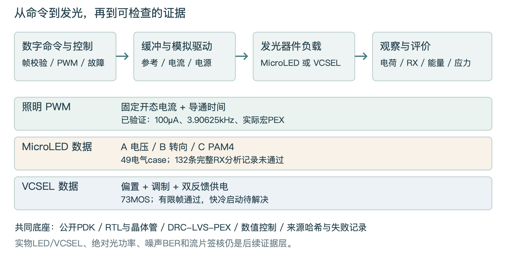
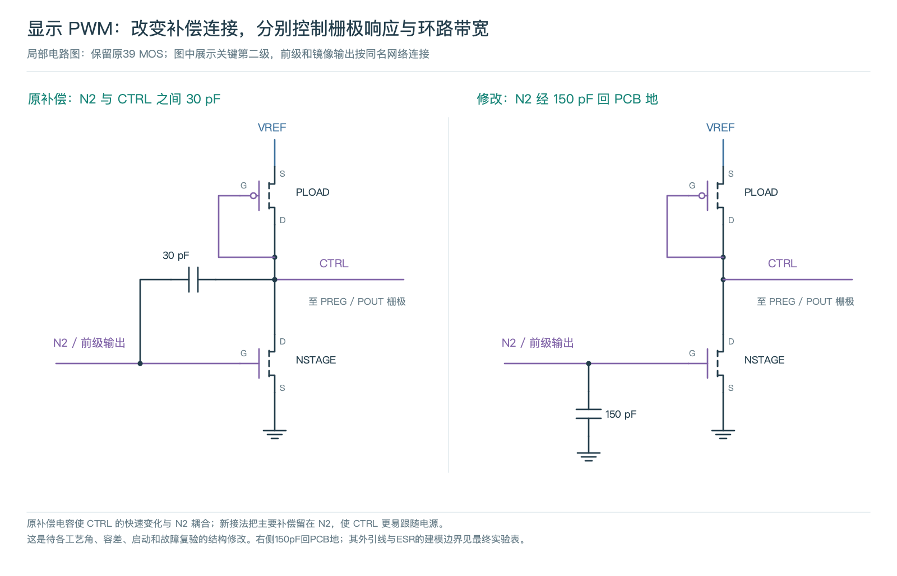
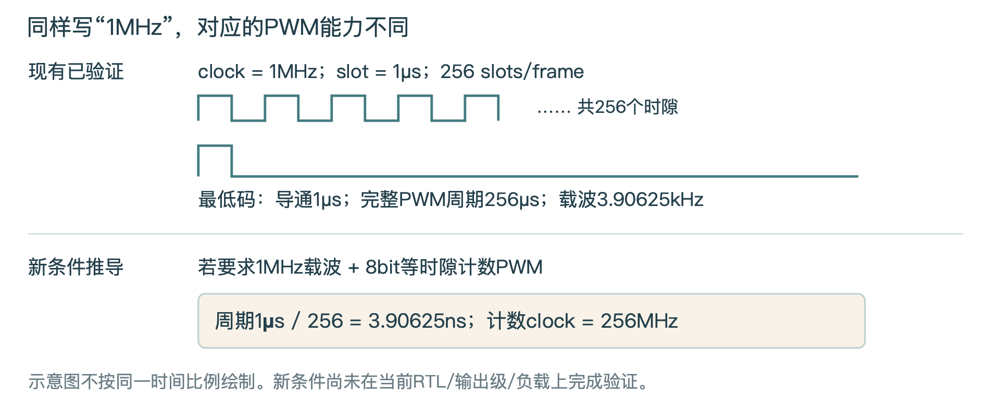
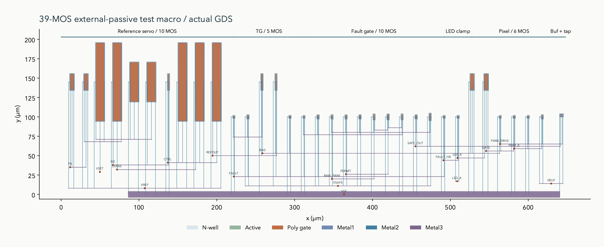
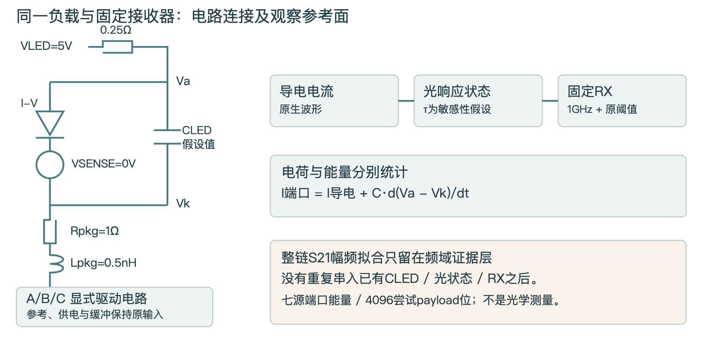
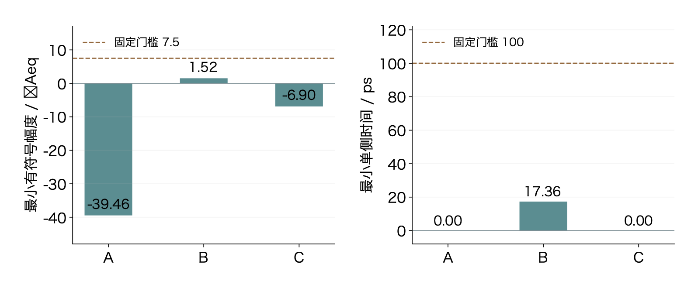
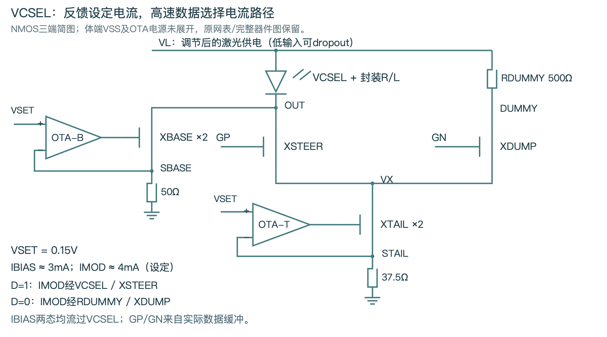
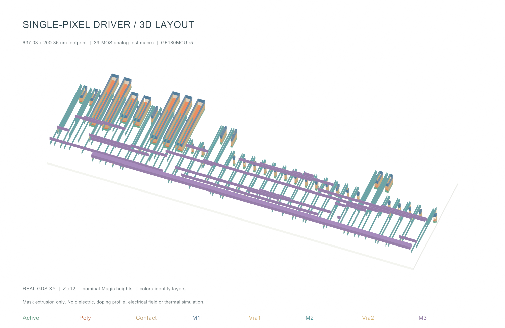
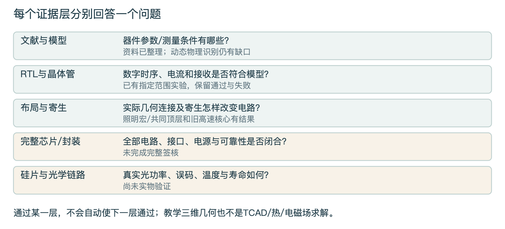

# Open MicroLED Driver ASIC 开发进度与主要成果报告

执行摘要 · 截至2026-11-08

**项目已经建立了从数字命令、晶体管电路到版图寄生和可追溯实验的单像素开发平台。** 现阶段最有价值的成果，是能够用电路、版图和数据回答“为什么通过、为什么失败、证据还缺在哪里”。目前没有流片、实物光学链路或产品量产验证。

| 方向 | 已完成的核心成果 | 当前判断 |
|---|---|---|
| 照明/显示PWM | 100µA参考与保护、数字宏、实际PEX及选定启动/PWM回归 | 验证平台已打通；mA级及1MHz PWM载波尚未覆盖 |
| MicroLED高速通信 | 20µm案例49个电气case；A/B/C同条件动态扫描 | 132条完整接收分析记录均未过门槛，暂不选路 |
| VCSEL高速通信 | 73MOS反馈供电与调制候选；净3.2Gb/s有限角落帧 | 帧接收代理通过；快冷启动仍有端压超限 |
| 器件/工程资料 | 多尺寸文献台账、原理图、二维版图与Blender教学动画 | 可学习和复现；不是物理器件/光学测量资格 |

**建议下一步先建立跨尺寸MicroLED与VCSEL的可比器件证据矩阵，再推进对应的驱动设计。** 20µm是已展开验证的案例，不是预先选定的器件尺寸。照明方向则以mA级恒流范围和PWM频率×灰度分辨率为新的研究工况，重新定义进入条件。

> 阅读顺序：第1-2页掌握全貌；第3-10页看工程成果与限制；第11-14页用于平台、方向与制造/交付；第15-17页核对来源。本文汇总现有结果，没有把本次文件审查写成重跑全部EDA/光学实验。[S01][S05][S07][S09]

---

# 一个平台，两类目标，三条电路研究线

01 · 总体架构

图1｜本报告原创架构图。方框表示功能与参考面；未用颜色暗示芯片已制造。

| 层级 | 已经可以检查什么 | 证据边界 |
|---|---|---|
| 数字逻辑 | 帧完整性/原子提交的功能模型；注册PWM与故障/恢复逻辑的RTL/门级检查 | 功能接收器未全部实现为RTL；逻辑4×4不等于物理阵列 |
| 缓冲与模拟 | 标准单元输出、模拟缓冲、参考/保护、电流设定和负载波形 | 引脚斜率与外部源/元件有明确假设 |
| 物理实现 | GF180公开PDK下的真实GDS、DRC、LVS与PEX | 各宏/版本范围分别记录，不能继承给另一版电路 |
| 验证与知识 | 数值控制、失败日志、来源哈希、报告/可视化和有限恢复 | 没有实物、噪声统计BER、车规或foundry签核 |

照明关注电流设定与脉冲电荷；通信关注数据判决、净速率和能量。二者可以共享参考、保护与物理设计方法，但不能互换LED模型、接收器或通过门槛。[S02][S14][S22][S23]

---

# 照明单像素：参考源、保护与供电恢复已有结果

02 · 模拟电路

当前导通目标为100µA。外部VSET=0.5V、RSET=5kΩ给出ISET≈100µA；反馈电路调节偏置，电流镜与开关把设定传到LED。它已替代最早的理想IREF前提，但外部电压基准和许可时序仍是接口条件。负载为约2.8V@100µA的教学合成LED。[S01]

图2｜既有原理图局部：补偿连接修改。最终使用片外150pF对地补偿及100Ω/15nF参考滤波；不是新增片内版图。

| 指标 | 当前结果 | 条件/含义 |
|---|---|---|
| DC设定与角落 | 名义99.7335µA；144点误差-4.436%～+1.985% | 固定100µA设定；历史DC等效复用并重测极值，非可调范围 |
| 供电扰动 | 12个选定顶点通过；最大偏离8.873%，最长恢复2.520µs | 10%/10ns阶跃；恢复至原基线±0.5%，预算≤5µs |
| 停钟故障 | LED达到安全条件约205.78ns | TT案例；Q+=0.505pC、Q−=-7.363pC；不是数字路径延迟 |
| 受控启动 | TT名义保持窗数值峰值约46.46pA，低于1nA研究门槛 | 仅指定电源顺序；不等于硅片pA级漏电或自主POR |

> 27个选定电气case通过，不意味着所有历史候选通过。100nF慢角电流不足、47nF恢复超时及三MOS软启动失败均保留。尚未完成自主POR/欠压互锁、任意电源顺序与真实光输出验证。[S01][S22]

---

# PWM与数字控制：时钟、载波和灰度必须分开

03 · 数字逻辑与缓冲

图3｜本报告原创时序示意，非新增波形仿真。现有1MHz clock形成256µs PWM周期；1MHz载波+8bit要求3.90625ns时隙。

| 已验证对象 | 结果 | 不能据此推断 |
|---|---|---|
| PWM合同 | 256slots/frame；载波3.90625kHz；最短导通1µs | 1MHz是clock，不能写成1MHz PWM载波 |
| 最低码电荷 | 99.6333pC；相对同网络DC×1µs误差-0.1005% | 这是电气电荷，不是实测光学灰度误差 |
| 当前控制数字宏 | 200×200µm；415个标准单元实例，20个时序单元 | 不是物理4×4像素阵列，也不是产品die面积 |
| 功能与时序 | 10RTL+10gate案例；9角SDF各4108检查；限定STA违规计数为0 | Icarus部分SDF/timing-check不支持；不能当完整时序签核 |

在1000ns时钟、200ns输入到达及72.91fF输出负载的SDC条件下，最小寄存器setup/hold余量为986.059/0.441845ns。这些数字是当前约束的余量，不是最高时钟性能。数字SDF事件曾回放到r5的30pF补偿/30pF SENSE/10MΩ名义网络；仍假设10ns引脚斜率，未完成共同顶层全部晶体管动态联仿。[S02][S03][S22]

> 9bit duty端口用于同时表达0和256两个端点，当前时间量化为8bit。12bit上层命令经过量化也不会自动得到12bit电气灰度。独立保护关断与正常帧边界更新是不同路径。

---

# mA级照明目标需要重新设计输出与时序

04 · 新工况与已验证能力的差距

以下仅作为后续独立实验的研究工况：45µm尺寸案例，典型2.5mA、室温Vf约3.2V，电流设定0.15-7.33mA/像素，最高PWM载波1MHz。这些输入不作为已核实的商业产品规格，也不作为项目已达到的性能。45µm是否代表有效发光边长、最高电流能否连续/全阵列使用，以及最高频率对应的灰度位数均待确认。

| 原理核算 | 结果 | 影响 |
|---|---|---|
| 电流放大倍数 | 2.5mA为现100µA的25倍；7.33mA为73.3倍 | 输出MOS、参考分配、供电与互连需要一起重新验证 |
| 典型LED电输入 | 2.5mA×3.2V=8.0mW/像素 | 电输入不全是热；还需绝对光功率及热阻数据 |
| 电流密度示例 | 若有效面积为45×45µm²，2.5mA约123.46A/cm² | 芯片外形不一定等于发光面积，不能升级成实测J |
| 1MHz+8bit计数PWM | 256MHz计数clock；最短3.90625ns | 需检查缓冲/开关建立、残流、抖动与脉冲电荷 |
| 1MHz+10bit计数PWM | 1.024GHz计数clock；最短0.97656ns | 这是架构条件推导，不是已支持规格 |

恒流条件还要求VLED≥Vf,max(I,T)+电流源压差+I×互连电阻+供电跌落。提高供电可以增加余量，也会增加线性驱动压降损耗。低灰度时，边沿充放电电荷可能占一个短脉冲的显著比例，必须积分核对。

> 进入mA级开发前：确认I-V(T)、有效面积、动态电荷/电容及脉冲限制；冻结电流精度与PWM频率×灰度组合；再设计DAC/分档镜像、输出级与独立关断。不能仅放大MOS尺寸后继承100µA验证。

---

# 真实版图已做到哪里，芯片面积怎样解读

05 · 工艺、布局与寄生

图4｜r5实际39MOS模拟宏GDS视图。边界637.03×200.36µm，约0.12764mm²；这是研究测试宏范围，不是单个阵列像素的量产面积。

| 对象 | 已执行结果 | 范围 |
|---|---|---|
| 39MOS模拟宏 | Magic/KLayout DRC、LVS与GDS回读通过；345R/288C，29/29网络提取 | 真实几何PEX；最新片外补偿在该网络上回归 |
| 200µm数字宏 | DRC/LVS/XOR及九角STA/SDF记录 | 数字宏提取；跨宏负载和异步安全仍有边界 |
| 共同顶层 | 916×204µm；7277MOS、36588R、30230C；6512/6512网络 | DRC/LVS与PEX拓扑审计通过；完整顶层瞬态未完成 |

驱动器采用硅基GF180MCU公开CMOS工艺研究；工艺配置gf180mcuD / 5LM_1TM_11K为五层互连金属，模拟宏实际使用M1-M3。它与InGaN/GaN发光器件的外延材料是不同部分。模型子集不能替代完整PDK，五层金属也不等于只有五道制造工序。[S04][S05][S15][S22]

> 制造签核仍缺：完整顶层电气/时序回归、pad/ESD、供电EM/IR、密度/天线/可靠性及匹配MPW规则包。当前面积不含完整产品pad ring/封装，也不能直接用于阵列面积或单价推算。

---

# MicroLED高速：A/B/C已具备同条件比较框架

06 · 晶体管电路与接收参考面

A为电压驱动NRZ，B为电流转向NRZ，C为译码/单位电流形成的Gray PAM4。当前候选分别显式包含20/21/49只MOS，并计入显式的参考、供电与数据缓冲电路。保持同一20µm静态I-V负载、1Ω/0.5nH封装假设，以及固定1GHz接收代理。[S06][S07]

图5｜按冻结testbench连接重绘的负载与参考面。VSENSE取导电电流，C充放电进入源端能量；光响应与RX为单独假设。完整电路见原专题报告。

4736线路位承载4096个payload位，完整帧1.28µs，故净速率3.2Gb/s、线路速率3.7Gb/s；A/B为3.7GBd，PAM4 C为1.85GBd。固定阈值、7.5µAeq幅度及100ps单侧时间门槛；每个波形只用训练段选采样delay，再检查验证段。

> 实测层仅能约束已有静态数据和归一化整链幅频。C=0/10/50/200/800fF与光响应τ=0/25/75/200ps均为敏感性假设；0值是理想诊断。缺相位/S11/去嵌，整链拟合未作为器件瞬态激活。旧6/9MOS核心虽有layout/PEX，本轮20/21/49MOS完整候选未完成相应新版图/PEX。[S08][S23]

---

# MicroLED高速：求解成功，接收条件仍未通过

07 · 数据结果与失败定位

图6｜从冻结接收结果重绘：同TT、10fF/25ps假设下的幅度与时间余量。虚线为固定门槛；B虽零观察错误，两项余量仍不足。原专题报告保留完整同坐标眼图。

| TT条件 | A错误/4096 | B错误/4096 | C错误/4096 |
|---|---|---|---|
| 200fF / τ200ps | 844 | 1440 | 1399 |
| 10fF / τ25ps | 1338 | 0 | 416 |

49个电气case全部求解并分析，包括33个动态帧及16个DC。典型C/τ扫描60个点（含24个理想诊断），另有48条角落与24条半步长控制，共132条full接收分析记录；原联合筛查通过数为0。B在10fF/25ps虽为零观察错误，幅度仅1.52µAeq、时间17.36ps，仍未满足7.5µAeq/100ps；不能据此选B。[S06][S07]

DC最大目标误差0.126733%；8组电容对照的DC差为0。6对原生半步长形成24项接收检查，判定与delay保持，但两项错误数各变化1位。较小电容还暴露A输出及C译码体结正偏风险，端对电压通过不能替代可靠性判断。

> 典型TT的15个电气扫描点，正向E+约0.50-0.74pJ/尝试payload位，是七个源端口在全帧的电气取能，不是成功交付能效。这里的132条记录不是132颗器件实验，也不能用来宣布所有A/B/C架构均不适用。

---

# VCSEL：有限3.2Gb/s帧验证通过，启动仍有未过项

08 · 偏置、调制与反馈供电

VCSEL以偏置与调制电流建立数据电平。当前r10候选包含73只显式MOS、供电反馈与电流伺服，并对参考电阻、供电和封装控制作有限回归。负载来自公开论文图读约束和独立模型，不是作者原始模型或本项目实测VCSEL。150fF及固定3mA幅频响应含假设，缺实测相位；发光器件代理不随.temp更新，角落变化主要作用于驱动器与供电。本73MOS候选尚无匹配的新layout/PEX。[S09][S10][S23]

图7｜按已有网表重绘的反馈电流核心。体端均接VSS；量测源、OTA内部、缓冲与稳压器未展开，完整候选仍为73MOS。设定值不是角落实测电流。

| 角落/电源 | 错误/4096 | 幅度µAeq | 时间ps | 正向pJ/尝试净位 |
|---|---|---|---|---|
| TT / 3.3V | 0 | 34.11 | 130.72 | 11.162 |
| SS / 2.97V | 0 | 33.20 | 115.06 | 9.874 |
| FF / 3.63V | 0 | 33.36 | 133.56 | 12.487 |

正常帧的有限判据通过，不能写成完整保护通过：FF条件20ns同步快启动端对电压约3.630879V，仍超3.63V研究筛查线约0.879mV。旧AC注入比未建立为真实return ratio，不能把历史数值称完整环路相位裕量签核。

> VCSEL使用5GHz接收代理及v3训练规则，MicroLED使用1GHz及v2规则；发光/负载条件也不同。上表不能与MicroLED直接排能耗胜负。零/4096仅为有限确定性序列，不是实测统计BER。

---

# 最高速率的研究重点：比较器件与链路条件

09 · 文献与器件共设计

已建立35条驱动相关目标导向来源索引，其中21篇研究论文的阅读深度分为13篇关键全文与8篇摘要。器件共设计另有9条MicroLED台账加2项根来源，VCSEL专题有7条VCSEL及2条MicroLED条目。它们不是可相加的去重论文总数，也不是全领域最高速率数据库。[S11][S12][S13][S21]

| 已提取的文献例子 | 尺寸/格式与结果 | 适用边界 |
|---|---|---|
| 黄光MicroLED公开数据 | 20/40µm作者OOK案例；20µm已提取I-V/P-I与幅频 | 不是器件极限；LED DC-only能量不是完整链路能量 |
| Ferreira2016 | 约24µm等效圆：1.7Gb/s OOK、BER1e-9；约42µm：作者报告PAM4净3.5、OFDM净5.0Gb/s | 格式、接收器/FEC和处理条件不同，不能据此归因尺寸 |
| 半极性60µm蓝/绿 | 优化OFDM约3.495/3.483Gb/s，约0.31m | 净开销未核，不能改称单通道净3.2Gb/s NRZ |
| VCSEL文献专题 | 已有25Gb/s器件/驱动/链路条目，部分仅摘要 | 不能把电眼、光链路、单通道/聚合与净吞吐混用 |

后续矩阵必须同时保存：发光有效面积/VCSEL孔径定义、材料/结构、偏置和电流密度、温度、小信号f3dB、格式/毛净速率、均衡/FEC、接收功率与BER测试条件，以及能量统计面。缺失项标为未知，不用GHz或标题Gb/s直接排序。

> 20µm只是已展开的研究案例。没有硬件时，文献测量约束模型，仿真检查驱动器在假设下的响应；二者都不能证明当前电路已交付同等真实光速率。尺寸、材料、晶向、量子阱与电极的取舍资料已形成专题报告，但统一最高净速率矩阵仍待完成。

---

# 二维版图和Blender把连接关系变成可检查的图

10 · 工具平台与教学成果

图8｜现有r5三维教学渲染：XY来自GDS，名义Z放大12倍。它解释层与连接，不是制造剖面、热场或电流密度仿真。

| 成果 | 可以交付什么 | 证据限制 |
|---|---|---|
| 二维viewer | 9074个多边形、分层显示/端口定位及GDS哈希 | 浏览辅助，不会自动证明DRC或电气正确 |
| PWM逐层动画 | 64s、1080p/24fps，层展开、器件与PWM高低路径；14项媒体哈希本次匹配 | 箭头与慢动作是教学标注，不编码电流/延迟/电荷 |
| 静态Blender场景 | 可编辑场景与三幅渲染图；PNG仍匹配旧记录 | 当前index/.blend两项SHA与旧回执不符，需重验 |
| 帧控制实验 | 完整性检查、atomic commit、量化、RTL/PWL到selected pixel回放 | 接收仍含Python功能模型；逻辑4×4不是电气/物理阵列 |

平台已有冻结工具/PDK与来源身份、DC/瞬态/角落和负控制、失败日志以及可复现生成器。实际物理工具包括Magic、Netgen、KLayout；数字流程使用Yosys/OpenROAD/LibreLane，模拟使用ngspice。不同历史工具版本分别保留，不能合并成一个统一签核版本。[S14][S16][S17][S18][S22]

---

# 下一阶段先解决能改变路线选择的问题

11 · 研究重点与进入条件

| 优先工作 | 具体输出 | 进入下一步的依据 |
|---|---|---|
| 1 器件证据与模型 | 跨尺寸MicroLED+VCSEL矩阵；每条速率的格式/净开销/BER/电流条件；模型卡与敏感性边界 | 能区分器件限制、驱动限制和接收处理收益；缺数据保持条件化 |
| 2 分场景驱动迭代 | 照明：mA级设定与PWM频率×灰度组合；通信：A/B/C/VCSEL的带宽、参考供电、能量与保护实验 | 同一发光器件/接收目标下比较；通过DC、动态/角落、应力与数值一致性再讨论选路 |
| 3 物理与实物闭合 | 给选定候选补新layout/PEX；完成共同顶层动态；定义pad/封装/测量板与光学测试 | 匹配PDK与实际接口；有绝对光功率、噪声和误码数据后才建立真实链路性能 |

**不以当前B路线的局部结果预选架构。** 也不以VCSEL代理帧通过来替代跨器件公平比较。若不同器件的最优驱动方式不同，应保留多个参考设计及各自适用边界。

能效的通用口径为Ebit=P统计面/R净；单位pJ/bit。bit/pJ是其倒数。更低的电流可能减少直流输入，但也会改变光功率、带宽和接收余量。应在相同吞吐与接收要求下评价器件、驱动器、收发链路与系统能量，不能把单个LED的IV/R与全链路直接比较。

> 本轮不设置虚构完成率、量产单价、流片日期或路线赢家。现阶段价值是减少错误前提和试验歧义，为后续实测与芯片设计提供清晰的实验输入和退出条件。

---

# 从研究宏到可制造ASIC仍有明确边界

12 · 工程闭合与制造交付

图9｜本报告原创证据分层图。各阶段需各自通过；版图检查和代理帧结果不能跳过完整芯片/实测环节。

| 问题 | 现有基础 | 还必须完成 |
|---|---|---|
| 完整芯片能否运行 | 单宏电气、数字STA/SDF、共同顶层GDS/RC | 完整顶层动态、任意电源顺序、异步释放及失效状态 |
| 阵列是否均匀 | 单像素恒流/电荷检查与逻辑帧平台 | 匹配/校准、共享参考和供电、同时切换、热耦合及阵列物理验证 |
| 流片给什么 | 已能产生研究用GDS及宏级报告 | 按指定MPW/工艺要求准备GDSII/OASIS、层映射、top/pin、签核报告、封装/测试计划 |
| 能否量产与成本 | 公开PDK验证方法和面积量化基础 | 制造授权/接受、良率与可靠性、封装光学及测试成本；当前无法给出可信单价 |

当前驱动器材料路线是硅CMOS，MicroLED或VCSEL光源采用其各自半导体与结构；高速应用并不自动要求驱动MOS使用同一种发光材料。是否需要更先进CMOS或其他器件平台，应由带宽、耐压、寄生、供电和成本约束决定，现有研究尚未完成工艺选优。[S15][S22][S23]

> GF180公开PDK和当前开源检查支持所声明的研究实现；它们不等于指定晶圆厂接受、车规可靠性或MPW流片签核。GDS本身也不包含完整封装、测试和产品合格证明。

---

# 证据可复现，远端原始备份仍未闭合

13 · 交付状态与阅读入口

| 交付层 | 截至本次审查的状态 | 如何正确使用 |
|---|---|---|
| 源码/报告/compact证据 | 审计基线为GitHub 7911797；本报告另行提交 | 历史实验按各自源码/输入SHA读取；不把当前dirty文件当已备份 |
| 本地raw增量 | 6卷、783files、原始约2.322GB；归档约2.136GB；哈希匹配 | 保留原始数据与失败；归档/member身份已有验证 |
| 限定恢复 | 同Mac恢复730metadata，DC与单case11RX重建通过 | 大tar取自本地已验证归档；不是另一电脑/完整矩阵复跑 |
| 远端raw Release | HTTP408上传超时后停止；9/14assets，5波形卷缺失；仍draft | 未完成全字节回读/远端验收，不应据此删除本地数据 |

上一轮“后台传输中”是当时状态。本轮直接核查日志与Release后，更新为“传输已停止、待恢复处理”。静态Blender场景的两个哈希差异也单独列为待重验，不用旧通过记录掩盖当前身份缺口。[S18][S19][S20][S21]

### 按问题进入已有成果

- 照明参考/保护/启动：docs/research/pwm-reference-startup-20261024/；PWM与数字合同：docs/pwm.md。
- 实际宏/共同顶层与二维viewer：docs/research/single-pixel-closure-20261015/。
- 最新MicroLED动态A/B/C：docs/research/microled-dynamic-validation-20261108/。
- VCSEL供电/参考与模型：docs/research/vcsel-reference-microled-dynamics-20261029/。
- 尺寸/材料/结构文献：docs/research/microled-device-codesign-20261029/；教学动画：docs/research/blender-pwm-animation-20261018/。

> 当前工作树另有存储路径适配的未提交改动。本报告保留它们，并不把这些改动计入已同步成果；报告审查也没有重跑全部历史EDA或重新取回所有论文。

---

# 来源、口径与核查方法

14 · 技术附录

本报告对现有工程文件做三组只读审计：显示/数字/物理，高速/器件文献，以及平台/可视化/交付。审计保存了原文件定位、SHA、条件和不支持的结论。报告生成不改变原实验数据，完整来源/claim与资产台账在配套evidence目录。[S21][S22][S23]

| 来源组 | 优先核查条目 | 回答的问题 |
|---|---|---|
| 照明/数字 | S01-S03、S22 | 电流/PWM/参考保护和数字时序实际达到什么 |
| 物理/制造 | S04-S05、S15、S22 | 哪个版本做过DRC/LVS/PEX，哪些签核仍缺 |
| MicroLED通信 | S06-S08、S23 | 49cases及132条接收记录是什么，模型证据边界在哪里 |
| VCSEL通信 | S09-S10、S23 | 73MOS候选、有限接收通过和启动未过项 |
| 文献/器件 | S11-S13、S21、S23 | 多尺寸/材料/结构与最高速率研究已覆盖哪些条件 |
| 平台/教学/备份 | S14、S16-S21 | 哪些图/文件可交付，哪些恢复与远端步骤未完成 |

### 必须保留的四个分母

- 电流精度：固定设定值的角落误差，不等于可编程范围或统计良率。
- 数据速率：线路位/毛速率、payload净吞吐及符号率分别记录。
- 接收结果：确定性4096位的错误数与研究门槛，不等于实测BER资格。
- 能量：正向、返回与净取能，统计面与尝试/有效交付位分开；启动/预充另列。

浏览版附完整来源链接、文件定位与短SHA；配套sources.json保留全SHA，claims审计文件保留逐项条件。PDF与HTML由同一内容结构生成，图表引用原项目资产或本报告原创示意。所有来源及资产复用范围均记录，未重新发布受限论文原图。

---

# 主要证据来源（1/2）

来源附录 · 完整路径与SHA另见sources.json

点击来源编号可打开审计基线下的原文件；本报告新增审计S21-S23则链接当前配套文件。JSON来源保留完整精度，报告按阅读需要取舍小数位。

| 编号 | 来源内容 | 文件名 / SHA前12位 |
|---|---|---|
| [S01] | 显示参考源与受控启动：最终电气摘要 | final-summary.json SHA a5300ce2b6e1 |
| [S02] | PWM时序合同 | pwm.md SHA ae4b164390bd |
| [S03] | 数字控制宏与SDF/STA | summary.json SHA 0f58925181dc |
| [S04] | 39MOS模拟宏物理检查 | summary.json SHA 9c3e21a9dc22 |
| [S05] | 模拟+数字共同顶层 | summary.json SHA c19dfc416a57 |
| [S06] | MicroLED动态电气矩阵 | electrical-summary.json SHA ebc3ec200f33 |
| [S07] | MicroLED接收与敏感性矩阵 | rx-summary.json SHA c7d954ee4348 |
| [S08] | 20µm条件化动态模型卡 | model-card.json SHA 21238ce974f7 |
| [S09] | VCSEL r10最终索引 | final-r10-index.json SHA 6147d39aadba |
| [S10] | VCSEL工程复核笔记 | engineer-notes.md SHA 0e7b4d2150bc |
| [S11] | MicroLED器件文献条件台账 | literature.json SHA 013b6e918bf8 |
| [S12] | VCSEL与高速驱动来源台账 | source-ledger.json SHA a9f47773bb08 |

> 来源S21-S23的本轮审计与sources.json记录逐claim条件、版本/模型身份及不能支持的结论。受限论文原图未被重新发布，复用图片为本项目既有原创电路、数据图或教学渲染。

---

# 主要证据来源（2/2）

来源附录 · 完整路径与SHA另见sources.json

点击来源编号可打开审计基线下的原文件；本报告新增审计S21-S23则链接当前配套文件。JSON来源保留完整精度，报告按阅读需要取舍小数位。

| 编号 | 来源内容 | 文件名 / SHA前12位 |
|---|---|---|
| [S13] | 器件研究根来源与数据 | root-sources.json SHA 575e866173db |
| [S14] | 帧控制实验 | summary.json SHA 8a7ce3b371e7 |
| [S15] | 完整工艺与制造交付边界 | fabrication-chapter.md SHA 7ec737426195 |
| [S16] | 二维版图原几何 | geometry.json SHA 9b91dd15ab2e |
| [S17] | Blender动画媒体身份 | media-validation.json SHA 800d58ee5d8a |
| [S18] | 静态Blender旧交付清单 | delivery.json SHA 954331bfd886 |
| [S19] | 本地原始归档验收 | archive-local.json SHA 0729e26a3a2c |
| [S20] | 限定恢复验收 | archive-restore.json SHA 72e6d6234a51 |
| [S21] | 本轮平台与远端状态审计 | platform-delivery-audit.json SHA 789d2d375bd6 |
| [S22] | 本轮显示/数字/物理审计 | pwm-physical-audit.json SHA d992604a770d |
| [S23] | 本轮高速与文献审计 | highspeed-audit.json SHA da71c77503b0 |

> 来源S21-S23的本轮审计与sources.json记录逐claim条件、版本/模型身份及不能支持的结论。受限论文原图未被重新发布，复用图片为本项目既有原创电路、数据图或教学渲染。

---

[S01]: https://github.com/Kevin-Kaiyo/open-microled-driver-asic/blob/79117978252dce1d5c84b5254689b0b0848c2a58/evidence/pwm-reference-v2/20261024/final-summary.json "显示参考源与受控启动：最终电气摘要"
[S02]: https://github.com/Kevin-Kaiyo/open-microled-driver-asic/blob/79117978252dce1d5c84b5254689b0b0848c2a58/docs/pwm.md "PWM时序合同"
[S03]: https://github.com/Kevin-Kaiyo/open-microled-driver-asic/blob/79117978252dce1d5c84b5254689b0b0848c2a58/evidence/control-v3/summary.json "数字控制宏与SDF/STA"
[S04]: https://github.com/Kevin-Kaiyo/open-microled-driver-asic/blob/79117978252dce1d5c84b5254689b0b0848c2a58/evidence/layout-v3/r5/summary.json "39MOS模拟宏物理检查"
[S05]: https://github.com/Kevin-Kaiyo/open-microled-driver-asic/blob/79117978252dce1d5c84b5254689b0b0848c2a58/evidence/layout-v3/joint-r2/summary.json "模拟+数字共同顶层"
[S06]: https://github.com/Kevin-Kaiyo/open-microled-driver-asic/blob/79117978252dce1d5c84b5254689b0b0848c2a58/evidence/microled-dynamic-v1/electrical-summary.json "MicroLED动态电气矩阵"
[S07]: https://github.com/Kevin-Kaiyo/open-microled-driver-asic/blob/79117978252dce1d5c84b5254689b0b0848c2a58/evidence/microled-dynamic-v1/rx-summary.json "MicroLED接收与敏感性矩阵"
[S08]: https://github.com/Kevin-Kaiyo/open-microled-driver-asic/blob/79117978252dce1d5c84b5254689b0b0848c2a58/analog/models/microled_dynamic_v1/model-card.json "20µm条件化动态模型卡"
[S09]: https://github.com/Kevin-Kaiyo/open-microled-driver-asic/blob/79117978252dce1d5c84b5254689b0b0848c2a58/evidence/vcsel-robustness-20261029/final-r10-index.json "VCSEL r10最终索引"
[S10]: https://github.com/Kevin-Kaiyo/open-microled-driver-asic/blob/79117978252dce1d5c84b5254689b0b0848c2a58/evidence/vcsel-robustness-20261029/engineer-notes.md "VCSEL工程复核笔记"
[S11]: https://github.com/Kevin-Kaiyo/open-microled-driver-asic/blob/79117978252dce1d5c84b5254689b0b0848c2a58/evidence/microled-device-codesign-20261029/literature.json "MicroLED器件文献条件台账"
[S12]: https://github.com/Kevin-Kaiyo/open-microled-driver-asic/blob/79117978252dce1d5c84b5254689b0b0848c2a58/evidence/three-gbps-vcsel-20261027/source-ledger.json "VCSEL与高速驱动来源台账"
[S13]: https://github.com/Kevin-Kaiyo/open-microled-driver-asic/blob/79117978252dce1d5c84b5254689b0b0848c2a58/evidence/microled-device-codesign-20261029/root-sources.json "器件研究根来源与数据"
[S14]: https://github.com/Kevin-Kaiyo/open-microled-driver-asic/blob/79117978252dce1d5c84b5254689b0b0848c2a58/evidence/control/summary.json "帧控制实验"
[S15]: https://github.com/Kevin-Kaiyo/open-microled-driver-asic/blob/79117978252dce1d5c84b5254689b0b0848c2a58/docs/research/startup-tapeout-20261014/fabrication-chapter.md "完整工艺与制造交付边界"
[S16]: https://github.com/Kevin-Kaiyo/open-microled-driver-asic/blob/79117978252dce1d5c84b5254689b0b0848c2a58/docs/research/single-pixel-closure-20261015/layout/geometry.json "二维版图原几何"
[S17]: https://github.com/Kevin-Kaiyo/open-microled-driver-asic/blob/79117978252dce1d5c84b5254689b0b0848c2a58/evidence/blender-pwm-animation/media-validation.json "Blender动画媒体身份"
[S18]: https://github.com/Kevin-Kaiyo/open-microled-driver-asic/blob/79117978252dce1d5c84b5254689b0b0848c2a58/evidence/blender-demo/delivery.json "静态Blender旧交付清单"
[S19]: https://github.com/Kevin-Kaiyo/open-microled-driver-asic/blob/79117978252dce1d5c84b5254689b0b0848c2a58/evidence/microled-dynamic-v1/archive-local.json "本地原始归档验收"
[S20]: https://github.com/Kevin-Kaiyo/open-microled-driver-asic/blob/79117978252dce1d5c84b5254689b0b0848c2a58/evidence/microled-dynamic-v1/archive-restore.json "限定恢复验收"
[S21]: https://github.com/Kevin-Kaiyo/open-microled-driver-asic/blob/main/evidence/project-progress-review-20261108/platform-delivery-audit.json "本轮平台与远端状态审计"
[S22]: https://github.com/Kevin-Kaiyo/open-microled-driver-asic/blob/main/evidence/project-progress-review-20261108/pwm-physical-audit.json "本轮显示/数字/物理审计"
[S23]: https://github.com/Kevin-Kaiyo/open-microled-driver-asic/blob/main/evidence/project-progress-review-20261108/highspeed-audit.json "本轮高速与文献审计"
