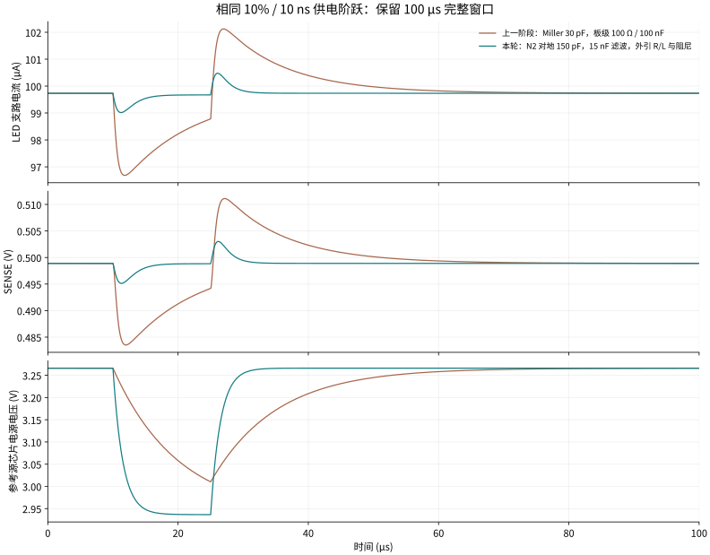
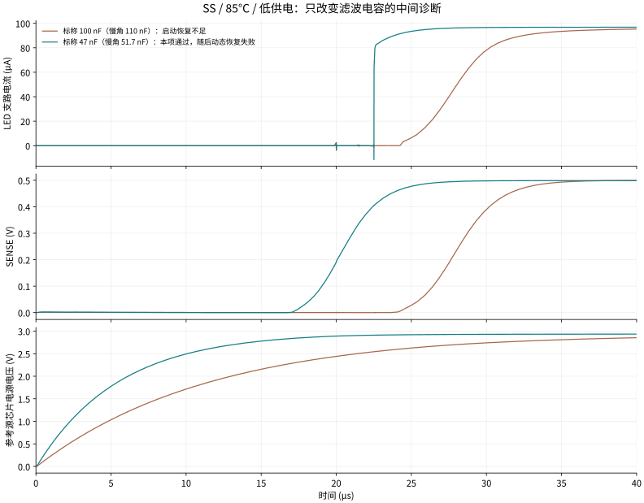
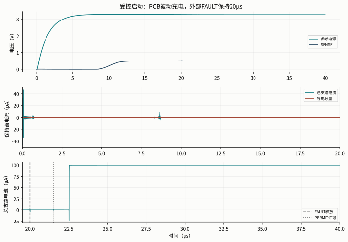
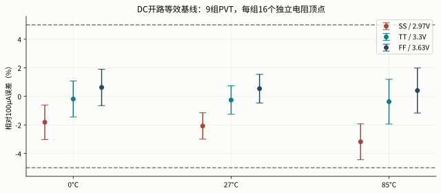
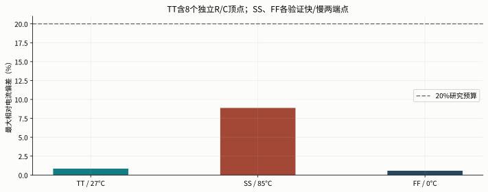
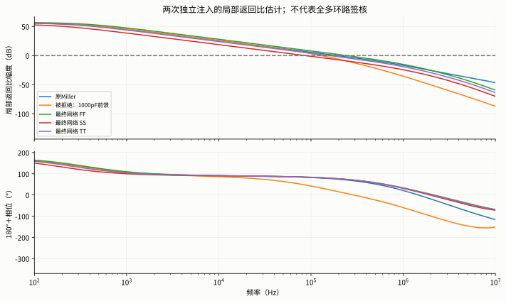

# 显示 PWM：参考源、受控启动与恢复时间

问题不是“电流能不能流过 LED”，而是供电变化、上电和故障恢复时，电流是否仍然受控。本报告固定原单像素负载、时序和判据，分别检查补偿、外部控制输入和封装回路。

## 本轮结论与决策

**在保留的负载、时序和研究门槛下，参考恢复与严格启动数值一致性已通过本轮限定验证。** 芯片仍是原 39 MOS 实际 PEX；修订在外部补偿和供电/控制边界：N2 对 PCB 地 150 pF、补偿引脚 R/L 与 10 Ω 阻尼、参考供电 100 Ω / 15 nF，以及三个外部控制端各 10 Ω 输出阻抗。

最终 27 个选定电气 case 已完成并通过，另有三个局部环路工作点；它们包括 DC 等效复核、供电、启动、故障、最低 PWM 码和有限 R/C 容差。原 144 点 DC 独立电阻矩阵保留，通过电容 DC 开路等效及极值重测复用，不写成全部以 15 nF 重跑。外部参考与 FAULT/PERMIT 仍是接口前提，尚未完成自主上电复位。

| 验证项目 | 最终结果 | 保留门槛 |
|---|---|---|
| TT 名义供电 10% / 10 ns 阶跃 | 0.7456% 最大偏差 | ≤20% |
| TT 名义恢复到基线 ±0.5% | 2.285 µs | ≤5 µs |
| TT 名义启动近零保持窗 | 46.458 pA 数值峰值 | ≤1 nA |
| 慢热启动恢复平均 | 96.7973 µA，30–40 µs | 100 µA ±5% |
| 独立故障到安全 | 205.78 ns | ≤1 µs |
| 故障正 / 负电荷 | +0.5049 / -7.3635 pC | Q+ ≤10 pC；Q− 幅值 ≤20 pC |
| 最短 PWM 码积分误差 | -0.1005% | ±2% |

下一步应把“外部保证参考建立后再许可”做成实际 reference-ready / 欠压互锁，再决定是否增加阵列规模；当前优先事项不是增加像素数。

[TOC]

## 先把显示 PWM 与高速通信分开

显示 PWM 的问题是：在每个灰度周期内，LED 打开时的电流是否准确，最短脉冲的电荷是否准确，关闭和故障时能否及时停止。本轮仍保持单像素 100 µA、1 MHz 时钟、256 µs 帧周期和原来的 MicroLED 合成模型。

该显示负载在 27°C 以约 2.8 V / 100 µA 校准，理想因子 N=3、串联电阻 50 Ω、CJO=2 pF、TT=1 ns，属于教学合成模型。PWM、FAULT、PERMIT 来自实际执行的 RTL 事件回放；模拟宏内的缓冲和保护按晶体管建模，但本轮未把完整数字许可宏全部替换为晶体管后与启动同仿。

高速 B 的问题则是：在每个 2 ns 的数据位内，高低电平是否能被固定接收器区分。它有基础电流和转向电流，低电平仍然耗电；不能把显示 PWM 的关断标准、合成 LED 或灰度积分结果直接换成它的接收条件。[高速参考与供电报告](../nrz-b-reference-power-20261024/index.html)单独记录这条路线。

## 参考电流怎样控制 LED

显示路径的电压设定为 VSET = 0.5 V，检测电阻为 RSET = 5 kΩ，因此参考目标约为 `ISET = VSET / RSET = 100 µA`。误差放大器调节 PMOS 栅极，使检测电压跟随 VSET；镜像和输出开关再把电流传到 LED 支路。实际 LED 电流仍受镜像误差、输出压差、温度、供电和寄生参数影响。

PWM 在快速开关电流路径；参考环路负责相对慢的电流设定。关断保护具有独立控制路径。把“平均电流等于占空比乘以开态电流”当成全部验证是不够的：开关边沿可能增加或减少电荷，参考恢复可能跨越最短 PWM 脉冲，故障释放也可能产生短暂过冲。

本项目的平均电流和积分电荷都是电气亮度代理量。这里没有新增光通量、EQE、色漂或实测亮度证据。

## 为什么输入滤波与受控启动要分别设计

上一阶段 100 Ω / 100 nF 的输入滤波把参考电源的快速扰动压低，但时间常数是 10 µs。它有助于减小启动位移电流，却使恢复时间超过保留的 5 µs 研究预算。单纯减小电容又可能使启动和容差点失败。这是相互冲突的动态要求，需要分开处理。

本轮先测量电源变化到控制栅极、SENSE 和 LED 电流的传递，再判断补偿是否把控制节点拖慢。原 Miller 电容连接 N2 与 CTRL；电源快速下降时，CTRL 不能同样快速跟随，PMOS 栅极相对电源侧端点的电压发生变化，镜像电流受到扰动。N2 改为对地补偿后，CTRL 的快速响应与前级补偿不再以原方式耦合。

以未加输入滤波的机理控制为例，电源下降后 100 ns，原补偿下栅极相对电源侧端点的变化约 0.252 V，新对地补偿下约 0.011 V。实际提取网表中该 PMOS 的源漏命名与功能上的高电位端不同，因此这里使用实际端点差 `v(xdut.ctrl.t3,xdut.vref.t1)`，不把它误标为按网表端序固定定义的 VGS。[端点样本与源记录](../../../evidence/pwm-reference-v2/20261024/mechanism-samples.json)保留该比较。这个局部控制不能直接当作最终板级网络的电流验收。

最终参考供电采用 **100 Ω / 15 nF**，其标称 RC 时间常数为 1.5 µs；100 nF 版本的慢角启动不足、47 nF 版本的慢热动态恢复超时均作为失败保留。N2 支路增加 10 Ω 阻尼，连同 1 Ω 引脚电阻和 0.5 Ω ESR，总串联约 11.5 Ω。若单独把 5 nH 与 150 pF 看作串联 RLC，`f₀≈1/(2π√LC)=184 MHz`，临界阻尼估计 `2√(L/C)≈11.55 Ω`。这只是取值依据：完整电路含有源器件、公共返回和大量 PEX，不能用这个简单公式证明旧超时的唯一根因，也不能替代两种积分方法的完整窗口核验。

进入稳态后仍然使用真实参考反馈；启动依靠有限控制输出阻抗、被动供电斜坡和原 FAULT/PERMIT 时序。尝试过的三 MOS 电源开关未通过，未纳入选定设计。任何外部 START、FAULT 的时序都明确记录，不把测试台给出的许可信号称为已实现的自主上电复位（POR）。

## 什么才算“启动收敛问题解决”

SPICE 停在 `vpermit#branch` 不意味着 PERMIT 在那个时刻发生切换。原失败时间约为 61 ps / 273 ps，PERMIT 当时恒为零，离实际许可沿很远。报错节点是定位线索，不能代替因果证据。

需要分别检查三件事：物理电路是否合理、理想电压源与控制端口是否给出过强约束、数值积分和时间网格是否得到一致结果。把容差放宽到能跑完，只证明求解器找到了另一种近似；不能单独证明启动电流或电荷准确。

本轮保留严格容差与完整窗口，记录有限控制输出阻抗这一物理假设，并用不同积分配置复核。启动保持电流门槛仍为 1 nA；故障电流、电荷、最低 PWM 码和恢复时间仍分别检查。任何未通过的原始日志、网表和波形都保留。

## 版图和寄生参数如何进入结论

原 39 MOS 宏使用实际提取的电阻与电容。新增加的 MOS 模块只有完成 GDS、DRC、LVS 和 PEX，并用其提取网络重测之后，才会被写作“实际版图后的验证”。PCB 上的滤波、补偿及设定电阻按片外器件建模，不能混入片内面积或寄生提取统计。

DRC 检查几何规则，LVS 检查连接与器件，PEX 把布局产生的电阻电容加入电路。这三项通过，都不能替代启动和 PWM 波形的电气验收；同样，某个仿真通过也不能证明全芯片已能流片。

## 修改方法：补偿连接与板级返回路径

<figure><figcaption>原 N2–CTRL 之间的 30 pF 改为 N2 对外部地的 150 pF。参考第二级 MOS 与镜像尺寸保持；这是一项电路连接修改，不是把原有版图寄生删掉。完整外引路径见下一图。</figcaption></figure>

<figure><figcaption>板级滤波、N2 外引封装和电容 ESR 与片内提取网络分开。封装 1 Ω / 5 nH 是明确的工程应力模型；没有 pad/ESD、互感和封装场解。</figcaption></figure>

### 为什么没有采用额外的三 MOS 电源开关

初始候选增加了两只并联 PMOS 和一只 NMOS，试图让参考电源慢慢建立。但 PMOS 没有打开时，其结电容仍会把输入电源变化耦合到局部节点，首轮完整窗口出现约 328 nA 位移电流峰，超过原 1 nA 启动保持门槛，并在故障控制沿遇到求解失败。这个方案没有被选入最终设计。

展开未采用的三 MOS 候选电路及其边界

<figure><figcaption>这是失败实验的真实连接。保留它是为了说明“开关处于关闭状态”不等于“没有电容耦合电流”。不能把该图当成已验收电路。</figcaption></figure>

## 修改前后：恢复变快，但不隐藏新的慢角失败

上一阶段的 PCB 侧 100 Ω / 100 nF + Miller 补偿，在同样 10% / 10 ns 参考供电阶跃中，最大电流偏差 **3.061%**，恢复 **17.713 µs**，超过 5 µs。最终网络的最大偏差为 **0.746%**，恢复后 **2.285 µs** 进入并保持在原电流 ±0.5% 误差带内。减小滤波电容会减少抑制快速扰动的能力，同时缩短充电尾部；当前选型按两项门槛一起判定。

<figure><figcaption>相同 LED 模型、10% / 10 ns 激励和 100 µs 窗口。两条是整个修订前后的对照；其中补偿拓扑、滤波电容与控制阻抗都有明确变化，不伪称单因素实验。SENSE 与参考轨都以各自芯片地为电压参考。</figcaption></figure>

改补偿后曾保留 100 nF，其名义结果很好，却在 **SS / 85°C、逻辑及参考 2.97 V、LED 4.5 V、105 Ω / 110 nF、补偿 165 pF** 的慢角，30–40 µs 平均仅 **91.7024 µA**，未通过 ±5%。这是实际充电和低压余量问题，不是求解器失败。

只把滤波电容标称改为 47 nF（同慢角 51.7 nF），其余条件及 FAULT 20 µs 释放不变，平均改善为 **96.7453 µA**。最慢 RC 时间常数从 11.55 µs 降到 5.4285 µs；单 RC 的 30 µs 建立比例估计从 92.55% 升到 99.60%。完整晶体管电流并不简单等于这个比例，因此仍以实际波形验收。

但 47 nF 的最终 SS 动态矩阵随后失败：快 RC 恢复约 8.057 µs，慢 RC 约 10.989 µs，超过同一个 5 µs 门槛。2.97 V 再下降 10% 后接近参考源的供电余量边界，充电尾部被转换成较大的电流误差。因此继续仅把滤波电容标称缩小至 **15 nF**，其它器件和判据不变，并重跑必要的动态、启动与故障验证；最终慢热启动的 30–40 µs 平均为 **96.7973 µA**。下面保留 100→47 nF 的诊断图，不能把这张阶段性图当成最终全部通过。

<figure><figcaption>这个对照才是单因素：110 nF → 51.7 nF，保持同一 SS、低供电、补偿、FAULT/PERMIT 和 40 µs 窗口。没有延长等待时间来遮住失败。</figcaption></figure>

## 启动：求解完成还要检查数值一致性

原理想控制输入、原 Miller 补偿在严格设置下曾于约 61 ps / 273 ps 失败。报错节点 `vpermit#branch` 当时并未切换，因此不把它当作 PERMIT 的物理根因证据。新模型明确加入控制驱动阻抗和补偿外引阻尼；严格容差仍为 `reltol=1e-7、abstol=1e-14、vntol=1e-9`。

完整 0–40 µs 启动分别采用 Gear2 / 2 ns 最大步长和 trapezoidal / 1 ns 最大步长；电源边沿附近保持 0.1 ps 细网格。两者保持峰值为 **46.3879 / 46.4579 pA**，差 **0.07000 pA**；保持电荷最大差 **1.33e-19 C**，恢复电流相对差 **8.47e-11**，均在事先声明的 2 pA、4×10⁻¹⁷ C、0.2% 一致性预算内。

这些 pA 是 SPICE 近零窗口的支路数值，包含浮点与结电容导数影响；它们支持“低于 1 nA 门槛且两方法一致”，不代表已经预测或测量了 pA 级硅片漏电。启动中安全、缓冲及 LED 电源预先供好，只有参考轨按 100 ns 上升；没有覆盖任意同时上电顺序。

<figure><figcaption>FAULT 在 20 µs 释放，RTL 的许可在后续时钟边沿建立。上图看电源，中图看近零保持窗，下图看正常电流恢复；总支路电流与二极管导电分量分开。</figcaption></figure>

含寄生电容的支路在开关瞬间可以出现负电流，它可能来自储存电荷的释放。不能把它解释为“负光输出”，也不能仅用平均电流掩盖它；本轮仍单独积分正、负电荷并检查峰值和时序。故障在 50.125 µs 施加、时钟已于 47.7 µs 停止，独立保护仍在 205.78 ns 内达到安全条件。

最低 PWM 码的导通目标为一个 1 µs 时隙，在固定 258.5–514.5 µs 的完整灰度周期内积分。实得电荷 **99.6333 pC**，对同一网络的 DC 电流×1 µs 误差为 **-0.1005%**。这里比较电荷，不只是比较脉冲看起来是否有相同宽度。

## PVT、元件容差与反馈范围

原 144 点矩阵覆盖三个 MOS 角 × 三个温度 × 四只外部电阻的 16 个独立顶点。RSET 5 kΩ、RBIAS 100 kΩ、RRELEASE 100 kΩ、RBLEED 10 MΩ 保持标称；DC 电流误差为 **-4.43614%～+1.98512%**。电容在 DC 开路，补偿支路串联电感在 DC 为短路且无电流，因此本轮通过 DC 等效与极值重跑确认可复用原矩阵；不把历史矩阵的每个点算成新的瞬态通过。

<figure><figcaption>每组竖线表示相应温度与 MOS 角的 16 个独立电阻顶点范围，不是统计误差条，也不是良率估计。</figcaption></figure>

叠加通用外部 VSET ±0.2% / 100 Ω 源阻抗的两个极端控制，误差为 -4.59665% / +2.18745%。这仍是外部基准边界敏感性，不是已经验证某款基准芯片。它与高速 B 的 2.5 V 分压方案分别记录，不能互换。

最终动态矩阵为 TT 的 8 个独立 Rfilter ±5%、Cfilter ±10%、Ccomp ±10% 顶点，加 SS/FF 各两个快慢端点，共 **12 点**。最大电流偏差 **8.8733%**，最长恢复到 ±0.5% 带为 **2.5204 µs**；不等于所有供电、温度、封装与无源容差的完整联合覆盖。

<figure></figure>
<figure><figcaption>局部双注入估计需要与启动、阶跃同时阅读；没有把局部相位裕量当成全多环路稳定性签核。</figcaption></figure>

全部选定条件、求解身份、数值比较和保留失败见[最终摘要](../../../evidence/pwm-reference-v2/20261024/final-summary.json)及[验证记录](../../../evidence/pwm-reference-v2/20261024/validation.json)。所有 39 MOS 的六对端压峰值在指定扰动/故障点留存；这不是 foundry 可靠性、SOA、ESD 或光学验证。

## 版图如何对应当前电路

当前继续使用原 r5 **39 MOS、345 个互连 R、288 个显式 C** 的实际提取网络。参考源、保护和缓冲的制造图形没有变化；本轮的外部补偿、板级滤波和输入阻抗不需要虚构一份新的芯片版图。历史 DRC/LVS/PEX 的范围保留，电气结果以本轮回归重新判定。

<figure><figcaption>复用的 r5 实际版图参考区。图形来自此前的 GDS 生成流程，本轮未重新布置 MOS。外部电容不在这张芯片图内。</figcaption></figure>

[打开原实际分层版图查看器](../single-pixel-closure-20261015/layout/viewer.html)。查看器帮助对应几何和电路网络，不是三维电磁、热或光学仿真。

## 如何复核与继续开发

原始数据位于 `build/pwm-reference-v2/20261024/`，公开紧凑证据位于 `evidence/pwm-reference-v2/20261024/`。每个 case 保留实际网表、求解器日志、压缩全波形、执行脚本和不可变输入清单；报告 CSV 是用于阅读的采样，不代替完整波形的峰值或电荷计算。

| 内容 | 入口 | 作用 |
|---|---|---|
| 最终元件与连接 | [final-network.json](../../../analog/pwm_reference_v2/final-network.json) | PCB、封装、实际 PEX 与外部控制边界 |
| 仿真和分析实现 | `scripts/pwm_reference_v2/{run,loop,validate,report}.py` | 同条件实验、数值网格及指标定义 |
| 实际参考源原理连接 | `analog/reference/vset_servo.spice` | 参考电压、误差放大与电流镜 |
| 原实际版图 | [r5 版图与验证](../single-pixel-closure-20261015/README.md) | 39 MOS 宏的历史物理范围；本轮没有改动芯片图形 |
| 旧输入身份问题 | [恢复审计](../../../evidence/pwm-reference-v2/20261024/manifest-recovery-audit.json) | 早期清单关联异常单独保留，不混入最终验收 |
| 独立最终审查 | [审查记录](../../../evidence/reference-v2-audit/review-final.md) | 输入、图文及电气结果核对 |

恢复新阶段 Release 的输入与指定 case 后，用 `scripts/pwm_reference_v2/reproduce.py --case CASE_ID --source build/pwm-reference-v2/20261024 --destination build/pwm-reference-v2/my-reproduction-check` 复跑。`CASE_ID` 应选本报告最终清单里的 DC 或瞬态点；脚本拒绝覆盖目录、核对执行源与清单，必要时重编译 RTL，然后按新根目录迁移 `.include` 路径。它不依赖旧机器的绝对路径。

早期可变输入清单曾造成两项执行源关联异常：`startup_diagnostic_strict_r10_gear1_fullmesh` 和 `pcb150_board100n_ac`。原 deck/log/raw 并未丢失，但这两项不作为最终被接受的证据；后续清单按内容哈希不可变保存。复现脚本会拒绝不匹配的 case，而不是自动修饰来源。备份与恢复范围见[跨机交接说明](../../development-handoff.md)。

### 下一步应解决什么

本轮受控启动依赖外部 FAULT/PERMIT 时序和有限 GPIO 输出阻抗。下一步应把参考就绪检测、欠压锁定与故障释放做成可验证的实际电路，并覆盖控制电源缺失的顺序；同时对外部 0.5 V 基准补真实启动、噪声和输出阻抗。

外部补偿电容需要 N2 引脚，其 pad/ESD 电容、封装互感及板级回流尚未由实物提取。已有 1 Ω / 5 nH 是应力假设，不能自动作为产品封装。建议先用板级电路和可测 LED 负载验证这些边界，再决定将补偿电容和基准集成到芯片，随后才扩展阵列规模。

## 文献、模型与证据边界

下面的公开资料用于理解误差和验证方法。项目的仿真数字来自本仓库网表与波形；没有把产品规格自动当作本设计的实测表现。

1. [GF180MCU 公开 PDK 文档](https://gf180mcu-pdk.readthedocs.io/en/latest/)及仓库锁定的实际模型版本：用于器件类型、公开模型及几何规则。`06v0` 是本项目选择的器件选项；它不是对任何波形、温度和寿命都成立的通用安全保证。必须逐只检查实际端压，并保留 foundry 可靠性签核边界。
2. [TI REF33 数据手册，SBOS392I，2026-04](https://www.ti.com/lit/ds/symlink/ref33.pdf)：低功耗参考的规格示例。初始精度 ±0.15%，温漂 30 ppm/°C；静态电流最大值随温度范围变化：25°C 为 5 µA，−40～85°C 为 6.5 µA，−40～125°C 为 8.5 µA。不能把室温最大值用于全部温度。该版第一页对 REF3312 的文字与详细电气表存在差异，输出值按详细表及官方产品页的 1.25 V 解读。本轮没有采用厂商验证过的该型号 SPICE 宏模型。
3. [TI REF34 数据手册，SBAS804G，2026-04](https://www.ti.com/lit/ds/symlink/ref34.pdf)：另一种精度/功耗取舍示例，±0.05% 初始精度、6 ppm/°C 温漂、静态电流典型 72 µA、最大 95 µA。其启动时间与输出电容有关系，不能把外部精密参考画成没有启动过程和耗能的理想电池。
4. [TI AN-1482，LDO Regulator Stability Using Ceramic Output Capacitors](https://www.ti.com/lit/an/snva167a/snva167a.pdf)：解释输出极点、ESR 零点及环路稳定性。它是设计方法依据，不构成本项目 LDO 稳定的证据。本轮失败的补偿实验正说明不能只看“电容变大”就推断更稳定。

5. [Tian 等，Striving for Small-Signal Stability，IEEE 2001，DOI:10.1109/101.900125](https://kenkundert.com/docs/cd2001-01.pdf)：反馈分析方法参考。论文的双向两端口算法与局部电压/电流双注入估计不能混称。本项目保留注入方向、工作点核对及长时间瞬态验证，不把局部相位裕量当成全电路稳定性签核。

温漂手册中的 **box method** 是规定温度范围内最大、最小输出的变化除以整个温度范围；它不等于每个温度点都服从一条经过 25°C 的直线。仿真若使用线性 ppm/°C 公式，是明确声明的工程应力模型，不能称为完整复现了厂商 box 规格。

以功耗预算为例，若外部参考由 5 V 供电，95 µA 静态电流对应 475 µW，在 0.5 Gb/s 下是 0.95 pJ/bit；这还没有包括输出负载与上游转换损耗。该例仅说明静态电流会改变能耗排序，不是本电路已经使用 REF34 的宣称。

原始引用位置、版本和复核备注集中在[公开来源清单](../../../evidence/reference-v2-research/sources.json)。显示 PWM 的 LED 是保留的合成模型，**没有新增实测 C–V、温度 I–V 或光学响应**。电流、电荷与 PWM 结果用于电气方法验证，不能直接解释为实测亮度均匀性或产品可靠性。
