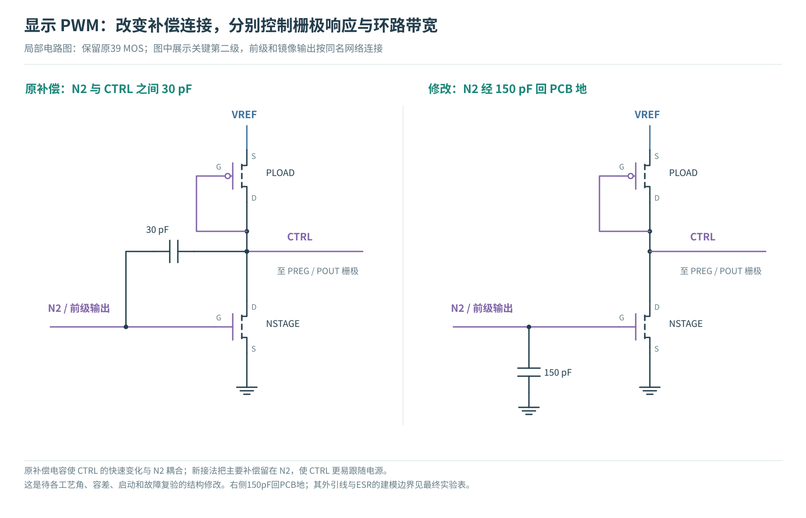
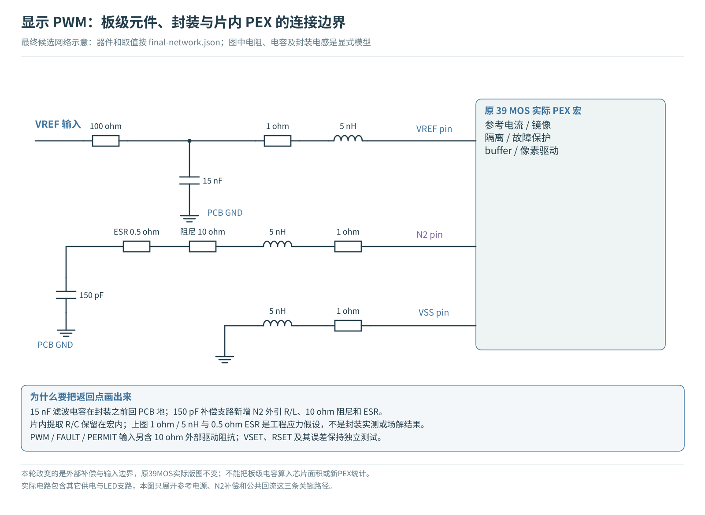
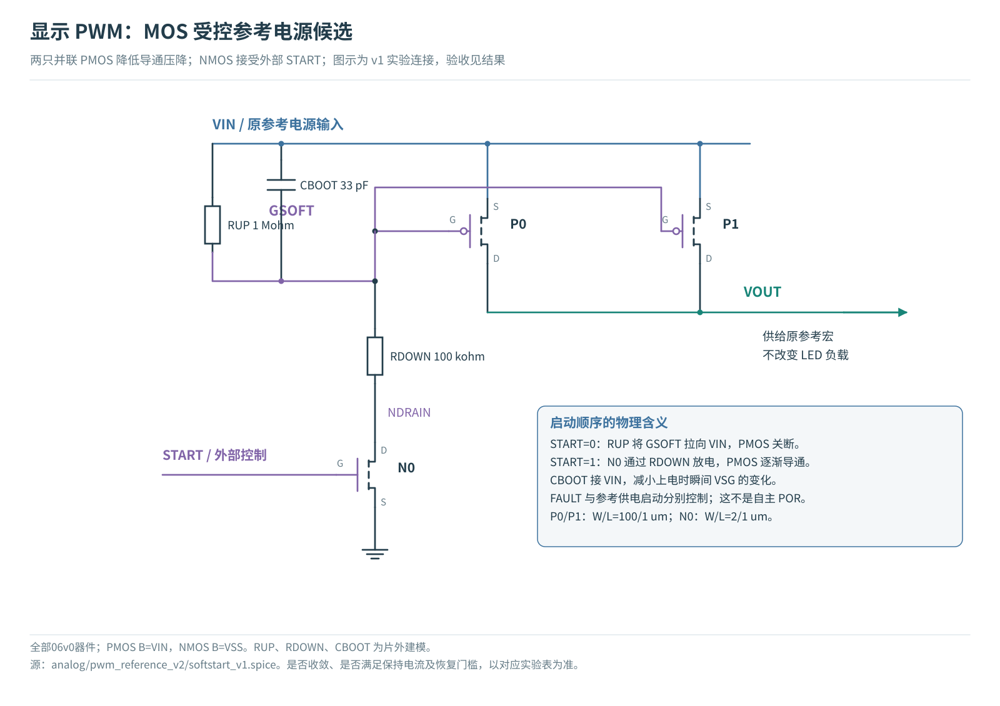
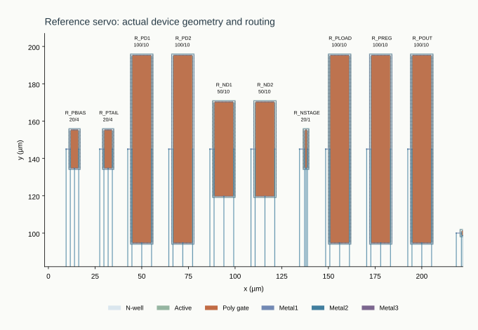

# 显示 PWM：参考源、受控启动与恢复时间

问题不是“电流能不能流过 LED”，而是供电变化、上电和故障恢复时，电流是否仍然受控。本报告固定原单像素负载、时序和判据，分别检查补偿、外部控制输入和封装回路。

{{OVERVIEW}}

[TOC]

{{ARCHITECTURE}}

## 修改方法：补偿连接与板级返回路径

<figure><figcaption>原 N2–CTRL 之间的 30 pF 改为 N2 对外部地的 150 pF。参考第二级 MOS 与镜像尺寸保持；这是一项电路连接修改，不是把原有版图寄生删掉。完整外引路径见下一图。</figcaption></figure>

<figure><figcaption>板级滤波、N2 外引封装和电容 ESR 与片内提取网络分开。封装 1 Ω / 5 nH 是明确的工程应力模型；没有 pad/ESD、互感和封装场解。</figcaption></figure>

### 为什么没有采用额外的三 MOS 电源开关

初始候选增加了两只并联 PMOS 和一只 NMOS，试图让参考电源慢慢建立。但 PMOS 没有打开时，其结电容仍会把输入电源变化耦合到局部节点，首轮完整窗口出现约 328 nA 位移电流峰，超过原 1 nA 启动保持门槛，并在故障控制沿遇到求解失败。这个方案没有被选入最终设计。

展开未采用的三 MOS 候选电路及其边界

<figure><figcaption>这是失败实验的真实连接。保留它是为了说明“开关处于关闭状态”不等于“没有电容耦合电流”。不能把该图当成已验收电路。</figcaption></figure>

{{RESULTS}}

## 版图如何对应当前电路

当前继续使用原 r5 **39 MOS、345 个互连 R、288 个显式 C** 的实际提取网络。参考源、保护和缓冲的制造图形没有变化；本轮的外部补偿、板级滤波和输入阻抗不需要虚构一份新的芯片版图。历史 DRC/LVS/PEX 的范围保留，电气结果以本轮回归重新判定。

<figure><figcaption>复用的 r5 实际版图参考区。图形来自此前的 GDS 生成流程，本轮未重新布置 MOS。外部电容不在这张芯片图内。</figcaption></figure>

[打开原实际分层版图查看器](../single-pixel-closure-20261015/layout/viewer.html)。查看器帮助对应几何和电路网络，不是三维电磁、热或光学仿真。

{{REPRODUCE}}

{{REFERENCES}}
