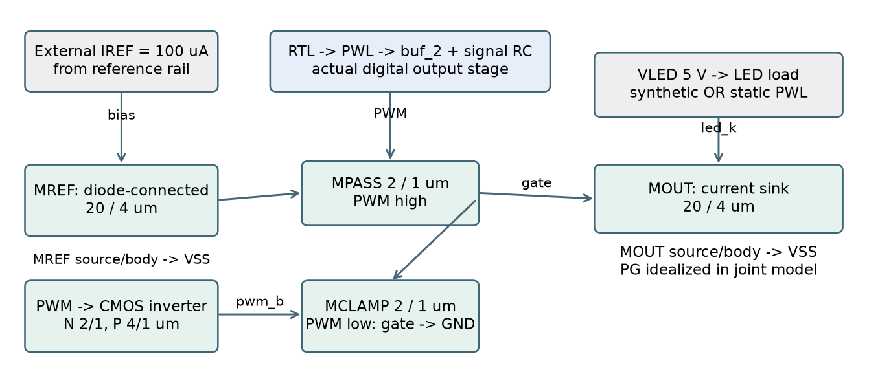
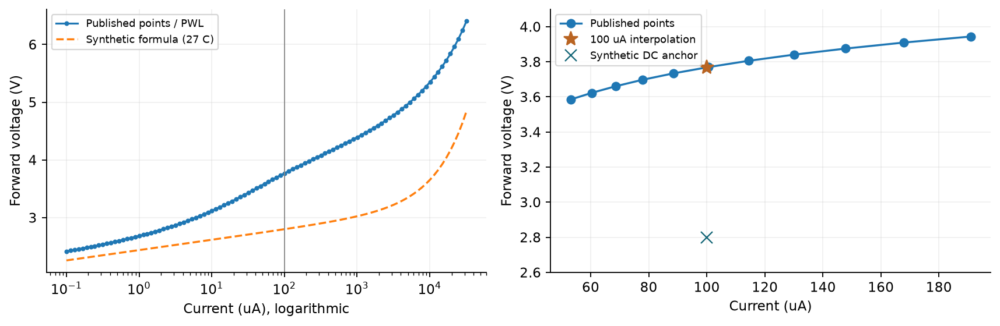
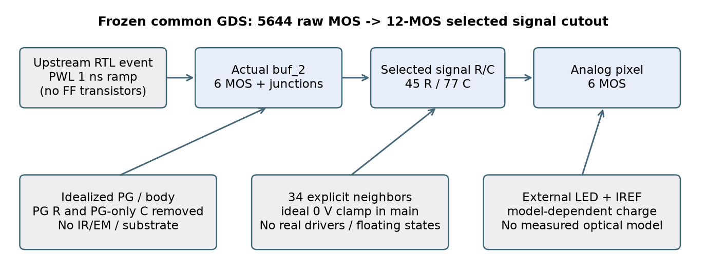
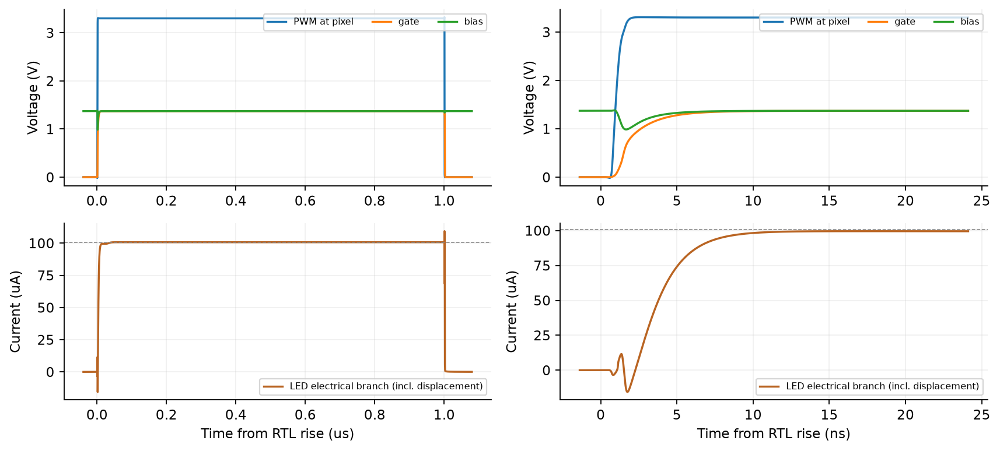
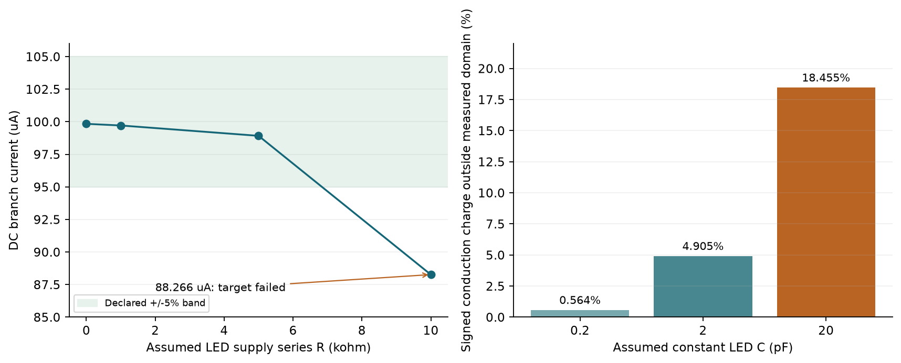

# 单像素 MicroLED 驱动研究：模型怎样建立，仿真实际证明了什么

**当前 checkout 的研究说明与审查 · 2026-10-08**  
审查基线：`781ceb266eb1f1dc16780d806cdcd0d5005716ae`，初始工作区干净。定位：实验性 R&D 方法验证与教学。

## 1　研究问题和实际结论

研究问题是：**一个由数字 PWM 控制的 100 µA 电流镜，在实际版图信号寄生和不同电气条件下，能否保持满开电流与最低脉冲电荷？哪些负载、电源或控制假设会使结论失效？** 本项目选择单像素，以便把数据、模型、连接和结果逐项对应，随后才决定哪些问题需要阵列。

目前最强的结果是**有物理来源的单像素条件仿真**。PWM 的 RTL、单像素数字宏与模拟版图已经实现；从共同 GDS 提取的末级 buffer＋像素信号模型包含 12 MOS。合成 LED 下，已运行矩阵的满开电流为 100.113–101.423 µA，最低码电荷面积最大误差 0.700133%，满足预先声明的 ±5%／±2% 门槛。这说明所选电路和模型在这些条件下相容。[结论 C1：原始指标](../../../evidence/robustness/main-summary.json)，[预声明门槛](../../specifications/electrical-v0.4.md)。

真实 LED 资料被引入为**独立静态负载案例**：公开的 20 µm yellow InGaN 曲线，在 100 µA 的插值电压约 3.768 V，明显高于合成基线的 2.8 V。因此它能改变电压余量（headroom）判断。联合 PEX 静态探针中，额外假设 LED 供电串联电阻 10 kΩ 时电流降到 88.266 µA，已失败于 ±5% 门槛。[C2：静态边界](../../../evidence/robustness/boundary-summary.json)。

| 对象 | 当前已取得的证据 | 仍缺的证据 |
| --- | --- | --- |
| 4×4 数据／帧模型 | Python receiver、完整性检查、atomic commit；16 logical positions | receiver RTL、实际总线、16 像素电气和物理实现 |
| 单像素 PWM | 实际 RTL、mapping、数字 physical 与 SDF 功能回放 | 完整数字晶体管瞬态和真实保护关断 |
| 末级输出＋像素 | GDS、执行过的 DRC/LVS、selected signal PEX、晶体管仿真 | 完整 PG/body、活动邻居、可实现 reference |
| LED／光学 | 一条公开静态 I–V 曲线；合成动态模型与假设 C 探针 | 同器件动态、温度、低电流、光功率与系统测量 |

**没有硅片、实物驱动、实测光输出或真实高速调制验证。** 1 MHz 是数字时钟；256 µs 一帧对应 PWM 3906.25 Hz；最短 on pulse 为 1 µs。模型中的 ns 边沿不能转换成 GHz 光学带宽或 Gbit/s 链路能力。

本次只读原代码和已有结果，做源文件／日志核查与独立图表整理，未重新运行 EDA 实验。原报告及运行结果保留。完整技术疑点及区分原因的方法见[疑点清单](questions.md)。

<!-- page -->

## 2　为什么选这个电路：偏置、负载和 PWM 分别决定什么

电流镜由相同 W/L 的 MREF 与 MOUT 构成。外部理想 IREF 向 diode-connected MREF 提供 100 µA，建立 `bias`；PWM 高时 MPASS 把这个偏置传到 MOUT 的 `gate`，PWM 低时 MCLAMP 将 gate 放电。另两个 MOS 组成 inverter，生成 `pwm_b`。这个拓扑保留了 LED 支路的电压余量，也让 gate 的关断状态可检查。



图 1：按当前 [schematic](../../../layout/pixel_driver_schematic.spice) 独立绘制；绿色是六 MOS 模拟电路，灰色为 testbench 提供的电源／reference，蓝色为提取的数字末级与信号线。图是解释图，省略分布 R/C，不能替代原网表。

| 器件／源 | 当前数值与单位 | 来源和选择依据 |
| --- | --- | --- |
| MREF、MOUT | W=20 µm，L=4 µm；W/L=5 | 独立设计；相对 10/2 增大面积，用 PDK mismatch 和最低码检查取舍 |
| MPASS、MCLAMP、INV_N | W=2 µm，L=1 µm | 当前 schematic；开关和 gate clamp |
| INV_P | W=4 µm，L=1 µm | 当前 schematic；3.3 V inverter 上拉 |
| IREF | 100 µA | testbench 理想／声明的行为源；片上 generator 未实现 |
| nominal rails | Vlogic=3.3 V，VLED=5 V | 研究设定；电源并非实测板级 PDN |

相同 W/L 并不保证严格相同电流。MREF 的 drain 与 gate 相连，而 MOUT 的 drain 电压由 LED 决定；channel-length modulation、mismatch 与开关动态会造成差异。低阶解释是 `VDS,out ≈ VLED − Vf − I×R`，但允许电流误差对应的 compliance 必须用实际 MOS 模型求解，不能只看 `VDS > VDSAT`。

**静态工作点要跟负载和路径一起读。** v0.2 actual analog RC＋实测静态表、typical MOS 27 °C、理想 IREF、3.3／5 V 下：Iout=99.788 µA，Vf=3.767285 V，cathode=1.232715 V，bias=1.374987 V。合成 Vf≈2.8 V 则留出约 2.2 V cathode 电压。两者证明的是不同负载条件。[C3：静态 OP](../../../evidence/characterization/measured-load-summary.json)。

这个约 1.23 V 是外部 cathode 对 ground，不自动等于带寄生的内部 MOUT VDS。关闭 LED 支路也不关闭 IREF：3.3 V×100 µA=330 µW 是模型的 reference rail 预算，不能将整个系统功耗按 PWM duty 缩放。[reference／尺寸依据](../reference-and-matching.md)。

<!-- page -->

## 3　真实 I–V 模型从哪里来，怎样检验

使用的是 Runze Lin 等人的公开数值数据集，配套论文 *Transfer-printed yellow and red InGaN micro-LEDs on diamond for ultra-low-power high-speed optical interconnects*（Nature Communications，2026-06-17，DOI 10.1038/s41467-026-74151-4）。选取 `I-V.xlsx / Sheet1 / A3:B102` 的 `20μm yellow` 曲线；原始电流单位 mA，转成 A。该方形 mesa 的面积为 400 µm²，100 µA 对应 25 A/cm²；这只是面积分母换算。[论文原文](https://pmc.ncbi.nlm.nih.gov/articles/PMC13433930/)，[公开数据](https://zenodo.org/records/20034288)，[源锁定记录](../../../analog/models/measured-led/source-lock.json)。

原始数值摘录（按原数值与单位忠实呈现）：

| 原曲线电流 | 原曲线电压 | 作用 |
| --- | --- | --- |
| 0.0001 mA＝0.1 µA | 2.41622 V | 已测低端边界 |
| 0.08855 mA＝88.55 µA | 3.73408 V | 100 µA 插值的左点 |
| 0.10065 mA＝100.65 µA | 3.76983 V | 100 µA 插值的右点 |
| 32 mA | 6.40451 V | 已测高端边界 |

电路使用 **piecewise-linear I(V) behavioral current source**，没有把它拟合成物理 GaN diode。曲线内按相邻点线性插值，得到 100 µA／3.767910 V。数据下端另接 `(0 V,0 A)`，反向／上端按 PWL 数值延拓；这些区间没有测量依据。



图 2：点为 Lin 数据集 100 个原数值点，实线为独立重绘；虚线是合成模型公式计算，仅作模型比较。数据集 CC BY 4.0；署名 Lin et al.，DOI 10.5281/zenodo.20034288。图没有增加动态或温度证据。

75 点建插值、同曲线 25 点留出，RMSE=1.948 mV、最大误差 2.953 mV；101 次 ngspice OP 与表插值一致到数值精度。这说明表被正确转换／回放，**不是 101 个器件样本，也不是跨器件预测准确度**。全域解析式曾得到留出最大误差221.369 mV而未被选用；局部拟合的无约束R=−43.360 Ω、约束后R=0，也不能解释为物理Rs。采用PWL是避免不合理参数归因的方法选择。[C4：拟合／回放记录](../../../evidence/led-fit/lin2026-yellow20-fit.json)。

论文／数据集本身另有光学和高速实验；**本项目当前只导入其中这一条静态曲线**，没有把论文的高速结果赋给电路模型。记录中的 Keithley 2614B 是论文仪器信息；这条 I–V 的温度、结温、扫描方向、settling、重复数和不确定度未明确。MOS `.temp 27` 只设置 MOS 模型；LED 静态表不随温度缩放。原 model-card 将数据“published”写成 2026-06-18：Zenodo 显示 declared publication 为 2026-05-05，record created／modified 才是 2026-06-18。本报告修正这一区分，原卡保留供追溯。

<!-- page -->

## 4　合成 LED 的参数不是论文提取值

基本 PWM regression 使用 `analog/models/microled.spice`。它是独立指定的 SPICE diode，便于控制 Vf、动态负载及失败对照。真实静态表没有 charge model，因此继续保留合成动态案例是合理的方法选择；需要清楚写出假设。

| SPICE 参数 | 当前设定 | 实际含义／证据等级 |
| --- | --- | --- |
| N | 3（无量纲） | synthetic emission coefficient；未物理提取 |
| RS | 50 Ω | LED 模型内串联 R；不是金属、封装或供电路径 R |
| CJO | 2 pF | zero-bias junction C；偏置后的有效 C 不是固定 2 pF |
| VJ、M | 2.5 V、0.33 | depletion-charge 方程假设 |
| TT | 1 ns | diode charge-storage 参数；不是实测光学 rise time |
| EG、TNOM | 2.6 eV、27 °C | 温度方程设定；没有 I–V(T) 校准 |
| IS | nominal 2.272535114×10⁻²⁰ A | 由 runner 为 100 µA／27 °C／Vf=2.8 V 反算 |

反算公式为 `IS = I / expm1[(Vf − I·RS)/(N·kT/q)]`。这只锚定一个 DC 点：不同 N、RS 可以通过不同 IS 达到同一 Vf，却产生不同斜率与动态行为。修改 Vf 时 runner 改 IS；2.4／2.8／3.2 V variants 不能命名为实际不同颜色／型号的 LED。

**为什么必须先独立 DC calibration？** 现存独立审计曾用 N=2.2、IS≈4.12×10⁻²⁹ A、100 µA 构造目标 3.2 V；默认 solver floor 下得到约 3.149566 V，降低 `epsmin` 后才接近 3.2 V。这证实极小 IS 的数值处理能改变实际模型。当前 N=3／目标范围使用独立 calibration 检查。Git 可见历史从首 commit 已为 N=3，不能编造某次已提交的 N=2.2→3 修正。[历史复现证据](../../../evidence/review/led-independent-checks.json)，[ngspice 47 diode 定义](https://ngspice.sourceforge.io/docs/ngspice-47-manual.pdf)。

现有 v0.4 main deck 明确保存 `LED_IS`、`.temp`、MOS corner 和 solver options；本报告不修改这些设置。`.temp`同时改变MOS与合成diode；旧隔离diode在100µA、0／27／85°C下Vf约2.789114／2.799999／2.821322V，呈未实测验证的正温度系数。`gmin`、absolute tolerances 与模型温度规律会影响 pA 级关闭电流。旧独立 LED 审阅使用过不同 driver hash，其 off-current 对照不能直接当成当前 20/4 joint PEX 的漏电结论。

**动态图中的端口电流含 displacement current。** 正峰、负峰和平均值是不同指标；负瞬态可来自电荷释放／耦合，但当前尚未逐器件分解因果，不能解释成负发光。实际 optical power、EQE、luminance、thermal droop 与 aging 均没有在这个模型中实现。[C5：模型文本](../../../analog/models/microled.spice)，[实际 deck](../../../build/robustness/main-mx5nfi8b/tt_post_d1_fine/testbench.spice)。

<!-- page -->

## 5　软件、版本和实际设置：不是一个抽象“仿真平台”

数字与模拟先后执行：Icarus 运行 RTL 得到事件；脚本转换成 PWL；ngspice 解锁定 MOS＋LED＋寄生电路；Python 按时间积分和检查。没有 analog→RTL feedback，也没有把整个 ASIC 当成一个晶体管网表进行 transient。

| 工具／依赖 | 现存运行记录 | 用途与锁定边界 |
| --- | --- | --- |
| Icarus Verilog | 13.0（stable） | RTL／gate／SDF 事件；本次未重跑 |
| ngspice | 47，KLU build | OP、transient；参数与 options 以逐 case deck 为准 |
| Python／numeric | CPython 3.12.13；uv.lock | 原生编排与积分；binary 安装命令本身并未锁版 |
| 原生 Magic／Netgen | 8.3.684／1.5.324 | analog layout、joint 五 RC style extraction |
| Linux physical | LibreLane 3.0.14、Yosys 0.62、OpenROAD dcf3613… | 数字实现；container digest 在 physical lock |
| Linux检查 | Magic 8.3.623、Netgen 1.5.316、KLayout 0.30.7 | 共同 top／独立几何检查；与原生版本分开 |

来源：[原生日志](../../../evidence/layout/ngspice-version.log)、[control 工具记录](../../../evidence/control/summary.json)、[Linux versions](../../../evidence/physical/tool-versions.json)、[environment](../../environment.md)。本次文档派生环境另写入 `deliverable-manifest.json`，不冒充实验运行环境。

存在两套模型来源。早期 schematic 使用原始 `nmos_6p0/pmos_6p0`，子集 commit `9f992d5…`；physical／joint 使用完整 `gf180mcuD` 的 `nfet_06v0/pfet_06v0`，open_pdks build `54435919…`。W/L 的 `20u/4u` 是 SI 米表达，Magic PCell 的 `20/4` 是 µm。不能将别名、模型文件或单位互换。[subset lock](../../../analog/models/pdk-lock.json)，[layout lock](../../../layout/pdk-lock.json)，[708 份 physical inputs](../../../scripts/physical/pdk-lock.json)。

一份实际最低码精细 deck 的关键片段（省略完整端口／34 邻居）：

```spice
.param sw_stat_global=0 sw_stat_mismatch=0 LED_IS=2.2725351141552272e-20
.lib sm141064.ngspice typical
.temp 27
VSUPLOG vsuplog 0 3.3
VSUPLED vsupled 0 5
BIREF refrail bias I={100u*v(ref_enable)}
BVIN input 0 V={v(raw_pwm)*v(logic_rail)}
; raw_pwm 是实际 RTL event 生成的 1 ns ramp
; XJOINT 仅实例化一次，旧 RC 不另叠加
```

main 为 MOS＋合成diode的27／85／0 °C联合条件包络，搭配3.3／2.97／3.63 V logic和5／4.5／5.5 V LED rail；不是MOS-only温漂或matched STA corner。DC／transient窗口及`.options`必须读原deck，不能从默认值推广到全部实验。

<!-- page -->

## 6　寄生来自哪里：RC 与电路、LED 电容的对应

v0.4 从冻结共同 GDS 实际提取。原始 flat nominal 包含 5644 MOS；电气研究只选中 `output12/buf_2` 的六 MOS 与模拟六 MOS，保留这条信号路径的 distributed R/C 与 cut neighbor ports。这是 **selected signal-path PEX**。



图 3：独立边界图；蓝色是求解器内的 12 MOS 与 signal R/C，灰色是被源代替或投影移除的网络。PWL 从末级 buffer 输入 I 接入；上游 FF／其他数字单元没有执行 transistor transient。共同 physical top 的 19 ports 与 cutout 的 44 formal ports（含34邻居）属于不同对象。

| nominal 量 | 数值 | 对应对象／来源 |
| --- | --- | --- |
| signal R／显式 C | 45 R／77 C | joint 导出网表；不同于旧 analog-only 59 R／43 C |
| Z pin→真实 analog 接入点 Req | 17.394804 Ω | 对完整保留 R 图的独立 nodal solve |
| 显式 C 总和 | 86.12439 fF | 分布 C 的代数和；不等于全部压在 PWM 的输入 C |
| PWM component incident C | 22.84770 fF | 指定 component 的入射 C 统计 |
| 旧新增跨宏线 | 30 µm、0.56 µm；4.81871 Ω／2.34604 fF | v0.3 metal-only link；已包含在 v0.4 路径，不再相加 |
| 邻居边界 | 34 个源固定0 V（main） | 人工 quiet clamp，含真实 floating fillcap／FF内部节点 |

MOS intrinsic charge 与结电容由 BSIM、提取的 AD/AS/PD/PS 计算；LED 的 synthetic CJO／TT 或 measured-case 假设 C 是负载模型。上述三类电容来源不同。PEX 没有提取外部 LED 的实际 C，也没有获得封装／bond 模型。

保留 signal↔PG C，但 PG/source/body R 被映射到理想 rails，PG-only C 省略。19 条 raw 小负 C 全属于 fixed PG-only removal；未作 clipping。最终网络的每个 R>0、C≥0，支持**导出网络**被动性，不能推出全芯片 raw 模型／PDN 已被验证。[C6：summary／ledger](../../../evidence/joint-pex/nominal/summary.json)，[详细投影合同](../joint-pex.md)。

五份 nominal／HRHC／LRHC／HRLC／LRLC 模型来自锁定 open extraction deck，不自动是制造签核 RC corners；全五份提取成功不等于 3 MOS×5 RC 的全部 transient 已跑。v0.4 post 应整体替换旧 buf schematic＋SPEF＋link＋analog RC；重复叠加会双计寄生。

<!-- page -->

## 7　实验如何得到结果：输入、过程和判定

先冻结模型、PDK inputs 和事件身份；单独验证 LED DC anchor，再求 full-on／off OP，最后从 RTL event 回放各 duty 的 transient。每次 run 保存输入副本、deck、solver log、完整 waveform 和 source hashes。这样一项结论可以追到它实际解过的电路，而不是只对应今天的源码。

| 步骤 | 实际输入／方法 | 它回答的问题 |
| --- | --- | --- |
| 数字激励 | 1 MHz clock；256 slots；duty 0/1/64/255/256 | 脉冲是否在规定 frame boundary 生成 |
| bridge | RTL 二值 event→人为 1 ns full-swing PWL | 声明边沿下末级输出／像素响应；不预测前级 slew |
| pre／post | 同一 event、rails、IREF、LED；post用一份joint | 新表示下电流／charge变化；差值含入口变化 |
| nominal与补点 | 3 MOS envelope×nominal；另SS×HRHC／FF×LRLC | 已测组合的条件稳健性；不是完整交叉穷举 |
| transient积分 | warm-up 2 frames；514.5–1026.5 µs，两完整帧 | 避免把启动阶段与稳态 PWM 指标混算 |
| 数值检查 | 保存全点梯形积分；最低码maxstep 10→1 ns | 保存采样下积分稳定性；不建立物理真实性 |

`Iavg = ∫Ibranch(t)dt / T`；`area error = [Iavg/(Ifull,duty256×duty/256) − 1]×100%`。robustness分母取**同条件、路径和窗口的duty256 transient平均**，不是任意100µA；独立DC另检查。它与DC数值近似相同，方法仍须分开。control回放才取独立full DC分母。Adaptive timestep样本不能简单算术平均。main guard为满开±5%、最低码面积±2%、off<1nA、Liberty 30→70%／70→30% slew≤3ns、短脉冲≥950ns。[C7：实际计算源码](../../../scripts/robustness/run.py)，[原指标](../../../evidence/robustness/main-summary.json)。

控制实验另从 16 logical positions 中选择 index=5，将 12-bit code 量化到 duty 0…256；14 正常帧、14 错误路径帧和4 timeout帧共8192 slots。47笔坏交易没有改变 active state／RTL events；错误路径与正常事件相同，所以共用正常电气 run，**未额外计一次模拟**。receiver是Python，actual RTL只有像素PWM。[C8：控制结果](../../../evidence/control/summary.json)。

code 0…4095 有4096种命令，PWM只有257种状态。最近舍入误差最大约0.195265个full-scale百分点；最低映射到duty1的code为8。该量化结果不建立12-bit optical grayscale。

历史 SDF 回放使用数字时序模型，再把 event 转成有限边沿电压；v0.4 main 使用RTL逻辑事件。前者的timing通过不补齐后者的上游FF晶体管行为，两个阶段的证据不拼接成“全链路真实模拟”。

<!-- page -->

## 8　怎样读结果图：平均达标仍可有边沿异常



图 4：直接取 `build/robustness/main-mx5nfi8b/tt_post_d1_fine/waveform.dat`；typical MOS、27 °C、3.3／5 V、100 µA IREF、合成 LED、nominal joint、34个0V邻居；maxstep=1 ns。左为1 µs脉冲，右为上升沿局部；没有重新仿真、平滑或用概念波形替换数据。完整输入／raw hash 见[原summary](../../../evidence/robustness/main-summary.json)。

| 条件／nominal RC | Post full-on | Duty1平均 | 面积误差 | PWM rise／fall |
| --- | --- | --- | --- | --- |
| typical／27 °C／3.3／5 V | 100.752788 µA | 0.392575663 µA | −0.251524% | 0.271417／0.144443 ns |
| SS／85 °C／2.97／4.5 V | 100.112984 µA | 0.388401993 µA | −0.681304% | 0.463540／0.237175 ns |
| FF／0 °C／3.63／5.5 V | 101.423393 µA | 0.395437053 µA | −0.188819% | 0.185828／0.103581 ns |

这些是工程目标内的结果。SS×HRHC 补点的最低码面积误差为 −0.700133%，是当前已测 main 的最大绝对值。[C1／C7：各case原始指标](../../../evidence/robustness/main-summary.json)。

**达标指标没有消除全部疑点。** 图中typical最低码fine run的端口电流峰值约109.330 µA，最小约−15.591 µA；它们不同于100.753 µA plateau。bias在开通瞬间下降，随后恢复。gate steering overlap、MOS charge injection、LED displacement current与信号耦合都是合理候选机制，但已有平均值不能区分各机制贡献；需按器件电流／charge分解与控制实验确认。不能把正峰画成光学峰值，或以平均达标宣称无stress。

1 ns PWL ramp 通过30%→70%本就只有约0.4 ns；末级输出的亚ns阈值测量是该输入下的电气响应。它不是前级FF真实slew、LED光学带宽或最短可通信bit周期。

控制回放的两个最低码帧约0.392533／0.392576 µA，分别−0.262290／−0.251524%。进入新duty的第一帧保留前态影响；应保留这个区别。10→1 ns 数值细化说明积分稳定，不验证未测的LED物理参数。[control独立复算](../../../evidence/control/validation.json)。

<!-- page -->

## 9　最有价值的失败与可疑通过



图 5 左：v0.4 联合信号 PEX＋公开静态表、typical MOS 27 °C、3.3／5 V／100 µA，不同**假设**供电串联 R 的四次 DC。右：v0.2 analog RC＋同静态表、另加0.2／2／20 pF恒定假设 C 的 duty1 transient；两图不是同一模型路径。点直接来自已存摘要，图中连线只辅助读数，不是新增sweep。

**静态失败是真实的模型边界。** R=0／1／5／10 kΩ 下电流分别99.840／99.714／98.920／88.266 µA。10 kΩ 并非实测供电电阻；它刻意暴露headroom不足。17.395 Ω的实际signal路径Req属于PWM输出线，不能拿它代替LED供电阻抗。下一步应独立扫描LED rail／输出cathode／reference compliance，区分输出MOS失去regulation与reference先失效。[C2：原DC结果](../../../evidence/robustness/boundary-summary.json)。

**动态“面积通过”也可能依赖未测模型。** 另加假设C的三个最低码面积误差都在±2%内，但导电电荷落在未测延拓区的占比分别约0.564%／4.905%／18.455%（signed charge ratio）。20pF案例最低LED电压约1.496V，依赖的是未测低端正向延拓，并未进入reverse；0.2pF案例才有小负偏压。这些计算不能称真实器件dynamic qualification。[C9：原cap probes](../../../evidence/characterization/measured-load-summary.json)。

**理想reference可能在电源未建立时供能。** 早开100 µA源的startup探针出现bias高于reference rail约1.372 V，行为源最小吸收功率约−137.235 µW，即主动输出能量。这揭示源模型的compliance问题；startup已数值完成不等于可实现电路安全。PG-only C、body／电源R和完整芯片decap未进入求解，1 nF外加假设也补不回这些网络。[C10：startup结果](../../../evidence/robustness/boundary-summary.json)。

**enable关断的等待时间已确认。** 20 µs拉低enable，实际注册PWM到258.5 µs才低，等待238.5 µs。这是frame更新合同，不能充当紧急关断。控制模型timeout在514 µs blank、RTL在514.5 µs低，也不构成硬件watchdog。关断首帧含charge释放，不能按稳态leakage读。[RTL事件／控制](../../../evidence/control/validation.json)，[电源与控制边界](../robustness.md)。

<!-- page -->

## 10　研究修正过程：已有记录和新建议分开

下表只写可由当前存档定位的变化；“解释／建议”不冒充已运行历史。

| 观察／历史记录 | 已做修正与证据 | 对结论的影响 |
| --- | --- | --- |
| 大电流镜误差预算受mismatch限制 | 10/2→20/4 µm；相同W/L、4倍gate area，PDK样本与实际PEX复验；[matching](../reference-and-matching.md) | 降低条件模型样本的随机分散，增加面积／gate charge；非制造yield |
| v0.3分块入口与实际GDS不同 | standalone formal在左，实际PWM从右端[119.99,111.52] µm进入；v0.4改为联合模型；[joint review](../../../evidence/research/v04-review.json) | pre/post差包含入口和RC表示变化，不能全归因buffer junction |
| 层次化raw出现大量signed C | 存档hierarchical nominal有661负C；flat r3仍有19条小负C；投影ledger将其随PG-only固定边界删除，未clip；[ledger说明](../joint-pex.md) | 只验证最终signal网络passivity，完整动态PG尚缺 |
| 最初flat抽取标签层错误 | `flat-nominal-r1/magic.log`记录DRIVER_N误标metal1移到space；最终r3未见此警告 | 失败版本不能当有效接入点证据；本轮未重提取 |
| 数字flow exit0仍超slew | 初次21项超限；50% repair margin尝试OOM；最终排除delay cells及弱buf_1，保持3ns门槛；[physical历史记录](../../../evidence/physical/summary.json) | 退出码／流程结束不等于工程通过；早期runner snapshot不完整 |
| boundary后处理判窗口不足 | 终点差1 ULP；已允许最多8 ULP序列化误差，仍拒绝真正缺失／非有限／非单调；[failure-record](../../../evidence/robustness/failure-record.json) | 物理solver未失败；模型／工程门槛未改变 |
| 合成极小IS与off数值疑点 | 现存独立floor／GMIN对照；严格GMIN例日志有OP失败／NaN；[旧LED审计](../../../evidence/review/led-independent-checks.json) | 不能把干净退出或pA数值等同器件测量；旧geometry结论不外推 |

最后一项仅支持“历史问题后来被独立复现”；早期未冻结deck及被覆盖结果不足以重建完整修正顺序。当前Git从首commit已采用N=3，本报告不填写不存在的commit历史。

本次核对还发现两种文档问题。第一，数据发布日期混淆（第3节）；这是metadata表达错误，本轮只在新说明中纠正。第二，旧阶段说明如“尚无joint PEX”在其当时成立，却已被v0.4超越；应作为历史条件读。旧source inventory也不能自动代表今天的全库：Phase1清单中5项hash已变化，核心PWM／driver／LED／runner仍匹配；TB变化被存档为可选TRACE_REALTIME格式。**有hash差异并不直接证明旧结果无效，但必须注明其as-run身份。** [旧／新映射](../../../evidence/research/input-mapping.json)。

DRC=0、LVS一致、GDS回读与负对照被拒绝，分别支持执行过的规则和连接检查。它们不会建立matching、IR/EM、完整reliability、provider接受或MPW readiness。没有证据的阶段应保留“未做”，而非替它解释成已通过。

<!-- page -->

## 11　下一项验证应怎样区分可能原因

以下都是**建议，尚未执行**。涉及模型或实验修改时，应先声明范围、独立DC calibration与coupled regression；本轮未实施这些调整。

| 疑点 | 竞争原因 | 能区分原因的下一验证 |
| --- | --- | --- |
| 最低码bias跌落／电流正负峰 | pass/clamp overlap、MOS charge、LED位移电流、signal coupling | 同一事件／路径记录各switch电流与电荷；一次只改slew或control timing，比较gate／bias／conduction／端口电荷 |
| 真实静态表＋C面积通过 | 有效导电响应／未测低端延拓补足积分 | 同一LED获取低电流／reverse和偏置C；比较conduction与displacement，改变数值延拓只作敏感性对照 |
| headroom失败 | 输出MOS失去regulation／reference compliance不足 | 固定cathode扫Iout，再单独扫reference供电／误差；绘实际内部VGS／VDS和IREF |
| startup主动供能 | 理想源缺compliance／真实PG和保护路径缺失 | 先定义可实现reference与power-good；保留PG/body网络，比较能量账户、轨外电压与关断条件 |
| quiet-neighbor结论能否外推 | clamp限制／floating charge／活动邻居耦合 | 从GDS身份决定真实driver或floating边界，逐邻居切换相位／阻抗；查最差pulse area与stress |
| 亚ns输出是否稳健 | 输入ramp预算、adaptive solver、实际数字slew | 使用同输入条件的细步长与容差对照，再由实际前级时序／晶体管源产生slew；保留其不同证据等级 |
| 控制blank是否安全 | 帧边界延迟／缺独立硬件fault path | 先给fault的deadline和safe-off电流门槛，再验证硬件关断与reference断电；不以正常PWM更新替代 |

扩阵列前最有价值的闭环是：可实现reference／安全关断、真实PG／邻居、同器件电气动态与光学测量。现有 ±5%／±2% 是项目预声明研究门槛，不是行业或产品认证规格；研究者可以在获得测量噪声与应用约束后重新定义，需保留旧门槛和改变依据。

样品测量应记录身份、面积、温度／结温、仪器与de-embedding、偏置、重复数和不确定度。带宽需同偏置下的响应与测量链路校准；静态I–V不唯一决定carrier lifetime或光学transfer function。其他论文或另一仓库的链路成功不能替代本像素证据。

完整10项疑点、优先级、已证实／待证实状态和对应输入见[技术疑点清单](questions.md)。

<!-- page -->

## 12　怎样复查：结论追到实际输入和输出

| 结论ID | 实际输入／过程 | 原输出与解释界限 |
| --- | --- | --- |
| C1／C7 满开与面积 | frozen joint、合成LED、RTL事件、main各case deck | `main-summary.json`，37 transient／12 DC；146 guards只属main |
| C2 headroom失败 | 同joint＋measured-static＋RLED=0/1/5/10kΩ | `boundary-summary.json` 4 DC；`passed=true`表示数值完成，10kΩ工程失败 |
| C3 静态偏置 | actual analog RC、measured table、27°C MOS | `measured-load-summary.json` 148 DC，其中135网格；不是v0.4joint同一路径 |
| C4 表转换／插值 | 原xlsx→normalized CSV→PWL，原始hash | `lin2026-yellow20-fit.json`；同曲线holdout，101 OP非101样品 |
| C5 合成动态 | `microled.spice`＋per-case IS／options | 独立calibration＋raw waveform；无实测动态／光学 |
| C6 寄生与投影 | 共同GDS、pinned deck、flat raw、projection ledger | 五RC summaries／SPICE；信号cutout而非full-chip PDN |
| C8 帧控制 | `frame_model.py`→`tb_frame_replay.v`→actual PWM | `control/summary.json`及validation；3transient／2DC／1calibration |
| C9 假设C边界 | measured PWL＋0.2/2/20pF，v0.2 analog RC | `measured-load-summary.json` 10transient；非dynamic qualification |
| C10 startup | 理想／finite-compliance行为源，假设rails | `boundary-summary.json`；未实现reference／POR／完整PG |

所有路径都可从上述各节点击；完整hash基线见[snapshot-inputs.json](snapshot-inputs.json)。raw在本地 `build/`，compact evidence在`evidence/`。本次新图读取输入的hash与派生方法在[deliverable-manifest.json](deliverable-manifest.json)，没有覆盖已有waveform、deck、日志或报告。

**先检查已有资料即可，不需要重新仿真来理解本报告。** 如果要重新确认physical extraction、真实reference或新增LED参数，现有证据不足，需要独立新run。必要范围应先报告：冻结新输入、写入新的build目录、执行DC calibration与coupled regression，并保留旧run；不应直接带`--publish-evidence`覆写compact证据。

仅供未来复现的已有入口（本轮未执行）：

```sh
# 基本模型路径；需要已有锁定工具和models
uv run python scripts/run_phase1.py
# 实际analog RC／实测静态表；需要已有完整PDK
build/layout/venv/bin/python scripts/characterization/measured_load.py
# 单像素帧回放；默认新建build/control/frame-*目录
uv run python scripts/control/run.py
```

joint原命令见[提取记录](../../../evidence/joint-pex/README.md)，各批冻结路径见[电气记录](../../../evidence/robustness/README.md)。工具或PDK不同，需比较实际版本、input hash与结果后再称复现。silicon与optical measurement仍是独立、未完成的证据阶段。
