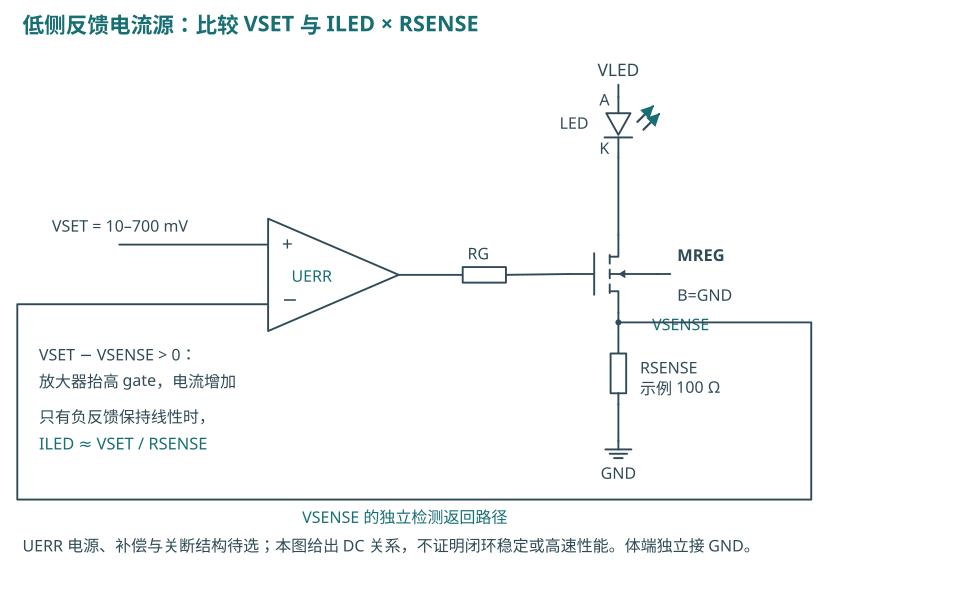
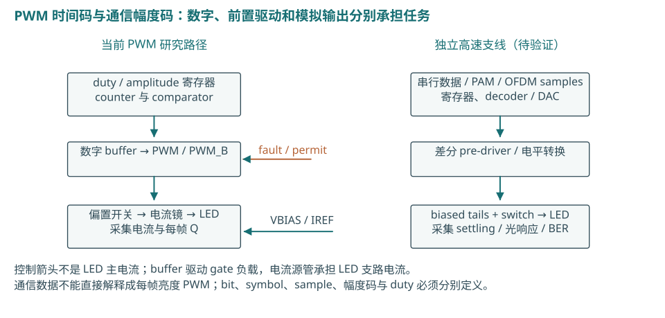

# 从 IREF 到 LED：电流设定、时序、均匀性与高速控制

2026-10-13。供主报告引用的教学章节。**本文新增的是独立计算和原理图，不是新 EDA 结果。** 实际新增 reference/fault 的图跟随当前网表、明确标为 pre-layout；主报告的新仿真必须引用各自冻结的运行证据。

读图约定：D/G/S/B 为漏/栅/源/体端；实心点表示连接，同名网络相连；箭头采用传统电流方向。图中的理想选择器、未选定放大器及高速支线都标为候选。图形属于本项目独立绘制，没有复制论文电路图片。出处、计算输入与图形连接检查见 [sources.json](sources.json)，重算入口为 `python3 scripts/research/reference_architecture_figures.py`。

## 1. IREF 是设定基准；电流镜负责把基准送到输出

外部 IREF 向 MREF 的漏栅短接节点注入电流。节点升到某个 VBIAS，使 MREF 能吸收这份电流。MOUT 得到相近 VGS，在有足够漏源电压、相近参数与温度时，电流近似满足：

`ILED ≈ IREF × (W/L)OUT / (W/L)REF`。

这条关系有条件：两管的 VDS、阈值、迁移率、体偏置和互连并不完全相同。实际值要由完整 compact model 和工作点计算。Gate 在稳态不承载理想的 LED DC 电流；LED 的主电流路径是 `VLED → LED → MOUT → GND`。电流镜因此不是把 IREF 沿 gate 导线“输送”给 LED。

当前模拟像素的 MREF/MOUT 为 20/4 µm、名义 IREF=100 µA。这个 **100 µA 基线** 与 **0.1–7 mA 调节研究**必须分开。把 IREF 直接增到 7 mA，会同时改变 MREF 的 VBIAS、参考源需求、开关端压与功耗；它不是仅改变输出的无代价办法。保持 IREF=100 µA、提高输出几何增益则主要增加输出器件及 gate 负载，仍须复验。

## 2. 0.1–7 mA 有三种候选设定方法

| 方法 | 如何设电流 | 优点与代价 | 当前状态 |
|---|---|---|---|
| 改变 IREF，固定镜像比 | `Iout≈k·IREF` | 直接；参考源需覆盖范围，VBIAS/噪声/余量随设定改变 | 未建立全范围真实参考源 |
| 分档／单位电流 DAC | 固定 IREF 与单位几何，选中 k 个输出单元 | 可保持每单元偏置范围；增加开关、buffer、decoder、面积与失配 | 70 个开关单元未实现 |
| VSET＋sense 负反馈 | 放大误差，调节 MOS gate，使 `VSENSE≈VSET` | 电流由电压/电阻约束；需要放大器、sense 压降及稳定性设计 | 通用反馈图是候选；实际新 servo 单列 |

### 2.1 单位电流与 thermometer 控制

设每个单位名义 100 µA，选择 `k=1…70` 个，就得到名义 `0.1…7 mA`，步长 0.1 mA；关闭另由 enable/fault 定义。7-bit 计数足以编码 0…70，但不意味着已经实现 7-bit 精度。

Thermometer code 的含义是选中前 k 个相同单位。Binary weighted 方案可用 1/2/4/8/16/32/64 份电流，减少独立控制数，但大进位时多个权重同时切换，对匹配与 skew 更敏感；100 µA 单位的完整 7-bit 权重总和为12.7 mA，必须限制超过70的命令，或另行设计满量程。两者都需要实际 decoder、switch、clamp 与 buffer，不能用 SPICE 中改变输出管 `m` 代替这些实现。

H05 的4-bit thermometer DLC说明“数字码选择相同电流单元”的公开实现线索，但它把16个单元分别送到16颗LED，以光幅度叠加形成同一个数据流；这与本图把多个电流单元并到一颗LED不同。[H05，§II-A／Fig.2](https://strathprints.strath.ac.uk/59246/1/Jalajakumari_etal_PTL_2017_High_speed_integrated_digital_to_light_converter_for_short_range_visible_light_communication.pdf)

### 2.2 分辨率不是最低电流精度

独立计算 CAL03 使用理想零起点 DAC：`I(D)=7 mA·D/(2^N−1)`，并假设就近舍入。8/9/10-bit 的 LSB 分别为 **27.451／13.699／6.843 µA**；半 LSB 相对100 µA分别为 **13.725%／6.849%／3.421%**。仅量化误差就说明：8-bit满量程码不能自动满足最低电流处±5%的目标。

若采用 `I=100 µA+D·6.9 mA/(2^N−1)`，两个端点可精确表达，但中间任意设定仍有量化；off要另设控制。双量程、粗细分段或校准可能改善最低端，但增加控制与切换问题。这些公式只描述理想码步长，不证明实物 DAC 的 DNL、INL、ENOB、光学灰阶或制造良率。H06的8-bit电流舵DAC是每通信通道的幅度生成器，不是八个Lane。[H06，§II-A](https://pure.coventry.ac.uk/ws/files/7726769/gigabitcomb.pdf)

### 2.3 一种明确的7 mA尺寸候选及其动态代价

保持参考单位20/4 µm及100 µA，用70份相同输出几何形成总W=1400 µm、L=4 µm、名义镜像增益70，是可检查的**候选**。这不是建议把L缩小70倍，也不是完成70个独立开关。实际分指、共享diffusion、布线、接触与位置必须另画版图并提取。

CAL05按GF180 6 V典型 `Cox=2.3 fF/µm²` 算得 `Cox·W·L=12.88 pF`。若再假设gate变化1.372 V，几何电荷尺度为17.67 pC；假设10 ns搬运这份电荷，平均驱动电流尺度约1.77 mA。**这不是实际Cgg/Qg、gate边沿或驱动器规格。** Bias-dependent channel charge、overlap、junction与互连需完整模型；100 µA参考源也不能被直接视为高速gate驱动器。[G04，§5.3](https://gf180mcu-pdk.readthedocs.io/en/latest/analog/spice/elec_specs/elec_specs_5_3.html)

若反复建立大gate偏置成为瓶颈，也可为大电流PWM采用恒偏置、支路开关或电流舵，不必按“PWM用六MOS、高速用电流舵”划分。需要公平比较尾流、电压余量、dummy能量和真实bias buffer；ideal stiff VBIAS只能作为机制对照，不能被命名为已实现的buffer。

## 3. 公开LED曲线先限定供电可行区间

CAL01对本项目已锁定的Lin等人一条黄色20 µm／diamond静态曲线作线性插值。来源为 `I-V.xlsx / Sheet1 / A3:B102`，100点、1条曲线；原测量温度未知，本文未作温度缩放。

| 目标电流 | 插值VF／V | 5 V减VF／V |
|---|---:|---:|
| 0.1 mA | 3.767910 | 1.232090 |
| 0.5 mA | 4.199540 | 0.800460 |
| 1 mA | 4.392385 | 0.607615 |
| 3 mA | 4.753373 | 0.246627 |
| 5 mA | 4.967338 | 0.032662 |
| 7 mA | 5.135606 | −0.135606 |

因此，**该曲线在7 mA处连LED本身都需要超过5 V**，尚未计算输出管、switch、cascode、sense或连接压降。曲线包含7 mA数据，不代表5 V driver可以到7 mA。表中电压是同曲线插值，不是新的LED测量、动态模型或所有颜色的共同VF。[L01：CC-BY-4.0数据](https://zenodo.org/records/20034288)

输出结构需要满足 `VLED≥VF(I)+输出级所需端压+I·Rpath`。若使用sense反馈，还要留出 `I·RSENSE`；若串Cascode或电流舵开关，增加相应余量。以0.7 V sense和人为0.7 V输出MOS余量举例，7 mA所需电源预算约6.536 V，**这只是加法预算，不能作为GF180额定推荐电源**。

GF180官方把正常5/6 V类别、drain HCI及gate-to-other-node的氧化层限制分别说明。多电源、off、open LED与瞬态排序都可能使端压不同于“rail减VF”；不能因on时有余量就认定off端压安全。应由源规则与完整端子对审查确定允许区间，不把SPICE收敛当作可靠性。[G05，§14.1.2、§14.1.4.1–2](https://gf180mcu-pdk.readthedocs.io/en/latest/physical_verification/design_manual/drm_14_1.html)

## 4. Sense反馈：测得电流再调整，而不是开环复制

负反馈放大器比较 `VSET−VSENSE`，输出驱动MREG gate。若反馈保持线性，`VSENSE≈VSET`，因此 `ILED≈VSET/RSENSE`。本图的100 Ω只是计算例：VSET=10–700 mV对应0.1–7 mA，7 mA时sense耗散4.9 mW，也占用0.7 V余量。

再假设输入offset=0.1 mV，会形成约1 µA电流误差；在0.1 mA处为1%，在7 mA处约0.0143%。较低sense电压节省功耗/余量，却放大offset、noise和接触误差的相对影响。电阻容差、温漂、放大器输入范围/输出摆幅及gate负载均须纳入预算。

TI公开V-I方法给出低侧Rsense负反馈、gate隔离和环路补偿的依据；本项目图是独立通用功能图，没有选择或复刻其具体器件。原文的稳定性数据属于其电路仿真，不能转移到本图。[R01，SBOA327A pp.1–4](https://www.ti.com/lit/an/sboa327a/sboa327a.pdf)

PWM关闭会改变输出负载与反馈状态。若放大器进入饱和，重新点亮可能先恢复；loop带宽、phase margin和startup必须独立验证。高速数据可以切换已设定电流，低速servo负责bias，但不能未经分析让servo直接追逐每个通信bit。

## 5. 新增实际reference和fault：先读连接，再读仿真

### 5.1 自偏置 beta-multiplier

图严格跟随 `analog/reference/beta_multiplier.spice`，端口顺序为VDD/VSS/IOUT。等尺寸PMOS P1/P2形成两条支路；N1漏栅短接，N2是4倍W/L并带source电阻。其自洽工作点给出电流；POUT再镜像并向旧pixel BIAS注入电流。PUP/NSENSE/NKICK用于退出零电流平衡点：NB低时SU上升、NKICK拉低PG；NB建立后NSENSE使SU降低。Startup不是自动POR，也不保证零静态耗电。

| 实例 | D / G / S / B | 尺寸或器件 |
|---|---|---|
| XP1 | PG / PG / VDD / VDD | PMOS40/4 µm |
| XP2 | NB / PG / VDD / VDD | PMOS40/4 µm |
| XN1 | NB / NB / VSS / VSS | NMOS20/4 µm |
| XN2 | PG / NB / RS / VSS | NMOS80/4 µm |
| XPOUT | IOUT / PG / VDD / VDD | PMOS40/4 µm |
| XPUP | SU / VSS / VDD / VDD | PMOS1/10 µm |
| XNSENSE | SU / NB / VSS / VSS | NMOS10/1 µm |
| XNKICK | PG / SU / VSS / VSS | NMOS2/1 µm；默认START=1 |
| XRSET | RS / VSS / body VSS | PDK ppolyf_u；默认L13.5/W2 µm |

长沟道、等支路电流、忽略失配与输出电阻的一阶模型可得 `I≈2·(1−1/√K)²/(βN1·R²)`，K=4，`β=µCoxW/L`。它说明电流仍依赖MOS与电阻工艺/温度，**不是bandgap精密基准**。RSET几何不能只用理想sheet R替代锁定的PDK电阻模型；名义校准也不能证明全PVT精度。

### 5.2 外部VSET约束的实际servo

实际另一候选见 `analog/reference/vset_servo.spice`：PMOS输入对、NMOS镜像load、NMOS第二级和PMOS调节/输出支路，共10 MOS。它通过SENSE支路负反馈约束电流，再用POUT向pixel供电流；外部VSET=0.5 V及RSET=5 kΩ是精密边界，名义 `VSET/RSET=100 µA`。RBIAS是tail bias用电阻，不能误认成决定输出精度的5 kΩ RSET。该候选不是片上bandgap，POUT/PREG的镜像误差也仍存在；Iout不应被直接等同于sense支路的VSET/RSET。

| 实例 | D / G / S / B | 尺寸 |
|---|---|---|
| XPBIAS | PB / PB / VDD / VDD | PMOS20/4 µm |
| XPTAIL | TAIL / PB / VDD / VDD | PMOS20/4 µm |
| XPD1 | N1 / VSET / TAIL / VDD | PMOS100/10 µm |
| XPD2 | N2 / SENSE / TAIL / VDD | PMOS100/10 µm |
| XND1 | N1 / N1 / VSS / VSS | NMOS50/10 µm |
| XND2 | N2 / N1 / VSS / VSS | NMOS50/10 µm |
| XNSTAGE | CTRL / N2 / VSS / VSS | NMOS20/1 µm |
| XPLOAD | CTRL / CTRL / VDD / VDD | PMOS100/10 µm |
| XPREG | SENSE / CTRL / VDD / VDD | PMOS100/10 µm |
| XPOUT | IOUT / CTRL / VDD / VDD | PMOS100/10 µm |

RBIAS默认100 kΩ、CCOMP在N2与CTRL间，默认3 pF；实际运行的参数覆盖须按冻结记录读取。反馈工作点、环路建立及弱第二级失败是不同证据；主报告应保存失败原型，避免只呈现校准后的成功点。

### 5.3 10MOS逻辑保护gate

图跟随 `analog/safety/fault_gate.spice`。fault inverter产生fault_b；三输入CMOS NAND与输出inverter完成 `OUT=raw_pwm AND permit AND NOT fault`。所有gate只搬运逻辑电荷，10MOS不承载LED主电流。OUT连接旧joint模型I输入，随后由既有buffer和像素控制gate。

`rtl/safety/pixel_safety.v`的inhibit在fault上升时异步置位；fault低且recover_request在clock edge、pre-edge raw_pwm低时才清除。permit来自这段RTL，其存储并没有新增晶体管/版图实现。fault-high的直接组合路径不依赖clock，所以不应依靠frame-latched enable承担紧急关断。

外部/testbench的1 MΩ pull-up向**有效3.3 V安全rail**建立断开fault默认高；图中VSAFE对应subckt vdd。它不证明安全rail未建立时的关断，也没有实现POR、brownout、sensor或ESD。

### 5.4 为什么还要在LED两端加active clamp

输入gate被关断之后，LED两端和支路内仍可能存储电荷；“数字OUT=0”与“LED支路立即没有电流”是不同问题。新增 `analog/safety/fault_led_clamp.spice` 让fault-high同时打开LED两端的旁路，使cathode向anode电位靠拢，降低LED正向偏压。这里的目的属于故障后的支路放电，不是ESD保护器件。

| 器件 | D / G / S / B | 尺寸 | 作用 |
|---|---|---|---|
| XLN0，NMOS | FAULT_HB / fault / VSS / VSS | 2 / 1 µm | fault-high将PMOS gate下拉 |
| XCP，PMOS | cathode / FAULT_HB / anode / anode | 2 / 1 µm | gate下拉时接通anode→cathode旁路 |
| RRELEASE | anode / FAULT_HB | 理想100 kΩ | fault-low时将gate恢复至anode，释放旁路 |

这也是一次电压域教学：5 V rail上的PMOS不能仅凭3.3 V“逻辑高”假定已经关闭；它的gate必须相对source接近anode电压。NMOS承担低压fault到高侧gate的控制，RRELEASE负责恢复，因此还要检查gate恢复速度、静态电阻电流以及所有MOS端压。fault-low只是释放旁路，RTL inhibit仍保持；恢复需要recover_request、clock edge且pre-edge raw_pwm=0。

新fault gate 10 MOS和本图2 MOS合计12 MOS，均是**pre-layout**；100 kΩ为理想电阻，MOS的AD/AS=0.88 µm²、PD/PS=4.88 µm源自0.44 µm落点假设，并非PEX。模拟fault边沿10 ns等测试条件必须随冻结数据一起读。旧12MOS joint signal PEX保持独立；它不能升级新增12MOS或reference的物理证据。故障过程中电流正/负面积、peak、持续off及恢复动作需分别报告；本图本身不保证这些指标通过。此前失败的4MOS level-shifter属于已放弃原型，不是当前电路。

## 6. 阵列均匀性：共同误差、局部误差与光学误差分开

一个共享IREF能让所有pixel接受共同设定，却不能使每pixel输出相同。第一阶误差可拆成reference共同误差、mirror ratio、local mismatch、空间梯度、不同VDS/headroom、PG drop、温度与trim量化；这些项还可能相互作用，不能把它们无条件平方和。

| 层次 | 需要区分的现象 | 可验证方法 |
|---|---|---|
| Global reference | 所有pixel一起偏高/低；共同工艺变化 | IREF/PVT与各镜像比单独保存 |
| Local mismatch | 相同偏置下不同pixel随机散布 | 锁定统计模型、受控seed、条件MC；不等于制造良率 |
| Ratio／gradient | 单位尺寸、朝向、邻近环境及系统性梯度 | 相同unit、对称/交错、dummy、相似连接；梯度假设另列 |
| Load／PG | LED VF与位置使VDS、供电与回流不同 | 真实负载、分布PG、同步/错相图案与coupled回归 |
| Trim／calibration | 一个点校正后其他电流/温度仍偏差 | 多设定、多温度的标定残差与quantization预算 |
| Optical | 同电流仍有光效、波长、温度、老化差异 | 电流测量与相机/光电测量分别校准 |

GF180 MP.1–13明确要求unit、相同环境、dummy与对称互连；这些是not-coded匹配指南，DRC=0并不证明已经满足。[G06，官方匹配规则](https://gf180mcu-pdk.readthedocs.io/en/latest/physical_verification/design_manual/drm_10_6_2.html) 现有两个独立20/4 PCell没有自动变成共心单位阵列。

只把相同电流复制到数组，无法关闭光学均匀性。C06将静态mismatch MC、分布供电电阻仿真和整个display光学测量分别执行，提供了分层方法，不能把其200个模型样本写成200个芯片良率。[C06，Materials and methods／Numerical simulation](https://www.light-am.com/article/doi/10.37188/lam.2026.103)

## 7. PWM：电流幅度与时间码是两个控制量

Amplitude register决定名义Ipeak；duty决定点亮时间。当前counter有256个slot，控制值0…256包含全关/全开。理想矩形支路 `Iavg=Ipeak·duty/256`；25%时100 µA峰值对应25 µA平均，7 mA峰值对应1.75 mA平均。这是CAL06的计算，不证明7 mA短脉冲已达到目标，也不等于平均光功率。

数字层须定义clock、reset、enable、command提交边界和fault优先级。更新影子寄存器并在frame边界提交，可以使同一frame保持一致命令；如果需要紧急关断，应独立处理，而非等frame边界。实际延迟、setup/hold、路径skew与buffer负载要在相应RTL/STA/晶体管层分别检查。

数字output buffer把逻辑电压送到gate负载；它不是LED恒流源。扩展输出几何后，原有2/1 µm pass/clamp、标准单元buffer或reference都不能仅凭100 µA基线照搬。模拟VBIAS buffer也不是数字反相器：需核对offset、noise、摆幅、gate负载与稳定性。

## 8. 高速数据：每个符号要形成可判决的光响应

OOK数据选两档光强；PAM选择多档幅度；OFDM提供由子载波组合的sample序列。数据、symbol、sample、DAC幅度码、Lane和PWM duty不可互换。NRZ每bit保持相应level；不能把任意高速数据直接解释为每frame亮度PWM。

H03的数字开关OOK四路各375 Mbit/s，总1.5 Gbit/s；PRBS2⁷−1、LED偏置6.5 V、作者BER标准＜10⁻¹⁰。它的LED共n-contact，且未公开晶体管拓扑/WL，不能套用本项目共阳极NMOS图。[H03，作者稿PDF pp.3–5](https://research-repository.griffith.edu.au/bitstreams/618f0b69-fb1c-524c-921b-e3d48ba37e73/download)

H05电流单元公开NMOS source＋Cascode＋差分switch及buffer，16颗LED形成同一个DLC波形；365 Mbit/s条件为200 MHz clock、16-QAM OFDM、5 cm、BER门槛10⁻³。H06 AMS0.18 µm每片4×8-bit DAC，实际两芯片四路4-PAM在1 m、约45 mA/LED、BER3.8×10⁻³门槛下raw1.23–1.30 Gbit/s；九路7.48 Gbit/s另用AWG，不能归给ASIC。H05未直接给出工艺节点。完整定位见sources.json。

电流舵可以保持尾管gate偏置，但switch、内部节点与LED电容仍搬运电荷；Cascode减少尾管漏压变化，同时增加headroom和电容。只有电气波形不能说明载流子复合、光学响应、receiver/ISI或BER。完整能量须积分LED、dummy、bias、pre-driver及相关rail，不能仅统计LED on期间V×I。

## 9. 主报告接下来应引用什么证据

1. IREF新电路与旧ideal source A/B：校准条件、PVT、负载compliance、startup、噪声/动态范围各自说明。
2. 单LED0.1–7 mA：synthetic与measured-static分别进行DC/headroom；范围图与最低PWM码复验，不把几何增益测试叫已实现DAC。
3. 故障保护：fault/permit/raw语义、clock停滞、恢复条件、各端压、Q⁺/Q⁻、peak与持续off分别报告。
4. 阵列：先关闭单pixel边界，再定义global/local/gradient/PG/LED optical的可分辨实验；单pixelMC不代表阵列均匀性。
5. 高速支线：行为→公开器件/bias/pre-driver→动态LED→PEX/package→光学receiver/BER。新目标及门槛须在开跑前冻结，文献速率不能移作我们的能力。

这些是研究方向和证据要求。本文没有宣称7 mA候选、70单元DAC、feedback loop、阵列或高速支线已经全部实现或通过。
