# MicroLED 驱动研究进展与参考源、保护关断

从电流建立，到 PWM 电荷，再到高速数据驱动

更新至2026-10-14 · 实验始于2026-10-13 · Open MicroLED Driver ASIC

> **当前定位：单像素硅 CMOS 恒流＋PWM 研究平台。** 既有基线已有真实版图和限定范围信号 PEX；本次新增参考源、独立保护和电流范围的电路实验。新增模块的晶体管仿真不等于新增版图、制造签核或光学验证。

## 本次回答什么问题

1. 理想 IREF 如何经电流镜变成 LED 的 DC 电流？
2. 单 LED 的 0.1～7 mA 调节需要什么电路？为什么不能只扩大输出管？
3. 阵列电流一致性、PWM 时序、数字和模拟接口怎样分工？
4. 高速数据怎样变成光信号？电流舵与电流 DAC 的作用是什么？
5. 新参考源与独立关断实际验证了什么，哪里仍失败？

| 证据层 | 当前事实 | 尚未建立 |
| --- | --- | --- |
| 既有单像素基线 | RTL、数字／模拟 GDS、声明规则的 DRC/LVS、selected signal PEX | 完整 PG、pad/ESD、package、制造接受 |
| 本次新增 | 8MOS beta与10MOS反馈参考候选、独立fault路径及0.1～7 mA几何／充电实验 | 新模块的 layout/DRC/LVS/PEX、silicon |
| LED | 合成动态负载；一条公开实测静态 I–V | 同器件 C–V、温度、光学、允许工作区 |
| 控制／阵列 | Python 帧模型与单像素后端；新保护 RTL | 接收器硬件、物理 4×4、光通信 ASIC |

**阅读顺序：** 先看电流与参考源，再看真实实验；接着理解范围、均匀性和接口，最后进入通信并核查结论与来源。详细推导另见 [架构教学章节](architecture-notes.md)。

<!-- PAGE -->

## 2　IREF → 电流镜 → LED：电流并不从栅极流进 LED

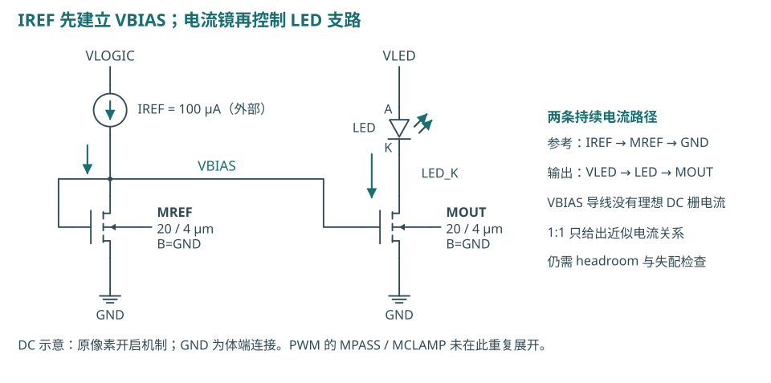

<p class="caption">图1　开启时电流镜的主要DC路径，PWM开关在此省略。MREF/MOUT=20/4 µm，NMOS体端接地；箭头采用传统电流方向。<a href="../six-mos-pwm-tutorial-20261012/README.md">完整六MOS原理图与开关状态</a></p>

**第一步：参考支路建立 VBIAS。** 理想源向 MREF 注入 100 µA。MREF 的漏极和栅极短接，电路自洽找到满足该电流的 VGS；不是先规定一个“标准 MOS 栅压”。

**第二步：开启时复制栅压。** PWM 高使 MPASS 连接 VBIAS 与 MOUT 栅极。两管源极同为地、几何相同，MOUT 在足够漏源电压下产生接近 IREF 的电流。栅极只在电压变化时需要充放电流，LED 稳态电流从漏源通道流过。

**第三步：LED 与输出管共同决定 DC 工作点。** LED 电源经 LED 到 MOUT，再回地；LED 的 VF 由实际电流决定。电流镜有限输出电阻、失配及余量不足均会使 ILED/IREF 偏离1。

<div class="eq">IREF ≈ ½ μn Cox (W/L)REF (VBIAS−VTH)²<br>ILED/IREF ≈ [(W/L)OUT/(W/L)REF] · [(1+λVDS,OUT)/(1+λVDS,REF)]</div>

以上为长沟道、强反型、饱和区的解释式；实际数值由锁定的 BSIM 模型求解，不能用平方律替代 PDK。既有含模拟 RC 的 TT/27°C DC：VBIAS=1.374989 V、VG=1.374873 V、ILED=100.695401 µA。两栅压只差0.116 mV，MPASS并非固定“减一个阈值”。[既有 DC 数据](../../../evidence/interface/dc.csv)

<!-- PAGE -->

## 3　把理想 IREF 换成实际参考电路

**候选A：beta multiplier。** 两个相同PMOS镜像支路使NMOS电流接近相等；N2的W/L为N1的4倍，源极电阻产生VGS差，形成非零偏置。第三个PMOS把电流送到像素MREF。弱PMOS、感测NMOS与kick NMOS构成启动支路；当NB升高，kick逐渐关闭。本次8只MOS＋实际PDK ppolyf_u电阻模型，未使用内部理想电流源或理想运放。

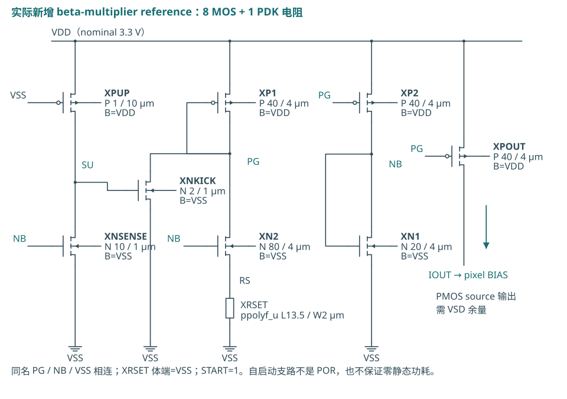

<p class="caption">图2　按本次参考源网表绘制的原理图，器件 D/G/S/B 与网表核对。新模块为 pre-layout；电阻值及模型覆盖范围见下文。此图不表示已经制造的片上精密参考。</p>

<div class="eq">忽略体效应及有限ro：I ≈ 2(1−1/√K)²/(β1R²)，K=4<br>β1=μnCox(W/L)1；R与μn变化会改变绝对电流。</div>

电阻W=2 µm、L=13.5 µm仅在TT/27°C/3.3 V、输出负载1.4 V处校准。N2源极升高产生体效应，两个PMOS漏压也不同，故公式用于理解依赖关系，实际电流由完整模型求解。

**误差必须分开。** 源产生多少电流，与像素复制该电流的比值，是两个不同问题：`ILED/100 µA = (IREF/100 µA) × (ILED/IREF)`。只有把两项分别测量，才知道应该调参考源还是调输出级。

**电阻与启动也是器件。** 理想电阻没有制造误差、温度系数和布局寄生；实物需要精密外置电阻或完整 PDK 电阻模型与 trim。参考电路若存在零电流解，正常 OP 收敛到非零点不能替代冷启动验证。

<!-- PAGE -->

## 4　参考源 DC：校准一个点，不等于所有条件通过

| 候选A验证 | 新仿真结果 | 判断 |
| --- | --- | --- |
| 独立名义参考，输出1.4 V | 100.051603 µA | 一个校准点通过 |
| 135个离散组合 | 53.667～233.996 µA | 126/135超±5% |
| 实际模拟RC耦合，TT全开 | 100.773754 µA | 仅该点绝对电流通过 |

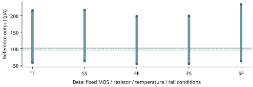

<p class="caption">图3　新仿真数据重绘。每个点的 MOS corner、温度、电源、RSET 与负载见原始表；参考电流和 LED 电流分别报告。±5%为原目标，不因新候选而放宽。</p>

**为什么需要比较耦合结果？** 即使参考支路的 DC 校准正确，接入 MREF 后的输出余量、像素栅极充电和开关耦合也可能改变结果。新参考源不能只接理想电阻验收，必须接入现有像素及已声明的 selected PEX 范围。

**判断：启动能力与电流精度分开。** 5个MOS corner×3个独立电阻corner×3温度×3逻辑电源构成135点；它是离散条件网格，不是制造概率。多数点失败，不能把这只未修调beta源选作当前精密100 µA主方案。保留它作为“由器件产生参考”及启动对照，再研究外部精密设定与反馈。

<!-- PAGE -->

## 5　外部 VSET＋实际反馈电路：精度依赖放在哪里

**候选B：外部设定电压＋实际MOS反馈。** 10只GF180 MOS中，PMOS输入对比较VSET与VSENSE，NMOS镜像负载与共源第二级驱动CTRL；PREG经RSET建立检测电流，匹配长沟道POUT向像素BIAS供电。另有真实二极管PMOS／RBIAS生成放大器偏置，CCOMP=3 pF作名义Miller补偿。若VSET高于VSENSE，CTRL下降、PMOS供电增加，反馈使VSENSE上升。

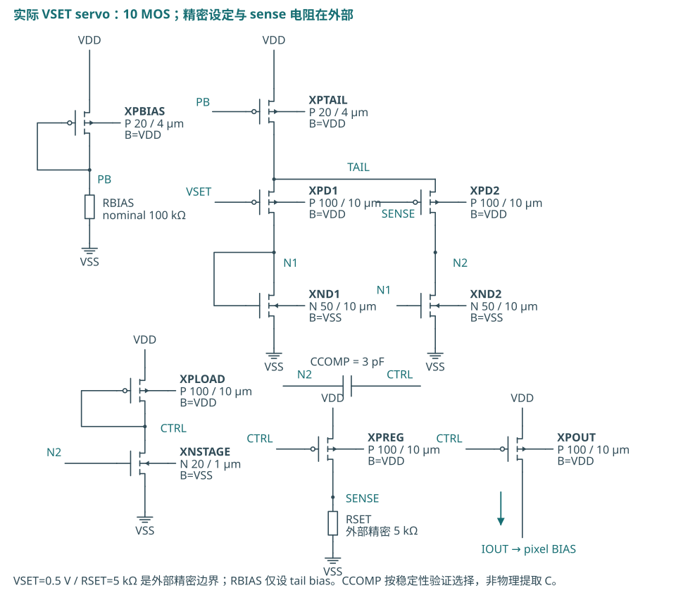

<p class="caption">图4　第二参考候选的实际晶体管电路。误差放大器与PMOS镜像采用GF180 MOS；CCOMP是理想3 pF补偿元件，RBIAS是理想100 kΩ。VSET及精密RSET仍是外部边界，未实现片上bandgap。</p>

<div class="eq">闭环稳态：VSENSE ≈ VSET　→　ISET ≈ VSET/RSET<br>VSET=0.5 V，RSET=5 kΩ　→　ISET≈100 µA</div>

外部VSET与RSET各±0.1%是研究预算。它们尚未选定实物器件，不是供应商保证值。放大器失调、有限增益、镜像比误差、温漂、输出余量及环路稳定性仍由实际电路验证；不能把0.1%直接宣称为总电流精度。

<!-- PAGE -->

## 6　反馈候选的结果：稳态精度与动态稳定分开验收

| 候选B验证 | 结果 | 原±5%目标 |
| --- | --- | --- |
| 独立名义参考／负载1.4 V | 99.251797 µA；VSENSE=0.499328 V | 通过 |
| 180点，含外部设定误差 | 98.942～99.520 µA | 0点超限 |
| 模拟RC耦合TT全开LED | 99.967300 µA | 通过 |
| 已测耦合开启条件 | 98.883～101.003 µA | 分别记录包络与外部边界 |

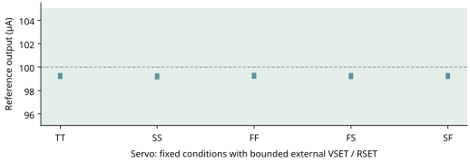

<p class="caption">图5　第二候选的新DC数据。外部基准和电阻预算、corner、温度、电源及输出负载分别记录；所测离散点不能升级为连续全域保证。</p>

**精度来自哪一部分？** 名义VSENSE/RSET约99.866 µA，而POUT约99.252 µA；前者有有限环路增益误差，后者还因PMOS输出与PREG漏压不同出现镜像比误差。接入像素后，NMOS镜像比又改变ILED，名义值接近100 µA不能被解释为误差消失。180点是5MOS角×3温度×3电源×4组VSET/RSET误差符号；未包含随机失配、噪声、实物漂移或全芯片网络。名义reference供电334.4 µA，约1.104 mW，包含内部偏置及参考负载供能，尚非全芯片功耗。

**验证不能只看DC。** 新闭环候选还需检查零初态／高初态、VSET阶跃的过冲与持续振荡、输出端负载变化及与PWM接入后的bias扰动。瞬态未见振荡不是完整AC环路phase margin证据；pad/package及新布局后仍要复验。

<!-- PAGE -->

## 7　参考源启动：从零电流状态走到工作点

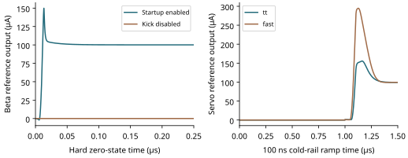

<p class="caption">图6　左：beta在已建立供电下的硬零初态／禁用kick对照；右：servo的100 ns VDD/VSET同步冷ramp。两类初态与供电条件分别记录，不把硬UIC等同自然上电。</p>

**候选A零态对照：** 启动开启后，TT最终约100.081 µA，进入最终值±1%约51.1 ns；禁用kick最终仅约5.41 pA，仍停在零态。

**零结面积主候选B不是无过冲启动。** 已测9个冷ramp、6个硬初态和3个VSET阶跃均最终恢复；冷启动的参考输出峰值最高约294.8 µA；硬初态峰值最高约1.729 mA，VSENSE最低-0.703 V。这些是参考端／MREF负载的电流，不能冒称LED峰值。需外部fault默认保持到偏置稳定；实际POR与brownout尚未实现。

**既有理想源的反例。** 旧 LED-first 上电实验中，BIAS 曾高出未建立的 logic rail 1.372421 V；理想源部分时间主动提供能量。新电路的目标是让输出受实际供电及晶体管状态约束，并记录 startup、端电压和源功率，而非只看到最终100 µA。

**没有自动升级的项目：** startup 数值通过只覆盖所测 ramp、初态及模型。POR、brownout、外部 fault 检测器、掉电时的反灌电流、工艺电阻与真实供电网络仍要分别验证。

**结几何敏感性：** 主servo的MOS默认AD/AS=0，不能据它认证body注入。另加每侧0.44 µm扩散假设，DC几乎不变；TT冷启动参考峰由155.565升至160.304 µA，最差最低码误差约−0.658%。硬低初态PLOAD模型ibd峰由gmin残余0.483 pA变为3.432 nA。它仍不是实际提取几何、实测注入或SOA签核。[A/B数据](../../../evidence/reference/junction-sensitivity.json)

<!-- PAGE -->

## 8　独立保护：正常 PWM 与故障关断走不同路径

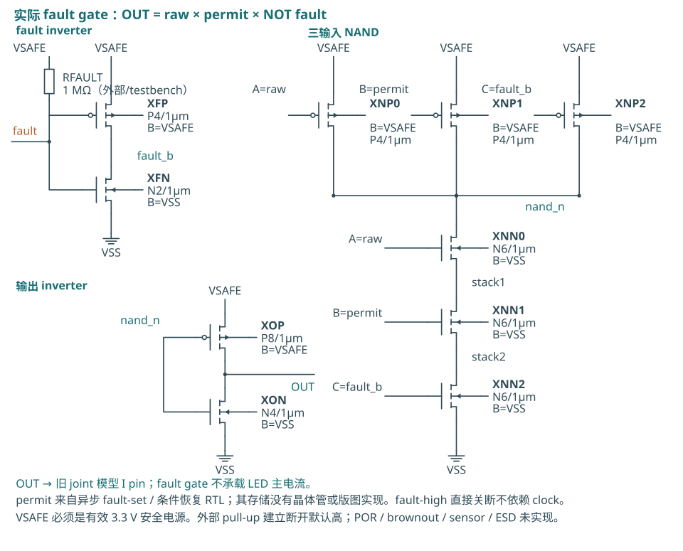

<p class="caption">图7　新逻辑和晶体管接口。正常亮度继续按 frame 更新；FAULT 高直接阻断像素 PWM。锁存／恢复的 RTL 证据与新增组合门的晶体管证据分开。</p>

**新实现分两层。** RTL使用异步fault置位的inhibit记忆，只有fault低、显式recover_request和raw PWM低时才在时钟边沿恢复。晶体管层新增10MOS组合门，实现`protected = raw_PWM ∧ permit ∧ ¬fault`，接入原12MOS selected signal PEX。另加2MOS LED端钳位；恢复存储目前只有RTL证据，未做其晶体管与物理实现。

**为什么不能使用原 enable？** 原 enable 于20 µs变低，PWM到258.5 µs才变低，等待238.5 µs。这是正常帧合同，不是故障保护。若时钟停在PWM高态，依赖后续时钟的控制路径可能持续点亮。

**保护不只看逻辑电平。** 需要测量 fault 输入 → 保护输出 → 像素 VG → LED 电流进入并持续保持规定阈值。电压变低、电流下降到50%、安全小电流及光学熄灭，是不同观测。

**先验门槛：** 从RTL fault事件、即PWL开始上升的t0计；完整边沿10 ns，50%在t0+5 ns，仅作分账。t0后1 µs内进入1 nA以下，t0+1～2 µs保持；[t0,t0+1 µs]正向尾电荷≤10 pC。钳位新增负向尾电荷20 pC、负峰10 mA及reverse0.5 V教学预算。这些不是真实LED或人身安全认证。FAULT必须在有效供电下有确定电平；1 MΩ外部pull-up研究断线默认关断。

<!-- PAGE -->

## 9　为什么还需要 LED 端钳位


<p class="caption">图8　新增2MOS＋100 kΩ电阻的pre-layout候选。PMOS跨接LED两端，NMOS在fault高时拉低它的gate；正常时电阻把gate拉到LED阳极，使PMOS关闭。体端分别接相应rail。</p>

**gate-only失败定位：** 保护门和MOUT栅极已很快变低，但LED阴极从约2.2 V缓慢浮升；合成LED与selected PEX节点电容产生尾流。仅关栅极时，稳定进入|ILED|≤1 nA约需2.638 µs，超过原1 µs门槛，不能用50%电流阈值证明通过。

上述历史gate-only用1 ns边沿，不与新10 ns结果直接排名。追加固定10 ns、保留全部器件负载、只禁用钳位动作的A/B：禁用约2.762 µs，启用约203.819 ns；10→2 ns步长下结论一致。[匹配条件对照](../../../evidence/safety-clamp-ab/summary.json)

<div class="eq">ILED,branch = Idiode,conduction + dQLED/dt<br>fault高：先阻断MOUT gate；同时钳位使LED两端电压接近0。</div>

**付出的代价：** PMOS增加LED阴极寄生；故障期间电阻有持续电流，5 V/100 kΩ≈50 µA。NMOS的漏极可升到LED rail，必须用适合该端压的器件，不能把3.3 V反相信号直接驱到高侧PMOS并假设正常时关闭。

**新增边界：** 钳位会产生电容放电的负向支路电流；它不自动等于LED反向导电。需要同时看VF、diode conduction、cap current、输出管及rail/clamp电流。下一页分别报告原故障合同与更强的全启动守卫。

<!-- PAGE -->

## 10　保护验证：延迟、尾电荷和恢复都要检查

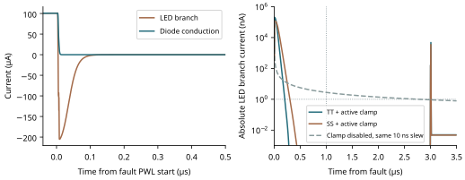

<p class="caption">图9　新 fault 波形。局部放大用于看电流阈值与尾巴；全窗用于检查 fault 保持及恢复。纵轴与归一化方式不能混用。</p>

| 场景 | 进入并保持1 nA阈值 | 判断 |
| --- | --- | --- |
| core TT／停钟，fault直接路径 | 203.82 ns | 原1 µs门槛通过 |
| core已测相位／TT、SS85、FF0 | 最长302.22 ns | 各声明场景通过 |
| 实际servo＋停钟＋钳位 | 204.10 ns | 原故障门槛通过 |
| 停钟，移除保护负对照 | 仍约100.75 µA | 预期失效被检测 |

**TT停钟尾电荷：** Q+=0.413 pC，Q−=-7.331 pC；电容分量signed约-7.551 pC，导电分量约0.634 pC。负支路电荷主要为电容处置；clamp rail约56.516 pC含电阻持续耗流，不能用signed LED电荷代表整个保护负担。

<div class="eq">Qtail,+ = ∫ max(ILED,0) dt　；　Qtail,− = ∫ min(ILED,0) dt</div>

**为什么不能只积分 signed Q？** 正向尾电荷和反向电荷可能互相抵消，掩盖仍有电流或反向应力。独立报告正、负电荷、峰值与端电压；电气小电流门槛也不等于已测得光学熄灭。

**附加全启动守卫仍失败。** 只让reference rail冷启动、逻辑和LED rail已有效、fault保持时，整个启动窗branch峰约5.791 nA；diode导电峰约3.24×10⁻¹⁷ A，电容为主。这个额外“全窗≤1 nA”守卫未通过，极小尾电荷步长变化也未闭环。Core22个transient／141项检查通过；servo联合suite整体passed=false，原正常／fault合同通过，附加startup两项仍失败。启动只有reference rail ramp100 ns，VSET固定0.5 V、logic3.3 V／LED5 V已有效，外部fault保持20 µs。

正常PWM逻辑回归保持原合同；本次servo同fixture最低码面积约-0.032016%。两帧514.5～1026.5 µs，以同fixture DC100.026013 µA×duty/256归一；使用10 ns输入刺激，不能同旧0.700133%或参考源独立回归直接排名。

<!-- PAGE -->

## 11　0.1～7 mA：先确定幅度，再安排点亮时间

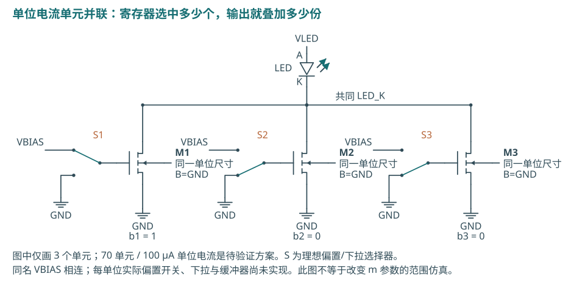

<p class="caption">图10　电流幅度控制的候选结构，未完成实际 decoder／开关阵列版图。图中的单位电流、开关与 bias 分配是功能分工，不能把网表几何参数当成已实现寄存器。</p>

**方案A：单位电流单元相加。** 若 IUNIT=0.1 mA，选择N=1…70个单元，`ION ≈ N×0.1 mA`。需要7-bit码表达0…70；其余码需明确定义 clamp 或 invalid。thermometer码改善相邻跳码，但70个单元有面积与匹配成本；binary/segmented方案减少部分逻辑，另有权重失配和动态跳变。

**方案B：闭环检测电阻。** 误差放大器比较 VSENSE 与 VSET，调节输出MOS；稳态 `ILED ≈ VSET/RSENSE`。例如RSENSE=100 Ω时，0.1～7 mA对应10 mV～0.7 V，最高电阻损耗4.9 mW。1 mV输入失调在最低码对应10 µA、即10%误差；因此可能需要增益分档、较小失调或校准，同时预算0.7 V余量及环路稳定性。

**PWM另管平均值。** 理想矩形电流时 `IAVG ≈ ION×duty/256`。改变幅度与改变占空比可能产生不同的LED效率、颜色和动态，不能默认光输出相等。[进一步推导](architecture-notes.md)

<!-- PAGE -->

## 12　新范围实验：7 mA 的供电余量与最低码都出现限制

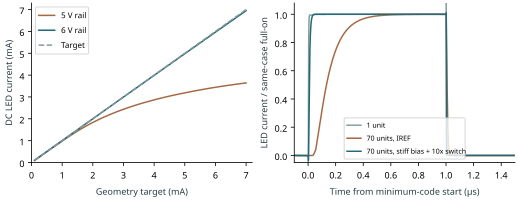

<p class="caption">图11　新 schematic-only 几何增益实验，TT/27°C、logic3.3 V、IREF100 µA。实测静态负载仅用于DC；合成动态负载用于PWM，两者不能拼成同一器件的动态模型。</p>

| 7 mA目标，理想IREF隔离输出问题 | 实际电流 | 相对目标 |
| --- | --- | --- |
| 公开静态LED／5 V | 3.642600 mA | -47.963% |
| 公开静态LED／6 V研究点 | 6.949303 mA | -0.724% |
| 合成LED／5 V | 7.011051 mA | +0.158% |

**计算依据：** 实测静态表独立插值，VF(7 mA)=5.135606 V；5 V−VF=−0.135606 V，尚未给输出MOS和互连留下电压。对20×20 µm的完整mesa面积估算，7 mA对应1750 A/cm²；这是面积计算，不能据此认证器件安全、电光效率或允许连续电流。

**尺寸带来的动态成本：** 一个20/4 µm单位的栅几何面积80 µm²；70个是5600 µm²。用典型Cox=2.3 fF/µm²计算得到12.88 pF的面积尺度，非完整偏置相关Cgg。增加W后仍必须模拟charge、前置驱动和bias扰动。[PDK Cox](https://gf180mcu-pdk.readthedocs.io/en/latest/analog/spice/elec_specs/elec_specs_5_3.html)

**机制对照：** 最低码误差从原结构-15.160%，仅增大pass/clamp到10倍为-10.415%；仅改为理想低阻电压bias为-8.276%，两者同时改变为-0.798%。这支持bias供给与开关充电共同限制短脉冲。理想电压源只是定位机制，不是已完成bias buffer；6 V DC点也不是可靠性或允许LED电流认证。Q按514.5～1026.5 µs两完整帧signed电支路积分，用同条件全开×duty/256归一，不代表光功率。最终证据含143个电路DC、16个PWM和4个独立LED校准。

<!-- PAGE -->

## 13　阵列均匀性：共享 reference 只能解决一部分误差

<div class="eq">Ij ≈ IREF · kj · (1+εlocal,j) · (1+εcompliance,j)<br>Qj = ∫ Ij(t) dt　；　Popt,j 还取决于 LED 的效率与温度</div>

| 误差来源 | 应做的设计 | 需要的验证 |
| --- | --- | --- |
| 全局reference误差 | 低漂移源、明确trim与校准 | 所有通道共同变化；各rail、温度与启动 |
| 局部MOS随机失配 | 单位单元、足够面积、匹配布局 | 正确启用PDK mismatch、样本分布与条件 |
| 系统性梯度／环境 | 对称、相同方向／邻近环境，评估common-centroid和dummy | 实际layout与梯度／工艺规则；MC不能代替 |
| 通道电压不同 | 保留compliance、控制IR drop和回流 | 各位置VF、局部rail、同时切换、温度 |
| PWM／buffer不同 | 相同时间合同、负载预算与必要校准 | 每通道Q、边沿、skew、最低码 |
| LED光效不同 | 单独光学校准与温度管理 | 同电流光输出、均匀性与测量不确定度 |

**已有依据：** 既有实际20/4模拟RC实验的nominal local-only n=256，ILED均值100.71316 µA、样本σ0.38428 µA；高边界条件下观察0/256超±5%。这是单像素模型抽样，不是16像素同芯片分布，也不证明零风险或制造良率。[既有匹配实验](../reference-and-matching.md)

**进入阵列时才冻结新指标。** 分别定义绝对误差、通道间spread、最低码Q差和光学差。共享reference导致误差相关，计算阵列spread时不能把全局误差当16个独立随机项。电流一致不能保证光输出一致。

**不能简单复制参考支路。** 若一个100 µA源同时接16个并联MREF，电流会在参考管间分配。可共享一个MREF产生的VBIAS并驱动各输出gate，或提供独立镜像参考支路；两者都要重新设计bias分配和瞬态充电，不能只把原六MOS复制16份。

<!-- PAGE -->

## 14　PWM 与数字／模拟／输出缓冲器的分工

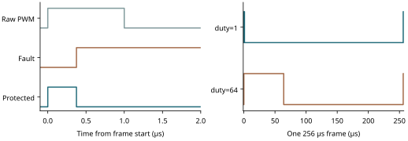

<p class="caption">图12　真实RTL事件重绘。左：最低码脉冲被独立fault有意中断；右：一个256 µs frame内duty1与64的开启时长。RTL为零延时逻辑，模拟回放另使用10 ns边沿。<a href="figures/architecture-control-layers.svg">接口分工图</a></p>

**数字部分：** 接收和检查命令、保存幅度／duty码、frame boundary原子更新、计数比较并注册PWM。当前receiver仍是Python；硬件接口、clock-domain crossing、watchdog与多像素存储尚未实现。保护路径另有优先级与恢复合同。

**模拟部分：** 参考电流、幅度DAC或电流镜、LED输出级、bias分配、关断放电，必要时电平转换及检测。LED电源与逻辑电源不同，所有MOS要逐管核查VGS/VGD/VDS、体结和上电顺序。

**输出缓冲器：** 从数字逻辑驱动MOS栅极的电荷。现有buf_2是标准单元两级非反相结构，共六MOS，不是电流DAC；其大小需按实际输入电容、slew、传播时间和供电预算选择。`Igate ≈ ΔQg/Δt`仅是平均充电预算，不能代替动态仿真和短路电流检查。

**正常时序保持：** 1 MHz时钟→1 µs slot→256 µs frame→3906.25 Hz。duty0全关、256全开，超过256 clamp；duty/enable仅在frame boundary更新。故障中断允许缩短当前脉冲，不能对该中断套用正常最短脉冲宽度要求。

**参考源接入的真实RTL回归：** 候选B在TT、SS85°C与FF0°C的最低码电荷最大绝对误差分别0.2529%、0.6548%、0.1966%，按同条件全开DC归一化，均低于2%。本组为servo＋既有模拟RC像素、1 ns PWM边沿，不含保护gate/clamp或旧12MOS joint切口；不能与保护联测的−0.032016%直接比较。10→2 ns是最大求解步长对照。

<!-- PAGE -->

## 15　高速 OOK：数据先变成开关状态，再变成光

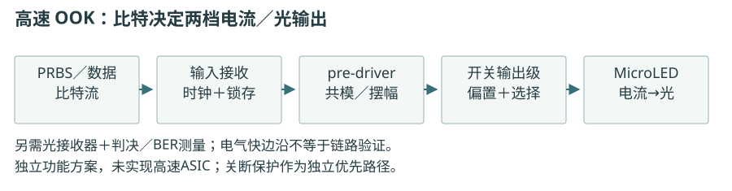

<p class="caption">图13　独立高速研究方案。输入／时钟、数据锁存、pre-driver、电流开关、LED及光接收链分层。尚未实现高速ASIC；图中DATA/DATA_B不是规定的0/3.3V栅极规格。</p>

**数据进入：** 测试可从PRBS开始，系统则由编码／串行化输出比特。输入receiver与时钟先将数据锁存成稳定的逻辑状态，再经pre-driver产生适合开关的共模、摆幅与互补时序。

**数据控制电流：** 两档OOK可用直接开关，也可用电流舵。电流舵让持续偏置的MI提供尾电流；DATA选LED支路，DATA_B选替代支路。尾源不必每个bit从零重建，但输出节点仍有电荷，替代支路仍耗电。

**电流产生光：** LED的结电容、载流子动态和偏置影响响应；输出管快速不等于光输出快速。接收器、光学功率、带宽及噪声共同决定BER。因此电气边沿、光学带宽和比特率要分别报告。

以100 Mbit/s OOK为例，每bit10 ns；若教学预算只给电流建立2 ns，就要按规定残差测settling、ISI与jitter。2 ns是规格示例，不是现有项目能力。现有1 µs PWM最小脉冲与高速bit窗口属于不同任务。

<!-- PAGE -->

## 16　高速电流舵：保持偏置，切换支路


<p class="caption">图14　独立电流舵教学图；RDUMMY为示意负载。DATA=1走LED，DATA=0走MD。</p>

**模拟级：** MI产生电流，ML/MD选择方向。可选cascode增加输出电阻，也增加余量、偏置和电容；不能直接断言更快。

**前置驱动：** 开关的VG与共同源节点VX共同决定VGS；互补信号过早、过晚或幅度不合适，会造成暂时两支路关闭／重叠及尾节点扰动。需要按实际共模、负载和corner核查skew、settling和功率，不能把普通PWM反相器直接视为完成的高速差分驱动器。

**输出与布局：** 先预算VF＋开关压降＋尾源compliance＋互连压降。短的输出连接、低寄生回流和对称pre-driver减少动态扰动，但仍需实际PEX、pad/package及电源模型。尾电流近似恒定，也不意味着每条供电rail的电流恒定。

公开CMOS DLC实现365 Mbit/s（200 MHz、16-QAM OFDM、5 cm、BER门槛10⁻³），未给工艺节点。[论文Fig.2／§IV-B](https://strathprints.strath.ac.uk/59246/1/Jalajakumari_etal_PTL_2017_High_speed_integrated_digital_to_light_converter_for_short_range_visible_light_communication.pdf)

<!-- PAGE -->

## 17　多级通信：数字样本 → 电流 DAC → LED

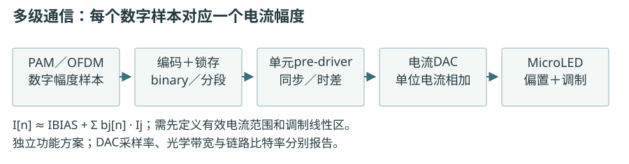

<p class="caption">图15　多级通信研究方案。PAM样本或OFDM波形经数字编码、电流DAC和输出级产生幅度；不通过低频PWM去近似每个高速样本。</p>

**数字级：** 根据链路选择OOK/PAM/OFDM，生成样本、编码和锁存时钟。DAC可将binary输入变为thermometer或segmented码，平衡布局、权重匹配和码切换glitch；接口吞吐与采样率单列。

**模拟级：** 多个单位电流源相加，通过差分开关控制LED电流。需要验证DC级间距、INL/DNL与噪声，也要在sample窗口验证settling、动态失真和供电耦合。通信方案还需要LED偏置、可用线性区及接收端的链路预算。

**公开实证：** AMS0.18 µm CMOS、每片四路8-bit current-steering DAC，实际两芯片四路实验在1 m、4-PAM、约45 mA/LED、BER门槛3.8×10⁻³下，四路总raw为1.23～1.30 Gbit/s。同文7.48 Gbit/s来自另一个九路AWG实验，不能归到该ASIC或单通道。[Rajbhandari 2017，§II-A、§IV-C/D](https://pure.coventry.ac.uk/ws/files/7726769/gigabitcomb.pdf)

它证明成熟硅CMOS可实现特定高速系统，并不保证GF180自动达到同样结果。当前材料是硅MOS；LED的GaN/InGaN与driver材料分开。BCD用于集成功率／高压功能，SiGe BiCMOS是高速备选，均由目标电流、余量、速度和可用PDK决定。

<!-- PAGE -->

## 18　这次结果怎样改变下一步方向

1. **参考源主线采用外部VSET＋精密RSET的反馈候选继续研究。** beta保留作失败／启动对照。反馈候选已有离散条件下的精度证据，外部基准、失配、补偿与实物还需核查。
2. **正常PWM与保护分开。** 保护保留直接fault优先、显式恢复及LED端节点处置；启动必须保持fault，不能只等待frame。
3. **7 mA另立输出级规格。** 先确定目标LED与rail、MOS余量、单位电流分辨率，再实现bias驱动和开关；理想低阻bias对照不能当已完成7 mA平台。
4. **高速作为独立单通道研究。** 先定符号率／电流／负载及误码目标，比较direct OOK与current steering；多级DAC在两档链路证据后推进。
5. **完成新单像素模块的layout与真实PG、LED测量后，再决定物理4×4。** 保留可复现的源、失败和门槛。

| 下一实验 | 固定什么 | 什么结果会改变设计 |
| --- | --- | --- |
| reference accuracy／trim | 实际source拓扑、100 µA负载、corner/T/rail | 源误差还是镜像比先耗尽预算 |
| fault／恢复边界 | normal PWM合同、阈值、所选LED模型 | 时钟停止、偏置未建立、掉电时能否保持安全 |
| 0.1～7 mA实现路线 | 目标LED、VF、允许电流、最短pulse | 电流DAC、bias buffer或sense反馈的实际代价 |
| 真实PG与LED动态 | 已冻结reference/fault、模型域 | droop、Q、端压或光学响应超预设门槛 |
| 阵列／高速进入 | 单像素条件闭环；明确实验问题 | 通道spread、同时切换或通信BER是否支持投入 |

**仍待确认：** 本次新增模块没有重新做layout／DRC／LVS／PEX；旧selected signal PEX仍理想化PG/body及邻居。没有完整芯片ESD、package、IR/EM、foundry signoff、silicon或光学实验。参考电阻、故障检测源、LED温度／允许工作区与模型失配人口都有独立边界。

**项目价值：** 提供从假设、器件、电路、RTL、寄生到失败定位的可复现教学路径。当前方向由能分辨原因的实验决定，商业性能与市场份额不在本次证据范围内。

<!-- PAGE -->

## 19　复现、原始数据与参考文献

```sh
uv run python scripts/current_range/run.py
uv run python scripts/current_range/validate.py
uv run python scripts/safety/run.py
```

参考源与报告的精确命令见[复现说明](README.md)。所有工具输出在独立build目录，紧凑证据和输入hash保存在evidence；重跑不会把失败改成通过。

| 证据 | 内容与边界 |
| --- | --- |
| [新参考源](../../../evidence/reference/summary.json) | 新晶体管source、校准、条件变化、startup、耦合；scope逐项列出 |
| [新保护关断](../../../evidence/safety/summary.json) | RTL与模拟路径、阈值、尾电荷、恢复及负对照 |
| [servo保护联测](../../../evidence/safety/servo-summary.json) | 原故障合同通过；附加全启动守卫及微小电荷收敛未通过 |
| [新电流范围](../../../evidence/current-range/summary.json) | 几何增益DC／PWM、失败与机制对照；非已实现DAC |
| [本报告证据清单](evidence-ledger.json) | 既有／新增分类、输入与输出hash、独立计算 |
| [详细架构教学](architecture-notes.md) | 电流控制、均匀性、时序、高速数据流及选型推导 |

**直接依据：**

- GF180官方：[Poly尺寸](https://gf180mcu-pdk.readthedocs.io/en/latest/physical_verification/design_manual/drm_07_08.html)、[Cox](https://gf180mcu-pdk.readthedocs.io/en/latest/analog/spice/elec_specs/elec_specs_5_3.html)、[匹配指导§10.6](https://gf180mcu-pdk.readthedocs.io/en/latest/physical_verification/design_manual/drm_10_6.html)、[可靠性§14.1](https://gf180mcu-pdk.readthedocs.io/en/latest/physical_verification/design_manual/drm_14_1.html)。网页用于解释；实际模型由本地lock和hash定位。
- Lin等，2026：[公开LED静态数据](https://zenodo.org/records/20034288)，I-V.xlsx/Sheet1/A3:B102，100点，温度未给；CSV单位已转A。
- Jalajakumari等，2017：[DLC作者稿](https://strathprints.strath.ac.uk/59246/1/Jalajakumari_etal_PTL_2017_High_speed_integrated_digital_to_light_converter_for_short_range_visible_light_communication.pdf)，DOI 10.1109/LPT.2016.2624281。
- Rajbhandari等，2017：[MIMO作者稿](https://pure.coventry.ac.uk/ws/files/7726769/gigabitcomb.pdf)，DOI 10.1109/JLT.2017.2694486。

本报告电路图为独立绘制；新波形、表及图来自本次仿真与计算。旧版报告保留为历史快照。模型统计、数值求解与资料研究都不能替代实物测量。[验收记录](validation.json)
