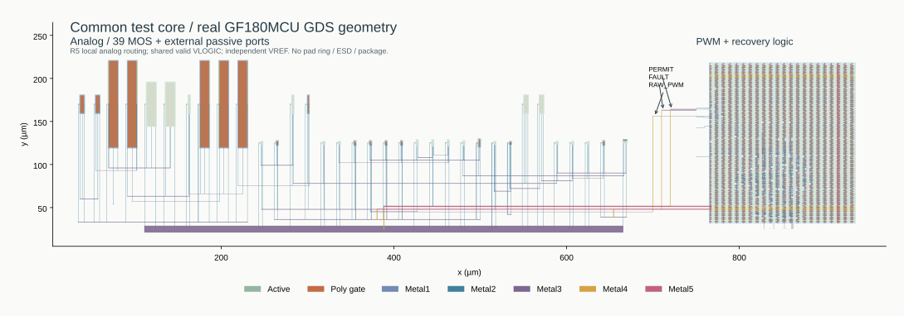

新参考/保护/像素宏与新数字宏已经接成真实共同顶层。RAW_PWM、PERMIT、FAULT及电源回流有实际金属连接；VREF独立供电。实际多边形包围盒跨度916×204 µm，约0.186864 mm²，尚无pad ring。

| 检查 | 结果 |
| --- | --- |
| Magic / 独立KLayout DRC | 均0错误；首轮Via2 cut 0.28 µm不合规，修成0.26 µm后重检 |
| 顶层LVS | 唯一匹配；真实断线及电源短路负控均被拒绝 |
| PEX提取覆盖 | 7277 MOS（含数字及官方fillcap）、36588 R、30230 C；Magic电阻网络展开6512/6512 |
| PEX拓扑审计 | 仅在审计副本中短接R/忽略C后，与独立设计网表LVS唯一匹配；实际RC文件保留全部寄生；该审计不验证R/C数值精度 |

初次提取只展开242/6512网络。后续在提取副本加入Magic支持的res:drive节点属性，坐标来自原始节点记录，才完整展开；未改变GDS或原始几何。补充审计验证只有这些属性被增加。**全共同顶层的7277管瞬态尚未完成回归；宏PEX+SDF回放结果不能自动覆盖它。**

官方LVS setup不比较AD/AS/PD/PS属性；PEX使用抽取结几何。网络覆盖不等同于三维场求解精度、RC工艺角或EM签核。
