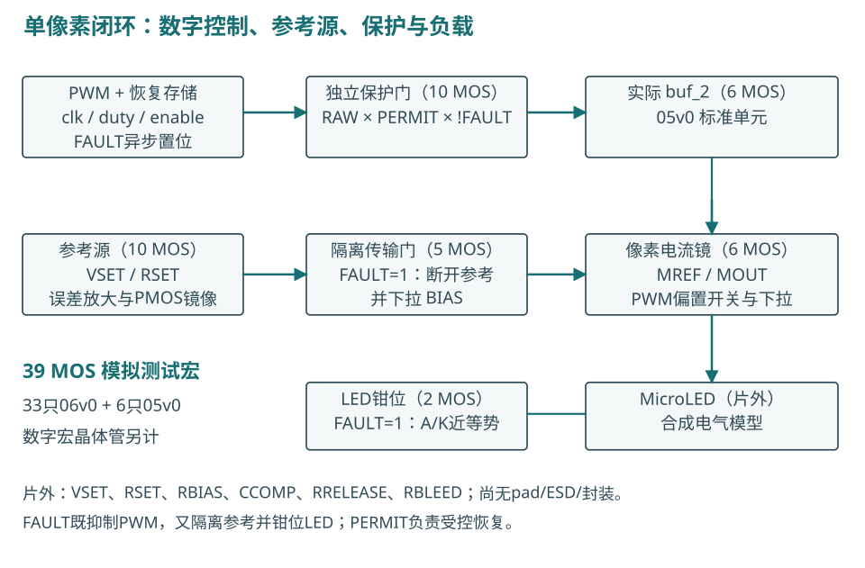
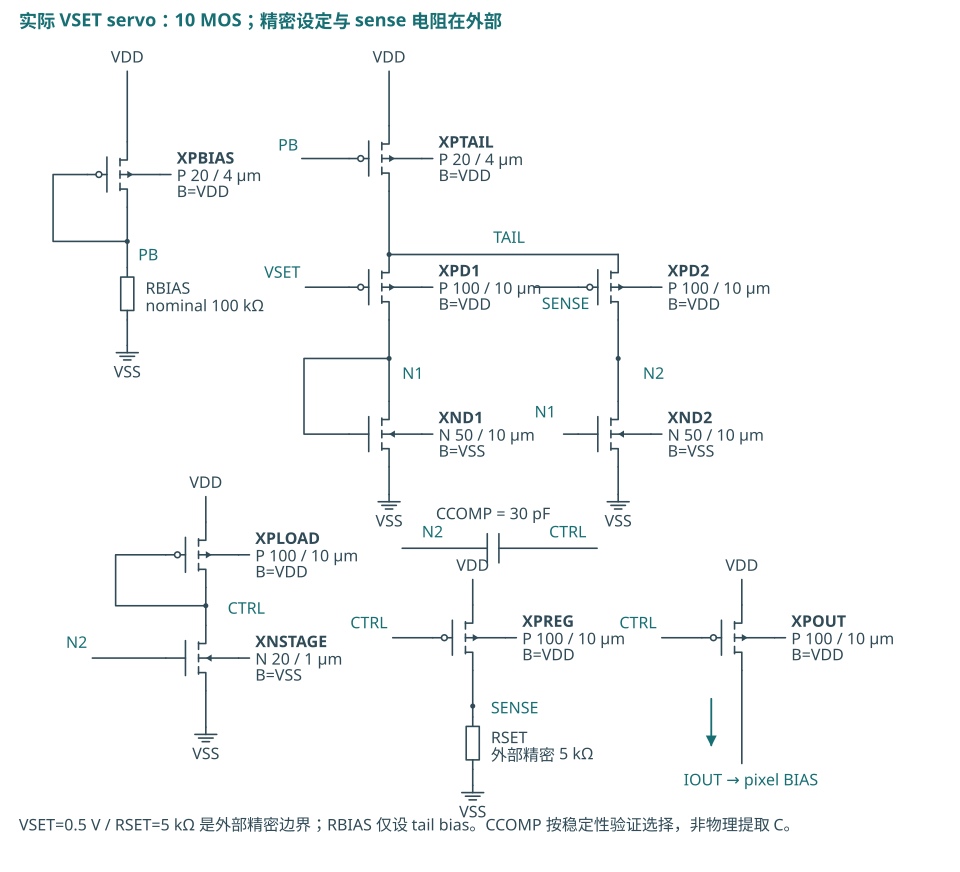
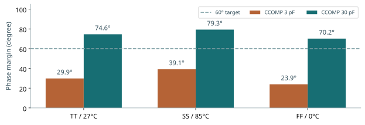
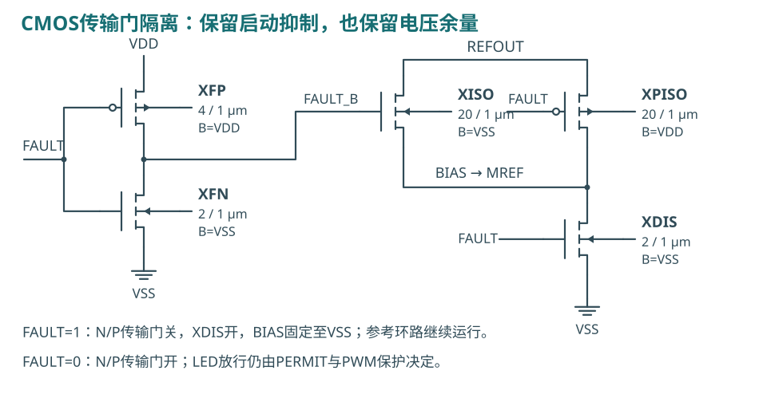
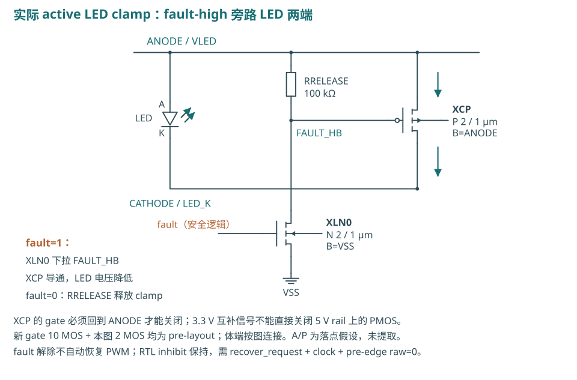
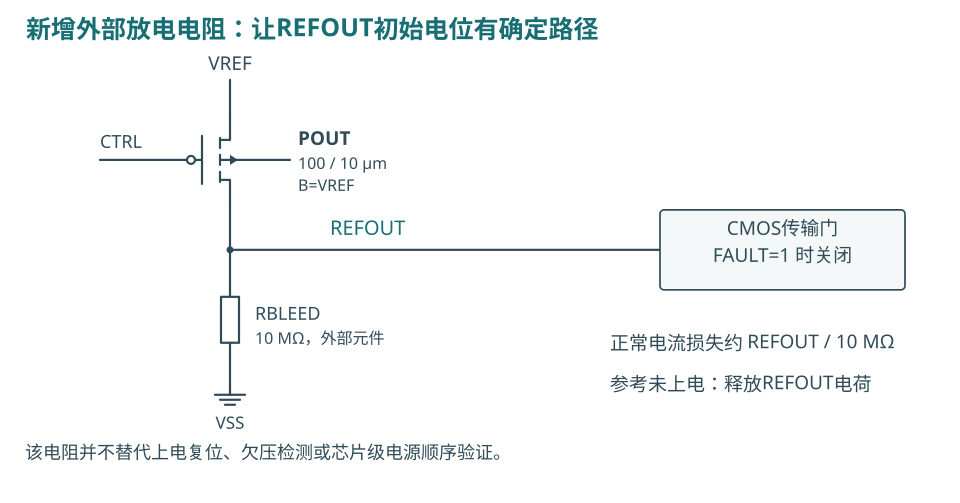
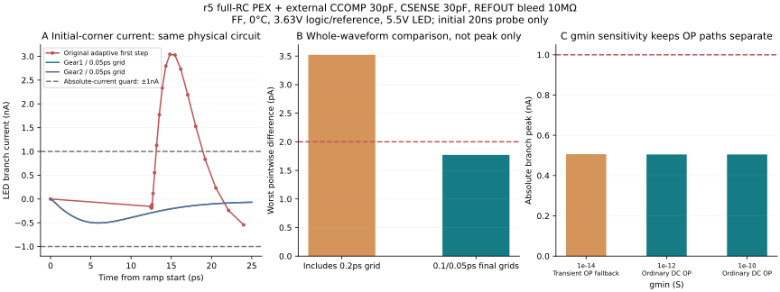
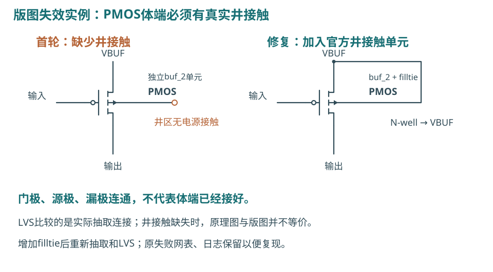

# 单像素启动、保护与版图验证

Open MicroLED Driver ASIC · 实验研究报告 · 2026-10-15

**研究问题：把原理图里的参考源和保护电路真正放进版图以后，启动、PWM 与故障关断是否仍满足约定？**

本轮从旧启动电荷收敛失败出发，新增参考环路稳定性试验、完整模拟宏版图、带保护恢复存储的数字宏，并对实际提取寄生重新仿真。下面按“问题 → 方法 → 数据 → 判断”的顺序阅读；每一项结论都对应独立证据文件。

@@RESULTS@@

本轮目标电流是 **100 µA 单像素**。所有 LED 动态数据来自合成电气模型，不能等同于实测光功率。本报告延续独立实验与教学定位。

已有总体框架见 [2026-10-14 产品开发框架报告](../product-framework-20261014/report.html)。本篇记录新实验和修改，不覆盖旧报告与失败证据。

<!-- PAGE -->
## 先看完整信号链

数字逻辑决定**何时允许发光**；参考电流源与电流镜决定**导通时的电流**。故障关断同时作用于 PWM、参考隔离和 LED 钳位，不能仅依靠每帧一次更新的 enable。

图中的 39 MOS 是本项目模拟测试宏的器件计数。它不是行业通用架构名称。新数字宏中的计数器、寄存器、恢复存储与缓冲器另外计算。

<!-- PAGE -->
## 参考源：从电压设定到 LED 电流

图中CCOMP已更新为30 pF，REFOUT的新增10 MΩ放电电阻在后页展开。原理图沿用十管伺服参考源；新版图的对应节点为 PB、N2、CTRL、SENSE、REFOUT。图中器件名字与新版图 XR_ 前缀一一对应，D/G/S/B 四端由网表和 LVS 核对。

**计算起点：** ISET≈VSET/RSET=0.5 V/5 kΩ=100 µA。误差放大器调整 CTRL，使 SENSE 靠近 VSET；PREG 建立取样电流，尺寸相同的 POUT 向 REFOUT 提供近似镜像电流。传输门放行后，MREF 把电流转换成 BIAS 电压，MOUT 再控制 LED 支路。

这不是精确恒等式。有限环路增益、镜像管漏源电压差、失配与供电余量都会产生误差。VSET、5 kΩ 精密 RSET、100 kΩ RBIAS、补偿电容和钳位释放电阻仍为**外部元件**，尚未包含 pad/ESD/封装模型。

<!-- PAGE -->
## 环路稳定性：外部线路电容改变了答案

问题是：RSET 引出芯片后，SENSE 上的附加电容会增加一个动态极点。原先的 3 pF 补偿在 30 pF SENSE 负载下，相位裕量明显不足，不能只凭 DC 电流准确就通过。

@@AC_TABLE@@

将外部 CCOMP 从 **3 pF 改为 30 pF** 后，所测三个工艺/温压包络恢复了裕量，代价是环路响应变慢。采用保持 DC 工作点的双注入法，闭环与两种注入连接的工作点一致性另有记录。这是小信号、局部环路验证，仍需启动、扰动、PWM 和故障大信号复验。

<!-- PAGE -->
## 保护电路：隔离参考，避免启动馈通

FAULT=1 时，N/P 传输门同时关闭，XDIS 将 BIAS 下拉，参考环路与像素偏置断开；FAULT=0 时，两种 MOS 共同传递偏置，减轻单个 NMOS 的阈值损失。

另一路十管逻辑保护门实现 SAFE_OUT=RAW_PWM×PERMIT×!FAULT，经真实 buf_2 驱动像素 PWM 开关。PERMIT 来自异步故障置位、受控恢复的数字存储。**FAULT 清除本身不恢复发光**，还需 recover_request、有效时钟以及低电平 RAW_PWM。

LED 钳位在 FAULT=1 时把 LED_K 拉向 LED_A，降低 LED 两端电压。该钳位是功能电路，不能作为 ESD 保护声明。有效 VSAFE/VBUF、预先拉高的外部 FAULT，以及已定义的电源顺序仍是试验前提。

<!-- PAGE -->
## 独立保护门：故障信号直接切断PWM

该10管电路先生成FAULT的反相，再用三输入NAND与输出反相器得到RAW_PWM×PERMIT×!FAULT。任意一个许可条件不满足，输出为低。图示电源名称对应新版图VSAFE，后接实际buf_2，再到像素开关。

RAW_PWM来自帧计数器；PERMIT来自可保持故障状态的恢复存储。FAULT的组合路径不等待帧边界或时钟，所以停钟时仍能切断PWM。数字延迟与LED实际电流下降时间是不同量，本报告分别测量。

<!-- PAGE -->
## LED钳位：释放电荷，但不能把正负电荷抵消

FAULT=1时，NMOS把FAULT_HB拉低，高侧PMOS导通，将LED_K拉向LED_A。LED两端电压接近零，原有结电荷通过钳位路径重新分配。FAULT=0时，RRELEASE把PMOS栅极拉回LED_A，钳位释放。

RRELEASE=100 kΩ、LED_A=5 V时，故障保持期间该电阻有约50 µA静态电流。因此“LED支路关断”不等于“整个芯片零功耗”。负向端口电流还需单独检查峰值、反向电压与电荷。

<!-- PAGE -->
## 参考未上电时，浮节点需要确定的放电路径

在安全电源已供电、VREF=0、FAULT=1 的初始工作点，REFOUT 由器件漏电和求解器 gmin 共同决定。原模型给出 REFOUT 比 POUT 体端高约 0.2167 V；改变 gmin 后，电位和 pA 级体电流也随之变化。这不能用来证明器件注入电流或可靠性合格。

@@BLEED@@

模拟测试宏仍为39只MOS。新增电阻是明确的外部试验元件，最终封装引出、板级漏电、容差及寄生尚待验证。电阻的 DC 作用已经进入网表，不能当成没有代价的理想钳位。

<!-- PAGE -->
## 旧“启动不收敛”：先区分数值问题

@@NUMERICAL_FIGURE@@

旧数据的正向电荷只有约 5×10⁻²¹ C，用它自身作相对误差分母，10 ns 与 2 ns 最大步长所得差异是 **4.909%**，超过旧 0.2% 标准。电流零交叉积分程序本来就是正确的；只收紧容差会导致部分求解失败，也不能保证答案更可信。

新方法保持电路、电源波形和 0–20 µs 窗口相同，在斜坡起止点附近插入**共线的 PWL 节点**，强制局部时间网格细化。它只改变数值取点，不改变电源斜率。再跨 Gear1/Gear2、容差及时间步长比较。

@@NUMERICAL@@

近零量新增绝对误差标准：ΔI≤2 pA，ΔQ≤4×10⁻¹⁷ C；电荷达到 20 fC 以上仍用 0.2% 相对标准。该边界来自 1 nA 关断预算的 0.2% 与 20 µs 窗口。**旧标准失败保留；新标准通过必须单独记录。**

<!-- PAGE -->
## 新PEX的最初几皮秒：验证网格，而不是删掉尖峰

r5在加入30 pF SENSE负载和10 MΩ放电电阻后，粗首步的FF试验仍出现3.043 nA尖峰，原样判为失败。保持相同电路、电源函数和工作点，局部细化后该正尖峰不再出现，但约−0.505 nA的真实电容脉冲仍保留。

0.1/0.05 ps两个细网格、Gear1/Gear2及容差对照共5组，10对比较最大电流差1.7709 pA；20 ns诊断窗的电荷差≤8.497×10⁻²³ C。该短窗诊断证明最初角点的数值一致性；完整启动与恢复仍由40 µs回归单独验收。

更紧联合容差挑战超时，低gmin组走了transient OP fallback，均独立保留。不能把这些组混入同一个初始工作点的“全部求解器设置均通过”结论。

<!-- PAGE -->
## 第一次版图错误：体端连接不能省略

第一次独立放入官方 buf_2 标准单元时，缺少井接触，导致 PMOS 体端悬空，LVS 未通过。加入官方 filltie 单元后重新生成版图、抽取和比较，才得到唯一匹配。

LVS 核对的不只是“输入接到输出”，还包括晶体管、尺寸、网络与体端。标准单元被移出原来的标准单元行时，必须重新处理供电、井接触与衬底接触。不能因为标准单元来自 PDK 就假定其孤立放置自动正确。

该失败日志保留在原始修订目录。通过后还需独立 DRC、GDS 回读和电气验证。

<!-- PAGE -->
## 第二次失败：DRC/LVS 通过，启动仍会超标

@@STARTUP_COMPARE_FIGURE@@

首版长并行导线布局 r4 的完整 PEX 含参考、保护、缓冲、像素及全部电源网络的 RC。100 ns 参考电源上升时，LED 总支路电流约 0.5 µA，超过 1 nA 门限；LED 模型导电分量仍只有 fA 量级。主要是结电容和互连耦合带来的位移电流。

图中r4/r5布线对照都采用CCOMP=30 pF、SENSE附加C=0、无放电电阻，隔离布局的影响。受控消融仅用于定位：去掉 REFOUT–LED_K 的 8.24068 fF 耦合后，TT 峰值由约 514 nA 降到约 110 nA；移除所有提取电容仍有约 43 nA，表明回流电阻与器件电容也有影响。**这些删寄生的模型不作为最终验收证据。**

修复方向是缩短网络、减少敏感节点间长平行走线、降低共享回流阻抗。单纯增大补偿电容无法消除该布局馈通。

<!-- PAGE -->
## 新版图：从可读布局走向电气可用布局

@@LAYOUT_FIGURE@@

@@LAYOUT_CHANGES@@

面积是实际 GDS 几何范围，不是最终产品 die area。测试宏仍未包括 pad ring、ESD、seal ring、封装焊盘与测试结构；目前布局也没有进行阵列面积优化。层图表达真实二维多边形，不能冒充三维电磁或工艺仿真。

<!-- PAGE -->
## 提取后验证：以电路行为验收版图

@@PEX_TABLE@@

@@PEX_FIGURE@@

验证条件：TT/27°C/3.3 V/LED 5 V；SS/85°C/2.97 V/LED 4.5 V；FF/0°C/3.63 V/LED 5.5 V。参考上电斜坡覆盖 100 ns、1 µs、10 µs，并检查 VSET 延迟到达。故障源在启动期间保持有效，LED 和安全电源预先有效。

此表与数字 STA 的温度/电压角不同：每项证据应按自己的测试条件阅读。外部 SENSE 电容、补偿值和寄生版本在证据中明确记录。

<!-- PAGE -->
## PWM 与故障：平均电流、尖峰和尾电荷分开看

@@FAULT_FIGURE@@

PWM 使用 1 MHz 时钟，每帧 256 个时隙，帧周期 256 µs。duty=1 的理想导通宽度为 1 µs，理想平均电流约 100 µA/256=0.390625 µA。实际验收积分整个帧中的 LED 支路电荷，并与同环境 DC 导通电流比较。

故障后用“持续低于 1 nA 的时刻”评估关闭时间，而不是第一次穿过阈值。正向尾电荷 Q+ 与负向钳位电荷 Q− 分开积分，不能互相抵消。门限为：1 µs 内关断、首个 1 µs 的 Q+≤10 pC、|Q−|≤20 pC。

@@COUPLED@@

<!-- PAGE -->
## 数字宏：恢复存储也进入物理实现

新顶层 pixel_control_v3 组合原 PWM RTL 和 pixel_safety 恢复控制，并保留 RAW_PWM、PERMIT、protected_monitor 三个输出。前两个进入模拟保护门；第三个只用于观测，未用它代替模拟保护路径。

@@DIGITAL@@

时序仿真使用实际布线后的 SDF。Icarus 不支持的部分 XOR 条件路径与时序检查已列入限制；静态 STA 另行检查寄存器路径、recovery/removal 和最小脉宽。不能把仿真通过解释成“任何异步输入都不会亚稳”。

本轮 SDC 把外部输入到达时间设为 200 ns，时钟周期 1000 ns，输出负载假设72.91 fF；共同顶层跨宏连线尚未回灌这组STA。FAULT 的任意相位释放、输入同步和板级时序约束仍需完善。没有自主上电复位或欠压检测器，外部 FAULT 启动有效是必要前提。

<!-- PAGE -->
## DRC、LVS、PEX：共同顶层与覆盖边界

@@JOINT@@

**DRC** 检查线宽、间距等几何规则；**LVS** 检查抽取电路与设计网表是否匹配；**PEX** 生成含寄生电阻、电容的电路。它们回答不同问题，不能互相替代。

工具与 PDK 都锁定在项目记录中：GF180MCU D 公共工艺、模拟 06v0 与标准单元 05v0 器件；Magic 8.3.684、Netgen 1.5.324、独立 Linux KLayout 0.30.7，数字实现采用固定 LibreLane 容器。完整电源网络包含在模拟宏提取中。

本轮的规则检查不代表晶圆厂签核。未完成制造方认可的完整 signoff deck、密度/填充/天线全覆盖、EM/IR、ESD/latch-up、封装/板级、可靠性与实物测量。

<!-- PAGE -->
## 下一步决策与复现入口

@@NEXT@@

后续顺序应保持：先完成单像素上电/电源顺序、pad/ESD 与板级寄生，再开展失配、温漂和真实 LED 模型标定；之后才扩展阵列及电流范围。0.1–7 mA、光通信高速调制和车规可靠性均不由本轮 100 µA 验证建立。

复现脚本：`scripts/startup_v3/`、`scripts/analog_v3/`、`scripts/layout_v3/`、`scripts/control_v3/`。完整原始波形、求解失败、网表和工具日志位于 `build/`；可追溯摘要与源文件哈希位于 `evidence/`。本报告的数值来自这些文件，未把文档检查数当成电路通过数。

公开基础资料：[GF180MCU PDK](https://github.com/google/gf180mcu-pdk)、[open_pdks](https://github.com/RTimothyEdwards/open_pdks)、[Magic](https://github.com/RTimothyEdwards/magic)、[Netgen](https://github.com/RTimothyEdwards/netgen)、[ngspice 手册入口](https://ngspice.sourceforge.io/docs.html)、[LibreLane](https://github.com/librelane/librelane)、[OpenSTA](https://github.com/The-OpenROAD-Project/OpenSTA)。具体模型和规则版本以本仓库 lock 文件与运行 manifest 为准。

研究负责人需要决定的是可验证的下一步，而不是仅看“已生成 GDS”。进入流片前还要确定制造渠道接受的 PDK/规则、顶层接口与封装、测试方法和交付清单，并完成对应签核。
