# PWM 栅极控制的 NMOS 电流镜：从连接到高速电流舵

“六 MOS”只是本项目采用六只晶体管的数量说明，不是行业统一的驱动架构名称。本文按功能称它为“带 PWM 栅极控制的 NMOS 电流镜驱动电路”。

**这六只 MOS 分担“建立参考电流、控制 LED 电流、切换输出栅极偏置、生成反相信号”四个任务。** LED 的主电流只经过 LED 与 MOUT；它不会依次流经全部六只晶体管。

本文从本仓库实际电路出发。标准原理图、器件表和 PWM 稳态图对应 [pixel_driver.spice](../../../analog/driver/pixel_driver.spice)。上升沿、下降沿图用于解释电荷变化，不是本轮新测得的瞬态波形。高速部分是独立的电流舵教学电路，说明另一种调制思路。

- [打开交互式教程：逐步查看器件、状态和电流路径](tutorial.html)
- [深入阅读：高速 Driver 的电流舵、Cascode、前置驱动与公开技术路线](high-speed-notes.md)
- [已有晶体管与布线研究报告](../driver-circuit-layout-20261012/report.md)
- [本教程原理图文件](figures/)

## 1. 先认识四个端子和四个网络

MOSFET 是金属氧化物半导体场效应晶体管。NMOS 与 PMOS 是两种互补的器件类型；这里的“六 MOS”是数量，不是工艺名称。

| 端子 | 英文 | 在本电路中怎样理解 |
|---|---|---|
| D，漏极 | Drain | 与源极共同构成沟道电流通路 |
| G，栅极 | Gate | 栅源电压 VGS 控制沟道；变化时需要充放栅极电容 |
| S，源极 | Source | 计算 VGS 的电压参考端，不一定等于全电路的地 |
| B，体端 | Bulk / Body | 必须有明确连接；本电路 NMOS 体端接 GND，PMOS 体端接 VLOGIC |

读图时先找到电源和网络名。同名网络表示电气相连，连接点标识导线相接；交叉而无连接点的导线不能据此认定相连。

- **VLOGIC**：反相器和外部参考支路的电源；下文典型条件为 3.3 V。
- **VLED**：LED 阳极侧电源；下文典型条件为 5 V。
- **VBIAS**：MREF 建立的参考栅极偏置。
- **VG**：MOUT 的栅极节点，由 MPASS 和 MCLAMP 控制。

**PWM 是输入控制信号，PWM_B 是反相器输出。VG 是模拟偏置节点，它在开启时约为 1.375 V，不是 3.3 V 的 PWM 电平。**

## 2. 六只 MOS 的完整连接

图中 M 标签是便于阅读的器件名；网表使用 X 标签调用 PDK 子电路。PDK 子电路引脚顺序为 D、G、S、B。

| 图中器件／网表实例 | 类型与 W/L | D 漏极 | G 栅极 | S 源极 | B 体端 | 作用 |
|---|---|---|---|---|---|---|
| MREF／XREF | NMOS，20/4 µm | VBIAS | VBIAS | GND | GND | 漏栅短接；由外部 IREF 建立参考偏置 |
| MOUT／XOUT | NMOS，20/4 µm | LED_K | VG | GND | GND | 输出电流管，吸收从 LED 流下来的电流 |
| MPASS／XPASS | NMOS，2/1 µm | VBIAS | PWM | VG | GND | 开启时连接 VBIAS 与 VG |
| MCLAMP／XCLAMP | NMOS，2/1 µm | VG | PWM_B | GND | GND | 关闭时把 VG 拉向 GND，并释放栅极电荷 |
| MN／XINV_N | NMOS，2/1 µm | PWM_B | PWM | GND | GND | 输入高时把 PWM_B 拉低 |
| MP／XINV_P | PMOS，4/1 µm | PWM_B | PWM | VLOGIC | VLOGIC | 输入低时把 PWM_B 拉高 |

六只器件使用公开 GF180MCU 模型中的 `nmos_6p0`／`pmos_6p0`，属于硅基 bulk CMOS 的 6 V 器件族。表中尺寸是沟道宽度／长度，不是工艺节点。

### 2.1 MREF 与 MOUT：参考与输出

MREF 的漏极和栅极短接。外部电流源把 IREF 注入 VBIAS；VBIAS 会达到一个使 MREF 能吸收该参考电流的电压。这个电压随后用于控制 MOUT。

MREF 和 MOUT 的尺寸相同。当两者栅源电压接近、输出有足够电压余量时，可以得到近似关系：

`ILED ≈ IREF × (W/L)OUT / (W/L)REF ≈ IREF`

这只是电流镜的工作关系。阈值电压差、漏源电压差、沟道长度调制、体效应、温度及连接电阻都会影响实际电流；“尺寸相同”不等于电流严格相等。

### 2.2 MPASS 与 MCLAMP：控制的是输出管栅极

MPASS **不在 LED 的主电流通路中**。它在 VBIAS 与 VG 之间导通，给 MOUT 的栅极充电并建立偏置。栅极没有理想的直流电流，因此到达稳态后，MPASS 不需要持续传输 100 µA 的 LED 电流。

MPASS 也不是一个固定扣掉阈值电压的降压器。NMOS 传输高电平的能力受其栅极电压、阈值及体效应影响；当 PWM 对目标 VG 有足够驱动余量时，VG 可以接近 VBIAS。当前典型 DC 数据正是后一种情况。

MCLAMP 则把 VG 拉向地。把输出栅极拉低比仅断开 MPASS 更明确：若只断开通路，栅极上残留的电荷可能使 MOUT 继续导通一段时间。

### 2.3 MN 与 MP：产生 PWM_B

两只管组成 CMOS 反相器，输入都是 PWM，输出都是 PWM_B。输入高时，MN 导通、MP 截止；输入低时，MP 导通、MN 截止。这里的“导通／截止”描述稳态的主要工作状态，不表示真实器件完全没有漏电。

## 3. PWM 高电平：建立输出电流

按信号传递顺序读图：

1. PWM 升到高电平，MN 把 PWM_B 拉低；MP 截止。
2. PWM 使 MPASS 导通，PWM_B 低使 MCLAMP 截止。
3. VBIAS 经 MPASS 接到 VG，MOUT 得到栅极偏置。
4. 如果 LED 与 MOUT 都有足够电压余量，LED 支路形成电流。

稳态下应分开读两条路径：

- **参考支路**：VLOGIC → 外部 IREF → MREF → GND，电流约为 IREF。
- **LED 支路**：VLED → LED → MOUT → GND，电流由 MOUT 的偏置和电压余量决定。

箭头表示传统电流方向，不是电子移动方向。VBIAS → MPASS → VG 的箭头只在充电过程中表示栅极充电电流，不应被误读为持续的 LED 电流。

## 4. PWM 低电平：释放栅极电荷

1. PWM 降到低电平，MP 把 PWM_B 拉高；MN 截止。
2. MPASS 截止，VBIAS 与 VG 之间的主要通路断开。
3. MCLAMP 导通，把 VG 拉向 GND。
4. MOUT 的 VGS 降低，LED 支路电流降到漏电等残余电流水平。

**此时 IREF 仍然存在。** PWM 关闭 LED 输出，不会自动关闭参考电流源。参考支路仍有静态功耗；六 MOS 单元也尚未包含一个可实际制造的参考电流发生器。

| 器件或节点 | PWM 高：稳态 | PWM 低：稳态 |
|---|---|---|
| MN | 导通，拉低 PWM_B | 截止 |
| MP | 截止 | 导通，拉高 PWM_B |
| PWM_B | 低 | 高 |
| MPASS | 导通，接通偏置 | 截止 |
| MCLAMP | 截止 | 导通，下拉 VG |
| VG | 接近 VBIAS | 接近 GND |
| MOUT／LED 支路 | 输出约 IREF；要求足够电压余量 | 输出关断，仍可能有残余电流 |
| MREF／IREF 支路 | 工作 | 继续工作 |

## 5. PWM 边沿：为何电流不能瞬间变化

静态图说明最后会达到的状态。实际栅极电容、连接电阻、反相器延迟及 LED 电荷使状态转换需要时间。

**上升沿的主要过程**：PWM 上升后，MPASS 开始接通；VBIAS 通过 MPASS 给 VG 及其相关电容充电。VG 上升，MOUT 的电流逐步建立。随后 PWM_B 下降，MCLAMP 退出下拉。参见 [上升充电示意图](figures/six-mos-charge.svg)。

**下降沿的主要过程**：PWM 下降使 MPASS 逐步关断；PWM_B 随反相器响应上升，MCLAMP 开始把 VG 的电荷泄放到 GND。VG 降低，MOUT 电流随之减小。参见 [下降放电示意图](figures/six-mos-discharge.svg)。

这些过程会部分重叠，不能把两个控制管理解成理想、严格互斥的开关。有限的输入边沿和反相器延迟可能造成 MPASS 与 MCLAMP 同时部分导通，也可能造成短暂的弱驱动状态；反相器本身在过渡时也可能同时导通。具体持续时间及其造成的 VBIAS 扰动需要瞬态仿真或测量确定。

因此，栅极充放电路径、持续的参考电流路径、LED 支路电流路径是三个不同概念。LED 电流下降到小值也不等于已测得光学输出瞬间归零。

## 6. 用已有 DC 数据核对这套解释

下面摘录既有 [evidence/interface/dc.csv](../../../evidence/interface/dc.csv) 的 `dc_tt_ideal_0` 与 `dc_tt_ideal_1`；不是本轮新增仿真。

条件：GF180MCU typical 模型，27 °C，VLOGIC=3.3 V，VLED=5 V，外部理想 IREF=100 µA，理想 PWM 输入，既有合成 MicroLED 电气负载。测试脚本已使用 [模拟像素版图提取 RC 网表](../../../evidence/layout/pixel_driver_rc.spice)。这两行数据尚未包含数字缓冲器与像素联合布局新增的互连、完整电源地网络、封装、真实参考发生器或光学测量，不能把“含模拟像素 RC”扩展为完整物理实现验证。

| 量 | PWM=3.3 V | PWM=0 V | 如何阅读 |
|---|---:|---:|---|
| VBIAS | 1.374989 V | 1.374761 V | 两种状态都保留参考偏置 |
| VG | 1.374873 V | 0.000183717 V | 开启接近偏置；关闭约为 0.184 mV |
| ILED | 100.695401 µA | 3.60782 pA | 电气模型的输出支路电流 |
| LED_K | 2.199428 V | 3.573819 V | MOUT 漏极，也是 LED 阴极节点 |

开启时 `VBIAS − VG ≈ 0.116 mV`，支持“MPASS 传递偏置”的解释；不能把它写成固定减去一个 MOS 阈值电压。这个 DC 点的 ILED 比目标 IREF 高约 0.695%，也说明“1∶1 电流镜”不意味着数值完全相同。

关闭电流的 pA 数值属于该模型、该条件的计算结果，不是实际芯片漏电或光学熄灭指标。平均 LED 支路电流可以作为电气亮度代理量；要得到实际光功率，还需要光电转换、温度及测量条件。

## 7. 高速通信：把已建立的电流切到不同支路

在 PWM 调光中，重点通常是控制每帧点亮的时间比例。高速通信则要让光强按数据快速变化，必须同时考虑电路的电荷变化和 LED 的电光响应。电流舵（Current steering）是一类常见方法：偏置电流持续存在，数据决定它流经 LED 还是另一个支路。

下面的 MI、ML、MD 是独立教学电路的三个 NMOS，**不是把本项目六 MOS 简单改成三只，也不是某篇论文的完整电路复刻**。高速图的 VBIAS 是独立的尾电流管偏置，不表示已经连接到前述单像素电路的 MREF。

| 器件 | 连接与作用 |
|---|---|
| MI，尾电流源管 | S/B 接 GND，G 接 VBIAS，D 接公共尾节点 VX；在足够电压余量下提供近似恒定的总电流 |
| ML，LED 支路开关 | D 接 LED 阴极，S 接 VX，G 接数据侧栅极驱动，B 接 GND；把尾电流引向 LED |
| MD，替代支路开关 | D 经 RDUMMY 接替代支路电源，S 接 VX，G 接互补栅极驱动，B 接 GND；把尾电流引向替代负载 |

RDUMMY 仅是说明替代支路的电阻等效负载，不代表真实高速芯片必然采用这个负载，也不等同于版图中的 dummy transistor。

### 7.1 数据“1”：电流经过 LED

差分或互补栅极驱动让 ML 承担大部分尾电流，MD 承担的电流很小。主要路径是：

`VLED → LED → ML → MI → GND`

ML、MI 串接后都需要电压余量，尤其 MI 要保持预期电流源工作状态。因此 LED 的正向压降、ML 的压降、MI 的最小工作余量以及供电和连接压降必须一起计算。

### 7.2 数据“0”：电流经过替代支路

驱动反转，让 MD 承担大部分尾电流。主要路径变为：

`替代支路电源 → RDUMMY → MD → MI → GND`

MI 仍处于偏置状态，无须每一位都从零重新建立尾电流；LED 支路获得的电流下降。替代支路持续耗电，所以这是一种以功耗和复杂度换取切换条件的设计选择。保留偏置不保证尾电流始终恒定：供电、回流或 VX 的变化若使 MI 失去所需电压余量，尾电流仍会发生变化。

实际差分开关的电流分配连续变化。数据 1/0 描述两个主要稳态，并不表示边沿期间电流瞬间从一侧跳到另一侧。

### 7.3 为什么不能直接把 3.3 V／0 V 的 PWM 接过去

ML 与 MD 的源极是 VX，不是 GND。决定导通程度的是各自的 `VGS=VG−VX`。高速差分驱动需要选定共模电压和差分摆幅，确保开关及 MI 的工作区、驱动能力和端口电压限制；不能未经计算就套用本项目的 PWM 电平。

图中省略了实际电路可能使用的共源共栅级（Cascode）、前置驱动器（Pre-driver）、偏置发生器、保护和接收链路。要设计可用的高速电路，这些部分必须根据器件模型及目标链路补齐。

### 7.4 从原理图到高速设计，应核对什么

| 问题 | 电路含义 | 需要的验证 |
|---|---|---|
| 电压余量（Headroom） | 两条支路均须让尾电流源维持工作；切换时不能因 VX 变化使电流明显失真 | 两状态及边沿的各管 VGS、VDS、支路电流 |
| 栅极与内部节点电荷 | ML/MD 的栅极、漏极及 VX 都有电容；数据驱动要快速改变电荷 | 完整瞬态模型、驱动负载和边沿；不能仅用静态电流判断速度 |
| LED 电容及电光响应 | 电流进入结电容会影响端口电压；载流子复合过程影响光强响应 | 可追溯的 LED 动态模型、光学响应与链路测量 |
| 电流回路电感及共享阻抗 | 电流经支路到 GND 后，须通过回流与电源形成闭合回路；芯片连接、键合线、封装和回流路径会引入约含 L·di/dt 项的电压扰动 | 闭合供电／回流等效模型、寄生提取或测量；同时检查 MI 电压余量与尾电流，不能仅因偏置常开就假定它们恒定 |
| 两支路差异 | 电位和负载差异改变开关电荷及尾节点状态 | 主支路／替代支路工作点、瞬态对称性及失配分析 |

**采用电流舵不能直接推出任何数据速率。** 本项目六 MOS 的开启 DC 点也不能证明高速通信能力。目标速度需要从数字输入、前置驱动、晶体管电流到实际光学输出、接收机及误码率逐段验证。

## 8. 原始依据与下一步

1. [六 MOS 实际网表](../../../analog/driver/pixel_driver.spice)：器件数量、D/G/S/B 连接、模型族及尺寸。
2. [已有 DC 原始结果](../../../evidence/interface/dc.csv)：典型理想输入的开启／关闭工作点。
3. Jalajakumari et al., *High Speed Integrated Digital to Light Converter for Short Range Visible Light Communication*，2017：[DOI](https://doi.org/10.1109/LPT.2016.2624281)、[作者机构条目](https://www.research.ed.ac.uk/en/publications/high-speed-integrated-digital-to-light-converter-for-short-range-/)、[作者稿全文](https://strathprints.strath.ac.uk/59246/1/Jalajakumari_etal_PTL_2017_High_speed_integrated_digital_to_light_converter_for_short_range_visible_light_communication.pdf)。该文包含电流源、共源共栅器件和差分开关的电流舵单元；本文简化电路仅借此索引研究方向。

先能从原理图指出每个控制节点及三类电流路径，再查看既有瞬态数据中 PWM、PWM_B、VG、VBIAS、ILED 的变化。下一步应补充对开关重叠、参考扰动和关断尾电流的量化分析；高速电流舵则需建立独立规格、完整偏置与动态负载模型后开展仿真。本教程本身不新增高速仿真结果，也不改变已有版图、寄生或光学证据等级。
