# 高速 MicroLED Driver：电流怎样建立、切换与变成光信号

**高速通信驱动的关键，是让 LED 的实际光强按数据及时、准确地变化。** 电流源是否准确、开关是否够快、LED 是否跟得上，以及接收端能否分辨，都属于同一条验证链。单独证明 MOS 导通或电流镜精度，不能证明通信速率。

本篇承接 [六 MOS 单像素教程](README.md)。先解释电流舵及共源共栅器件，再梳理三种已有研究路线，最后给出适合本项目的独立实验支线。下面的原理图是独立教学示意，未使用商业协议或内部电路，也没有新增高速仿真结果。

## 1. 从 PWM 调光到按数据调制

六 MOS 单元通过 MPASS 与 MCLAMP 改变 MOUT 栅极偏置：点亮时建立 LED 电流，关闭时释放输出栅极电荷。用于 PWM 调光时，主要关心每帧的点亮比例、短脉冲积分误差和关闭状态。

通信也可以用两档光强传输数据，但关注的是**每个符号间隔内，光强能否进入接收机可区分的范围**。若上一位的电荷还没有释放，下一位已经到来，就会形成码间干扰（Inter-symbol interference，ISI）。提高数字时钟并不能自动消除这个问题。

电流舵提供另一种控制方式：保留一个已建立的尾电流，把它切到 LED 支路或替代支路。它主要改变电流去向，而不要求尾电流管的栅极偏置每一位都从零重新建立。

| 本教程的两种控制方式 | 数据主要改变什么 | 仍需验证什么 |
|---|---|---|
| 六 MOS 栅极偏置开关 | MOUT 的栅极电荷与导通程度 | 栅极充放电、参考扰动、LED 电流与光学尾部 |
| 差分电流舵 | 两个开关对既有尾电流的分配 | 开关电荷、公共节点变化、尾电流误差、LED 动态响应 |

电流舵常用于高速设计，但它不是“用了这个结构就一定更快”的证明。器件尺寸、偏置、负载和寄生共同决定结果。

## 2. 先读懂三 NMOS 电流舵

先查看 [数据 1 原理图](figures/current-steering-one.svg) 与 [数据 0 原理图](figures/current-steering-zero.svg)。

- **MI**：尾电流管。源极与体端接 GND，栅极接固定偏置 VBIAS，漏极接 VX。
- **ML**：LED 支路开关。源极接 VX，漏极接 LED 阴极，栅极接数据侧驱动。
- **MD**：替代支路开关。源极接 VX，漏极经 RDUMMY 接替代支路电源，栅极接互补驱动。

RDUMMY 是独立教学图的等效负载。实际电路可以采用不同的替代支路结构；不能从图中电阻推断论文的具体实现。

### 2.1 先建立电流，再决定它流向哪里

VBIAS 先使 MI 建立预期的吸收电流。MI 的电流除了受 VGS 控制，还会受漏极电压 VX、源极电位、器件参数和温度影响；只有在所需工作区及电压余量内，它才近似恒流。

数据驱动 ML 与 MD 的栅极。当 ML 的栅源电压较高时，大部分尾电流从 LED 支路流入 VX；反过来时，大部分电流从替代支路流入 VX。

| 状态 | 主要电流路径 | 不应作出的推断 |
|---|---|---|
| 数据 1 | VLED → LED → ML → MI → GND | 不代表 LED 光强瞬间达到最终值 |
| 数据 0 | 替代支路电源 → RDUMMY → MD → MI → GND | 不代表不耗电，也不代表尾电流在边沿中完全不变 |
| 切换中 | 电流连续地在两支路间重新分配，并对内部节点电容充放电 | 两条支路不能按理想瞬时开关处理 |

在静态、忽略漏电的理想情形，可写 `ILED + IDUMMY ≈ ITAIL`。边沿期间，节点电容也吸收或释放电流，因此不能把瞬时的两条支路电流之和与尾电流严格等同而忽略位移电流。

### 2.2 VX 不是固定的地

ML、MD 的源极都接 VX，所以各自的栅源电压是 `VGS=VG−VX`。它们对输入数据的响应取决于驱动的**共模电压**和**差分电压**：

`VCM = (VG_L + VG_D) / 2`

`VDIFF = VG_L − VG_D`

差分电压主要决定哪一支路承担更多电流；共模电压帮助决定 VX 所处的电位及各管的工作余量。两者都必须根据实际模型设定。单像素 PWM 的 3.3 V／0 V 是另一套电路的控制条件，不能未经分析直接接到高速差分开关上。

## 3. 前置驱动器为什么是电路的一部分

数字逻辑只提供数据状态，前置驱动器（Pre-driver）需要把它变成能够驱动 ML／MD 栅极的电压与瞬态电流。若输入接口和开关需要不同的电压范围，还需适当的电平转换。

要逐项核对：

1. **摆幅与共模**：两只开关能否在目标工作区充分转移电流；G/S/D/B 任意相关端口电压是否满足器件限制。
2. **驱动电流与栅极电荷**：驱动器是否能在目标时间内给栅极及互连充放电。
3. **两路偏斜（Skew）**：数据与互补数据的边沿是否匹配；偏斜是否引起输出电流毛刺、VX 扰动或脉冲面积误差。
4. **负载及连接对称性**：两路驱动器看到的栅极、金属和耦合电容是否接近。

栅极电荷变化满足 `ΔQG = ∫ IG(t) dt`。用平均驱动电流作尺度估算时，可写 `Δt ≈ ΔQG / IG,avg`；这不是对本项目边沿时间的测量。真实栅极电容随偏置变化，还包含栅漏耦合，必须从选定器件模型和工作点求取。

加大开关宽度可能降低导通阻抗，也会增加电荷及前置驱动负担。尺寸选择需要同时看输出电流、切换波形和驱动功耗，不能仅按“管子越大越快”判断。

差分对本来允许两管在过渡时同时承担部分电流。这里应追求可控的电流转移，而非把“完全不重叠”当作所有电流舵的必要条件。用一个反相器生成互补信号也不自动保证两路同步。

## 4. 加一只 Cascode，解决哪一个问题

若 VX 随切换明显变化，MI 的漏源电压也变化，可能扰动尾电流。可在 MI 上方串接共源共栅管（Cascode）MC，让 MI 的漏极电压 VI 对上方 VX 的变化不那么敏感。

[查看数据 0 状态](figures/current-steering-cascode-zero.svg)。这是在独立三管教学图中加入 MC 的原理示意，不表示已经完成 H05 的完整设计。

| 器件 | D | G | S | B |
|---|---|---|---|---|
| MC，共源共栅管 | VX | VCAS | VI | GND |
| MI，尾电流管 | VI | VBIAS | GND | GND |
| ML／MD | 各自输出支路 | 各自驱动 | VX | GND |

MC 的栅极由 VCAS 偏置。在合适的工作区、给定电流下，其源极 VI 会近似处在由 VCAS 和 MC 的 VGS 决定的位置。MC 使上方 VX 的变化较少传到 VI，从而降低 MI 电流对输出节点变化的敏感性；它不会把 VI 变成绝对恒定电压。

需要付出的代价是多一只器件、一个偏置以及额外的电压余量和节点电容。LED 支路的电压预算变为：

`VLED − VF_LED ≈ VDS_ML + VDS_MC + VDS_MI + 连接压降`

替代支路也必须满足自己的电压预算。任一支路使 MI 或 MC 离开所需工作区，抑制电流变化的效果就会减弱。VCAS 偏置本身的噪声和变化也会影响 VI。

因此 Cascode 是改善电流稳定性的一种候选方法，不能直接等同于更高通信速率。新增电容、内部节点和驱动条件可能改变带宽及边沿，必须与不加 MC 的版本在一致条件下比较。

H05 在电流单元中公开了“NMOS 电流源＋Cascode＋差分开关”的结构依据；本节是在此研究线索上独立解释其作用。[H05 作者稿，§II-A／Fig.2](https://strathprints.strath.ac.uk/59246/1/Jalajakumari_etal_PTL_2017_High_speed_integrated_digital_to_light_converter_for_short_range_visible_light_communication.pdf)

## 5. 从 MOS 电流到光信号，还隔着哪些动态过程

### 5.1 输出节点电容

LED 端口、开关漏极、焊盘及连接都包含电容。改变电压时需要 `I=C·dV/dt` 对其充放电。测得的端口电流可同时包含电容电流和产生发光所需的电流，不能把瞬时端口电流直接当成光功率。

单独在输出放一个固定电容，只能测试指定的电气负载假设。真实 LED 的结电容、偏置相关性和其他动态过程仍需可追溯数据。

### 5.2 载流子与光响应

注入载流子之后，复合过程才产生光。即使驱动电流的电气边沿足够快，载流子动态仍可能限制光强变化。光电响应与偏置电流、器件结构及温度有关；电气仿真通过不等于光学带宽已验证。

高速验证应同时关注 LED 电流、LED 电压、测得光响应以及接收机输出。这样才能区分瓶颈在驱动、LED、光路还是接收机。

### 5.3 闭合电流回路与多个电源轨

图中电流到 GND 后，还要经过回流路径和供电源形成闭合回路。封装、键合线、PCB、去耦及片上金属共同决定回路阻抗；快速电流变化会产生包括 `L·di/dt` 的电压扰动。

**尾电流近似固定，不表示每个电源轨的电流固定。** LED 电源轨承担 ILED，替代支路电源轨承担 IDUMMY；转向时两者分别变化。前置驱动器也从自己的电源取充放电电流，公共回流路径还会受到这些电流的叠加影响。

缩短高频电流回路、减少共享阻抗、让供电及回流连接明确，是控制扰动的方向。具体金属宽度、封装连接和去耦方式需要从提取模型或测量判断，不能只画两根理想电源线就认为问题解决。

### 5.4 功耗怎样计算

对所有供电轨计算瞬时输入功率，再在相同的数据窗口积分：

`Pavg = (1/T) ∫₀ᵀ Σk [Vk(t) · Ik(t)] dt`

若电源电压近似恒定，可用各轨电压乘平均电流求和。至少应包括 LED、替代支路、偏置和前置驱动器，且记录电流方向。只计算 LED 的 V×I 会漏掉替代支路持续耗电和驱动功耗。

## 6. 公开论文实际展示了哪几条路线

下面精选三个已核对的公开研究样例，用于比较技术路线，不是对所有高速驱动方案的完整统计。这些研究展示了 CMOS 高速驱动路径；它们使用不同的 LED、连接、调制和接收机，不能据此推断 GF180MCU 六 MOS 单元的速率。

| 研究路线 | 公开事实与条件 | 对架构理解的影响 |
|---|---|---|
| **数字开关驱动 OOK：H03，Zhang 2013** | 四路独立数据同时调制，4×375 Mbit/s，总 1.5 Gbit/s；OOK-NRZ，LED 偏置 6.5 V，作者的“error-free”定义为 BER＜10⁻¹⁰ | 每路是可独立传数据的光通道；原文只在功能层描述高速 CMOS 开关，不能凭此复刻单 NMOS 拓扑 |
| **电流舵 DLC：H05，Jalajakumari 2017** | 16 个电流单元分别驱动 16 颗 LED，通过点亮数量生成同一 DLC 的光幅度；实测链路 365 Mbit/s，200 MHz 时钟，16-QAM OFDM，5 cm，BER 门槛 10⁻³ | 多颗 LED 的光幅度相加，不是 16 条独立通信通道；可学习电流源、Cascode 和差分开关 |
| **每通道电流舵 DAC／MIMO：H06，Rajbhandari 2017** | 每芯片四个独立 8-bit 电流舵 DAC 通道；实际四路实验用两芯片。1 m、4-PAM、约 45 mA/LED，四路总原始速率约 1.23–1.30 Gbit/s，BER 门槛 3.8×10⁻³ | DAC 分辨率描述电流幅度码；MIMO 通道数描述独立数据路径，两者不能互换 |
| **DC 偏置＋AC 波形的频响测量：H06 对照实验** | 在相近偏置电流下，以不同频率正弦信号比较 DAC 与 AWG 驱动后的完整 LED＋APD 系统响应 | 适合分离驱动与负载限制；这是一种表征平台，不是公开完整的第三套 ASIC 晶体管电路 |

来源及定位：[H03，§II／§III](https://research-repository.griffith.edu.au/bitstreams/618f0b69-fb1c-524c-921b-e3d48ba37e73/download)，[H05，§II-A／§III／§IV-B](https://strathprints.strath.ac.uk/59246/1/Jalajakumari_etal_PTL_2017_High_speed_integrated_digital_to_light_converter_for_short_range_visible_light_communication.pdf)，[H06，§II-A／§IV-A／§IV-C](https://pure.coventry.ac.uk/ws/files/7726769/gigabitcomb.pdf)。

H03 的 LED 是**共 n-contact、独立 p-contact**；H05／H06 的 NMOS 吸收电流路径则使用适配的共阳极、独立阴极结构。连接方向必须依原始器件结构确定，不能把本文共阳极的 NMOS 原理图套到 H03 上。[H03 结构定位：作者稿 PDF 第3页，§II](https://research-repository.griffith.edu.au/bitstreams/618f0b69-fb1c-524c-921b-e3d48ba37e73/download)

H06 报告的 **7.48 Gbit/s** 对应另一个九路、0.5 m、AWG 驱动的实验，DAC 被 AWG 替换。它不是该 CMOS 驱动器的九路速率，也不是单通道速率。[H06，§III／§IV-D](https://pure.coventry.ac.uk/ws/files/7726769/gigabitcomb.pdf)

在 H06 的正弦对照中，作者还报告 DAC 驱动的下降响应较慢。这个观察提示：电流舵也需要检查输出放电路径。其具体 ASIC 工作方式不能直接移为本项目的结论。[H06，§IV-A／Fig.7](https://pure.coventry.ac.uk/ws/files/7726769/gigabitcomb.pdf)

## 7. OOK、PAM、OFDM、DAC 和 Lane 分别是什么

| 名称 | 它回答的问题 | 容易混淆的地方 |
|---|---|---|
| OOK，On-off keying | 用两档光强表示数据状态 | 不要求暗态在物理上严格零光；也不规定只能用某种 MOS 电路 |
| PAM，Pulse-amplitude modulation | 每个符号选择哪一个幅度级别 | 理想 M 级 PAM 每符号承载 log₂M 比特；有效吞吐还受编码与协议开销影响 |
| OFDM，Orthogonal frequency-division multiplexing | 如何在多个子载波上组织调制，再形成待输出波形 | 16-QAM 是子载波调制方式；不能把 200 MHz 芯片时钟直接写成链路比特率 |
| DAC，Digital-to-analog converter | 数字码怎样映射为模拟幅度 | 8-bit 是幅度分辨率，不是 8 个通信通道 |
| DLC，Digital-to-light converter | 数字码怎样映射为光幅度 | H05 以多个 LED 的输出共同形成一个数据波形 |
| Lane／MIMO 数据通道 | 有多少条可独立承载数据的路径 | 多颗 LED 同发一个波形不能按颗数相加独立吞吐 |

符号率的单位通常是 symbol/s，比特率的单位是 bit/s。电气带宽来自指定电气节点的频率响应；电光带宽还包含发光器件响应；链路比特率则需要接收和判决条件。它们不是同一个观测量。

BER 是错误比特数与测试比特数的比例，并受测试长度、接收功率、均衡、编码等条件影响。图形边沿很陡、眼图看似打开或短序列未观察到错误，都不能被直接写为 BER=0。

## 8. 本项目适合怎样开展独立高速支线

优先继续完善现有单像素的参考、余量、边沿和物理连接证据，同时建立一个**单 LED、OOK、三 MOS 电流舵**的独立实验支线。先少量状态与节点，再逐层引入真实限制，可以定位问题来源。

| 步骤 | 搭建内容 | 记录与判断依据 |
|---|---|---|
| 1. 行为模型 | 理想尾电流、互补控制、LED／替代支路，先定义数据与观测窗口 | 两状态电流去向、节点电压、切换电荷和各轨功耗；明确理想化条件 |
| 2. 器件与驱动 | 选定公开器件模型，加入实际偏置、前置驱动、差分共模与摆幅 | 各管 VGS/VDS、尾电流误差、栅极驱动负载、偏斜及失败条件 |
| 3. 动态 LED 负载 | 加入可追溯的偏置相关动态及电光响应；缺失参数单列为假设 | 电流／电压／光响应的对应关系，参数敏感性和来源范围 |
| 4. 物理连接 | 加入版图提取、焊盘、封装、供电及回流等效模型 | 两支路波形、过冲／扰动、共享电源影响；与理想连接对照 |
| 5. 光学链路 | 加入或搭建接收器与测试数据链 | 光学波形、接收条件、误码统计、距离与原始／有效吞吐 |

是否加 MC 应由“尾电流对 VX 变化的敏感性”决定，并比较它增加的电压余量和动态代价。是否扩展 DAC、PAM 或多个 Lane，应由单通道动态和光学证据决定。

本路线没有预设新的数据速率、MOS 尺寸或验收数字。应先定义 LED、供电、目标调制和可测量的平台，再设定可复核的目标。已有六 MOS 单像素结果仍属于其原有电气／物理证据范围，不因本教程增加高速章节而升级为通信实证。

## 9. 原始来源与待确认项

| ID／来源 | 原始链接 | 本文使用的定位 | 证据边界 |
|---|---|---|---|
| H03，Zhang et al., 2013，*1.5 Gbit/s Multi-Channel Visible Light Communications Using CMOS-Controlled GaN-Based LEDs* | [DOI](https://doi.org/10.1109/JLT.2013.2246138)；[机构条目](https://strathprints.strath.ac.uk/43161/)；[作者稿](https://research-repository.griffith.edu.au/bitstreams/618f0b69-fb1c-524c-921b-e3d48ba37e73/download) | 含封面作者稿 PDF 第3页 §II；第4–5页 §III／Fig.4–6 | 实测 CMOS＋LED 并发链路；未公开本文可完整复刻的晶体管拓扑 |
| H05，Jalajakumari et al., 2017，*High Speed Integrated Digital to Light Converter for Short Range Visible Light Communication* | [DOI](https://doi.org/10.1109/LPT.2016.2624281)；[机构条目](https://www.research.ed.ac.uk/en/publications/high-speed-integrated-digital-to-light-converter-for-short-range-/)；[作者稿](https://strathprints.strath.ac.uk/59246/1/Jalajakumari_etal_PTL_2017_High_speed_integrated_digital_to_light_converter_for_short_range_visible_light_communication.pdf) | 4页作者稿，第2页 §II-A／Fig.2、第2–3页 §III、第4页 §IV-B | 公开电流单元结构及实测 DLC 链路；本文图是独立教学电路 |
| H06，Rajbhandari et al., 2017，*A Multi-Gigabit/sec Integrated Multiple-Input Multiple-Output VLC Demonstrator* | [DOI](https://doi.org/10.1109/JLT.2017.2694486)；[机构条目](https://ora.ox.ac.uk/objects/uuid%3Addefaf94-717e-41e8-b1d7-55b2a8fa7c18)；[作者稿](https://pure.coventry.ac.uk/ws/files/7726769/gigabitcomb.pdf) | 含封面作者稿 PDF 第3页 §II-A、第5页 §III／§IV-A、第6页 §IV-C、第7页 §IV-D | CMOS 四路与 AWG 九路是不同驱动配置；频响对照不是完整 ASIC 复刻资料 |

来源登记承接 [现有 sources.json](../driver-circuit-layout-20261012/sources.json)。本文仅引用公开事实、给出研究定位，并使用独立原理示意；没有转载论文电路图片。

接下来仍需确认：

- 本项目要研究的实际 LED、动态模型、允许电压、电流范围与温度条件。
- 所选公开 MOS 模型在高速偏置下的电容、栅极电荷、工作区和完整端口限制。
- 前置驱动共模、摆幅、偏斜及偏置发生器的可实现电路。
- 两支路负载、电源／回流和封装连接的实际参数。
- 接收器、光路和可记录 BER 的测试平台；原始吞吐与有效吞吐的定义。

这些未知项决定能设定什么实验目标。本节提供技术方向与验证顺序，不把文献速率移植成当前项目的能力。
