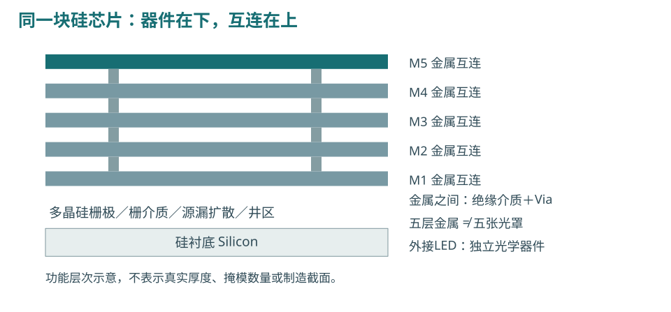
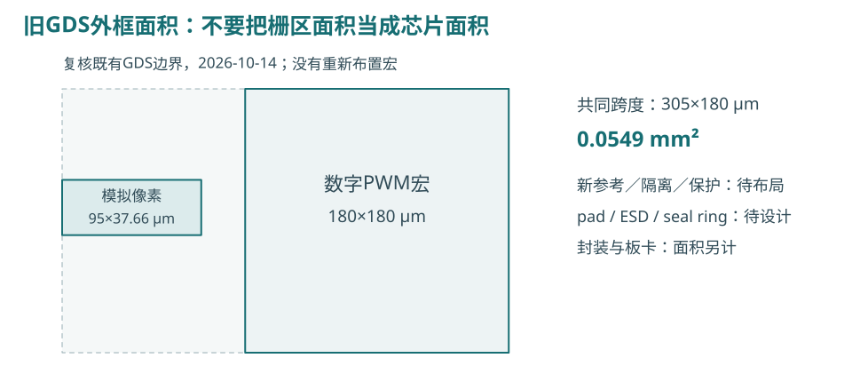
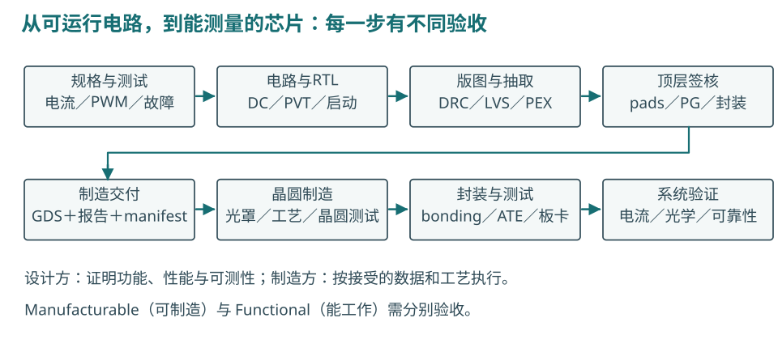

# 单像素启动修复与 ASIC 流片路线

从失败波形、电路修改，到版图、生产与回片验证

2026-10-14 · Open MicroLED Driver ASIC · 实验方法验证与教学

> **本轮先完善单像素。** 新参考源和保护模块仍是晶体管／RTL实验；既有像素与PWM已有版图证据。这里分别回答“为什么启动失败”“修改后验证了什么”“还需要做什么才能制造和使用”。

## 读完后应该能做的判断

- 看懂位移电流与LED导电电流的区别，知道为什么不能只检查PWM为低。
- 理解参考输出隔离、关断保持与恢复时序的设计依据。
- 分清硅CMOS驱动、外接MicroLED材料与五层金属互连。
- 用真实GDS外框估算已有宏面积，识别尚未设计的pad、ESD和新模块。
- 知道向设计服务商、流片服务商与封装测试方分别提交什么。

@@CURRENT_STATUS@@

本报告是在[上一版19页参考源／保护研究](../reference-safety-20261013/report.pdf)之后的追加实验；旧失败及旧电路保留。[完整制造教学章节](fabrication-chapter.md)提供更深入的背景与公开来源。

<!-- PAGE -->

## 为什么PWM已经关了，启动检查仍然失败

@@FAILURE_FIGURE@@

参考源电源在100 ns内从0升到3.3 V，logic与LED电源已经有效，外部fault保持高20 µs。这是**参考电源单独启动**，不是所有电源同时上电，也不是片上POR。

**原始测量：** LED支路绝对峰约5.791 nA，出现在约67.739 ns；同时LED_K约5.0000233 V，模型导电分量最大约3.24×10⁻¹⁷ A。LED本身几乎没有导通，但端口电流超过原1 nA守卫，因此仍算失败。

**物理路径：** 旧selected PEX有BIAS→GATE 2.0854 fF、BIAS→LED_K 0.20686 fF、GATE→LED_K 1.22948 fF。BIAS快速变化，经这些寄生和MOS固有电容引起LED端电压变化。LED模型含2 pF结电容，产生位移电流。

iC = C × dV/dt 2 pF × 2.9 mV/µs ≈ 5.8 nA

这个算式解释数量级，不是对非线性结电容和所有耦合路径的精确替代。PMOS shunt有有限导通电阻，不能把LED_K当成理想固定电压。W20对照曾降至2.815 nA，仍未过线；不能靠“导电电流很小”改写支路守卫。

<!-- PAGE -->

## 修改电路：从扰动源头隔离参考输出

@@ISOLATION_FIGURE@@

@@ISOLATION_EXPLANATION@@

保留原参考环路、旧selected PEX、原W2 LED shunt和原1 nA门槛；新增器件采用GF180实际MOS模型。不是把理想开关串进去，也不是将LED支路电流改为模型导电分量。

正常：参考输出 → 隔离MOS → BIAS → MREF 保护：隔离MOS关闭；BIAS经钳位固定到VSS

**代价也要验证。** 导通时隔离MOS产生压降；保护时参考输出可能上升到接近供电，解除隔离会重新建立BIAS。这会改变输出余量、恢复尖峰及建立时间，必须联测，不能仅验收启动峰。

<!-- PAGE -->

## 关断与恢复：谁控制哪一个时刻

@@RECOVERY_FIGURE@@

@@RECOVERY_EXPLANATION@@

**三种状态不要混淆：** fault有效时必须立即关闭；fault撤销后保持禁止；明确recover_request、有效时钟且raw PWM低时才允许恢复。参考BIAS重新建立和LED放行可以需要不同的阶段，不能因fault低就直接产生一个不完整脉冲。

PWM仍为1 MHz时钟、1 µs slot、256 µs frame，即3906.25 Hz。正常duty/enable仅在frame boundary更新；故障路径可以中断当前脉冲。恢复寄存器的证据是RTL执行，新增组合与隔离的证据是晶体管仿真，尚不是完整数字硬件签核。

<!-- PAGE -->

## 修改前后：用同一套门槛验收

@@RESULTS_TABLE@@

@@RESULTS_INTERPRETATION@@

**条件必须随数据给出。** 全部启动和故障检查使用外部LED串联电流计；模型[id]−[capcur]只辅助解释。fault计时从PWL／RTL故障起点开始，不能挪到输入50%点。正常最低PWM码按完整帧电荷积分，并用同条件全开电流归一。

@@SCOPE_COUNTS@@

<!-- PAGE -->

## 电路问题与数值问题，要分别解决

原始Trap求解在稳态出现逐步正负交替的小电流：10 ns步长在1–5 µs峰约69.96 pA，2 ns约27.60 pA；gate波纹与允许vntol100 nV同量级。正向积分会累计这种小纹波，signed积分则相互抵消。

| 原始0–20 µs启动积分 | 10 ns maxstep | 2 ns maxstep |
| --- | ---: | ---: |
| Q+ | 2.8950×10⁻¹⁶ C | 1.2628×10⁻¹⁶ C |
| Q− | −2.8935×10⁻¹⁶ C | −1.2614×10⁻¹⁶ C |
| Q+相对变化 | — | 56.3789%：未过原0.2%门槛 |

@@CONVERGENCE_RESULTS@@

**为什么不能只改求解器？** 原5.791 nA峰在两档步长中相同，是电路耦合问题；应先改拓扑。**为什么仍要改求解设置？** 亚fC量级方向电荷接近数值纹波时，应报告积分器、容差、步长与失败日志，证明结果稳定，而不是拿正负相消掩盖误差。

0.2%方向电荷收敛门槛与1 nA峰值门槛保持；没有换分母、增加绝对容差或舍弃峰值采样来获得通过。新增模块尚无实际布局寄生；后续PEX会重新定义真实电容和版图环境。

<!-- PAGE -->

## 本轮完善了什么，哪些仍需继续验证

@@NEW_BOUNDARIES@@

实际参考候选仍依赖外部VSET=0.5 V、RSET=5 kΩ及其声明误差；10只MOS放大器、镜像和3 pF理想补偿构成参考源。上一轮180离散点的98.942～99.520 µA精度证据仍适用其原负载和条件，不能自动扩展到新隔离结构的全部条件。

后续应测环路增益与phase margin、负载阶跃、随机失配、噪声、真实R/C与温漂；硬初值造成的内部峰也需按真实供电／状态合同判断。新保护不等于片上POR、brownout或传感器，外部故障保持有效是本轮前提。

从现在到新版图：固定单像素参考／保护接口 → 实现实际被动元件及恢复逻辑 → hard macro布局 → 全供电与body连接 → DRC/LVS/PEX → 同一套回归。先把这条链路闭环，再扩展4×4或高速通道。

<!-- PAGE -->

## 用什么材料、工艺和互连层

**驱动ASIC：硅CMOS。** 本项目使用180 nm GF180MCU D公开工艺平台，电流镜、开关和保护由NMOS／PMOS构成，当前器件采用6-V模型。6-V名称不能替代逐端VGS/VGD/VDS、体二极管和可靠性检查。

**MicroLED：独立器件。** 已引用的黄色LED静态曲线来自InGaN器件；不同颜色和器件结构可能使用不同材料。本项目没有把LED生长在这块硅ASIC上，后续可通过板级连线、wire bond或其他合规封装互连连接。

**D变体：五层金属M1～M5。** 金属之间由绝缘介质分开、via连接；井区、扩散、多晶硅、接触孔、via、钝化和pad opening等也各有规则。五层金属不是五张掩模，也不表示全部加工层数。

D配置标签为5LM_1TM_11K；标签单位11 kÅ=1.1 µm。本地LEF的M5名义厚度1.19 µm、官方电容仿真表typ1.25 µm属于不同模型／条件，不能任选一个当实物厚度或电迁移额定。真实stack与制造版本需服务商确认。[工艺与材料来源](fabrication-chapter.md)

<!-- PAGE -->

## 开发平台：每个工具回答一个问题

| 平台／工具 | 本项目用途 | 不应据此推断 |
| --- | --- | --- |
| Icarus Verilog | RTL、PWM和保护恢复时序 | 已有所有门级／I/O时序 |
| ngspice＋锁定GF180模型 | DC、PVT、启动、故障、LED电流 | 光学输出／可靠性／可流片 |
| Magic＋公开PCell | 模拟布局、抽取、当前deck DRC | foundry接受所有规则 |
| Netgen | extracted netlist对schematic的LVS | 性能、噪声、ESD合格 |
| KLayout | GDS读回、独立规则与geometry核查 | 所有可选检查已开启 |
| Yosys＋OpenROAD／LibreLane | 数字综合、布局布线、时序与视图 | 模拟参考源自动设计完成 |
| Python＋版本化脚本 | 实验编排、积分、hash、数据报告 | 替代EDA或制造方签核 |

模拟布局在macOS执行；既有数字流程在锁定Linux工具环境执行。当前记录包含ngspice47、Magic8.3.684／Netgen1.5.324模拟工具；数字流程LibreLane3.0.14、Yosys0.62、KLayout0.30.7等另有冻结版本。不能将两套工具的报告混成同一次run。

**继续用现有平台完成研究。** 工艺库需包括模型、PCell、层映射、规则、标准单元、I/O库与提取参数；analog/models/pdk-lock.json只是早期模型子集。公开PDK仍声明experimental／alpha；真实制造必须使用服务商接受的版本、检查与交付规范。

<!-- PAGE -->

## 新单像素模块怎样布局

**先定接口和供电域。** logic3.3 V、LED5 V以及参考电源的上电关系写进spec；每个MOS的body和well接点显式连接。PWM buffer只充放控制节点；LED输出级负责漏源电流，不能用逻辑buffer替代恒流输出管。

**把模拟参考作为hard macro。** 电流镜同尺寸、同方向、相近环境；输入差分对匹配，RSET／CCOMP选用实际可制造器件或明确外置。是否采用common-centroid、dummy和guard ring，要由失配与substrate噪声目标决定，并验证寄生与规则。

**针对这次失败安排布线。** 降低BIAS与LED_K／GATE间的非预期耦合；参考输出隔离及钳位靠近受保护节点。用VSS屏蔽可能减小耦合，但会增加节点对地电容，因此必须比较PEX后的建立时间和最低码电荷，不能只看距离。

**数字宏与模拟宏再做共同顶层。** 预留power strap、return path、tap与well ties；新保护存储需要实际综合／物理实现。5 V输出与3.3 V控制分域，I/O或level shift选型须逐信号验证。LED shunt必须检查故障电荷与电源消耗，不只检查布线连续。

**电流决定线宽与via数量。** 按公开单向电流规则的125°C列，7 mA对应普通金属7/0.67≈10.45 µm、11 kÅ顶金属7/1.5≈4.67 µm、理想均流via至少ceil(7/0.18)=39。这只是无裕量下界，尚需温升、拥挤、峰值与实际规则验证。[原始EM表](https://gf180mcu-pdk.readthedocs.io/en/latest/physical_verification/design_manual/drm_14_2.html)

**最后补fill与重验。** 金属密度、dummy fill和antenna检查按接受规则处理；fill会改变电容，需再提取。全PG的IR drop、EM和body／substrate边界仍是单独工作。画出guard ring不等于latch-up通过，DRC通过也不等于EM通过。

<!-- PAGE -->

## 面积：用实际GDS外框，分清三个层级

| 已有GDS，本轮重新读回 | 尺寸 | 外框面积 |
| --- | ---: | ---: |
| 六MOS模拟像素 | 95×37.66 µm | 3577.7 µm²＝0.0035777 mm² |
| 数字PWM宏 | 180×180 µm | 32400 µm²＝0.0324 mm² |
| 共同顶层占用跨度 | 305×180 µm | 54900 µm²＝0.0549 mm² |

**栅区面积≠cell面积≠die面积。** 六MOS按W×L相加只有170 µm²；layout还要源漏、contact、well、tap、间距与金属。因此不能用170 µm²估最终芯片，更不能把宏数直接乘到阵列die。

本轮KLayout读回旧GDS并核对top、DBU、外框和SHA；不是新布局。新参考源、隔离、保护和恢复逻辑尚无版图，不能给出已验证的新版总面积。[面积复核数据](area-baseline.json)

<!-- PAGE -->

## 最终裸片面积：核心、焊盘与封装一起约束

Acore ≈ Aanalog + Adigital_cells / utilization + 路由／供电／隔离余量 Ldie ≥ max(Lcore＋两侧边缘余量，pad ring所需边长) 单位：1 mm²＝10⁶ µm²；金属层数不乘入平面面积

数字utilization是目标放置密度，不包含全部芯片开销；模拟宏应按已布好的外框计算。最终以完成pad、seal ring及制造边界的GDS为准，routing congestion／density可能迫使面积增加。

**一个可复算的教学例子，不是报价或PDK尺寸：** 假设24个pad、每边6个、pitch100 µm、pad宽80 µm、角部余量每端100 µm，则一边需要(6−1)×100＋80＋2×100＝780 µm，约0.6084 mm²。若核心更大，核心反过来限制die；若服务采用固定slot／预制I/O harness，还须满足其slot规则。

因此，一个很小的单像素电路也可能被pad和封装限制。封装外形面积与die面积又不同；bond wire位置、散热、LED连接和测试点由封装／板卡设计决定。

**补偿电容也会占很大面积。** CCOMP=3 pF若将来采用被接受的1.0／1.5 fF/µm² MIM结构，主极板约3000／2000 µm²，即正方边长54.77／44.72 µm；不含边缘、contact及keepout，也未确认D选项接受哪一种。这个面积已接近旧模拟像素外框，不能只数MOS。

0.1～7 mA仍未实现可编程DAC；7 mA的功耗与线宽、via、温度和封装散热也要分别验证，不能由栅区面积推出可用性。

<!-- PAGE -->

## 设计验证：可制造和能工作分别闭环

| 要回答的问题 | 必要验证 | 本项目仍需补齐的重点 |
| --- | --- | --- |
| 行为和时序正确吗 | RTL、reset、CDC、fault、frame更新 | 硬件receiver／保护恢复存储与新门级时序 |
| 电流按预期吗 | DC、compliance、PVT、MC、环路、动态 | 新隔离联测全域、真实被动器件和LED动态 |
| 版图连接正确吗 | 全层DRC、LVS、层映射与GDS回读 | 新参考／保护macro及新共同顶层 |
| 布线后还正确吗 | PEX、多角、最小PWM、startup、fault | 全供电、body、邻居与实际新寄生 |
| 生产规则齐吗 | density/fill、antenna、ERC、端压 | 接受版本的完整规则与豁免清单 |
| 引脚和封装能用吗 | pads、ESD、bond map、package、PCB | 实际选择与验证 |
| 量产测试能判好坏吗 | test mode、可观测性、ATE limits | 晶圆／封装测试与光学量测方案 |

公开wafer precheck能检查slot尺寸、top、origin、grid、金属层、密度、天线与DRC；其清单不能替代LVS或电流性能。我们的“0错误”报告也有运行选项：既有KLayout FEOL/BEOL/connectivity/offgrid检查不表示可选density／antenna都已运行。

验证的对象、工具、deck、版本、配置和覆盖范围必须一起交付。通过相邻阶段不能升级证据；正slack不能证明模拟电流精度，GDS能打开也不能证明版图等于电路。

<!-- PAGE -->

## 顶层I/O、保护与测试：让芯片能够被接上和测量

**先画板级连接表。** VDD、VSS、LED电源／回路、CLK、RESET、PWM／duty接口、FAULT、RECOVER及VSET/RSET连接逐一确定：方向、电压、上拉下拉、上电状态、最大负载、ESD和测试方式。

**默认关闭需要真正实现。** 外部fault保持是当前实验前提；回片不能依赖仿真initial值。必须选片上POR／brownout或明确外部监督器，保证输入断开、慢升电源、停钟与复位期间的状态。供电无效时的晶体管行为须单独检查。

**不要直接把模拟内部节点全部接pad。** Bias／sense观测要评估pad电容、泄漏与保护网络是否破坏环路。测试模式可提供受控观测或复制支路；输出LED_K的ESD、绝对电压、package寄生均要与6-V器件安全域匹配。

**首次芯片优先可观测性。** 预留能验证参考电流、输出电流和fault响应的测试路径；输出短路／开路注入方式、外部sense resistor和示波器探头负载写进test plan。并非所有故障都已包含传感器，当前只验证了故障输入被正确响应。

Package需有pin map、die orientation、pad坐标、bond连接、供电回流与热路径。PCB需限流电源、去耦、测试点及LED可替换负载；先测电气，再做光学，不把电流平均值当亮度测量。

<!-- PAGE -->

## 如何向ASIC厂家交付，让它把芯片做出来

**先确认对方提供哪种服务。** 设计服务商可接收spec／原理图／RTL继续做layout与签核；foundry或MPW服务通常接收已符合接受规范的layout数据；封装测试方接收die、pad／bond map与test程序。三种责任不能用一句“厂家流片”混在一起。

**最终制造包至少要可复查：** top-level GDSII或接受的OASIS、top名称、DBU／grid、origin、边界尺寸、layer map、工艺／stack选项、PDK／deck版本、签核报告及批准豁免。GDS包含器件和金属多边形；光罩数据转换及生产处理由接受服务定义。

**工程伴随包：** 冻结source／extracted netlist、寄生与时序、验证覆盖、供电／引脚／bond map、wafer／package测试计划、README及SHA256 manifest。并非每个文件都上传给foundry；按对方提交规范分包，避免把内部工程资料当mask数据。

Tape-out是设计数据冻结与制造提交的节点，不是“已有硅片”。提交前取得书面接受范围、生产PDK／rule-deck、slot／die规则、pad／seal-ring责任、测试／封装、数量、交期和报价；本项目尚未获得这些接受确认。

<!-- PAGE -->

## 从晶圆到能用的板卡：生产与测试步骤

**制造链：** 接受数据 → mask preparation → 晶圆前端器件形成 → 金属／via／钝化 → wafer probe → 切割 → 封装／bonding → packaged test → 板级bring-up。实际MPW交付可能只提供裸die或晶圆；是否含probe／封装须合同约定。

| 测试阶段 | 最小测量内容 | 目的 |
| --- | --- | --- |
| wafer／裸die | 短路、静态电源电流、参考电流、基础数字访问 | 区分制造／连接与功能异常 |
| 封装电气 | ILED/VSET、compliance、PWM d0/d1/d256 | 验证精度、最小码与封装影响 |
| 故障和电源 | fault停钟、恢复、各上电顺序、慢升／掉电 | 验证真实启动和关断合同 |
| 温度／样本 | 多温度、多die／批次，记录分布 | 形成实测误差及一致性数据 |
| LED光学 | 波形、光功率、均匀性、响应时间 | 电流代理升级为光学证据 |

Bring-up先限流供电和dummy电负载，逐个打开电源域与测试模式；验证后接真实LED。记录探头带宽、校准、串联电流计／sense阻值、测试脚本和失败die，不挑选单个最好样本宣称yield。

仿真与测试阈值来自spec，但实际器件的允许电流、反向电压、温度和ESD来自厂商／工艺允许区。当前10pC／20pC等教学守卫不能替代这些额定值；未测光学关断不能宣称真实光完全熄灭。

<!-- PAGE -->

## 下一步决策：什么达到后才能前进

@@NEXT_GATE@@

| 阶段 | 进入下一步需要什么 | 交付物 |
| --- | --- | --- |
| 单像素电路冻结 | 当前启动／fault闭环，补环路与外部元件 | spec、schematic、回归与未决问题 |
| 新模块物理实现 | 实际R/C、恢复存储、well／body／PG明确 | GDS、LVS、DRC、PEX、多角回归 |
| test chip冻结 | pads／ESD／POR／封装／板卡可测 | 芯片顶层、测试计划、生产manifest |
| 制造提交 | 服务商接受版本／检查／责任书面确认 | 最终GDS包＋报告＋hash |
| 回片验收 | 多样本电气与光学，复现故障恢复 | 原始测量、偏差归因、改版判断 |

“保证做出来又能用”应转化为逐项证据和可测试设计，不能由单次仿真作绝对保证。当前方向是一个可测的单像素验证芯片，而不是立即扩大阵列或把现有GDS直接交付生产。

<!-- PAGE -->

## 来源、复现与证据入口

@@PRIMARY_SOURCES@@

[制造章节与精确来源](fabrication-chapter.md) · [来源清单](fabrication-sources.json) · [面积原始复核](area-baseline.json) · [报告证据清单](evidence-ledger.json) · [报告验收](validation.json)

@@REPRODUCTION@@

所有新实验raw／失败保留在build，新成功和未通过判断写入独立evidence/startup-v2。旧19页报告、旧参考网表和旧失败CSV未覆写。复算审查通过只证明记录与计算一致，不等于全部电路或制造检查通过。
