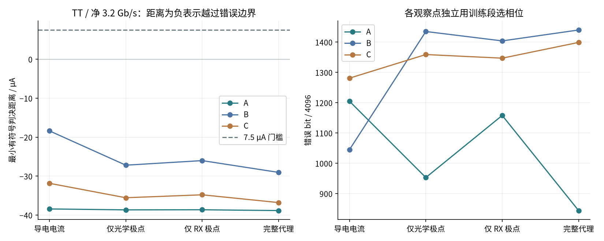
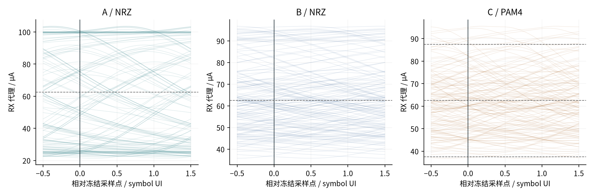
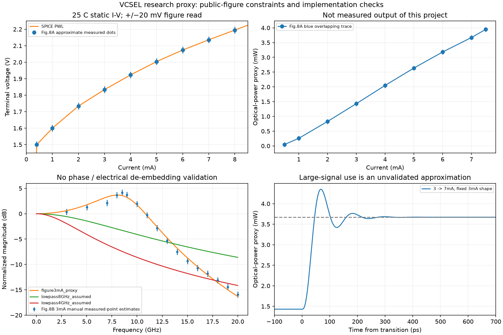
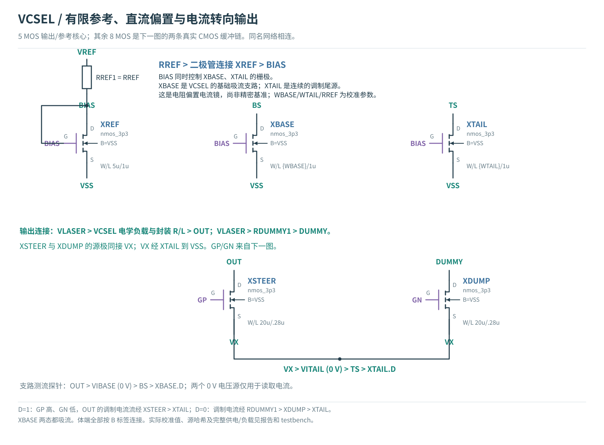
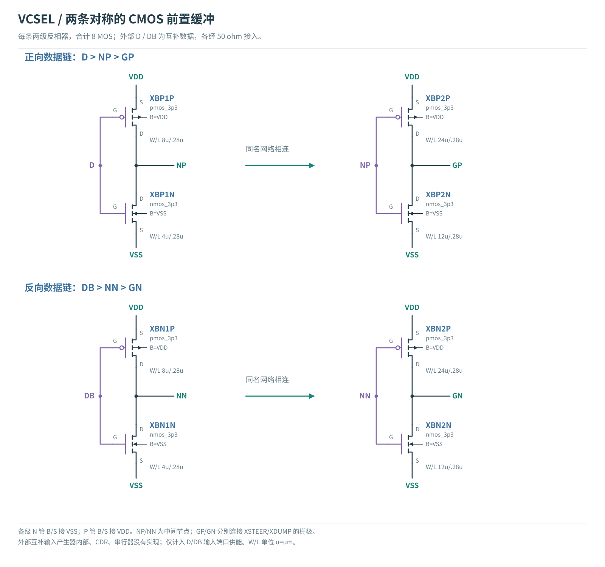
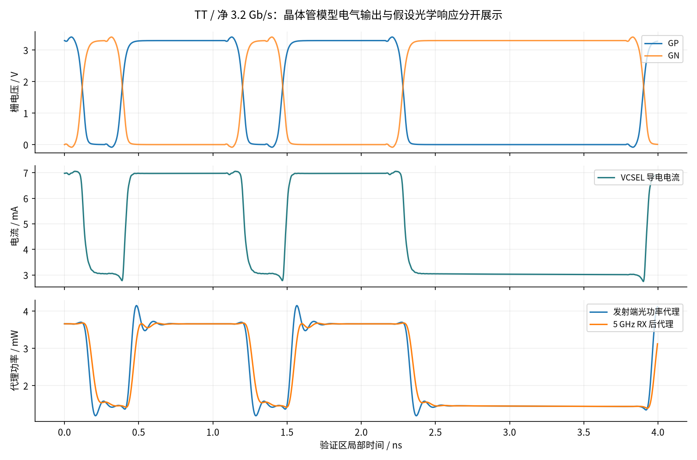
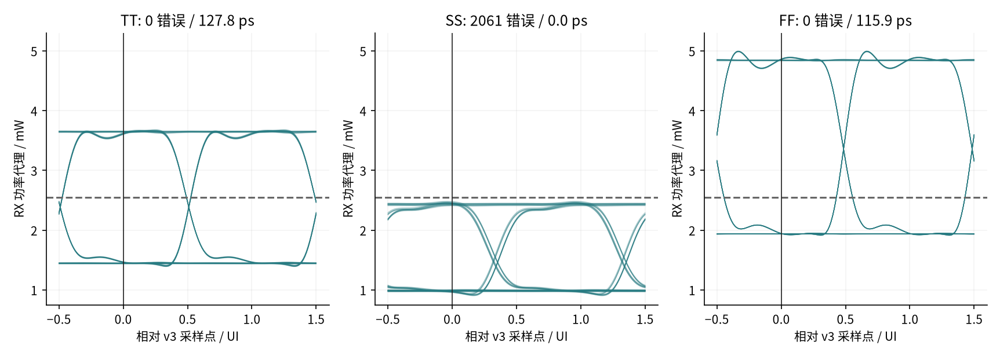
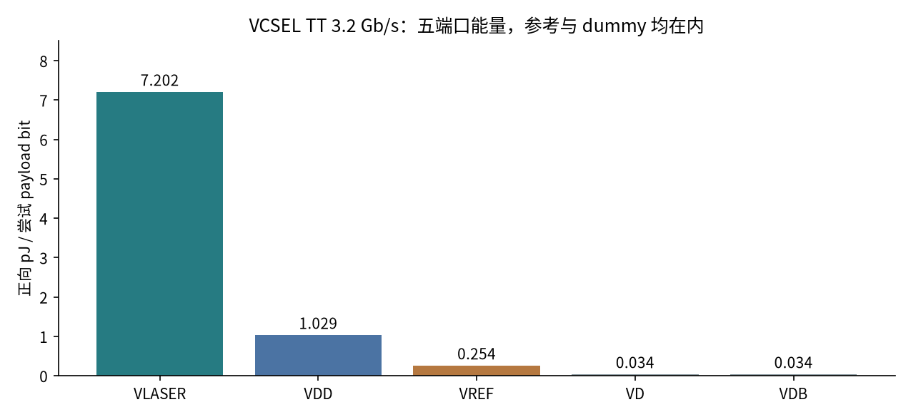

# 净 3.2 Gb/s 单通道：MicroLED 瓶颈诊断与 VCSEL 晶体管实验

**2026-10-27｜研究报告｜原理图级晶体管仿真 + 明示假设的发光器件代理。** 本轮目标已由用户确定为单个发光通道净吞吐 **3.2 Gb/s**。A/B/C 与 VCSEL 分别验证，暂不预选路线。

先读三项结果：

- **MicroLED A/B/C：**目标速率下九个原条件角落全部未通过；已用零电容、理想源与分层滤波区分负载和电路/接收限制。
- **VCSEL：**13 MOS 电路在 TT、图读代理与联合训练规则下，非重叠新 PRBS 窗口为 0/4096 错误、127.75 ps 余量、约 8.56 pJ/尝试 payload bit。这是条件性仿真结果；慢热和快冷仍未闭合。
- **路线尚未选定：**下一步先补同器件动态模型、参考/供电与全角落验证，再决定优化和布局对象。没有新的版图、PEX 或光学实测。

本报告把“跑完 SPICE”“无观察错误”“有足够余量”“模型对应真实器件”分开判断。它们不是同一件事。旧版图的 DRC/LVS/PEX 结果不适用于本轮的新电路。

## 1．目标和比较边界

实验帧仍是 4736 bit，其中 payload 4096 bit。`η=32/37`，`Rline=Rnet/η=3.7 Gb/s`，整帧 1.28 µs。A/B 和 VCSEL 使用 NRZ：3.7 GBd、270.27 ps/UI。C 使用 PAM4：1.85 GBd、540.54 ps/UI。

| 变量 | MicroLED A/B/C | VCSEL 本轮独立实验 |
|---|---|---|
| 输出级 | A：受限摆幅电压输出；B：电流转向；C：电流 DAC/PAM4 | 电阻参考 + 独立偏置吸流 + 差分调制转向；这是最小研究实现，不是路线定案 |
| 发光器件 | 保留 Lin2026 黄色 20 µm 静态 I–V；CLED=200 fF 为原假设 | 从公开 VCSEL 图读约束 I–V / P–I，结电容与封装值另列假设 |
| 电流 | A/B：25/100 µA；C：25/50/75/100 µA | 目标 3/7 mA，TT 校准后冻结 |
| 光学 / RX | 原 200 ps 光学一阶与 1 GHz RX；旁路只用于诊断 | 图读 S21 形状代理 + 5 GHz RX 假设；另扫光学形状与 1 GHz RX |
| 能量口径 | 7 个输入端口正向供能 / 4096 payload bit | 5 个输入端口正向供能 / 4096 payload bit |
| 共同数字方法 | 固定 PRBS15；448 bit 训练评分 + 64 bit 保护；4096 bit 验证；训练后冻结采样 | 同左；VCSEL 以预定的 3/7 mA 对应光功率归一化，不能把其 µAeq 当成探测器真实电流 |

两类器件的波长、工作电流、发光效率、光耦合和接收器没有统一，所以本轮**不按 pJ/bit 给 MicroLED 与 VCSEL 排名**。可以在各自模型内判断失效原因，也可以明确下一轮公平比较还缺什么。

MicroLED 继续使用原判据：最小判决距离 ≥7.5 µA、最小单侧时间余量 ≥100 ps、训练与验证无错误。VCSEL 的 v2 基线保持同一算法与归一化门槛，但实际光功率量纲另行换算。100 ps 已占 NRZ UI 的 37%；本轮没有看到失败后放宽它。离线 5 ps 延迟网格不是已实现的时钟恢复。

## 2．MicroLED：按信号经过的层级寻找瓶颈

数据 → 真实缓冲 / 输出 MOS → 电气负载 I–V 与 C → **导电电流** → 光学代理 → 接收代理 → 训练 / 判决。电容位移电流不计为发光电流。MicroLED 角落为 TT/27°C/3.3 V、SS/125°C/2.95 V、FF/−40°C/3.65 V；VIN/VLED=5 V、VREF=2.5 V。它们与下文 VCSEL 的独立供电条件不同。

分层诊断保留同一数据序列，只依次观察导电电流、仅光学滤波、仅 RX 滤波、完整两级滤波。每个观察点都只用训练段选择延迟；旁路结果不是可以直接制造的接收器。再使用理想电流源驱动同一个 LED，区分器件充放电与 MOS 电路本身。

### 2.1 为什么低电流时，200 fF 也可能成为瓶颈

局部小信号关系是 `τ≈rd×C`，其中 `rd=dV/dI`。原静态曲线在 25 µA 附近的 rd 约 10.77 kΩ，乘 200 fF 约 **2.15 ns**，明显大于 270 ps 的 NRZ 比特间隔。这不是载流子寿命测量，也不是任何电压驱动的统一极限：电压输出能够提供额外充放电电流，行为要由实际输出阻抗与负载共同决定。

把 C 设为零仅用于定位机制，不能称为可制造的改良器件。我们检查了这种改动的 DC 不变性，并保留实际 MOS 电路的全部输入能量。

<!-- MICROLED_RESULTS -->

**新跑的九个原条件目标速率点全部未通过接收筛查。** 以下 pJ/bit 对应失败工作点，不能称为有效交付能效。

| 条件/路线 | 错误 bit /4096 | 最小判决距离 µA | 单侧时间 ps | 正向 pJ/尝试 bit | 最大体结正偏 V |
|---|---|---|---|---|---|
| TT/A | 844 | -38.84 | 0.00 | 0.5256 | 0.157 |
| TT/B | 1440 | -29.04 | 0.00 | 0.5014 | 0.144 |
| TT/C | 1399 | -36.79 | 0.00 | 0.7445 | 0.858 |
| SS/A | 2055 | -47.74 | 0.00 | 0.3627 | 0.217 |
| SS/B | 1884 | -34.55 | 0.00 | 0.4354 | 0.172 |
| SS/C | 1678 | -52.15 | 0.00 | 0.6298 | 0.722 |
| FF/A | 925 | -44.40 | 0.00 | 0.7872 | 0.146 |
| FF/B | 1389 | -27.86 | 0.00 | 0.5559 | 0.122 |
| FF/C | 1403 | -37.32 | 0.00 | 0.8411 | 0.935 |

| TT 诊断 | 200 fF 电气错误 | 0 fF 电气错误 | 200 fF 完整错误 | 0 fF 完整错误 |
|---|---|---|---|---|
| A | 1205 | 597 | 844 | 1288 |
| B | 1045 | 0 | 1440 | 773 |
| C | 1281 | 114 | 1399 | 756 |

去掉外接电容后，各电路仍未通过完整筛查；A 的部分指标甚至更差，说明移除外接 C 不足以解决电路动态与波形问题。错误数不可按各层简单相减：滤波会改变波形形状，每层独立训练相位，可能消除部分尖峰，也可能加重码间干扰。

| 隔离输入/负载 | 格式 | 电气错误 | 完整代理错误 | 完整距离 µA | 完整时间 ps |
|---|---|---|---|---|---|
| 理想导电电流波形 | NRZ | 0 | 0 | 0.496 | 25.95 |
| 理想 sink + 200 fF | NRZ | 863 | 1158 | -23.520 | 0.00 |
| 理想 sink + 0 fF | NRZ | 0 | 0 | 0.492 | 25.84 |
| 理想导电电流波形 | PAM4 | 0 | 215 | -1.559 | 0.00 |
| 理想 sink + 200 fF | PAM4 | 1199 | 1377 | -41.200 | 0.00 |
| 理想 sink + 0 fF | PAM4 | 0 | 232 | -1.587 | 0.00 |

理想波形对照不是所有真实驱动的严格性能上界；它只检验未加预加重的固定两/四电平。最细 1.25 ps 参考网格下，理想 NRZ 完整代理仍只有约 0.499 µA、26.06 ps；PAM4 仍有 215 bit 错误。即使 MOS 瞬间切换，这组原负载/代理也没有自动满足目标。

<figure><a href="figures/microled-stages.png"></a><figcaption>实际 A/B/C 晶体管波形的分层诊断；两个面板共享相同条件。旁路不是新物理实现。</figcaption></figure>
<figure><a href="figures/microled-eyes.png"></a><figcaption>TT 完整代理眼图，展示前 128 个验证符号；错误数和最差余量使用全部 4096 bit 计算。纵轴是等效电流，不是光功率。</figcaption></figure>

**检查范围：**16 个 DC 点，200/0 fF 的最大 DC 电流差 0 µA；三条 TT 路线把最大步长从 UI/40 收紧至 UI/80，原数值门槛均满足、错误数不变。原模型及接收源未修改。

C 的 TT 体结正偏峰值约 0.858 V；A 的 0 fF 对照约 0.731 V。端子两两压差筛查不能替代体结/可靠性签核。原条件和对照都不能因求解成功而宣称电气安全。

<!-- END MICROLED_RESULTS -->

### 2.2 这组数据允许作出的决定

单独更换采样相位、减少一个模型极点，或让输入边沿更理想，都不能证明当前电路实现目标。优先要完成两项相互独立的工作：用同一真实高速 MicroLED 的 I–V、L–I、偏置相关 C/阻抗与复数 S21 建立负载；在固定负载下分别研究 A 的充放电能力、B 的转向/顺从电压与 C 的译码及多电平建立。

原电路完整器件连接仍可查阅：[A 输出与辅助轨](../fair-driver-comparison-20261025/index.html)、[B/C 与公共参考的完整原理图](../fair-driver-comparison-20261025/index.html)。本轮复用相同源，不将“六 MOS”用作完整 Driver 的行业分类。

## 3．VCSEL 负载：哪些来自公开曲线，哪些仍是假设

原始来源为 Giannakopoulos 等，*A 112 Gb/s Radiation-Hardened Mid-Board Optical Transceiver in 130-nm SiGe BiCMOS for Intra-Satellite Links*，Frontiers in Physics，2021，DOI [10.3389/fphy.2021.672941](https://doi.org/10.3389/fphy.2021.672941)。这里采用的是其中 **Fig.8 的器件曲线**；标题的 112 Gb/s 是四通道聚合，不能作为本项目单通道结果。

<figure><a href="../three-gbps-vcsel-20261027/figures/frontiers-2021-figure8.webp"></a><figcaption>原始证据：Giannakopoulos 等，Fig.8，© 原作者，CC BY 4.0；沿用上一报告已授权原图。虚线/点为测量，实线为作者模型。原图不是本项目仿真；详见<a href="../three-gbps-vcsel-20261027/figures/NOTICE.md">来源与许可</a>。</figcaption></figure>

正文说明作者建立了电学前端和光学后端，但没有公开完整参数或模型代码。因此本轮实现的是**公开曲线约束的独立研究代理**，不能称为复现了作者的已验证 VCSEL 模型。

| 参数 / 模型 | 本轮实现 | 证据限制 |
|---|---|---|
| 静态 I–V | 25°C 蓝色测量点近似图读，PWL 插值；3 mA≈1.834 V、7 mA≈2.136 V | 电压图读估计误差 ±20 mV、电流 ±0.05 mA；主要可信范围 2–8 mA |
| P–I | 原图蓝色曲线提取；P(3 mA)≈1.431 mW，P(7 mA)≈3.671 mW | 测量点/模型线局部重合；±0.08 mW 是图读估计，不是厂家容差；上界 7.5 mA |
| 电气 C | 模型实现检查扫 50/150/500 fF；驱动完整帧采用 150 fF，另做 500 fF 对照 | 未由同器件 S11 提取，不能说是实测结电容 |
| 动态形状 | 对 Fig.8B 的 3 mA 归一化 S21 幅度做稳定三阶近似 | 非作者模型；没有相位、去嵌、温度与偏置插值；全摆幅套用同一形状是研究假设 |
| 数值延拓 | 低电流与图外高电流允许求解器连续计算 | 超出图读范围的电流不能用于器件性能资格判断 |

动态代理为 `H(s)=ω0²/(s²+2ζω0s+ω0²) × ωp/(s+ωp)`。所选形状参数 f0≈9.17 GHz、ζ≈0.303、fp≈15.33 GHz，是本项目拟合参数，不是作者披露的物理参数。样本内 RMS 残差约 0.50 dB，最大约 1.18 dB；部分误差超过 ±0.6 dB 的图读估计，不能称为高精度拟合或独立验证。

还有一个关键限制：论文的电到光 S21 没有公开去嵌过程。把该形状作用在包含假设 C 的导电电流之后，可能重复计入电学带宽损失。没有同器件的复数 S11/S21，无法唯一分离。这轮结果只能用于**条件性电路研究**；“通过代理”不能转换成真实光链路通过。

<!-- MODEL_RESULTS -->

<figure><figcaption>派生图：左上 I–V 编码与图读点；右上 P–I；左下幅频形状与假设对照；右下为代理阶跃。DC/AC 和滤波实现自洽检查通过，不等于同器件电光联合标定。<a href="../../../analog/models/vcsel_research_20261027/MODEL_CARD.md">模型卡与逐项来源</a>。</figcaption></figure>
<!-- END MODEL_RESULTS -->

## 4．VCSEL：从电阻参考到偏置、调制和实际 MOS

新电路共 **13 MOS**：XREF / XBASE / XTAIL 三只设置电流，两只选择 LED/dummy 路径，八只构成两条 CMOS 缓冲链。采用公开 GF180 `nmos_3p3 / pmos_3p3` 模型子集，输出开关/缓冲 L=0.28 µm，镜像管 L=1 µm。它是硅 CMOS 驱动；VCSEL 的发光材料与驱动 MOS 工艺是不同层级。

<figure><a href="figures/vcsel-core.svg"></a><figcaption>源网表绑定原理图。相同网络标签电气相连；全部体端已标。XBASE/XTAIL 前的 0 V 源仅为支路电流探针，不提供理想参考电流。</figcaption></figure>

`VREF → RREF → 二极管连接 XREF → VSS` 形成参考电流，近似 `IREF=(VREF−VGS,REF)/RREF`。冻结值 RREF=6.9 kΩ、XREF W/L=5/1 µm；XBASE 为 60/1 µm，XTAIL 为 84/1 µm。几何比约为 12 和 16.8，但有限输出电阻、不同 VDS 和温度让实际比例偏离理想值。

数据 0 时，XBASE 保持基础偏置，调制尾电流由 dummy 支路承担。数据 1 时，调制电流通过 XSTEER 叠加到 VCSEL，形成 `ILASER≈IBIAS+IMOD`。两态均消耗偏置和尾源能量，所以 dummy 功耗必须算入。

<figure><a href="figures/vcsel-buffers.svg"></a><figcaption>外部 D / DB 经各 50 Ω 接入；两级反相后分别成为 GP / GN。真实栅电容、交越和各级耗能都参与 SPICE。外部串行器、互补信号产生器内部和 CDR 尚未实现。</figcaption></figure>

这是可运行的最小偏置/调制电路，还没有精密基准、温度补偿、APC、保护关断和实际版图。固定外部电源加有限阻抗，不等于已经实现了电源管理芯片。

<!-- VCSEL_RESULTS -->

### 4.1 校准后冻结，角落不重新调参

| GF180 条件 | 低档 mA | 高档 mA | 参考 µA |
|---|---|---|---|
| TT | 3.0014 | 6.9828 | 246.79 |
| SS | 2.2135 | 4.6933 | 183.92 |
| FF | 3.8259 | 9.0928 | 312.11 |

TT/25°C/3.3 V，SS/125°C/2.97 V，FF/−40°C/3.63 V。这里同时改变了 MOS 角、温度与供电；VCSEL 静态曲线仍固定 25°C，不能称为真实光器件的全温度验证。SS 高档下降，FF 高档越过公开图域，说明电阻参考、镜像输出阻抗和顺从电压需要继续改进。

独立参考电阻 ±1%（TT）对照：低档 2.9791–3.0241 mA，高档 6.9412–7.0246 mA。这是电阻容差，不是 MOS 工艺角，也没有覆盖片上电阻温漂或器件失配。

## 5．VCSEL：实际瞬态结果与接收训练对照

| 条件 / 净 Gb/s | 错误 /4096 | 距离 µAeq | 单侧时间 ps | 正向 pJ/尝试 bit | 端压筛查 | 静态模型域 |
|---|---|---|---|---|---|---|
| FF-3p2 | 0 | 20.43 | 105.89 | 11.9526 | 失败 | 越域 |
| SS-3p2 | 2061 | -4.92 | 0.00 | 5.5258 | 通过 | 域内 |
| TT-0p8 | 0 | 36.70 | 53.61 | 31.1869 | 通过 | 域内 |
| TT-3p2-C500 | 0 | 35.53 | 69.74 | 8.5600 | 通过 | 域内 |
| TT 3.2 / 重叠相移对照 | 0 | 36.30 | 82.30 | 8.5463 | 通过 | 域内 |
| TT 3.2 / 非重叠窗口 | 0 | 36.32 | 82.29 | 8.5607 | 通过 | 域内 |
| TT-3p2 | 0 | 36.33 | 87.31 | 8.5549 | 通过 | 域内 |
| TT-3p2-step80 | 0 | 36.33 | 87.31 | 8.5548 | 通过 | 域内 |

这是 **v2 幅度优先训练的原结果**。TT 3.2 Gb/s 零观察错误，但约 87 ps 小于 100 ps；SS 高档光功率代理低于固定判决阈值，所以改变采样相位无法补偿偏置/电流不足。FF 虽有约 106 ps，却有约 3.822 V 的端压峰值，超过本轮 3.63 V 筛查值；约 48.94% 时间超过 P–I 的 7.5 mA 上界，不能使用该点证明高速能力。

### 5.1 低速时序余量反而较小，说明什么

TT 0.8 Gb/s 的 v2 结果同样无错误，却只有约 54 ps。原算法先最大化最差幅度距离，仅在幅度几乎并列时考虑时间。带共振的波形可能让算法选中接近过冲峰值的相位。因此不能把这一非单调现象说成驱动器的物理速率上限。

为验证这一机制，本轮在观察失败后**另立 v3 诊断规则**：每个候选相位计算 `min(训练幅度距离/7.5 µAeq, 训练时间余量/100 ps)`，取最大者，完全并列时取最早相位。仍只使用 448 bit 训练，阈值、100 ps 门槛、8 ns 搜索范围、5 ps 网格、滤波和能量都不变；验证段不参与选择。v2 数据保留，v3 不覆盖原结论，也不是硬件 CDR。最初的 v3 对照复用了已看过的验证帧，所以属于事后方法诊断，不能称为全流程预注册的独立确认；后续另立非重叠 PRBS 窗口对照。

| 同一波形/模型 | v2 时间 ps | v3 时间 ps | v3 距离 µAeq | v3 错误 | 通信+端压+图域 |
|---|---|---|---|---|---|
| FF-3p2 | 105.89 | 115.89 | 20.21 | 0 | 未通过 |
| SS-3p2 | 0.00 | 0.00 | -4.92 | 2061 | 未通过 |
| TT-0p8 | 53.61 | 488.61 | 36.39 | 0 | 条件性通过 |
| TT-3p2-C500 | 69.74 | 129.74 | 33.84 | 0 | 条件性通过 |
| TT 3.2 / 重叠相移对照 | 82.30 | 127.75 | 35.08 | 0 | 条件性通过 |
| TT 3.2 / 非重叠窗口 | 82.29 | 127.75 | 35.06 | 0 | 条件性通过 |
| TT-3p2 | 87.31 | 127.76 | 35.08 | 0 | 条件性通过 |
| TT-3p2/optical8-control | 61.97 | 129.00 | 34.98 | 0 | 条件性通过 |
| TT-3p2/rx1-control | 81.56 | 109.90 | 17.99 | 0 | 条件性通过 |
| TT-3p2-step80 | 87.31 | 127.76 | 35.08 | 0 | 条件性通过 |

**非重叠序列复核：**冻结电路、模型与 v3 后，新增 PRBS15 周期偏移 8192 的 seed `0x57AE`，完整窗口与原帧不重叠。新帧 0/4096 错误、127.75 ps、1.0469 mW 模型功率余量、8.5607 pJ/尝试 payload bit。支持该条件下结果可在另一段码型保持；仍不是独立随机噪声 BER 实验。先试的 seed `0x1ACE` 被审计发现有 1582 个验证 bit 的周期位置重叠，保留为相移对照，没有当作非重叠确认。


“条件性通过”只表示该代理、短帧、端压筛查和图读域满足本轮门槛，不含真实相位响应、全温度、抖动噪声、启动或光学 BER。MicroLED 全部 12 个基线/零电容点的**完整代理阶段**，在原网格内的最佳训练幅度距离均为负，换成这种联合评分也不能满足固定幅度门槛。

<figure><a href="figures/vcsel-waveforms.png"></a><figcaption>GP/GN 与导电电流来自晶体管瞬态；光功率是公开曲线约束的研究代理，未测量。取验证区前约 4 ns 展示。</figcaption></figure>
<figure><a href="figures/vcsel-eyes.png"></a><figcaption>v3 训练后冻结相位的眼图：每图展示前 160 个验证 bit；数值取全验证帧。FF 的图外高功率不代表有效器件能力。</figcaption></figure>
<figure><a href="figures/vcsel-energy.png"></a><figcaption>按原生时间样点分段线性功率的过零点精确积分。VLASER 包括 VCSEL、dummy 和串联损失；VDD 包括两条真实缓冲链。v2/v3 共用同一电路能量。</figcaption></figure>

数值检查包括 TT SPICE 最大步长 UI/40→UI/80，光学重采样 2.5→1.25 ps，以及独立输入能量重算。门槛附近的时间差需保留到后续真实抖动预算；不能把代理算法的数字精度当成器件模型精度。

<!-- END VCSEL_RESULTS -->

## 6．如何读能耗、错误数和接收余量

`Ebit=∫frame Σ max(Pport(t),0) dt / 4096`，单位 pJ/payload bit。另报回送与带符号净能量；不假设回送可被上游无损回收。单纯提高速率会摊薄偏置能量，但若不能正确接收，这个数只能叫**尝试发送每个 payload bit 的能量**，不能称为有效交付能效。

7.5 µAeq 是 VCSEL 归一化坐标门槛，不是实体 PD/TIA 的噪声。基准两档 P–I 相差约 2.239 mW；25–100 µAeq 映射到这个跨度，所以 7.5 µAeq 对应约 **0.224 mW 发射端模型功率余量**，尚未乘光耦合损耗与 PD 响应度。高斯噪声计算只在固定样点、固定假设下成立，不包括 RIN、散粒噪声、随机抖动、模式噪声或 FEC。

4096 bit 的确定性 PRBS 验证，即使零错误，也不能证明 BER<10⁻¹²。在独立同分布错误的额外统计假设下，要以 95% 置信上界检验 10⁻¹²，零错误试验约需 3×10¹² bit；按 3.2 Gb/s payload 计约 15.6 分钟。当前仿真没有开展这样的随机试验。

## 7．下一步由证据决定，不先选 A、B、C 或 VCSEL

| 要解决的问题 | 下一项能改变判断的实验 | 进入下一阶段的依据 |
|---|---|---|
| MicroLED 电气与光学模型缺少同器件动态 | 同一高速 MicroLED 的 I–V/L–I、C 或 S11、复数 S21，覆盖偏置/温度 | 能同时解释 DC、阻抗与光学动态，不用任意减小 C 代替器件数据 |
| A/B/C 在 270/541 ps 内的建立 | 同负载下测试输出阻抗、主动充放电、缓冲尺寸/摆幅、C 的译码和单位电流切换 | 同一吞吐、能量口径与判据下得到稳定余量；保留全部失效点 |
| VCSEL 参考漂移、顺从电压与过冲 | 精密/可调参考与偏置反馈，独立电阻容差，MOS 角落和供电扰动分别扫参 | 工作电流处于模型域，器件端压与电流门槛均通过，而非只看眼图 |
| 跨发射器路线选型 | 固定光路损耗、接收灵敏度、BER 目标、温度及能量范围，统一接收实现 | 再比较正确接收的净速率、完整能量、制造/封装代价 |
| 从电路到芯片 | 先冻结能通过的原理图，再布局布线、DRC/LVS、RC/RLC 提取与后仿真 | 不把历史版图或当前二维原理图当成新芯片实现 |

## 8．复查、复现与证据位置

<!-- REPRODUCIBILITY -->

详见 [MicroLED 完整数值](../../../evidence/three-gbps-experiment-20261027/microled-summary.json)、[数值检查](../../../evidence/three-gbps-experiment-20261027/microled-validation.json)、[VCSEL 完整数值](../../../evidence/three-gbps-experiment-20261027/vcsel-driver-summary.json)、[VCSEL 独立复核](../../../evidence/three-gbps-experiment-20261027/vcsel-independent-review.md)、[逐器件图源绑定](../../../evidence/three-gbps-experiment-20261027/circuit-figures.json)。

源脚本位于 `scripts/three_gbps_experiment/`；原网表、日志、校准中间点、失败、全帧压缩波形及运行快照保留在 `build/three-gbps-experiment-20261027/`。新报告的构建命令：

```sh
build/layout/venv/bin/python scripts/three_gbps_experiment/diagrams.py
build/layout/venv/bin/python scripts/three_gbps_experiment/report.py
```

[复现与备份说明](reproduce.md)说明冻结输入、依赖、Release 恢复及与独立机器验证的区别。
<!-- END REPRODUCIBILITY -->

此前文献背景：[单通道超过 3 Gb/s 与 VCSEL 驱动研究](../three-gbps-vcsel-20261027/index.html)。本轮实验计划与固定判据：[experiment-plan.md](experiment-plan.md)。本研究仅验证研发方法；没有器件实测、实片、全链路 BER 或流片签核结论。
