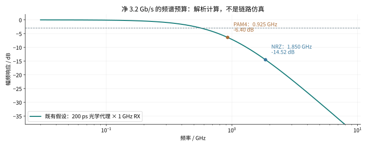
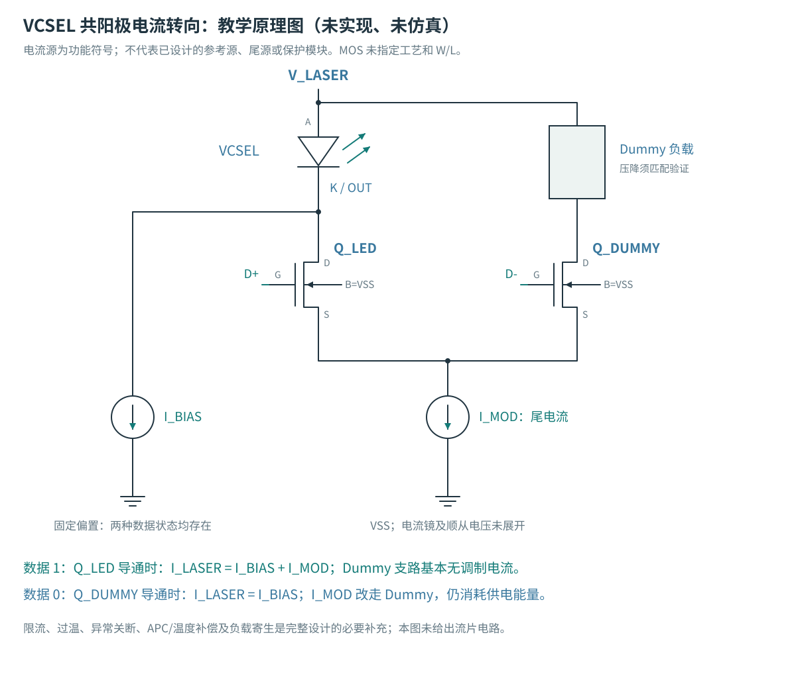
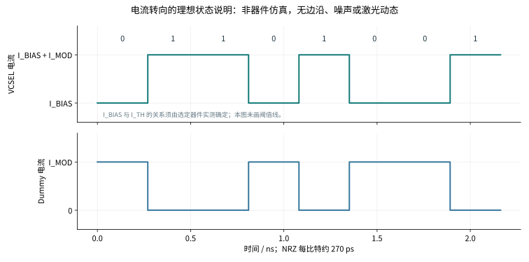
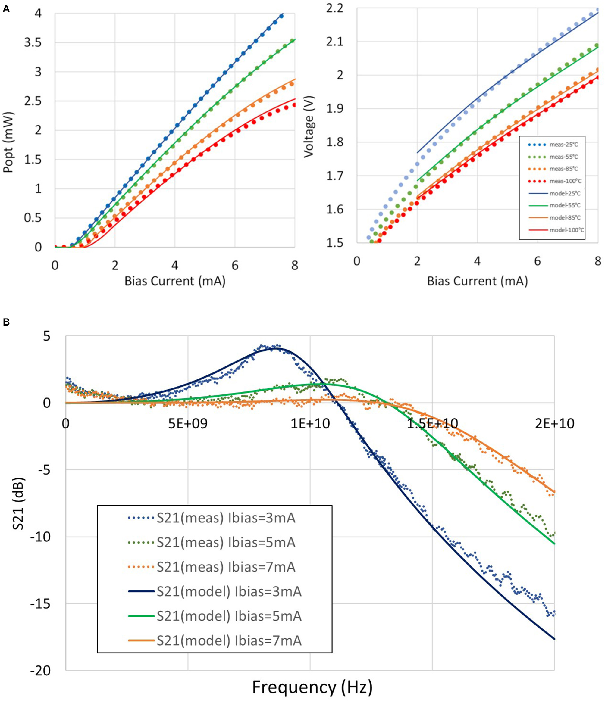

# 单通道超过 3 Gb/s：MicroLED 的下一阶段目标与 VCSEL 驱动

**2026-10-27｜研究增补：既有数据复核、解析计算与公开文献。** 用户已确认目标是**一个发光通道的净吞吐超过 3 Gb/s**，不是多个像素相加。本页以 **3.2 Gb/s 净吞吐**作为首个建议评估点；这个具体数值是本轮工程建议，尚未成为产品规格。本轮没有新增晶体管仿真、VCSEL 实现、版图或光学测量。

先给结论：公开实验表明 MicroLED 和 VCSEL 都能实现多 Gb/s 单通道。**当前项目的 A/B/C 候选尚未达到这个目标，不能把低速通过点外推成 3 Gb/s。** 下一步需要同时研究发光器件动态、驱动电路、封装和接收端。VCSEL 值得建立独立的研究分支；它的典型驱动原理是“直流偏置＋高速调制”，与 MicroLED 的电流转向有共同基础，但光学负载和工作点不同。

## 1．把“超过 3 Gb/s”换成电路能够使用的指标

当前实验每帧 4736 bit，其中验证 payload 为 4096 bit，实验效率 `η=4096/4736=32/37≈0.864865`。训练、保护和尾部都占用线路时间。沿用这个定义，`R_line=R_net/η`。

| 项目 | 净 3.0 Gb/s，仅作边界参照 | 建议评估点：净 3.2 Gb/s |
|---|---:|---:|
| 线路比特率 | 3.46875 Gb/s | 3.70000 Gb/s |
| NRZ 符号率 | 3.46875 GBd | 3.70000 GBd |
| NRZ 一个 symbol / bit 的时间 UI | 288.288 ps | 270.270 ps |
| PAM4 符号率，每符号 2 bit | 1.734375 GBd | 1.85000 GBd |
| PAM4 一个 symbol 的时间 UI | 576.577 ps | 540.541 ps |
| NRZ 的 Nyquist 频率 `Rs/2` | 1.734375 GHz | 1.85000 GHz |
| PAM4 的 Nyquist 频率 `Rs/2` | 0.867188 GHz | 0.92500 GHz |

这里的净吞吐是本项目的实验定义，不包含尚未实现的产品编码、包头、FEC 或重传。真实协议另有开销时，需要重新计算线路率。`Gb/s` 表示比特速率，`GBd` 表示符号速率，`GHz` 表示频率或带宽，三者不能互换。

Nyquist 频率用于理解所需频谱，不是“器件 −3 dB 带宽必须恰好等于这个值”的验收规则。均衡、噪声、调制格式和接收算法共同决定可用速率。3.2 Gb/s NRZ 的数字缓冲、输出级和封装必须在约 270 ps 的比特间隔内提供可判决信号；仅把逻辑输入时钟调快不够。

## 2．现有电路与目标相差在哪里

本节从[冻结的 A/B/C 结果](../../../evidence/fair-driver-v1/summary.json)重新核对，使用最终 v2 接收规则。电流目标仍为 A/B 的 25/100 µA、C 的 25/50/75/100 µA。原负载、200 fF、电源和接收条件未改。

| 既有实验 | A：电压 NRZ | B：电流转向 NRZ | C：电流 DAC / PAM4 |
|---|---|---|---|
| 三角落均通过接收筛查的已采样净速率 | 0.1、0.25 Gb/s | 0.1、0.25、0.5 Gb/s | 0.1、0.25 Gb/s |
| 净 1 Gb/s，接收通过角落数 | 2/3 | 0/3 | 0/3 |
| 净 2 Gb/s，接收通过角落数 | 0/3 | 0/3 | 0/3 |
| 净 2 Gb/s、TT 的错误数 | 1044/4096 bit | 918/4096 bit | 1118/4096 bit |
| 仍需单独解决的问题 | 电流 PVT 漂移、启动与保护 | 参考/dummy 功耗、新版图寄生与启动 | 低电平建立、内部体结正偏、失配与接收复杂度 |

以上接收通过不等于电流精度、启动安全或光学 BER 通过。2 Gb/s 共九点失败，**本项目尚无 3.0 或 3.2 Gb/s 新仿真**。这说明当前尺寸、偏置和模型组合不合格；它不是这些拓扑的理论极限，也不证明 GF180 的任何电路都无法做到 3 Gb/s。

### 2.1 既有“光学＋接收代理”本身就有明显带宽损失

当前代理是 200 ps 的一阶光学极点，串联 1 GHz 的一阶 RX 极点。光学极点对应 `1/(2πτ)=0.7958 GHz`，两者级联 −3 dB 带宽约 **0.5689 GHz**。

`|H(f)| = 1 / sqrt[(1+(2πfτopt)²) × (1+(f/fRX)²)]`

在净 3.2 Gb/s 对应的 Nyquist 频率，解析幅度衰减为 NRZ **−14.52 dB**、PAM4 **−6.40 dB**。这仅是原代理的频域计算，未包括驱动、电气负载和噪声；不能称为真实 LED 的测得带宽，更不能直接换算成 BER 或宣告某一格式必然胜出。

<figure><figcaption>项目独立解析计算。曲线描述假设代理，不是新的晶体管或光学仿真。PAM4 的频谱位置较低，但四电平间距和噪声代价仍须验证。</figcaption></figure>

电气负载也没有自动变快：既有 PWL I–V 配合假设 200 fF，在 25 µA 附近的局部 `rd×C` 约 2.154 ns；上一轮理想电流 sink 的 100→25 µA 隔离计算，到 30 µA 约需 3.586 ns。它不是测得的载流子寿命，也不适用于能够提供位移电流的所有电压驱动。它说明：**先区分负载充放电、MOS 建立与发光动态，再决定提高偏置、主动充放电或预加重。** [原计算与边界](../../../evidence/fair-driver-v1/load-dynamics.json)。

### 2.2 接收判据也需要清楚解释

原 100 ps 单侧时序门槛，在净 0.5 Gb/s NRZ 占 0.0578 UI，到净 3.2 Gb/s 占 **0.37 UI**。继续使用它可以保持历史可比性，但它已经是很严格的剩余时序余量要求；不得在看到失败后偷偷放宽。硬件的随机抖动、确定性抖动、采样误差和 CDR/转发时钟预算，应另行预先定义并同时报告。

64 bit 训练保护区在 3.7 Gb/s 线路上仍有约 17.30 ns，足以容纳既有 8 ns 延迟搜索。训练/验证隔离本身不会在这个速率自动失效。离线的 5 ps 搜索分辨率不代表已经实现同等精度的时钟恢复硬件。

## 3．MicroLED 超过 3 Gb/s 有哪些真实证据

以下索引的是公开研究，不设商业产品对标或协议复现目标。论文标出的速率大多是线路率，未明确扣除本项目帧开销。

| 原始来源及定位 | 证据与条件 | 可以决定什么，不能决定什么 |
|---|---|---|
| Pezeshki，CS MANTECH 2025，Fig.2、§Results | 16 nm 硅背板集成驱动，60 路逐路测量的 3.3 Gb/s BER 曲线；单路活动 | 证明该器件/ASIC组合存在多 Gb/s 路径；不是所有通道同时以该 BER 工作，也不是本项目 GF180 候选的证明 |
| 同文 Fig.5–7 | 蓝宝石测试基板上的 MicroLED、外部 50 Ω 激励与一抽头 FIR；10 Gb/s NRZ、约 10⁻¹⁰ BER；约 1 pJ/bit 按 LED 平均 I×V/R 计算，作者预计加集成驱动约再增 20% | 说明发光器件与均衡协同能够超过 3 Gb/s；不能把仪器驱动能量、LED能量和完整 ASIC/链路能量混为一谈 |
| *High-Speed Micro-LEDs Based on Nano-Engineered InGaN Active Region Towards Chip-to-Chip Interconnections*，JLT 2024，DOI 10.1109/JLT.2024.3444324，可见出版摘要 | 改进 InGaN 有源区；E–E −3 dB 带宽超过 2.6 GHz；NRZ-OOK 自由空间单通道 3.07 Gb/s、石英光纤 2.60 Gb/s；另列四通道总速率 12 Gb/s | 说明外延/载流子动态与光路影响结果；摘要的 3.07 Gb/s 不是净吞吐 >3 Gb/s 的直接证明 |

[CS MANTECH 原文](https://csmantech.org/wp-content/uploads/2025/05/10A.1-Final.2025.pdf) · [JLT 出版页/DOI](https://doi.org/10.1109/JLT.2024.3444324)。前者已读取原图 Fig.5 的频率/电流密度坐标及 Fig.6 能量边界；本地原始证据页另存于 build，未将未明确授权的原图再发布到公开仓库。后者本轮仅核对可见出版摘要，未获得完整方法页。

对本项目的启示是：不能把当前黄色 20 µm 静态曲线和任意常数电容，当作已验证的高速蓝光 MicroLED。要收集**同一器件**随偏置和温度变化的 I–V、L–I、C/阻抗、S11/S21、瞬态及光耦合数据。改变发光器件或接收条件时另建实验组，不覆盖原 A/B/C 公平比较。

## 4．VCSEL 是什么，为什么偏置和调制要分开

VCSEL 是 Vertical-Cavity Surface-Emitting Laser，垂直腔面发射激光器。典型近红外器件在上下 DBR 反射镜之间设置有源区，用电流孔径限制注入区域。**它有激光阈值，不能只用 LED 静态二极管曲线表示光输出。** 850 nm 器件常见 GaAs 平台；这不意味着所有波长的 VCSEL 都采用相同材料。

在高于阈值且没有热 rollover 的局部工作区，可用教学近似 `Popt≈ηs×(I−Ith)`：`Ith` 是阈值电流，`ηs` 是斜率效率。二者随器件与温度改变；接近阈值、深度调制或高速时必须使用动态模型。

采用本页单极性调制定义：

- 数据 0：`I0=IBIAS`，维持基础工作点。
- 数据 1：`I1=IBIAS+IMOD`，增加调制电流。
- 若两个状态都高于阈值，局部近似 `OMA=P1−P0≈ηs×IMOD`；消光比 `ER=10log10(P1/P0)`。

`IBIAS` 较低可能改善消光比和直流功耗，但低于/接近阈值会引入开启延迟和非线性；较高偏置通常能改善某些工作区的调制响应，却提高静态功耗和温升。`IMOD` 增大可以提高 OMA，也会增加峰值电流与应力。这里不存在“偏置越大就永远越快”的结论。

### 一个可读的电流转向电路

<figure><figcaption>项目独立绘制的教学拓扑。电流源是功能符号，未指定 PDK、尺寸或补偿，未作晶体管验证；它不是任何商业芯片的内部电路复制。</figcaption></figure>

VCSEL 阳极接 `V_LASER`，阴极是 `OUT`。独立偏置 sink 从 OUT 吸取 `IBIAS`。两只 NMOS 的源极相连，并接尾源 `IMOD`；漏极分别接 VCSEL 阴极和 dummy 负载，体端均标为 VSS。互补数据 D+/D−控制电流去向。

1. **数据 1**：Q_LED 开、Q_DUMMY 关。供电→VCSEL→Q_LED→尾源→VSS，VCSEL 支路再叠加基础偏置，得到 `IBIAS+IMOD`。
2. **数据 0**：Q_LED 关、Q_DUMMY 开。VCSEL 仍流过 `IBIAS`；尾电流改由供电→dummy→Q_DUMMY→尾源→VSS 提供。
3. dummy 为尾源保持近似连续工作条件，也消耗功率。其电压和寄生需要设计，不能把它当作免费或天然匹配的负载。

电流转向是常见路线之一。也有电压模式 push-pull、源端串联终端 SST、AC 耦合及混合方案；不能把“VCSEL 驱动”直接等同于本项目 B，更不能从当前 MicroLED B 的数据推导 VCSEL 性能。[ADI ADN2530 原厂说明](https://www.analog.com/en/products/adn2530.html)与[MWSCAS 2021 电压模式原始论文](https://confcats-event-sessions.s3.amazonaws.com/mwscas21/papers/2257.pdf)提供两类教学索引；后者的 20 Gb/s、40 mW 是**仿真**。

<figure><figcaption>归一化状态示意，不指定某颗器件的 mA 数值，不包含真实边沿、阈值、光子/载流子动态。VCSEL 电流保留基础偏置，dummy 只承担调制尾电流。</figcaption></figure>

## 5．完整 VCSEL Driver 的数字、模拟与缓冲架构

| 层级 | 电路承担的工作 | 设计中必须保留的区别 |
|---|---|---|
| 高速输入 | 差分终端、输入放大/限制、必要的均衡和重定时 | CML/差分数据输入是逐比特通路；I²C/SPI 是参数配置，不能代替高速数据通路 |
| Predriver | 驱动输出管栅电容/基极电容，控制幅度、传播延迟和交越 | 缓冲耗电、互补偏斜、短路电流、上升下降时间均须计入；高速输入不宜穿过慢速保护逻辑链 |
| 高速输出 | 电流转向、push-pull 或 SST；可增加单/多抽头预加重 | 电压顺从范围、动态输出阻抗、负载 C/L、峰值电流与体结/端压约束同时验收 |
| 慢速模拟设置 | 偏置 DAC、调制 DAC、精密参考、温度补偿 | 慢环路设置工作点，高速路径传递数据；参考带宽不必等同数据带宽 |
| 光功率控制 | 有 monitor PD 时可用 APC 控制平均光功率；无 monitor 时需其他可验证方案 | APC 不是每 bit 的调制环，也不自动保证 OMA、消光比或 BER；并非每颗 VCSEL 都有 monitor PD |
| 保护与测试 | 限流、过温、独立关断、上电时序、开短路诊断、PRBS/BERT | 保护必须覆盖偏置和调制两路；仿真中的理想 DISABLE 不代表硬件保护闭合 |

预加重是在跳变附近暂时改变输出，用额外电流/电压弥补高频损失。它不能恢复被噪声淹没的信息，也不能忽略峰值、电能和热预算。激光的上升与下降动态可能不同，因此有些设计使用非对称整形。[TI ONET8501V 数据手册，功能框图及 Output Waveform Shaping/APC](https://www.ti.com/lit/ds/symlink/onet8501v.pdf)。该器件官网已标 obsolete，仅作为电路方法资料。

## 6．VCSEL 驱动的公开数值怎样读

| 来源 | 速率与能量/电流 | 证据层级和不能省略的条件 |
|---|---|---|
| MAX3795，原厂 Rev.0，2004，pp.1、10–12 | 1–4.25 Gb/s；偏置 1–15 mA，调制 2–15 mA；典型转换时间 52 ps | 数据手册规格，不是净吞吐或完整链路能耗；官网 NRND，不作新采购推荐 |
| ADN2530，原厂 Rev.D | 最高 11.3 Gb/s；3.3 V；偏置 2–25 mA，**差分**调制 2.2–23 mA；典型 26 ps 边沿 | 差分电流不能直接当成单支 VCSEL 电流；官网 obsolete。体现背终端/反射处理，不代表本项目可直接复现内部电路 |
| Inoue 等，SOCC 2024，DOI 10.1109/SOCC62300.2024.10737718 | 65 nm CMOS 实片；36 Gb/s 电气眼图、41.6 mW、1.16 pJ/b；核心 124×309 µm² | 晶圆探针**电气测量**，本轮核对可见出版摘要；不是实测光学 BER，也不是全链路能耗 |
| Schow 等，IBM / PTL 2012 | 90 nm bulk CMOS driver＋RX、850 nm VCSEL；25 Gb/s、BER<10⁻¹²；标题全链路 6.5 pJ/b，另列 22 Gb/s 3.8 pJ/b、15 Gb/s 2.6 pJ/b | 实测光链路；作者声明计入全部组件功率。2012 的结果，非当前纪录；可见摘要未列完整距离、测量时长和净开销 |
| Giannakopoulos 等，Frontiers 2021，Fig.8、11，Table4 | 130 nm SiGe BiCMOS；单路 28 Gb/s；25°C 3/7 mA 工作点，driver 74 mW / 2.64 pJ/b | 器件特性有测量；这里的 driver 眼图/功耗是**版图提取后仿真**。标题 112 Gb/s 是 4×28 聚合，不是单通道 |

[MAX3795 手册](https://www.analog.com/media/en/technical-documentation/data-sheets/MAX3795.pdf) / [当前状态](https://www.analog.com/en/products/max3795.html) · [ADN2530](https://www.analog.com/en/products/adn2530.html) · [SOCC 2024](https://doi.org/10.1109/SOCC62300.2024.10737718) · [IBM 原始摘要](https://research.ibm.com/publications/25-gbs-65-pjbit-90-nm-cmos-driven-multimode-optical-link) · [Frontiers 原文](https://doi.org/10.3389/fphy.2021.672941)。

这些数值有意按证据类别列出，**不能按 pJ/bit 直接排序**。本项目是七个输入端口的电气能量，36 Gb/s 示例是 driver 电气输出，IBM 是作者定义的完整光链路，包含范围不同；速率的 raw/net 分母也未统一。

### 原始数据图：为什么要在同一器件上测静态和动态

<figure><figcaption>原始证据，非本项目结果：Giannakopoulos 等，Frontiers in Physics 9:672941 (2021)，Fig.8，© 原作者，按 <a href="https://creativecommons.org/licenses/by/4.0/">CC BY 4.0</a> 复用；原图不裁切、不改色，仅按显示宽度缩放。<a href="https://doi.org/10.3389/fphy.2021.672941">原文与完整图注</a>：虚线为测量、实线为模型；A 为不同温度 DC，B 为不同偏置的归一化 S21。</figcaption></figure>

读图顺序：先看 A 的阈值/斜率随温度变化，再看 B 在不同偏置下的频率响应。**归一化 S21 不是绝对光功率**，也不是某个数据速率下的 BER。图说明模型需要静态与动态一起拟合，而不能把一条 I–V 和固定电容当作完整 VCSEL。图中数值没有被本项目直接数字化或拟合。

## 7．材料、工艺与版图：要改变的是哪一层

| 层级 | MicroLED 路线 | VCSEL 路线 | 对我们下一步的意义 |
|---|---|---|---|
| 发光材料 | 本项目黄色 InGaN 静态曲线；高速论文也有蓝光 GaN/InGaN | 典型 850 nm oxide VCSEL 是 GaAs 平台，含有源区与 DBR 腔 | 不能把发光材料说成驱动 MOS 的材料；先选器件与波长，再确认模型与检测器 |
| 驱动芯片 | 可研究硅 CMOS 电压/电流输出 | 硅 CMOS 也能高速驱动；SiGe BiCMOS 是另一类选择 | **SiGe HBT 是异质结双极晶体管，不是“特殊材料 MOS”**；是否采用由速度/电压/功率和模型可得性决定 |
| 器件约束 | 正向压降、载流子寿命、C、效率和热 | 阈值、斜率效率、弛豫响应、阻尼、寄生和热 | 静态电流准确不代表光学响应准确；更换负载需重新标定 |
| 输出连接 | 互连/接触与负载充放电可能主导 | driver 到激光器的 pad、bond wire/bump、传输线和回流影响过冲/振铃 | 每一种封装做独立 RLC 或 S 参数模型；跨 die 连接不能只保留理想导线 |
| 布局 | 小输出回路、低寄生、干净的参考与电源回流 | 同样需要；还要考虑高偏置热、激光耦合及可能的峰化电感 | 先有模型和电流预算，再决定管宽、金属宽度、过孔数与摆放；MOS 个数不能换算 die 面积 |

[Broadcom AFCD-V51KY 原厂资料](https://www.broadcom.com/products/fiber-optic-modules-components/components-broadband/short-reach-gaas-die/lasers/afcd-v51ky)明确器件为 850 nm GaAs VCSEL；结合上述 CMOS 驱动实验，可见发光器件与驱动工艺应分别描述。[Frontiers 工艺章节](https://doi.org/10.3389/fphy.2021.672941)明确高速器件为 npn SiGe HBT。公开 CMOS 实测说明“超过 3 Gb/s 必须用 III–V MOS”不成立；也不能反推随便一个 CMOS PDK 都能低能耗达标。

本项目的 GF180 开源路径适合验证电流控制、保护和版图方法。`pdk-lock.json` 仍只是模型子集，不能替代完整物理 PDK、可靠性规则和高频模型验证。65/90/16 nm 论文不是对本项目免费可用的 PDK 承诺。本轮**没有决定换工艺**；若 GF180 在实际器件/电源/PEX 条件下不能满足目标，需要把“教学验证平台”和“产品候选工艺”分开记录。

## 8．接下来如何验证，而不是提前选赢家

| 步骤 | MicroLED 研究 | VCSEL 研究 | 交付证据 |
|---|---|---|---|
| 1：固定目标与基线 | 旧 A/B/C 原条件追加 3.0/3.2 Gb/s TT 诊断，保留失败 | 单独定义 850 nm 等候选器件、光路/PD/TIA与偏置范围 | 冻结净率、帧开销、峰值/平均电流、能量边界；不能混用两种发光器件的接收条件作拓扑排名 |
| 2：器件与通道建模 | 同器件 I–V、L–I、C/阻抗、S11/S21、温度/偏置扫描 | 同器件 I–V、P–I、Ith、动态 S11/S21/阶跃；必要时载流子–光子速率方程 | 可追溯原始数据、拟合残差、独立验证点；无数据的参数只作敏感性假设 |
| 3：电路单因素修改 | A 的电流漂移/启动，B/C 的建立时间；独立比较受限预加重和主动充放电 | 电流转向 vs push-pull/SST，偏置/调制 DAC、predriver、APC及独立关断 | 每次修改原理图、DC、瞬态、端压/体结、能量及同条件接收；不预设 B 优胜 |
| 4：物理与接收闭合 | 同等级布局/DRC/LVS/PEX、封装/电源、失配/角落 | 同样流程，加真实激光/PD/TIA噪声、抖动与光路损失 | 新旧网表身份、寄生、能耗、眼图、时序余量；模型通过与实测分开 |

本轮只是明确目标、完成研究和差距计算；上表中的新增仿真和电路尚未执行。对“更省电”的判断，应在速率、光路、接收噪声/BER、峰值和热限制都满足后比较可行点。`Ebit=P/Rnet`：净 3.2 Gb/s 时，1 pJ/bit 对应 3.2 mW，3 pJ/bit 对应 9.6 mW；这只是预算换算，不是本项目已实现数值。

若以后采用 BER≤10⁻¹² 作为示例测量目标，在独立、平稳伯努利错误假设下，零错误的单侧 95% 上界需要约 **2.996×10¹² bit**，若连续统计全部 3.7 Gb/s 线路 bit，约 13.5 min；若像当前实验只计有效 payload，应按净 3.2 Gb/s 计算，约 15.6 min。它仍不是完整跨温度/老化签核。当前无噪声的 4096 bit 确定性仿真，不满足这个统计试验假设，不能用“零错误”证明真实 BER。

## 9．可复核文件与阅读顺序

入门读第 1、4、5 节，先理解速率、偏置和调制；设计研究读第 2、7、8 节；数字与来源核对使用下列文件：

- [当前基线审计与 18 个高速度点](../../../evidence/three-gbps-vcsel-20261027/baseline-audit.json)：旧结果的只读复核。
- [解析计算](../../../evidence/three-gbps-vcsel-20261027/calculations.json)：帧效率、UI、两极响应和条件统计示例；不是 SPICE。
- [原始来源与复用台账](../../../evidence/three-gbps-vcsel-20261027/source-ledger.json)：来源、定位、数值条件、证据层级和未支持的解释。
- [生成与哈希清单](../../../evidence/three-gbps-vcsel-20261027/manifest.json)与[重建脚本](../../../scripts/three_gbps_vcsel/report.py)：只重建本增补，不改旧仿真。
- [原 A/B/C 完整报告](../fair-driver-comparison-20261025/index.html)：三路线已完成的实际晶体管仿真。

`build/layout/venv/bin/python scripts/three_gbps_vcsel/report.py` 可在已有项目绘图库/字体环境中重建。本地原始 PDF/证据页保留在 `build/three-gbps-vcsel-20261027/`；Frontiers Fig.8 按其许可公开复用，其余未核实公开复用许可的原图仅保留本地，公开报告使用事实表、独立计算和自行绘制的教学图。没有发布博客、采购器件或宣称流片可用。
