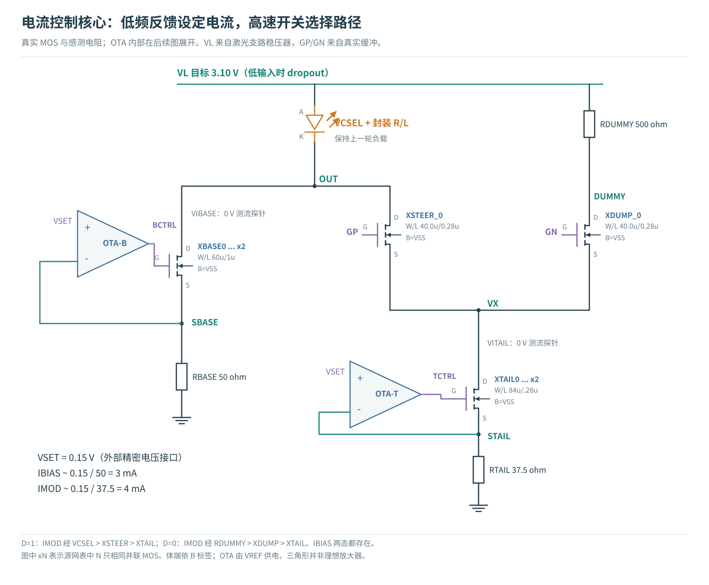
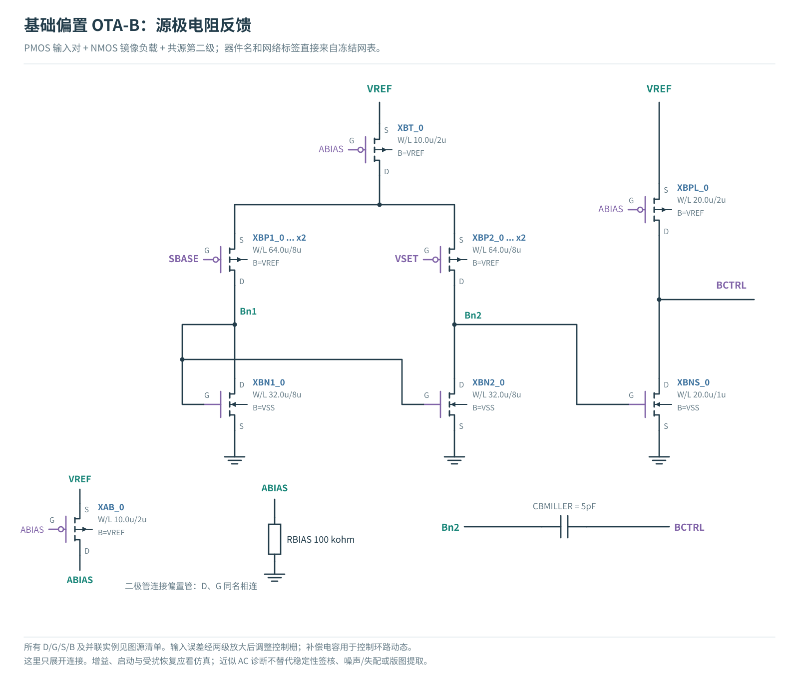
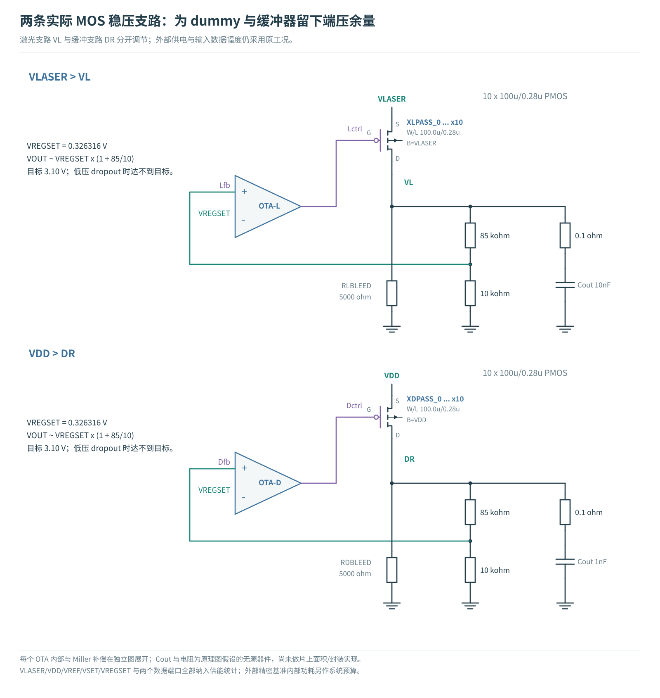
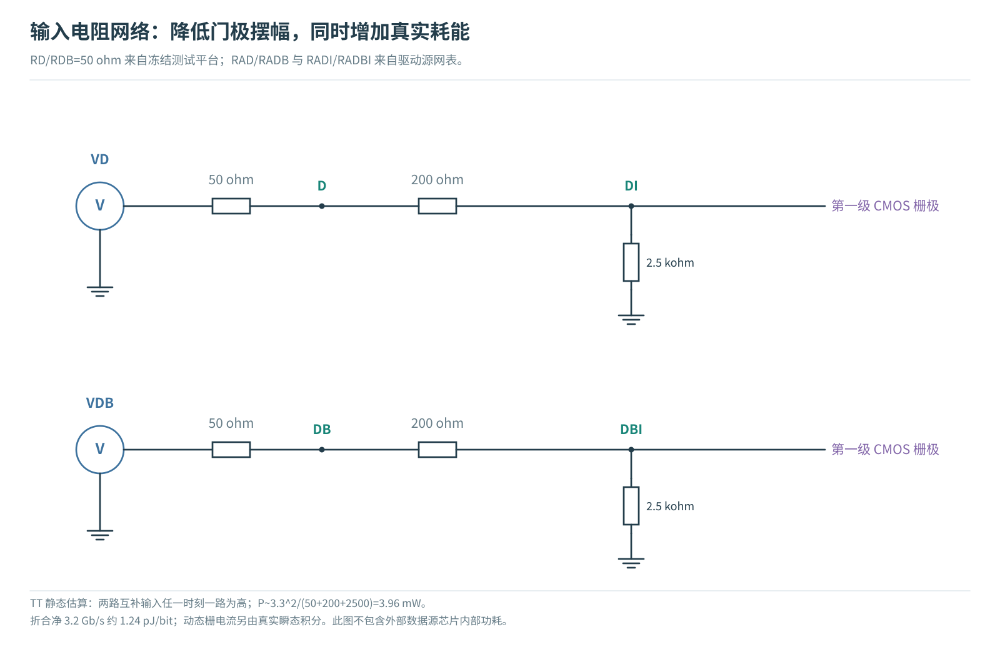
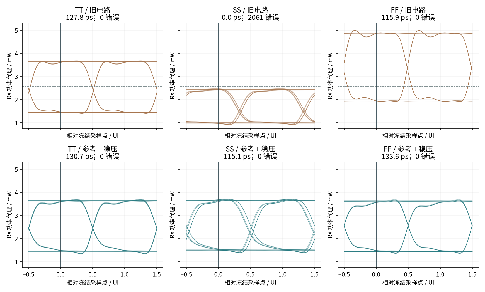
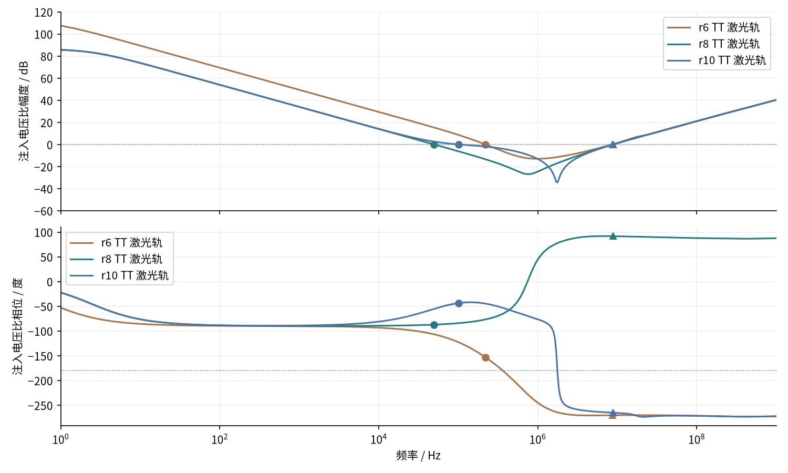
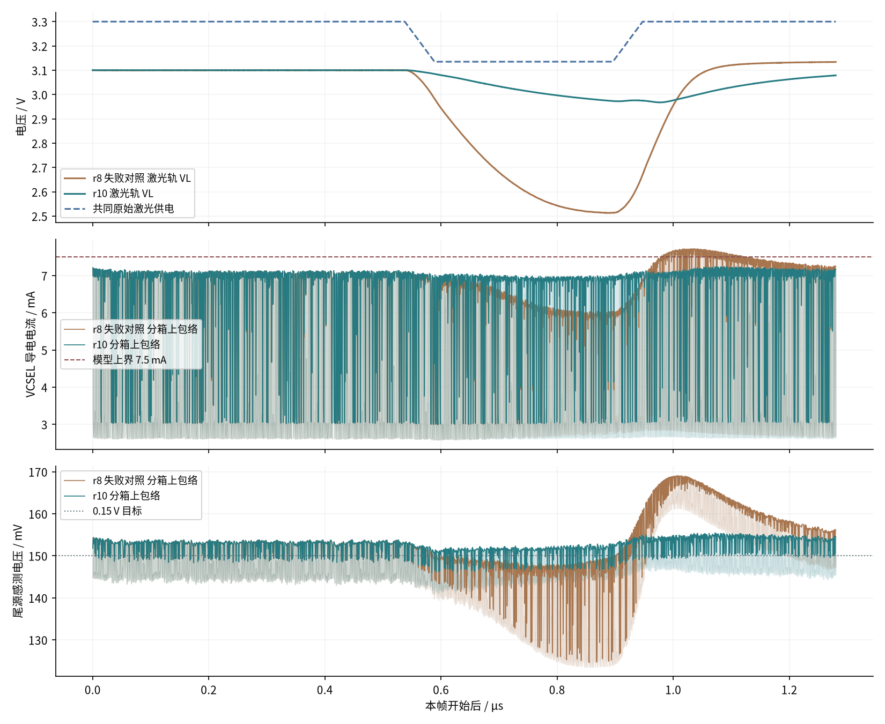
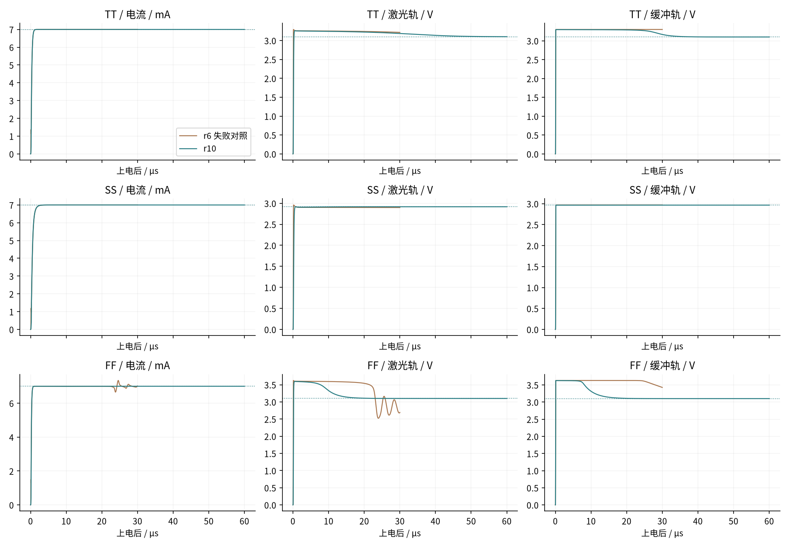
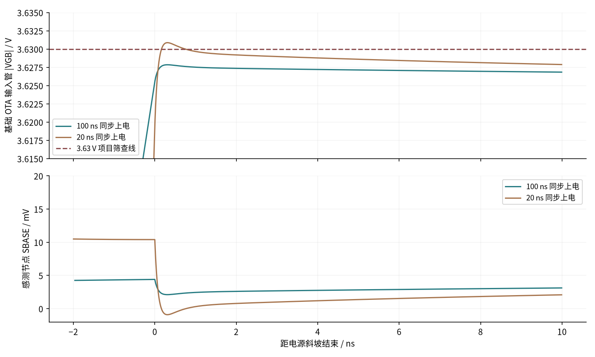
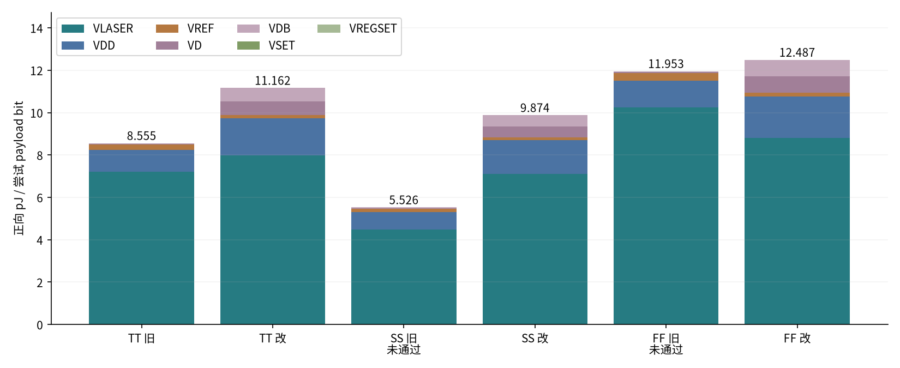

# 净 3.2 Gb/s：VCSEL 参考与供电改进，及 MicroLED 动态模型依据

2026-10-29｜研究报告｜原理图级晶体管仿真与公开数据研究

<!-- CONCLUSIONS -->

**本轮用 r10 原理图候选改善了 VCSEL 慢热电流不足与正常发送时的快冷过冲，并保留中间失败；产品级供电和光链路验证仍未完成。**

- 建立后的单帧净速率固定为 3.2 Gb/s，同一负载与接收规则下，TT/SS/FF 均为 0/4096 观察错误，单侧时间余量约 **130.72 / 115.06 / 133.56 ps**。SS 从接收失败恢复；FF 正常发送最大端压从约 **3.822 V 降到 3.485 V**。
- 这有明确代价：三个 1.28 µs 实验帧约 **11.162 / 9.874 / 12.487 pJ/尝试净位**，TT 相比旧电路增加约 30.5%。它包含已建模供电与数据端口，尚非完整光链路能效；电容储能、启动等待另外列出。**快冷 20 ns 上电仍超出 3.63 V 筛查线约 0.879 mV**，100 ns 上电也仅剩约 2.147 mV，供电可靠性尚未闭合。
- MicroLED 的公开数据确有 GHz 级幅频，但包含测量链且缺少相位/阻抗。它修正了旧瓶颈解释，**没有被擅自换算成新的瞬态接收成绩**。继续保留 A/B/C 与 VCSEL 候选，暂不预选路线。

<!-- END CONCLUSIONS -->

本轮沿着上一报告的失效点继续。3.2 Gb/s 指单通道净载荷；计入训练和帧开销后，NRZ 线路速率为 3.7 Gb/s，每个码元 270.27 ps。研究分两部分：先改善 VCSEL 电路，使它在相同负载和接收条件下更接近 3/7 mA 的目标；再核对 MicroLED 动态负载的实测依据。两种发光器件的光路、接收灵敏度和工作电流尚未统一，不能用本轮 pJ/bit 给它们排出优劣。

**VCSEL 接收模型的限制应先读：**上一轮仅用公开图的 3 mA 幅频拟合形状，将该固定形状用于 3–7 mA 整个摆幅；150 fF 是独立假设，未去嵌的电光幅频再叠加它可能重复计算电学滚降。缺少同器件复数阻抗与相位，无法唯一修正。因此本报告的接收余量用于固定代理下比较电路，不是对真实光链路的性能保证。完整定义见[冻结模型参数](../../../analog/models/vcsel_research_20261027/parameters.json)。

[TOC]

## 1．先把失效原因说清楚

旧电路通过电阻和二极管连接的 NMOS 产生 IREF，再用电流镜得到基础偏置和调制尾电流。近似关系是 `IREF=(VREF−VGS,REF)/RREF`。因此，VREF、温度引起的 VGS 变化和 MOS 工艺角都会改变参考电流。电流镜又受到输出电压和晶体管输出电阻影响，实际电流比并不等于宽长比。

<!-- BASELINE -->

| 旧组合条件 | IREF / µA | 低档 / mA | 高档 / mA | 调制支路 / IREF |
|---|---|---|---|---|
| TT | 246.79 | 3.0014 | 6.9828 | 16.192 |
| SS | 183.92 | 2.2135 | 4.6933 | 13.576 |
| FF | 312.11 | 3.8259 | 9.0928 | 16.926 |

TT=typical/25°C/3.3 V；SS=slow/125°C/2.97 V；FF=fast/−40°C/3.63 V。VCSEL 的静态温度模型未随此变化。

| 拆分实验（其余典型） | 高档电流 / mA |
|---|---|
| 全部典型 | 6.9828 |
| 仅 MOS 慢角 | 6.4863 |
| 仅 125°C | 6.2499 |
| 仅供电 2.97 V | 5.7470 |
| 慢角 + 热 + 低压 | 4.6933 |

快冷峰值出现在 XDUMP 的漏—体压差：3.8216 V。该时刻从原模型重建的本地激光轨约 3.6278 V，dummy 高出轨约 193.74 mV，且 GN 正在上升。节点证据说明过冲发生在局部切换节点，与开关耦合机制一致；它排除了整条电源轨出现同幅振铃，但尚未分离栅漏耦合、沟道电荷与支路换流的各自贡献。重建方法和相互核对见[独立节点审计](../../../evidence/vcsel-robustness-20261029/audit-ff-peak.json)。

<!-- END BASELINE -->

这种分解有助于决定怎样改电路：如果 IREF 自己变小，单纯加大输出 MOS 会同时把快冷电流推得更高；如果调制尾管失去足够的漏源电压，即便理想 IREF 不变，电流镜也可能无法维持电流。需要分别检查参考误差、输出管的工作电压和切换瞬间的寄生充放电。

## 2．参考、供电与输出级如何连接

<!-- CIRCUIT -->

新候选共 **73 个源网表 MOS 实例**：基础与调制电流各有实际 MOS 反馈放大器，激光轨和缓冲轨各有实际 PMOS 稳压电路。图中的并联组完整对应源网表，不代表已完成版图指状结构。

<figure><figcaption>图 1｜感测电阻反馈设定 3 mA 基流与 4 mA 调制尾流；高速数据仍由转向管选择通路。</figcaption></figure>
工作过程可以按三步理解。先用 OTA-B（把电压误差转为控制信号的跨导放大器）调节基础支路 MOS，使其源极感测电压逼近外部 VSET=0.15 V，得到 `IBIAS≈0.15/50=3 mA`。再用 OTA-T 产生 `IMOD≈0.15/37.5=4 mA`。数据为低时，调制电流流向 dummy（虚设负载支路），VCSEL 仍保有约 3 mA 偏置；数据为高时，调制电流转入 VCSEL，与基础电流叠加成约 7 mA。参考控制环主要处理较慢的误差，高速数据通过转向管切换，不要求反馈放大器逐 bit 重新建立电流。

主要修改按原因展开：单级 OTA 的输出摆幅不足，改为带 Miller 补偿的两级结构；尾电流管 L 从 1 µm 改为 0.28 µm，转向管每只 W 从 20 µm 改为 40 µm，降低慢热时的压降。两条稳压输出目标为 3.10 V；慢热低输入电压时允许进入 dropout，实际输出由调整管压降决定。该值全角落相同，不逐角校准。

| 保留的迭代 | 仅参考反馈：SS 高档 mA | 再加稳压：SS 高档 mA |
|---|---|---|
| r3：单级 OTA | 5.0074 | 4.8913 |
| r4：两级 OTA | 6.3491 | 5.9938 |
| r5：短沟道尾管 | 6.6868 | 6.2911 |
| r6：加宽转向管 | 6.9990 | 6.9990 |

以上是不同迭代的机制证据，不把每一步都称为可交付设计；r6 在完整帧和启动验证中失败，保留为对照，不能把每轮修改都称为完成设计。

<figure><figcaption>图 2｜基础偏置 OTA 的实际器件连接。PMOS 差分输入、NMOS 镜像负载及第二级调节 BCTRL；5 pF 为明确的补偿假设。</figcaption></figure>
调制、激光稳压与缓冲稳压放大器的完整展开分别见 [OTA-T](figures/ota-t.svg)、[OTA-L](figures/ota-l.svg)、[OTA-D](figures/ota-d.svg)。

<figure><figcaption>图 3｜两条 PMOS 调整支路与 85 kΩ/10 kΩ 反馈分压。r10 激光轨采用外部 10 nF/0.1 Ω，缓冲轨为 1 nF/0.1 Ω；基线未计输出电容 ESL，另做敏感性控制。这些无源器件还没有片上面积与封装实现证据。</figcaption></figure>
稳压目标按 `VOUT≈VREGSET×(1+85k/10k)` 得到：VREGSET=0.326316 V 对应约 3.10 V。r10 的激光/缓冲 Miller 支路均串联 100 kΩ，补偿电容均为 30 pF；两输出各接 5 kΩ 最小负载。它沿用 r8 的参考伺服，针对供电跌落恢复另增大激光轨外部去耦并调整补偿；第 4 节保留失败和单因素过程。两级放大器与 PMOS 调整管引入多个极点，串联电阻会改变补偿零点；不能只把电容做大便认定稳定。大信号建立还受 `I=C·dV/dt` 限制，因此上一版 100 pF 会让控制栅充电变慢。具体稳定性和启动结果见第 4 节。

<figure><figcaption>图 4｜输入衰减网络的完整连接；不改变理想输入源幅度，代价是持续的电阻耗能。</figcaption></figure>
两条两级 CMOS 缓冲的八个 MOS 见[缓冲器展开](figures/buffer-detail.svg)。所有供电、数据和参考端口进入能量统计。

<!-- END CIRCUIT -->

电阻感测反馈的目标是让放大器调节输出 MOS 的栅极，使 `VSENSE≈VSET`，于是 `I≈VSET/RSENSE`。放大器使用实际 MOS 时，有限增益、输入失调、输出摆幅、稳定性和启动都必须验证。它不会自动消除感测电阻误差，也不会自动生成一个精密 VSET。

采用外部 VSET 时，系统需要另外提供其精度、温漂、噪声和启动顺序。小信号误差近似为 `ΔI/I≈ΔVSET/VSET−ΔR/R+反馈残差`；失配和温度误差不能用一次典型条件校准代替。

## 3．修改前后：同一个 3.2 Gb/s 判据

<!-- COMPARISON -->

| 组合条件/设计 | 错误 /4096 | 单侧时间 ps | 幅度 mW (µAeq) | pJ/尝试净位 | 最大端压 V | 联合筛查 |
|---|---|---|---|---|---|---|
| TT/旧电路 | 0 | 127.76 | 1.047 (35.08) | 8.5549 | 3.4797 | 条件性通过 |
| TT/参考反馈 | 0 | 129.72 | 1.027 (34.39) | 8.6140 | 3.5280 | 条件性通过 |
| TT/参考 + 稳压 | 0 | 130.72 | 1.018 (34.11) | 11.1620 | 3.2996 | 条件性通过 |
| SS/旧电路 | 2061 | 0.00 | -0.147 (-4.92) | 5.5258 | 3.1825 | 未通过 |
| SS/参考反馈 | 0 | 121.36 | 1.017 (34.06) | 7.6469 | 3.1823 | 条件性通过 |
| SS/参考 + 稳压 | 0 | 115.06 | 0.991 (33.20) | 9.8739 | 3.1629 | 条件性通过 |
| FF/旧电路 | 0 | 115.89 | 0.604 (20.21) | 11.9526 | 3.8216 | 未通过 |
| FF/参考反馈 | 0 | 130.88 | 1.036 (34.70) | 9.6238 | 3.9307 | 未通过 |
| FF/参考 + 稳压 | 0 | 133.56 | 0.996 (33.36) | 12.4874 | 3.4848 | 条件性通过 |

失败点的 pJ/bit 只表示尝试发送的能量，不能当作有效交付能效；本轮没有把旧慢热低电流所带来的低耗电称为优势。表中的稳态帧从工作点开始；后面的启动后码流是独立检查。

<figure><figcaption>图 5｜上下采用相同纵轴。每图显示前 160 个验证位，指标使用全部 4096 位；快冷旧眼图有开口仍因端压和模型越域失败。</figcaption></figure>

<!-- END COMPARISON -->

本轮固定上一阶段的 v3 接收训练规则：只使用 448 个训练位，在预定的 5 ps 相位网格内同时评价幅度和时间；4096 个验证位不参与选相位。门槛仍为最小幅度距离 7.5 µAeq、最小单侧时间余量 100 ps，以及训练/验证无观察错误。这里的 µAeq 是发射端功率的归一化坐标，尚未包含真实光路、探测器和 TIA 噪声。冻结换算为 `Ieq=25 µA+(P−P3mA)/[(P7mA−P3mA)/75 µA]`，其中 P3mA≈1.431145 mW、P7mA≈3.670528 mW。因此 7.5 µAeq 门槛相当于 **0.22394 mW 的功率代理距离**，不是探测器电流或实际链路灵敏度；62.5 µAeq 判决阈值相当于约 2.55084 mW。

端压继续沿用全程六组端子差值不超过 3.63 V 的研究筛查。其依据是 [GF180 公开可靠性手册 §14.1](https://gf180mcu-pdk.readthedocs.io/en/latest/physical_verification/design_manual/drm_14_1.html)的 3.3 V 薄氧器件供电/栅压约束；没有套用未经寿命评估的短时过压豁免。体结正偏 0.3 V 是本项目筛查值，不是完整晶圆厂签核规则。

## 4．启动、扰动和数值检查

<!-- ROBUSTNESS -->

r6 的 2.85 V 稳压方案使 TT/SS 的单侧时间余量降到 85.45/39.06 ps，低于固定 100 ps 门槛。30 µs 上电仿真又暴露稳压轨未建立、快冷时电流随环路振荡的问题。仅看头 2 µs 电流，或只从 DC 工作点发码，都会遗漏这个失败。

后续改动把目标设为 3.10 V，并修改补偿与最小负载。慢热 2.97 V 原始电源低于设定值，此时调整管进入 dropout；它不是凭空升压，实际轨电压应与该条件下的 DC 解比较。最小负载帮助空闲缓冲轨放电并改变输出极点，也增加静态功耗。

<figure><figcaption>方法复核：保留 1 Hz–1 GHz 全扫频和向下（圆点）/向上（三角）全部 0 dB 交越。此电压注入比含高频加载项，不是经验证的环路返回比；不能据图宣称相位裕量或稳定性签核。</figcaption></figure>
原脚本只统计向下交越，曾给出 r8 TT 约 92.84° 的“近似相位裕量”。独立审查发现 r10 六条轨/角落曲线均在约 8.83–10.45 MHz 再次向上穿越 0 dB。仅有分压等效电阻 `Rth=85k||10k` 和放大器输入电容 Cin、完全没有有源反馈时，这种注入电压比也含 `s·Rth·Cin` 项，仍可产生高频交越。故撤回把首个交越数值作为稳定性依据的解释；保留原始诊断以便复核。SS dropout 没有向下交越，同样不表示稳定性已经通过。

本轮能支持的是所列启动与供电扰动的时域结果；不能外推到任意负载、ESR、封装或运行点。也不能反过来把高频上穿直接判成实际电路振荡。完整交越、被动 RC 反例和方法文献见[独立方法审查 §14](../../../evidence/vcsel-robustness-20261029/independent-review.md)与[全部交越记录](../../../evidence/vcsel-robustness-20261029/audit-ac-all-crossings.json)。下一步要用能保留双向加载的返回比方法（例如双注入）并覆盖偏置/负载条件，才能建立可靠的环路相位与增益余量。环路相位余量、接收时间余量及电源抑制比（PSRR）也是三个不同指标。

<figure><figcaption>TT −5% 供电扰动的完整 1.28 µs；NRZ 电流与感测电压使用每 0.5 ns 原生最小/最大包络以免密集跳变混叠，判定仍用全部原生样点。</figcaption></figure>
r8 在供电恢复时导电电流峰值约 7.727 mA，超过冻结 P–I 数据的 7.5 mA 上界，即使零观察错误也判失败。固定高电平的单因素实验显示，仅扰动 VREF 时约 6.921–7.070 mA；仅扰动激光原始轨时约 6.186–7.902 mA，支持激光供电瞬态是主要问题来源。

| 固定高电平机制对照（不是接收验证） | 最小电流 mA | 最大电流 mA |
|---|---|---|
| r8 基础 | 6.168 | 7.915 |
| 仅参考供电 RC | 6.171 | 7.895 |
| 仅电流伺服补偿 5 pF→1 pF | 6.393 | 8.709 |
| 仅激光去耦 1 nF→10 nF | 6.905 | 7.045 |
| 10 nF + 激光补偿 Rzero=100 kΩ | 6.908 | 7.056 |

仅加大输出电容会改变环路动态。早期注入诊断曾给出 FF 约 25°，但上述方法审查说明它不能当作可靠的实际相位裕量。r10 同时把激光 Miller 串联电阻改为 100 kΩ；目前支持此候选的是重新执行的启动、供电扰动和完整数据帧结果，严格返回比稳定性验证仍待完成。10 nF 明确属于外部去耦，ESR=0.1 Ω 是本实验设定；完整实体电容与封装网络还没有实测。

<figure><figcaption>图 7｜同一行比较电流、激光轨和缓冲轨；虚线是新版独立 DC 目标，曲线仅覆盖实际仿真时长。</figcaption></figure>
| 条件/设计 | 末点 mA | 末点 VL / V | 末点 DR / V | 进入并保持 DC 带内 µs：I / VL / DR | 联合启动筛查 |
|---|---|---|---|---|---|
| TT/r6 失败对照 | 6.9992 | 3.2156 | 3.2995 | 0.70 / 未进入 / 未进入 | 失败 |
| TT/r10 | 6.9994 | 3.1019 | 3.1002 | 0.69 / 41.33 / 32.41 | 通过 |
| SS/r6 失败对照 | 6.9988 | 2.8991 | 2.9697 | 1.29 / 未进入 / 未进入 | 失败 |
| SS/r10 | 6.9990 | 2.9176 | 2.9658 | 1.28 / 0.51 / 0.14 | 通过 |
| FF/r6 失败对照 | 7.0159 | 2.6910 | 3.4271 | 0.47 / 未进入 / 未进入 | 失败 |
| FF/r10 | 6.9998 | 3.1001 | 3.1001 | 0.46 / 15.79 / 15.77 | 通过 |

本轮在发现两轨未建立后补充了启动诊断条件：电流进入对应 DC 值 ±5%、两电源轨进入 ±1%，并检查末段波动和全程端压。这不是把新增条件追溯说成最初已经预注册的门槛。求解器的“仿真结束”不等于这些指标通过；也不把始终未进入稳压状态的末点拿来重新定义目标。

VCSEL 原静态曲线的可信工作区间从 2 mA 开始；从零启动会经过人工延拓区。因此这里的建立时间只验证**这份数值负载下的控制环**，还不是实际发光器件的上电规格。通信帧的负载工作域另行筛查。

r10 的 TT 两轨最晚约 41.33 µs 才进入对应 DC 带内，因此连续实验等待 60 µs；SS 激光轨受 dropout 限制，按实际 DC 目标判断。100 ns 同步上电在 FF 仅有约 2.147 mV 端压余量，20 ns 快速上电的失败见下表。电流先建立不代表电源轨或可靠性已经就绪。

<figure><figcaption>FF 短窗原生数据：XBP1_0 为基础电流 OTA 的 PMOS 输入管，G=SBASE、B=VREF。快速上电末端 SBASE 短暂低于地，形成栅—体端压越线；横轴对齐斜坡结束便于比较，完整波形保留。</figcaption></figure>
| FF 上电峰值复核（前 0.5 µs，约 50 ps 步长） | 最大端压 V | 距 3.63 V / mV | 峰值所在器件/端对 |
|---|---|---|---|
| 100 ns 同步斜坡 | 3.627852634 | +2.147366 | XBP1_0/GB |
| 20 ns 同步斜坡 | 3.630878890 | -0.878890 | XBP1_0/GB |

**20 ns 快速上电仍失败。** 100 ns 细步与原粗步的峰值只差约 0.406 µV，说明薄余量不是原步长造成的假象；不能用正常发送的 0/4096 掩盖这个上电失败。短窗只检查峰值，不能因为尚未进入 DC 电源带而将它计作完整启动验收。当前没有自主上电复位（POR）、电源就绪（PGOOD）或异步参考排序保护；“100 ns 同步斜坡 + 等待 60 µs”只是已测试的外部条件，也不是全部斜率与量产容差保证。下一修订需限制上电端压并加入启动许可，再重跑整个链路。

| 独立控制实验 | 错误 | 时间 ps | 幅度 mW (µAeq) | pJ/尝试净位 | 端压 V | 联合 |
|---|---|---|---|---|---|---|
| r8：TT供电−5%，失败对照 | 0 | 109.93 | 0.441 (14.78) | 11.1055 | 3.3332 | 失败 |
| r10：TT供电−5% | 0 | 127.07 | 0.969 (32.46) | 10.9463 | 3.2996 | 通过 |
| r10：TT供电+5% | 0 | 125.36 | 1.013 (33.93) | 11.6561 | 3.4388 | 通过 |
| r10：SS供电−2% | 0 | 112.17 | 0.943 (31.59) | 9.8106 | 3.1629 | 通过 |
| r10：TT−5%且去耦ESL=0.5nH | 0 | 126.59 | 0.968 (32.41) | 10.9459 | 3.3008 | 通过 |
| r10：SS感测电阻+1% | 0 | 113.94 | 1.004 (33.62) | 9.8115 | 3.1629 | 通过 |
| r10：FF感测电阻−1% | 0 | 132.34 | 1.037 (34.75) | 12.5681 | 3.4844 | 通过 |
| r10：TT非重叠码型0x7B43 | 0 | 130.78 | 1.020 (34.15) | 11.1693 | 3.2996 | 通过 |
| r10：TT电路步长减半 | 0 | 130.72 | 1.018 (34.10) | 11.1619 | 3.2990 | 通过 |
| r10：TT光学网格减半 | 0 | 130.36 | 1.020 (34.15) | 11.1620 | 3.2996 | 通过 |
相同4736-bit帧、4096验证位和冻结接收门槛。0x7B43位于PRBS15周期的非重叠窗口，仍是确定性码型，不能充当随机BER样本；steps80把电路最大步长从UI/40减半。光学网格从2.5ps减至1.25ps后时间余量变化约−0.358ps，没有改变联合判定。0.5nH是外部去耦支路ESL的工程敏感性假设，VCSEL原来的0.5Ω/0.2nH封装模型保持不变。

### 上电后直接发送，是否与工作点启动一致

以下保持同一次瞬态状态：同步上电、等待至 60 µs，再发送同一 1.28 µs 帧；没有重新计算工作点。等待期保持高电平，不是休眠。

| 连续启动 → 数据 | 错误 /4096 | 时间 ps | 幅度 µAeq | 数据帧 pJ/尝试净位 | 前 60 µs 正向能量 µJ | 若只发一帧：额外摊销 pJ/净位 |
|---|---|---|---|---|---|---|
| TT | 0 | 130.734 | 34.112 | 11.15936 | 2.059628 | 502.84 |
| SS | 0 | 115.080 | 33.204 | 9.87378 | 1.794394 | 438.08 |
| FF | 0 | 133.562 | 33.356 | 12.48729 | 2.304352 | 562.59 |

3.2 Gb/s 指进入发送状态后的净吞吐。若每个 4096 bit 短包都冷启动并等待 60 µs，包含等待的平均吞吐只有 `4096/(60+1.28)µs≈66.84 Mb/s`，且必须加入表中的启动/等待能量。此处没有证明连续许多帧的储能周期稳态，也没有重新训练验证位；接收规则和独立验证窗口保持冻结。

### 电流误差由什么决定

| 确定性设定（范围覆盖三个组合条件） | 低档 mA | 高档 mA |
|---|---|---|
| 理想 VSET/R，失配关闭 | 2.9996–2.9999 | 6.9990–6.9998 |
| 两 Rsense 同时 −1% | 3.0299–3.0302 | 7.0697–7.0705 |
| 两 Rsense 同时 +1% | 2.9699–2.9702 | 6.9297–6.9305 |
| RBASE −1% / RTAIL +1% | 3.0299–3.0302 | 6.9897–6.9905 |
| RBASE +1% / RTAIL −1% | 2.9699–2.9702 | 7.0097–7.0105 |
| VSET −1% | 2.9696–2.9699 | 6.9290–6.9298 |
| VSET +1% | 3.0296–3.0299 | 7.0690–7.0698 |
| VREGSET −1% | 2.9996–2.9999 | 6.9990–6.9998 |
| VREGSET +1% | 2.9996–2.9999 | 6.9990–6.9998 |

下表为最终r10的48个确定性容差点与6个标称DC点；它们分别改变一个误差源或两电阻的相对方向。

理想 VSET 与 R 的六个 nominal DC 点误差约 −0.015% 至 −0.002%，只表示这组条件下的有限增益残差，**不能称为芯片达到 0.015% 电流精度**。48 个新增容差点分别改变 VSET、稳压参考或电阻，包含两支感测电阻反向偏差；不是所有误差叠加的最坏组合，也不是随机失配统计。实际精度还需温漂、放大器失调、噪声和校准验证。

<!-- END ROBUSTNESS -->

稳态工作点计算只回答“求解器找到这个平衡点时电路是什么状态”。供电从零上升、反馈进入稳态和受扰后恢复，需要单独的瞬态实验。启动阶段与通信验证窗口分开统计，不用理想平衡点掩盖启动问题。

## 5．能量的统计范围

<!-- ENERGY -->

<figure><figcaption>图 6｜输入端口 VD/VDB 的电阻衰减功耗清楚保留；VSET/VREGSET 输入端功率较小，不代表外部基准内部免费。</figcaption></figure>
| 条件 | 修改前 pJ/尝试净位 | 修改后 pJ/尝试净位 | 差值 | 相对变化 |
|---|---|---|---|---|
| TT | 8.5549 | 11.1620 | +2.6071 | +30.5% |
| SS | 5.5258 | 9.8739 | +4.3481 | +78.7% |
| FF | 11.9526 | 12.4874 | +0.5348 | +4.5% |

### 电容不是免费电源

激光轨外部 10 nF 在 3.10 V 时储能约 `½CV²=48.05 nJ`，与一个实验帧的源端能量同量级。判断外部电源消耗时必须同时看初末状态：`ΔU=½C(V末²−V初²)`，负值表示本帧用掉了一部分先前储能。

| 原生波形独立积分 | 正向源能量 pJ/位 | 回送 pJ/位 | 所列显式电容 ΔU pJ/位 |
|---|---|---|---|
| TT / 标称数据帧 | 11.16200 | 0.02099 | -0.03832 |
| SS / 标称数据帧 | 9.87395 | 0.05563 | -0.00529 |
| FF / 标称数据帧 | 12.48736 | 0.02325 | -0.02106 |
| r10：SS感测电阻+1% | 9.81146 | 0.05463 | -0.00546 |
| r10：FF感测电阻−1% | 12.56813 | 0.02306 | -0.02108 |
| r10：TT供电−5% | 10.94629 | 0.09545 | -0.19247 |
| r10：TT供电+5% | 11.65607 | 0.09000 | +0.13390 |
| r10：SS供电−2% | 9.81063 | 0.07279 | -0.00991 |
| r10：TT−5%且去耦ESL=0.5nH | 10.94592 | 0.09512 | -0.19251 |
| r10：TT非重叠码型0x7B43 | 11.16934 | 0.02112 | -0.03846 |
| r10：TT电路步长减半 | 11.16192 | 0.02098 | -0.03831 |
| TT / 上电后数据帧 | 11.15936 | 0.02100 | -0.04084 |
| SS / 上电后数据帧 | 9.87378 | 0.05566 | -0.00520 |
| FF / 上电后数据帧 | 12.48729 | 0.02327 | -0.02106 |

此表只列供电与补偿显式电容，不包含全部 MOS 电荷和负载/封装储能，不能称为完整能量守恒校验。TT −5% 扰动帧中约 0.1925 pJ/位来自电容储能释放；既不把它算作节能，也不假设回送源端的能量可无损回收。持续能效仍需足够长的重复帧与恢复窗口验证。

<!-- END ENERGY -->

本节实验帧端口能量只积分 **4736-bit、1.28 µs 的通信帧**，再除以 4096 个 payload bit；不包含上电、预充和发码前等待。连续启动后再发帧的实验也分开统计两段能量。输出电容的初末储能另外列出；在未验证长期重复帧之前，不将这些数值称作持续稳态光链路能效。60 µs 是本次连续实验的外部上电等待，不是每个通信帧必需的帧开销。若每发一个帧都重新上电，则含等待的平均速率只有 `4096/(60+1.28) µs≈66.84 Mb/s`，启动能量也要摊销；正常持续发送的帧净速率为 3.2 Gb/s。当前恒高等待仍耗电，没有实现低功耗休眠或片上启动使能。

采用 `Ebit+=Σ∫帧内 max(Vport×Iin,0)dt/4096`，按原生时间样点之间的线性功率曲线在过零处分段积分。偏置支路、dummy、真实缓冲、片内参考和新增供电端口都计入；回送能量单独列出，不假定上游能无损回收。输入源的端口供能已算入，但生成理想码流的编码器、串行器、时钟源内部功耗，以及外部电源转换损耗、探测器和 TIA 不在本模型内，因此这里不是完整光链路能效。

外部 VSET 的输入端功率不能代表产生 VSET 的基准芯片自身功耗。若尚未实现的外部基准/电源另消耗固定功率，额外能量为 `Pextra/Rnet`：在净 3.2 Gb/s 下，0.1/1/10 mW 分别增加 0.03125/0.3125/3.125 pJ/bit。这是系统预算示例，不能作为已选器件的实测值。

## 6．MicroLED：核对同系列器件的公开动态数据

<!-- MICROLED_EVIDENCE -->

原先沿用的静态 I–V 数据集还公开了动态测量。我们重新检查了 Lin 等人的 [原论文](https://www.nature.com/articles/s41467-026-74151-4)及其 [Zenodo 数据](https://doi.org/10.5281/zenodo.20034288)，提取黄色 20 µm 器件 25–100 µA 的频响。完整原表位置、单位核对、计算及文献索引见[动态模型证据专章](microled-dynamic-evidence.html)。

| 偏置 | 源定义 −3 dB | 源定义 −6 dB | 1.85 GHz 幅度 |
|---|---|---|---|
| 25 µA | 2.1358 GHz | 2.8504 GHz | −2.0582 dB |
| 50 µA | 2.3485 GHz | 2.8528 GHz | −1.4106 dB |
| 100 µA | 2.3833 GHz | 2.8543 GHz | −1.0689 dB |

这是**外部作者整条测量链的归一化幅度**，不是本项目的光学验证。源论文把 −3 dB 和 −6 dB 分别标示为 E–E、E–O；它们来自同组频响，不能都称“3 dB 带宽”。复算与原表一致不代表仪器具有同样数值精度。75 µA 没有独立列，不能把插值称为实测。

<figure><figcaption>公共数值数据的独立重绘，按 CC BY 4.0 标示来源。−6 dB 交点靠近检测器与扫描上限，不能据此认为已去除测量链影响。</figcaption></figure>

为什么这组数据达到 GHz，而旧模型可能很慢？先看电路的输入位置。同一个并联 `rd || C`，若由理想电流源驱动，导电电流相对输入电流的极点由 `τ=rdC` 决定；若由带串联电阻 Rs 的电压源驱动，归一化导电电流的极点为 `τ=(Rs||rd)C`。

<figure><figcaption>同一个电容，所处的驱动电路不同，电学响应就不同。Rs=50 Ω 是解释原理的假设，不是 A 路线输出阻抗的测量。</figcaption></figure>

采用现有静态曲线的局部斜率与旧假设 200 fF：25 µA 时 rd≈10.768 kΩ，理想电流驱动的时间常数约 **2154 ps**；假设 Rs=50 Ω 的电压激励约 **9.95 ps**。后者的电学计算没有证明器件电光响应也如此快。真实 MOS 的输出阻抗会随状态和频率改变。

因此，本轮修正的是瓶颈解释，**没有把公开的整链 S21 直接乘到已含 RC 和 RX 的旧仿真上**。公开数据缺少相位、复数端口阻抗和完整测量链校准，也未证明静态/动态数据来自同一颗物理像素。只有幅度不能唯一确定时延，更不能产生可信的大信号接收与 BER 数据。

下一版模型必须联合拟合校准参考面上的 I–V、P–I、复数阻抗与电光响应，再用留出偏置和大信号跳变验证。旧 200 fF、200 ps、RX 1 GHz 仍保留为原实验假设；新证据不足以排除 MicroLED，也不足以宣布其满足本项目净 3.2 Gb/s。详见[模型输入契约](../../../evidence/microled-dynamic-20261029/response-contract.json)。

<!-- END MICROLED_EVIDENCE -->

## 7．当前能支持什么决定

<!-- DECISIONS -->

| 现在有证据的进展 | 可以做的判断 | 仍需完成的工作 |
|---|---|---|
| 电阻感测 + 真实 MOS 反馈恢复 3/7 mA，慢热帧通过 | 旧参考/电流镜顺从电压是可改进的电路问题 | 外部精密基准、感测电阻温漂、噪声和统计失配 |
| 稳压与补偿改进了正常发送端压和时序 | 电流、供电与缓冲必须联合设计；低轨电压并非越低越好 | 快冷启动余量、异步时序、POR/PGOOD、供电异常及实际器件可靠性 |
| MicroLED 动态源表提取与参考面计算可复现 | 旧假设下的慢响应不能排除该器件的潜力 | 同像素复数阻抗与电光响应、温度、大信号及接收噪声 |

下一步先做三个方向的验证：解决快冷快速上电的实际越线，并为较慢上电建立明确的电压余量预算、限压和发送许可；减少输入分压、最小负载及长等待带来的能量，同时维持固定接收判据；补齐两类发光器件的动态模型，再统一系统边界比较路线。

本轮选择 r10 只表示在同一 VCSEL 候选内修正电路，不代表选择 VCSEL 淘汰 MicroLED，也不代表在 MicroLED A/B/C 之间作决定。两者工作电流、光功率和接收模型尚不同，不能直接按本页的 pJ/bit 给材料或架构排名。

<!-- END DECISIONS -->

当前 VCSEL 静态曲线仍来自 25°C 图读数据，动态形状没有同器件相位/去嵌验证；MOS 的 SS/125°C 和 FF/−40°C 仿真不能替代发光器件的温度模型。电路端压和体结筛查也不是可靠性签核。短确定性码流的零观察错误不能证明随机光链路的 BER 目标。本轮不新增版图、DRC/LVS/PEX 或实片证据。

## 8．来源、复现与备份

<!-- REPRODUCE -->

源网表、运行配置、原生波形哈希和独立审查相互绑定：

- [本轮结果索引](../../../evidence/vcsel-robustness-20261029/summary.json)与[报告案例清单](../../../evidence/vcsel-robustness-20261029/report-cases.json)；[独立数值审查](../../../evidence/vcsel-robustness-20261029/independent-review.md)。
- [r10 冻结网表](../../../analog/circuits/vcsel_robustness_20261029/regulated-r10.spice)、[冻结条件](../../../analog/circuits/vcsel_robustness_20261029/frozen-r10.json)及[73 MOS 图源清单](../../../evidence/vcsel-robustness-20261029/circuit-figures.json)。
- [MicroLED 来源/许可账本](../../../evidence/microled-dynamic-20261029/source-ledger.json)、[独立原表与 KCL 检查](../../../evidence/vcsel-robustness-20261029/audit-microled-contract.json)。
- [恢复与复现步骤](reproduce.md)：源代码、Release 原始证据、公开/私有资料边界和另一台电脑的恢复方法。

VCSEL 图读来源与静态/动态代理的历史依据见[上一轮模型报告](../three-gbps-experiment-20261027/index.html)及 `analog/models/vcsel_research_20261027/parameters.json`。本轮保持它们字节不变。MicroLED 文献索引集中在[动态证据专章](microled-dynamic-evidence.html)，每项都标出阅读范围与可支持的结论。

<!-- END REPRODUCE -->

本阶段的固定条件见[实验约定](experiment-plan.md)。上一阶段完整数据和失败记录见[2026-10-27 报告](../three-gbps-experiment-20261027/index.html)。保留旧结论，可逐项核查这一次到底改了什么。
