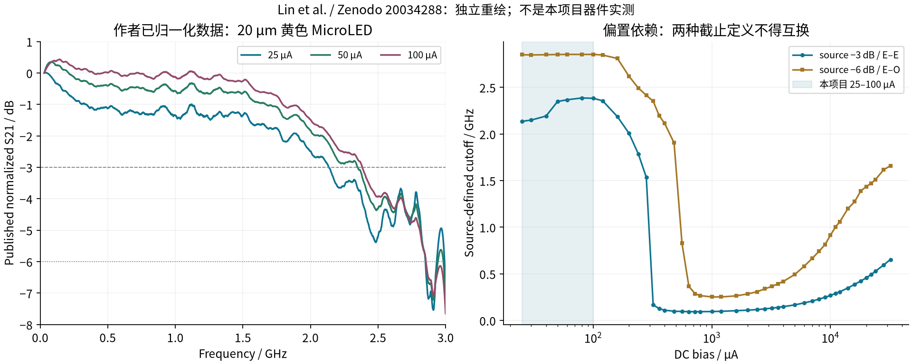
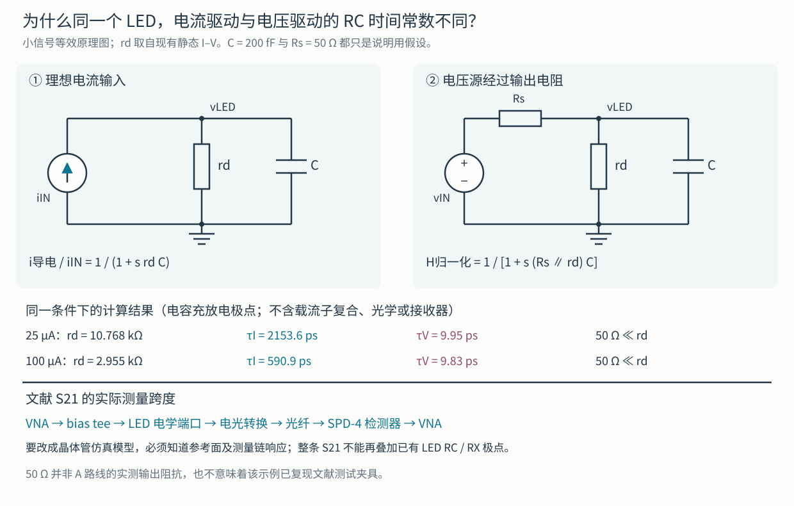
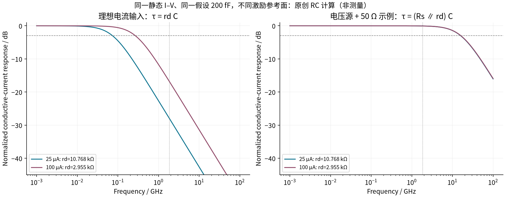
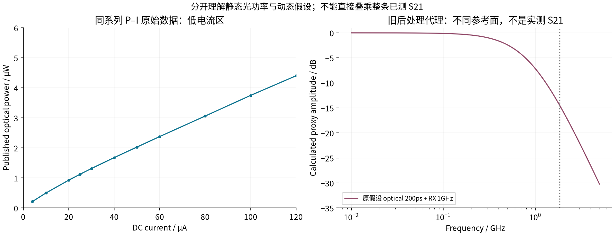

# MicroLED 动态负载证据复核：先明确参考面，再改变模型

2026-10-29｜文献数据复核 + 原创小信号计算。本文没有修改历史负载、A/B/C 电路或接收结果，也没有完成新的光链路验证。

本轮最重要的发现是：**现有黄色 20 µm MicroLED 静态 I–V 所属的 Lin 2026 数据集，也公开了覆盖 25–100 µA 工作区间的频响。** 因而不能再把旧模型的低速表现直接解释成该器件的实测带宽上限；但这些幅频数据仍不足以校准一个唯一、可用于瞬态误码验证的动态模型。

先保留三个判断：

1. 200 fF、200 ps 和 1 GHz 接收低通仍是旧实验假设，不是这只 MicroLED 的联合实测参数。
2. 论文的频响来自 **VNA → LED → 光学 → 检测器 → VNA** 整条测量链。必须保留其输入、输出参考面，不能直接接在已经包含 LED RC 和接收低通的仿真之后。
3. 新证据要求重新验证 MicroLED 的带宽瓶颈，尚不能据此宣布它已满足单通道净 3.2 Gb/s，也不能据此预选 A/B/C。

## 1. 现在的模型，哪些有依据？

| 模型层 | 当前依据 | 可以回答的问题 | 仍不能回答的问题 |
|---|---|---|---|
| 静态端口 I–V | Lin 2026 / Zenodo 原始数值，现有 CSV 与分段线性模型 | 给定电流时的端压、局部微分电阻 | 电荷储存、频响、温度变化、同一像素统计分布 |
| 并联 200 fF | 项目工程假设 | 给定电容下，驱动电路对负载充放电的敏感性 | 真实结电容、焊盘/钝化/互连电容及其偏置依赖 |
| 光学 200 ps 一阶低通 | 项目后处理假设 | 给定响应速度时的接收敏感性 | 真实微分复合寿命或电光响应 |
| RX 1 GHz 一阶低通 | 项目统一接收条件 | A/B/C 在同一代理接收器下的比较 | 实际探测器/TIA 的复数响应、噪声、灵敏度和 BER |

源文件分别见 `analog/models/measured-led/model-card.json`、`scripts/fair_driver_v1/run.py` 和 `scripts/fair_driver_v1/receiver_equal_latency_v2.py`。这里的“实测”仅指外部论文作者的测量，并非本项目实物测试。

## 2. 原始单位和工作点：25 µA 不是 25 mA

以下是 [Lin 等人的独立公开数据集](https://doi.org/10.5281/zenodo.20034288)中 `yellow20_s21_bandwidths.xlsx` 的忠实单元格摘录。原表 `Bandwidths` 的电流单位为 **A**；`Shifted_Curves` 的列名直接带 `A`。这不是屏幕截图，数值和表头未改写。

`2.5e-05 A = 0.025 mA = 25 µA`；`0.0001 A = 0.1 mA = 100 µA`。20 µm 正方形的面积为 `400 µm² = 4×10⁻⁶ cm²`，两点对应 **6.25 和 25 A/cm²**。这与论文偏置说明一致。75 µA 没有独立动态数据列；60/80 µA 只能作为其两侧数据，插值不能称为测量。

| 偏置 / µA | J / A·cm⁻² | 源定义 −3 dB / GHz | 源定义 −6 dB / GHz | 1.85 GHz 处源表幅度 / dB |
|---:|---:|---:|---:|---:|
| 25 | 6.25 | 2.1358 | 2.8504 | −2.0582 |
| 50 | 12.50 | 2.3485 | 2.8528 | −1.4106 |
| 60 | 15.00 | 2.3673 | 2.8542 | −1.2627 |
| 80 | 20.00 | 2.3867 | 2.8536 | −1.0707 |
| 100 | 25.00 | 2.3833 | 2.8543 | −1.0689 |

表中精度来自数值文件，不代表相同精度的仪器测量。每条曲线有 2001 个点，30 MHz–3 GHz；从曲线线性插值重算截止点，与作者带宽表差异小于 `1×10⁻⁸ MHz`。这证明**提取一致性**，不建立测量不确定度。独立 `frequency_response_low_current.xlsx` 中的 100 µA 曲线也与主表逐点一致。

当前帧效率为 `32/37`，净 3.2 Gb/s 对应 NRZ 线速率 3.7 Gb/s，因此在表中检查其 Nyquist 频率 1.85 GHz。此处只有幅度，不能由单个频点判断眼图、BER 或 PAM4 电平间串扰。

作者按 −3 dB 标示 E–E、按 −6 dB 标示 E–O。这是源论文的定义；两列不是两套互相独立的设备测试，也不能把它们都简称“3 dB 带宽”。上图保持源定义。作者归档的是已处理、归一化幅度，并非仪器未处理的复数采集文件。所有所选曲线在首点 30 MHz 恰为 0 dB；未获得独立 DC 归一化测量。

### 测量边界为什么重要

[原文 Fig. 4 与 Methods / Measurement method](https://www.nature.com/articles/s41467-026-74151-4)给出的链路是：6 GHz Pico 106 VNA，经 6 GHz bias tee 驱动器件，光纤连接 3 GHz SPD-4 检测器，再回到 VNA。文章另一个通信实验使用 1 GHz APD；它与频响测试的 SPD-4 不是同一个接收器。

作者说明某些低电流曲线接近 3 GHz 时受到高频噪声底影响，并认为截止点此前已经穿越。我们保留这一作者判断，同时要求校准证据：−6 dB 截止点都接近 2.85 GHz，检测器额定 3 GHz，扫描也止于 3 GHz。仅凭现有曲线，不能定量排除测量链对结果的影响。

本轮检查了主文、Fig. 4 和四个相关原始工作簿；未得到复数 S11、S21 相位、检测器去嵌响应、每个偏置的 RF 小信号幅度、dark/off 背景曲线或跨温度频响。补充材料当前未成功取得，故这里不声称“整篇研究均未报告”。I–V、P–I、S21 指向同结构/尺寸/颜色的器件类别，**没有可核验的物理像素序列号证明三者来自同一颗像素**。

## 3. 为什么文献是 GHz，而旧电流驱动 RC 计算很慢？

两者首先使用了不同激励参考面。只用最小并联 `rd || C` 电学模型就能说明差别；这不是对实际器件完整物理的拟合。

**理想电流输入：** 输入总电流在导电支路和电容支路之间分配。

`i导电 / iIN = 1 / (1 + s rd C)`，所以 `τI = rd C`。

**电压源经过 Rs：** 节点充放电时，电容看到 `Rs || rd`。将导电电流相对于其低频值归一化，得到：

`H归一化 = 1 / [1 + s (Rs || rd) C]`，所以 `τV = (Rs || rd) C`。

采用现有静态 CSV 中包围工作点的两个采样点计算 `rd = ΔV/ΔI`；维持旧假设 `C=200 fF`，另取 **Rs=50 Ω 作为电路原理示例**：

| 工作点 | 静态局部 rd | 理想电流输入 τI | 电压源示例 τV | 理想电流输入电学极点 |
|---:|---:|---:|---:|---:|
| 25 µA | 10.768 kΩ | 2153.57 ps | 9.954 ps | 73.90 MHz |
| 100 µA | 2.955 kΩ | 590.91 ps | 9.834 ps | 269.34 MHz |

50 Ω **不是 A 电路的实测输出阻抗，也不是对论文夹具的校准**。约 16 GHz 的电压驱动 RC 极点同样只是这个假设电路的计算，完全没有证明 LED 的电光带宽能到 16 GHz。真实晶体管的输出阻抗还会随电流、状态和频率改变。

这个例子说明：GHz 级电压激励测量不要求 `rd C` 也一定是几十 ps；反过来，旧理想电流分配计算很慢，也不能推翻外部电压激励的频响。应先把驱动输出阻抗、LED 端口电流和复合电流分开，再判断瓶颈。

## 4. 为什么还不能把频响换成一个“实测 70 ps 寿命”？

把 −3 dB 截止点硬换成单极点时间常数，可得到约 67–74 ps。但同一个零频归一化单极点要求 `f−6dB / f−3dB ≈ 1.731`；数据在所选工作点只有约 1.20–1.33，还带有起伏。因此单个参数不能同时解释两个截止点。更基本地，`H(s)` 和 `H(s)·exp(−s·100 ps)` 的幅度完全一样，采样延迟却不同。只有幅度，无法唯一确定相位、时延或瞬态眼图。

左图为同数据集 `diamond-optical-power.xlsx` 的黄色 20 µm P–I；右图单独画旧 `200 ps optical + 1 GHz RX` 假设。它们与上面的整链 S21 不是相同参考面，故不叠图宣称“拟合改善”。旧模型已经算过电 RC，再把整条 S21 乘进去，还可能把相同电学/接收效应重复计算。

## 5. 另外两篇一手研究教给我们的建模方法

| 一手来源与本轮阅读深度 | 实际证据 | 对本项目的意义与限制 |
|---|---|---|
| X. Li 等，2023，arXiv:2310.17066v1；已读全文与 Fig. 2 原图，按预印本引用 | 100 µm 注入直径的两类 InGaN/GaN LED，以阻抗和频响联合检验单/多寿命模型。40 A/cm² 时两结构带宽 20.2 / 4.2 MHz；非均匀载流子分布使单寿命拟合不足 | 支持“不能只靠一个带宽倒算唯一寿命”的方法选择。结构与本项目黄色 20 µm 器件不同，数值不移植。[原文](https://arxiv.org/abs/2310.17066) |
| L. Zhu 等，Optics Express 32, 39974–39983 (2024)；本轮核对作者摘要，全文页面未成功取得 | 摘要报告将 PCB、键合线与器件等效参数共同建模；深刻蚀使拟合电极电容减小 24.9 pF，并在 4 kA/cm² 下将带宽从 203 提到 249.8 MHz | 支持先分离封装/互连与器件，再做参数识别。这里的 pF 数值、电流密度均不套给 Lin 器件；摘要不足以重建其电路。[DOI](https://doi.org/10.1364/OE.539321)、[作者摘要存档](https://pubmed.ncbi.nlm.nih.gov/39573804/) |

两个例子展示的是方法和边界，不能与黄色器件排出简单“最快/最慢”名次。它们也未补齐本项目缺少的同像素全参数。

## 6. 下一步怎样产生可用于晶体管仿真的新模型？

先冻结 [幅频 CSV](../../../evidence/microled-dynamic-20261029/yellow20-s21-selected.csv) 和 [模型输入契约](../../../evidence/microled-dynamic-20261029/response-contract.json)。最小新增证据应包含：

1. **同像素身份与静态量：** 尺寸、外延/封装版本、I–V/P–I、温度和重复性。先覆盖 25、50、75、100 µA，再加测试留出点。
2. **电学与电光复数测量：** 校准器件参考面上的 S11/阻抗和 S21 幅度+相位；记录小信号电压/电流、RF 幅度、dark 背景及探测器响应。检查低电流线性区，不把测量噪声底拟合成极点。
3. **先联合识别，再跑接收：** 建立偏置相关 `ZLED(s,I,T)`，从校准整链响应中移除已知电学和 RX 后才拟合剩余电光动态；验证因果性、稳定性、参数相关性与留出偏置。随后验证 25–100 µA 大信号跳变、固定净吞吐和统一噪声接收。

实现上可使用分段偏置的状态空间/极点模型，但必须和静态 I–V、P–I、电荷状态一致。**本轮没有给这个候选模型编造系数。** 新模型应有新版本号和 DC/耦合回归，旧 baseline 继续保留，才能分辨“电路改善”和“负载假设改变”分别贡献多少。

## 7. 复现、原图与许可

运行 `build/layout/venv/bin/python scripts/microled_dynamic_20261029/extract.py`，再运行同目录 `make_evidence.py` 和 `finish_ledger.py`。前者验证既有源 ZIP 的 SHA-256 并提取数据；第二步计算参考面差异并生成原创图，最后更新账本和文件哈希。依赖 NumPy、Matplotlib，不需要安装 Excel。原理图交付 SVG，同时以显式中文字体生成 PNG 预览。

- [证据/许可账本](../../../evidence/microled-dynamic-20261029/source-ledger.json)保存来源、工作簿哈希、字段位置、能够及不能支持的结论；[检查结果](../../../evidence/microled-dynamic-20261029/extraction-checks.json)保存计算值。
- 公共数值和独立重绘按数据集 **CC BY 4.0** 归属；原论文为 **CC BY-NC-ND 4.0**，不能与数据许可证混同。见 [NOTICE](../../../evidence/microled-dynamic-20261029/NOTICE.md)。
- 本地 `build/microled-dynamic-20261029/private-evidence.md` 直接展示原文 Fig. 4 和 Li 原文页，供私人核对；这些原图/PDF 不属于公共证据包。补充材料与未获得的全文明确保留为证据缺口。

本轮改变的是对证据的理解：MicroLED 的真实动态潜力仍需在正确参考面重新验证，现有慢响应仿真不足以排除它；公开 GHz 幅频也不足以保证本项目的 3.2 Gb/s 接收与能效。
